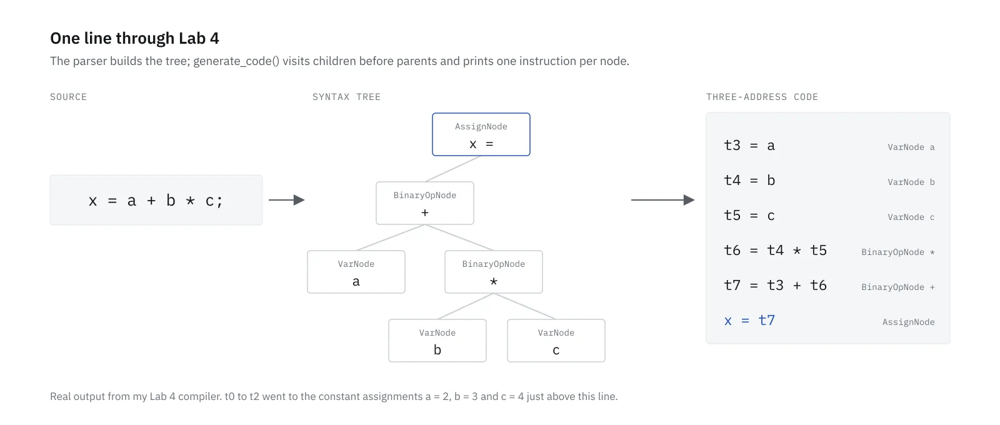

In Spring 2026 I took CSE420, Compiler Design, at BRAC University. The labs build one compiler front end for a subset of C, a phase at a time, in Flex, Bison and C++. Lab 1 is the lexer and parser. This post is about the three labs after it: a symbol table, semantic checks, and a syntax tree that turns into three-address code.

For this post I rebuilt all three from my final lab code and ran them again. Two of the things that turned up are bugs that are still in that code, and they're more interesting than the parts that worked.

> **Key Takeaways**
>
> - A symbol table for nested scopes is a stack of small hash tables: look a name up in the innermost one first, then walk outwards.
> - Semantic checks ride on the parser. Each expression carries a type up the tree, and an "error" type stops one mistake from producing a cascade of messages.
> - Caching which temporary holds a variable makes the three-address code shorter, but it breaks loops: my compiler reads a stale temporary at the top of a `while` loop.


## A note on code

These are graded labs, and the specs get reused: my Lab 2 handout is headed Spring 2025, and the Lab 3 and Lab 4 handouts say Spring 2024. So there's no lab code in this post. The snippets below are written fresh to show an idea, and everything in a `text` block is real output from my compiler, trimmed to the lines that matter.

To rerun it I copied my final lab sources into a scratch folder and built them with flex 2.6.4, bison 3.8.2 and g++ 16.2.1, the same steps as the lab's `script.sh`. The test inputs are the sample files each lab came with, plus two small programs I wrote for this post.

## Lab 2: a symbol table that knows about scope

The handout describes the structure: one hash table per scope, called a scope table, and a stack of them. Entering a block pushes a new table. Leaving it pops the table. A lookup starts at the top of the stack and walks down through each parent.

```cpp
// Written for this post, not the lab code.
Symbol* lookup(const std::string& name) {
    for (Scope* s = current; s != nullptr; s = s->parent) {
        if (Symbol* hit = s->find(name)) return hit;
    }
    return nullptr; // undeclared
}
```

That walk is what makes shadowing work. If a block declares its own `a`, the lookup finds it in the inner table and never reaches the outer one.

The handout leaves the hash function up to you, but the output has to show which bucket each name landed in, so mine had to agree with the sample logs. I used the sum of the character codes, mod 10 buckets. `a` is 97, so it goes in bucket 7. `main` adds up to 421 and lands in bucket 1.

The handout says "You are highly encouraged to produce output exactly like the sample one." My commit messages from the evening I got Lab 2's log to match read "somewhat accurate", then "changes to match logfile", then "exact match", all within about 25 minutes.

Running it again today, the log for the first sample input matches the reference apart from blank lines. The third sample is six nested blocks, each declaring its own `a`, and that one shows a bug:

```text
New ScopeTable with ID 6 created
New ScopeTable with ID 7 created
Scopetable with ID 7 removed
Scopetable with ID 7 removed
Scopetable with ID 7 removed
Scopetable with ID 7 removed
Scopetable with ID 7 removed
Scopetable with ID 7 removed
```

The stack itself pops correctly: the table printed after each exit has one fewer scope. Only the message is wrong. My exit function printed the counter that hands out new IDs, which stays at 7, instead of the ID stored in the table being removed. The reference prints 7, 6, 5, 4, 3, 2. The same code went into Lab 3 unchanged, so the bug is there too.

The second sample turned up a smaller difference. `func` and `func2` add up to 428 and 478, so they share bucket 8. My printer writes the bucket number again before the second name, where the reference prints it once and lists both.

## Lab 3: semantic checks

Lab 3 keeps the parser and adds checks to its actions: types in assignments, array indexes, modulus operands, division and modulus by zero, function arguments, void functions used in expressions, undeclared names and repeated declarations. The handout also says not to stop at the first error and not to report one bad expression on several lines.

The sample input for this lab has seven faults in fourteen lines:

```c
int func(int a){
	return a;
}

int main(){
	int a[2],c,i,j ; float c;
	a[2.5]=1;
	i=2.3;
	j=2%3.7;
	a=4;
	func(a);
	b=8;
	return 0;
}
```

My Lab 3 build reports all seven, and its error file matches the reference byte for byte:

```text
At line no: 6 Multiple declaration of variable c

At line no: 7 array index is not of integer type : a

At line no: 8 Warning: Assignment of float value into variable of integer type 

At line no: 9 Modulus operator on non integer type 

At line no: 10 variable is of array type : a

At line no: 11 variable is of array type : a

At line no: 12 Undeclared variable b

Total errors: 7
```

The warning on line 8 counts towards the total, which is how the reference counts it too.

The way it works: every expression node in the parser carries a type string, `int`, `float`, `void`, or `error`. A rule like `term MULOP unary_expression` reads the types of its two sides, decides the result type, and reports a problem if there is one. When a name is undeclared, its type becomes `error`, and every rule above it passes `error` along without reporting anything else.

I checked that with a small file of my own:

```c
int main(){
	int i, j;
	i = 5 % 0;
	i = 5 % (1-1);
	j = k * 2 + 1;
	return 0;
}
```

```text
At line no: 3 Modulus by 0 

At line no: 5 Undeclared variable k

Total errors: 2
```

Line 5 gives one error for `k` and nothing for the multiply, the add or the assignment built on it. Line 4 shows the limit of my zero check: it compares the right operand's text with `0`, so `5 % (1-1)` goes through.

## Lab 4: from a syntax tree to three-address code

Lab 4 came with a starter. `ast.h` had the node classes (variables, constants, binary operators, assignments, if, while and so on), with each `generate_code` body left for us to write. My part was filling those in and making the parser build the tree.

Three-address code is a flat list of instructions with at most one operator each, using temporaries `t0`, `t1` and labels `L0`, `L1`. Generating it from a tree is a walk where each node first generates its children, then prints one instruction that combines their temporaries.



That's real output for an eight-line test program I wrote. The tree gets precedence right for free: the parser already put `*` below `+`, so the walk emits the multiply first.

On the lab's first sample input, my `code.txt` matches the reference except for one trailing space. The other two samples differ, and the reason is a design choice.

## Caching temporaries, and where it breaks

My generator keeps a map from variable name to the temporary that last loaded it. The second time an expression reads `a`, it reuses that temporary instead of printing `t9 = a` again. An assignment to a variable drops its entry, and so does a declaration, because a new `int a` in an inner block is a different variable from the outer `a`. Blocks, ifs and loops get a copy of the map so their entries don't leak out.

The third sample is the same six nested blocks from Lab 2, each declaring a fresh `a` and testing `a>1`. Here's the second test, right after `float a` is declared. Mine reloads `a`:

```text
t3 = a
t4 = 1
t5 = t3 > t4
```

The reference reuses `t0`, which holds the outermost `int a`, in every nested test:

```text
t4 = 1
t5 = t0 > t4
```

Each inner `a` is a different variable, so reading it again is what the declaration rule is for. The cache does have a real problem with loops, though, and the reference output has it too. Here's a test I wrote:

```c
int main() {
    int n, m;
    n = 3;
    m = n;
    while (n > 0) {
        n = n - 1;
    }
    return n;
}
```

```text
t0 = 3
n = t0
t1 = n
m = t1
L0:
t2 = 0
t3 = t1 > t2
if t3 goto L1
goto L2
L1:
t4 = 1
t5 = t1 - t4
n = t5
goto L0
L2:
return t1
```

`m = n` loaded `n` into `t1` and cached it. The loop test at `L0` then compares `t1`, and the body subtracts from `t1`. The body stores the new value in `n`, but nothing reloads `t1`, so every pass through `L0` sees 3. The loop never ends, and the `return` would hand back the old value.

When `n` isn't read before the loop, the load happens after `L0` and the code is correct. That's why the lab's samples didn't catch it. The reference output for the second sample has the same pattern in its `while (c > 0)` loop.

The fix is to forget cached temporaries at any label a jump can land on, so the loop head always reads the variable from memory. A simpler option is to drop the cache after each statement and accept a few extra loads.

## What the reruns showed

Every handout asked for output like the samples, and my Lab 3 error file matches its sample exactly. But the samples don't cover everything. The wrong scope ID only shows when a scope that contained another scope closes, and the stale temporary only shows when a variable is read before the loop that changes it.

The reference output isn't a full answer key either. The stale-temporary pattern is in the expected `code.txt`, so matching it more closely would have made my compiler worse, not better.
