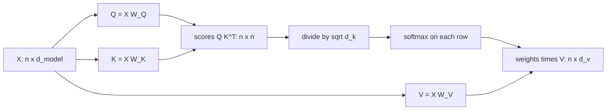
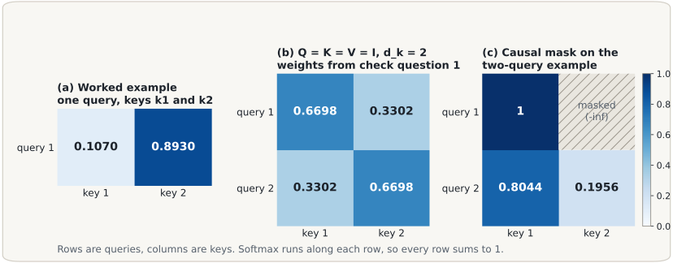
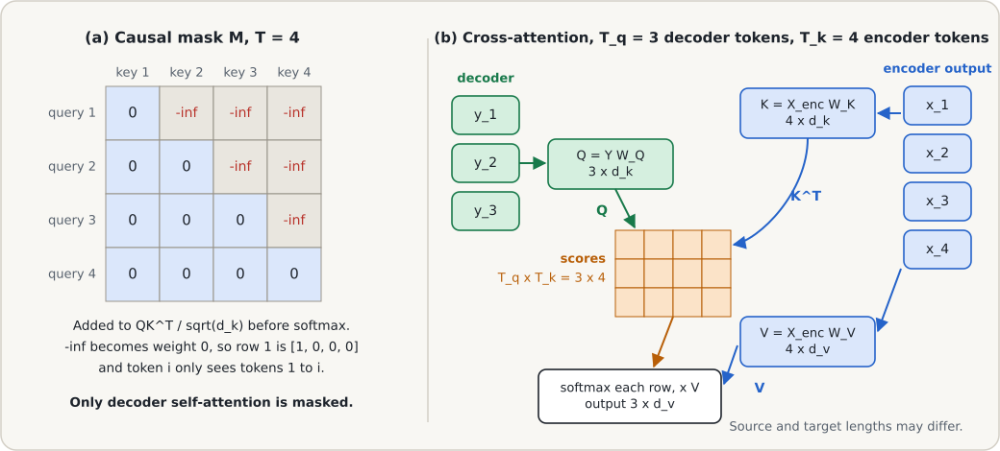

Take the sentence "The animal didn't cross the street because it was too tired." To encode "it", the model has to decide whether "it" means the animal or the street. An RNN reads left to right and squeezes everything so far into one hidden vector. By the time it reaches "it", the animal is several steps back and partly forgotten.

Attention skips the squeeze. Each word scores every other word in a single matrix product, turns the scores into percentages, and builds its new vector as a weighted average of the others. "it" can put 70 percent of its weight on "animal" and a few percent elsewhere. Nothing waits for the previous step, so all words are processed at once.

## Picture it

Every attention layer, in one line of flow. The only learned parts are the three projection matrices.

*Weights from this post's examples; each row is one query's softmax, so each row sums to 1.*

## The detail

Let $X\in\mathbb{R}^{n\times d_{model}}$ hold one row per token. Three learned matrices project it. $W^Q,W^K\in\mathbb{R}^{d_{model}\times d_k}$ and $W^V\in\mathbb{R}^{d_{model}\times d_v}$.

$$Q=XW^Q,\qquad K=XW^K,\qquad V=XW^V$$

The query row of a token is what it is looking for. A key row is what a token advertises for matching. A value row is the content that actually gets mixed in. Matching uses $Q$ and $K$ only, and mixing uses $V$ only.

$$\mathrm{Attention}(Q,K,V)=\mathrm{softmax}\!\left(\frac{QK^\top}{\sqrt{d_k}}\right)V$$

Shapes decide most exam marks. $Q$ is $m\times d_k$, $K$ is $n\times d_k$, so $QK^\top$ is $m\times n$. Softmax runs along each row, so every query's weights sum to 1. The output $Z$ is $m\times d_v$. In self-attention $m=n$, and the score matrix is $T\times T$ for $T$ tokens. That is why the cost grows as $T^2$, even though the number of sequential steps stays at one.

**Why divide by $\sqrt{d_k}$.** This is the derivation to memorise. Assume each entry of $q$ and $k$ is independent with mean 0 and variance 1. The score is $S=\sum_{i=1}^{d_k}q_ik_i$.

Each term has mean $E[q_i]E[k_i]=0$, so $E[S]=0$. Each term has variance $E[q_i^2]E[k_i^2]-0=1$. The terms are independent, so the variances add and $\mathrm{Var}(S)=d_k$. Dividing by a constant $c$ divides the variance by $c^2$, so $c=\sqrt{d_k}$ brings it back to 1.

Without it, large $d_k$ gives huge scores and softmax saturates. Take logits $[8,0,0,0]$. Softmax gives the first entry 0.9990, almost one-hot, and the gradient to the other three is nearly zero. Divide by $\sqrt{64}=8$ and the logits become $[1,0,0,0]$, giving 0.4754. The weights stay soft and can still learn.

**Multi-head.** Run $h$ attentions in parallel, each with its own $W^Q,W^K,W^V$, then concatenate and mix with $W^O$.

$$\mathrm{head}_j=\mathrm{Attention}(XW_j^Q,XW_j^K,XW_j^V),\qquad \mathrm{MHA}(X)=\mathrm{Concat}(\mathrm{head}_1,\dots,\mathrm{head}_h)\,W^O$$

With $d_k=d_{model}/h$, $d_{model}$ must divide by $h$. For $d_{model}=512$ and $h=8$, each head has width 64. Different heads can follow different relations, one for the previous word, another for the subject.

**Position.** Permute the input tokens and the outputs permute the same way, so attention alone cannot see word order. We add a positional encoding to the embedding $E$.

$$PE_{(pos,2i)}=\sin\frac{pos}{10000^{2i/d_{model}}},\qquad PE_{(pos,2i+1)}=\cos\frac{pos}{10000^{2i/d_{model}}},\qquad X=E+PE$$

For $d_{model}=4$ the rows are, to four places:

| pos | channel 0 | channel 1 | channel 2 | channel 3 |
|---|---|---|---|---|
| 0 | 0 | 1 | 0 | 1 |
| 1 | 0.8415 | 0.5403 | 0.0100 | 1.0000 |
| 2 | 0.9093 | -0.4161 | 0.0200 | 0.9998 |

Channels 2 and 3 use divisor $10000^{2/4}=100$, so they change slowly. It is added, not concatenated, so $X$ keeps width $d_{model}$ and no extra parameters are needed. The sinusoid form can also produce encodings for positions longer than any seen in training, and a shift by a fixed offset is a fixed linear map of the encoding, which makes relative position easy to read off.

**Masked attention.** A decoder must not see future tokens. Add a mask to the scaled scores before softmax.

$$S=\frac{QK^\top}{\sqrt{d_k}}+M,\qquad M_{ij}=\begin{cases}0 & j\le i\\ -\infty & j>i\end{cases}$$

Softmax turns $-\infty$ into weight exactly 0. The first token therefore always gets weights $[1,0,0,\dots]$. Mask before softmax, never after, otherwise the rows no longer sum to 1.

**Cross-attention.** Queries come from one sequence (the decoder, length $m$) and keys and values from another (the encoder output $H_{enc}$, length $n$).

$$\mathrm{CrossAttn}(Y,H_{enc})=\mathrm{softmax}\!\left(\frac{(YW^Q)(H_{enc}W^K)^\top}{\sqrt{d_k}}\right)H_{enc}W^V$$

The score matrix is $m\times n$, so source and target lengths can differ. Encoder self-attention and cross-attention are unmasked. Only decoder self-attention is masked.

*The mask hides future keys from each query; in cross-attention the decoder asks and the encoder answers, so scores are m x n.*

## Worked example

One query, two keys, $d_k=2$. Given $q=[1,2]$, keys $k_1=[1,0]$, $k_2=[0,2]$, values $v_1=[2,1]$, $v_2=[0,3]$.

Scores: $q\cdot k_1=1$, $q\cdot k_2=4$.

Scale by $\sqrt2=1.4142$: $[0.7071,\;2.8284]$.

Softmax: $e^{0.7071}=2.0281$, $e^{2.8284}=16.9188$, sum $18.9469$, so weights $[0.1070,\;0.8930]$.

Output: $0.1070\,[2,1]+0.8930\,[0,3]=[0.2141,\;2.7859]$.

$$\boxed{z=[0.214,\;2.786]}$$

The second key matched far better, so the output sits close to $v_2$.

A masked check on the same machinery. Let $Q=\begin{bmatrix}2&0\\1&1\end{bmatrix}$, $K=\begin{bmatrix}1&2\\0&1\end{bmatrix}$, $V=\begin{bmatrix}1&2\\3&4\end{bmatrix}$. Scaled scores are $\begin{bmatrix}1.4142&\text{masked}\\2.1213&0.7071\end{bmatrix}$. Row 1 has weights $[1,0]$ and output $[1,2]$. Row 2 has weights $[0.8044,0.1956]$ and output $[1.3911,\;2.3911]$.

## Exam corner

Asked in past exams: transformers did not appear in any past paper we have. The older finals we have are about CNNs, recurrent networks and backprop. So the weight here comes from the typed practice set and the mock paper, where attention shows up often: a 6-mark scaled dot-product numeric, a 4-mark question on why positional encoding is added and why it is sinusoidal, and dozens of practice items on shapes, masks and head width.

Marks come from: writing the formula with $\sqrt{d_k}$, showing scores before and after scaling, softmax per row with the weights listed, then the weighted sum of value rows with the final vector. For the masking question, show the mask matrix and say it is added before softmax.

Common slips: softmax down columns instead of across rows. Masking after softmax. Calling the encoder self-attention masked. Saying positional encoding is concatenated. Putting queries from the encoder in cross-attention. Dropping the $\sqrt{d_k}$.

One more form to expect: head-width arithmetic such as $d_{model}=768$, $h=12$, so $d_k=64$.

Cheat line: $\mathrm{softmax}(QK^\top/\sqrt{d_k})V$, shapes $(m\times d_k)(d_k\times n)\to m\times n$, then times $n\times d_v$.

## Check yourself

1. Give $Q=K=V=I_2$ and $d_k=2$. What is the attention weight matrix?

Answer
Scores are $I_2$, scaled by $1/\sqrt2$. Row 1 is $[e^{0.7071},e^0]$ normalised, so the weights are $[[0.6698,0.3302],[0.3302,0.6698]]$. The output equals the weights because $V=I$.

2. Why does a causal mask put the first token's weights at $[1,0,0]$ regardless of the scores?

Answer
Positions 2 and 3 are set to $-\infty$, which softmax maps to 0. The only finite entry takes all the weight, whatever its score.

3. $d_{model}=512$, $h=8$. What are the shapes of one head's $Q$ and its score matrix for $T=16$ tokens?

Answer
$d_k=512/8=64$. $Q$ is $16\times64$ and the score matrix is $16\times16$.

## Read more

- [The Illustrated Transformer by Jay Alammar](https://jalammar.github.io/illustrated-transformer/), a step-by-step visual walkthrough of the same computation.
- [Attention Is All You Need on arXiv](https://arxiv.org/abs/1706.03762), the original paper.
- [d2l.ai chapter on attention mechanisms and transformers](https://d2l.ai/chapter_attention-mechanisms-and-transformers/index.html), with code for each piece.

<!-- Reviewer note: the digest flags that the classroom positional-encoding example uses theta=p/10 with d_model=2; it was not reused. The true formula values are tabulated above. Notation: h for head count, H_enc for encoder output. Exam frequency: zero past papers; counts come from typed prep set only. -->
