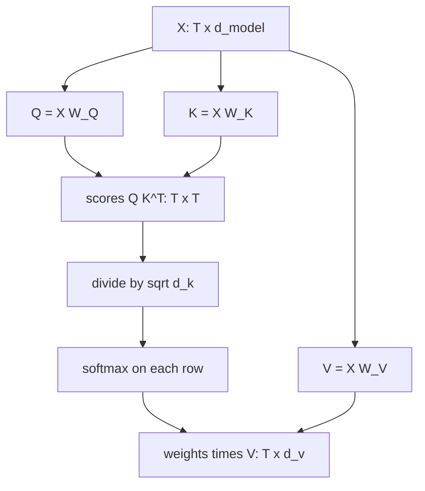

In "The animal didn't cross the street because it was too tired", the word "it" means the animal, and a reader knows that only by looking back several words. An RNN reads left to right and squeezes everything so far into one hidden vector, so by the time it reaches "it" the animal is several steps back and partly forgotten.

Attention skips the squeeze. Each word scores every other word in a single matrix product, turns the scores into percentages, and builds its new vector as a weighted average of the others. "it" can put most of its weight on "animal" and only a little elsewhere. Nothing waits for the previous step, so all words are processed at once.

> **Key Takeaways**
> - Each token makes a query (what it is looking for), a key (what it offers for matching) and a value (the content that gets mixed in).
> - Attention weights are a softmax over query-key dot products divided by $\sqrt{d_k}$, and the output is the weighted sum of the value rows.
> - Dividing by $\sqrt{d_k}$ keeps the scores at a size where softmax can still spread its weight.
> - Position has to be added separately, a causal mask hides future tokens, and cross-attention takes its queries from one sequence and its keys and values from another.

## One query, two keys

A word is represented by a vector, a list of numbers. To attend, a word builds three vectors from it. The query $q$ says what the word is looking for. A key $k$ is what a word advertises so that others can match it. A value $v$ is the content that actually gets copied into the answer. Matching uses queries and keys only, and mixing uses values only.

Here is the smallest case: one query, two keys, vectors of length $d_k=2$. The query is $q=[1,2]$, the keys are $k_1=[1,0]$ and $k_2=[0,2]$, and the values are $v_1=[2,1]$ and $v_2=[0,3]$.

A score measures how well a key matches the query, using the dot product: multiply entry by entry and add.

$$q\cdot k_1=1\cdot1+2\cdot0=1$$

$$q\cdot k_2=1\cdot0+2\cdot2=4$$

The second key matches far better. Next, divide the scores by $\sqrt{d_k}=\sqrt2=1.4142$ (why the square root is explained further down):

$$[1,\ 4]/1.4142=[0.7071,\ 2.8284]$$

Softmax turns the scores into weights that are positive and add up to 1. Each score becomes a power of $e$, and each result is divided by the total:

$$e^{0.7071}=2.0281,\qquad e^{2.8284}=16.9188$$

$$\text{total}=18.9469$$

$$\text{weights}=[0.1070,\ 0.8930]$$

The output is the weighted sum of the value rows:

$$0.1070\,[2,1]+0.8930\,[0,3]$$

$$\text{output}=[0.2141,\ 2.7859]$$

Almost 90 percent of the weight went to key 2, so the output lands close to $v_2=[0,3]$.

If you list the two keys in the opposite order (with their values), the weights swap with them and the output doesn't change. A weighted average has no idea which key came first, which is why word order has to be added by hand later on.

## The general rule

Where do $q$, $k$ and $v$ come from? A token's vector $x$ is multiplied by three learned matrices. If $x=[1,1]$ and

$$W^Q=\begin{bmatrix}1&0\\0&2\end{bmatrix}$$

then $xW^Q=[1\cdot1+1\cdot0,\ 1\cdot0+1\cdot2]=[1,2]$, which is the query used above. For all $T$ tokens at once, stack the token vectors as the rows of a matrix $X$ of size $T\times d_{model}$, where $d_{model}$ is the length of one token vector, and project:

$$Q=XW^Q$$

$$K=XW^K$$

$$V=XW^V$$

Here $W^Q$ and $W^K$ have size $d_{model}\times d_k$ and $W^V$ has size $d_{model}\times d_v$. In single-head attention these three are the only learned weights. The whole computation is

$$\mathrm{Attention}(Q,K,V)=\mathrm{softmax}\!\left(\frac{QK^\top}{\sqrt{d_k}}\right)V$$

Check it against the example: $QK^\top$ for one query and two keys is the row of dot products $[1,4]$, scaling and softmax give $[0.1070,0.8930]$, and multiplying by the value rows gives $[0.2141,2.7859]$.

Keep track of the shapes. $Q$ is $T_q\times d_k$ and $K$ is $T_k\times d_k$, so $QK^\top$ is $T_q\times T_k$: one row of scores per query. Softmax runs along each row, so every query's weights add up to 1, and the output is $T_q\times d_v$. In self-attention the queries and keys come from the same tokens, so $T_q=T_k=T$ and the score matrix is $T\times T$. That is why the cost grows as $T^2$ even though the number of sequential steps stays at one.

With two queries you get two rows of weights. Let

$$Q=\begin{bmatrix}2&0\\1&1\end{bmatrix}$$

$$K=\begin{bmatrix}1&2\\0&1\end{bmatrix}$$

Each row of $QK^\top$ is one query's dot products with the two keys, and dividing by $\sqrt2$ gives the scaled scores

$$\begin{bmatrix}1.4142&0\\2.1213&0.7071\end{bmatrix}$$

Row 1: $e^{1.4142}=4.113$ and $e^0=1$, total $5.113$, so the weights are $[0.8044,\ 0.1956]$. Row 2: $e^{2.1213}=8.342$ and $e^{0.7071}=2.028$, total $10.370$, giving the same weights $[0.8044,\ 0.1956]$ (the gap between the two scores is 1.4142 in both rows). With

$$V=\begin{bmatrix}1&2\\3&4\end{bmatrix}$$

the output of each row is

$$0.8044[1,2]+0.1956[3,4]=[1.3911,\ 2.3911]$$

## Why divide by the square root of d_k

Each score is a sum of $d_k$ products, so a longer vector gives a bigger sum. With 64 dimensions the scores get so large that softmax gives one word everything and the rest nothing, and training stalls. A concrete case: scores $[8,0,0,0]$ give weights $[0.9990,\ 0.0003,\ 0.0003,\ 0.0003]$. The weights barely respond to a small change in any score, so there is almost nothing for training to learn from.

How large do the scores get? Suppose each number in $q$ and $k$ is random and independent, centred on 0, with a typical size (spread) of about 1. Each product $q_ik_i$ then also has a spread of about 1. Adding 64 of them gives a spread of about 8, because spreads of independent terms add as squares: $1^2$ added 64 times is 64, and the square root of 64 is 8. In general, the sum of $d_k$ such products has spread $\sqrt{d_k}$. Dividing by $\sqrt{d_k}$ brings the scores back to a spread of about 1.

Check on the example: dividing $[8,0,0,0]$ by $\sqrt{64}=8$ gives $[1,0,0,0]$, and softmax gives $[0.4754,\ 0.1749,\ 0.1749,\ 0.1749]$. These weights still move when a score moves, so training has something to work with. In the two-key example $d_k=2$ the effect is small: without scaling $[1,4]$ gives weights $[0.047,0.953]$, and with scaling $[0.107,0.893]$.

## Several heads

One attention can follow only one pattern of matching at a time. Multi-head attention runs $n_h$ attentions in parallel, each with its own $W^Q$, $W^K$ and $W^V$, then concatenates the results and mixes them with a matrix $W^O$:

$$\mathrm{head}_j=\mathrm{Attention}(XW_j^Q,XW_j^K,XW_j^V)$$

$$\mathrm{MHA}(X)=\mathrm{Concat}(\mathrm{head}_1,\dots,\mathrm{head}_{n_h})\,W^O$$

Usually $d_k=d_{model}/n_h$, so $d_{model}$ must divide by $n_h$. For $d_{model}=512$ and $n_h=8$, each head has width 64, and $d_{model}=768$ with $n_h=12$ also gives 64. The total cost is about the same as one big head. Different heads can follow different relations: one might track the previous word while another tracks the subject.

## Word order

Back to the swapped keys from the first example. In general, permute the input tokens and the outputs permute the same way, so attention alone cannot tell the first word from the last. Order is added separately with a positional encoding $PE$, added to the token vectors (in this note called $X_{tok}$):

$$PE_{(pos,2i)}=\sin\frac{pos}{10000^{2i/d_{model}}}$$

$$PE_{(pos,2i+1)}=\cos\frac{pos}{10000^{2i/d_{model}}}$$

$$X=X_{tok}+PE$$

For $d_{model}=4$, position $pos$ and channels 0 to 3, the values to four places are

| pos | channel 0 | channel 1 | channel 2 | channel 3 |
|---|---|---|---|---|
| 0 | 0 | 1 | 0 | 1 |
| 1 | 0.8415 | 0.5403 | 0.0100 | 1.0000 |
| 2 | 0.9093 | -0.4161 | 0.0200 | 0.9998 |

Channels 0 and 1 use divisor $10000^0=1$, and channels 2 and 3 use $10000^{2/4}=100$, so those change slowly. The encoding is added, not concatenated, so $X$ keeps width $d_{model}$ and no extra parameters are needed. The sine and cosine form can also produce encodings for positions longer than any seen in training.

## Masking

A decoder that generates text must not see future tokens. A mask $M$ is added to the scaled scores before softmax:

$$S=\frac{QK^\top}{\sqrt{d_k}}+M$$

$$M_{ij}=\begin{cases}0 & j\le i\\ -\infty & j>i\end{cases}$$

Softmax turns $-\infty$ into a weight of exactly 0. The first token therefore always gets weights $[1,0,0,\dots]$ whatever its scores are. The mask goes in before softmax, because masking after would leave rows that no longer sum to 1.

Apply it to the two-query example, where both rows had weights $[0.8044,\ 0.1956]$ without a mask. Row 1 is the first token and can only see key 1, so its weights become $[1,0]$ and its output is $[1,2]$. Row 2 sees both keys, so it keeps weights $[0.8044,\ 0.1956]$ and output $[1.3911,\ 2.3911]$.

## Cross-attention

In cross-attention the queries come from one sequence (the decoder's, length $T_q$) and the keys and values from another (the encoder's output $X_{enc}$, length $T_k$). Let $Y$ be the decoder's vectors:

$$S=\frac{(YW^Q)(X_{enc}W^K)^\top}{\sqrt{d_k}}$$

$$\mathrm{CrossAttn}(Y,X_{enc})=\mathrm{softmax}(S)\,X_{enc}W^V$$

The score matrix is $T_q\times T_k$, so source and target lengths can differ. Only the decoder's self-attention gets the causal mask; encoder self-attention and cross-attention see every position.

Where all this sits inside a full model is in [The Transformer, Block by Block](/blog/cse425-final-transformer-architecture/). For a step-by-step visual version, see [The Illustrated Transformer](https://jalammar.github.io/illustrated-transformer/), the original paper [Attention Is All You Need](https://arxiv.org/abs/1706.03762), and the [d2l.ai chapter](https://d2l.ai/chapter_attention-mechanisms-and-transformers/index.html), which has code for each piece.

## Laying out an attention answer

A full answer writes the formula with $\sqrt{d_k}$, shows the scores before and after scaling, gives the softmax weights for each row, then the weighted sum of the value rows. Shapes are worth stating: $(T_q\times d_k)(d_k\times T_k)\to T_q\times T_k$, then times $T_k\times d_v$. For a masking question, show the mask matrix and say it is added before softmax. Softmax runs across rows and not down columns.

## Weights, a mask and head shapes

Let $Q=K=V=I_2$ (the $2\times2$ identity matrix) and $d_k=2$. What is the attention weight matrix?

Answer

The scores are $I_2$, scaled by $1/\sqrt2$. Row 1 is $[e^{0.7071},e^0]$ normalised, so the weights are

$$\begin{bmatrix}0.6698&0.3302\\0.3302&0.6698\end{bmatrix}$$

The output equals the weights because $V=I$.

Why does a causal mask put the first token's weights at $[1,0,0]$ regardless of the scores?

Answer

Positions 2 and 3 are set to $-\infty$, which softmax maps to 0. The only finite entry takes all the weight, whatever its score.

$d_{model}=512$ and $n_h=8$. What are the shapes of one head's $Q$ and its score matrix for $T=16$ tokens?

Answer

$d_k=512/8=64$. $Q$ is $16\times64$ and the score matrix is $16\times16$.

