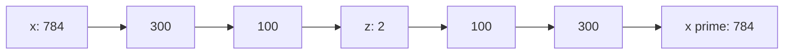
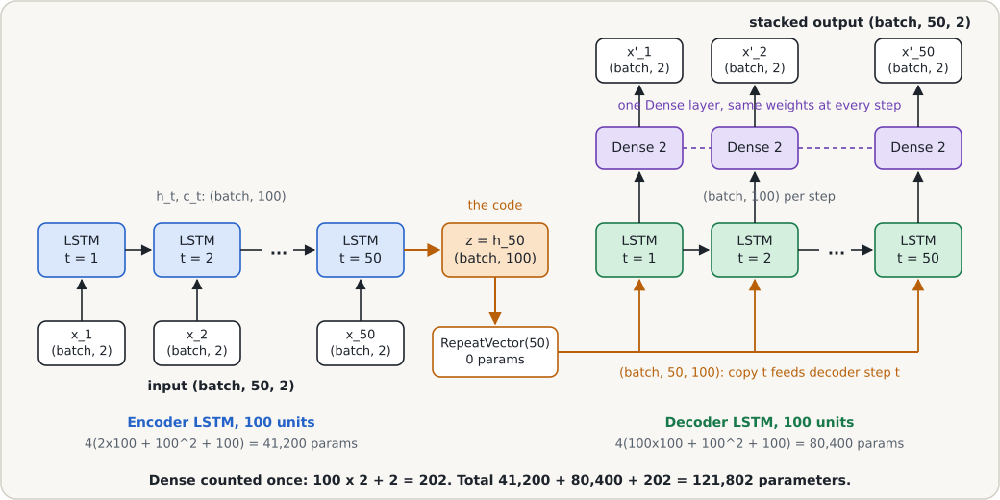

## Quick idea

Take a 784-pixel digit, squeeze it down to 2 numbers, then rebuild all 784 pixels from those 2. If the rebuilt image looks like the original, those 2 numbers must have kept what matters. That is an autoencoder: an encoder that compresses, a decoder that expands, and a loss that compares the output $x'$ with the input $x$.

There are no labels anywhere, so it is unsupervised. The input is its own target.

The squeeze is the whole point. Make the middle layer as wide as the input and the network just copies, learning nothing. Make it narrow (undercomplete) and it has to keep only the structure that repeats across the data. Students lose marks by describing the decoder as the useful part. After training you usually keep the encoder and throw the decoder away.

## Picture it

The first four boxes are the encoder, the last four the decoder. The narrow box in the middle is the bottleneck $z$.

*Illustrative codes: a random z falls in a gap for a plain autoencoder, but among training codes for a VAE.*

## The detail

Notation: $x\in\mathbb R^D$ is the input, $z\in\mathbb R^K$ the code with $K<D$, and $x'\in\mathbb R^D$ the reconstruction. Training minimises the mean squared error over $N$ examples:

$$L=\frac1N\sum_{n=1}^{N}\left\|x^{(n)}-x'^{(n)}\right\|^2$$

For a single example, drop the $\frac1N$ and sum the squared differences over features. State which one you use in an answer.

Why not just use a linear network. Stack two linear layers and you get $W_2(W_1x)=(W_2W_1)x$, which is one matrix. A linear autoencoder trained with MSE ends up doing what PCA does, however many layers you add. The non-linear activations (ReLU, sigmoid) are what let an autoencoder bend around curved data that PCA cannot follow.

What the latent space looks like. A plain autoencoder is only trained to reconstruct training points. Nothing forces nearby codes to decode to similar images, so the latent space is islands with empty gaps. Pick a random $z$ and you usually land in a gap and decode junk. This is why a plain autoencoder is not a generator, and it is the problem the VAE in the next post fixes.

Variants, one line each.

| Variant | Change | Use |
|---|---|---|
| Denoising | Corrupt the input, score against the clean target | Remove noise |
| Sparse | Hidden layer may be wider than the input, L1 penalty keeps most units at zero | Useful features without a narrow bottleneck |
| Anomaly detection | Train on normal data only | A large reconstruction error flags something unusual |

Counting parameters. A dense layer with $m$ inputs and $n$ outputs has $mn+n$ parameters. The $+n$ is the biases, and forgetting it is the most common slip. An LSTM layer with input size $n$ and hidden size $d$ has four blocks (forget, input, candidate, output), each with an input weight matrix, a recurrent matrix and a bias:

$$4\,(nd+d^2+d)$$

LSTM autoencoder. For sequences, replace the dense layers with LSTMs. The encoder LSTM reads $T$ steps and its final hidden state $h_T$ is the code $z$. A RepeatVector layer copies $z$ onto all $T$ steps, because the decoder LSTM needs an input at every step. The decoder LSTM runs over those copies. Finally one Dense layer, applied with the same weights at every step (TimeDistributed), turns each decoder hidden state back into a feature vector. Without TimeDistributed you would get one output for the whole sequence instead of one per step.

Shapes for an input of 50 steps with 2 features, 100 units in each LSTM: $(\text{batch},50,2)\to z:(\text{batch},100)\to(\text{batch},50,100)\to(\text{batch},50,100)\to(\text{batch},50,2)$.

*Shapes at every edge of the LSTM autoencoder; RepeatVector adds no parameters and the shared Dense is counted once, giving 121,802.*

Why denoising works. Feed the network $\tilde x_t=x_t+\varepsilon_t$ but compute the loss against the clean $x_t$:

$$L=\frac1T\sum_{t=1}^{T}\left\|x_t-\hat x_t\right\|^2$$

The code $z$ has a fixed size, so it can only hold a short description of the sequence. The signal has a short description (a smooth shape). Random noise does not, so it gets dropped. The forget gate helps too. If a one-off spike enters the cell state and the forget gate sits near $f$, its contribution after $k$ steps is about $f^k$. This is a simplification, since the real update also involves the input gate, but with $f=0.1$ the spike is at $10^{-1}, 10^{-2}, 10^{-3}, 10^{-4}, 10^{-5}$ of its size after 1 to 5 steps.

## Worked example

Two numbers, one hidden unit, ReLU on the hidden unit, linear output. Encoder weights $w=(0.6,0.4)$, decoder weights $v=(0.5,0.9)$, input $x=(1,2)$.

Encode: $h=\text{ReLU}(0.6\cdot1+0.4\cdot2)=\text{ReLU}(1.4)=1.4$, so $z=1.4$.

Decode: $x'=(0.5\cdot1.4,\ 0.9\cdot1.4)=(0.70,\ 1.26)$.

Loss: $(1-0.70)^2+(2-1.26)^2=0.09+0.5476=0.6376$.

$$\boxed{L=0.6376}$$

Parameter count for the 784-300-100-2-100-300-784 network, with biases:

Encoder: $784\cdot300+300=235{,}500$, then $300\cdot100+100=30{,}100$, then $100\cdot2+2=202$. Sum: $265{,}802$.

Decoder: $2\cdot100+100=300$, then $100\cdot300+300=30{,}300$, then $300\cdot784+784=235{,}984$. Sum: $266{,}584$.

$$\boxed{265{,}802+266{,}584=532{,}386}$$

LSTM autoencoder parameters (input 2, hidden 100 in the encoder; input 100, hidden 100 in the decoder; Dense 100 to 2):

Encoder LSTM: $4(2\cdot100+100^2+100)=41{,}200$. Decoder LSTM: $4(100\cdot100+100^2+100)=80{,}400$. Dense: $100\cdot2+2=202$.

$$\boxed{41{,}200+80{,}400+202=121{,}802}$$

Note that RepeatVector adds no parameters, and the Dense layer is counted once because it is shared across the 50 steps.

## Exam corner

Asked in past exams: autoencoders did not appear in any of the past papers we have. Those papers ask CNN output sizes and shared weights, GRU versus LSTM gates, backprop local gradients and pattern separability. So the weight of this topic comes from the typed prep set, where it has 7 worked problems: architecture, parameter count, a forward pass, why the decoder is discarded, LSTM autoencoder shapes, LSTM parameters, and why the bottleneck denoises. Treat it as medium weight, and do not assume it is skippable.

Marks come from: writing the layer-by-layer count before adding; including biases; getting all four LSTM blocks; showing each shape after each layer; stating that the loss is against the clean target in a denoising question.

Common slips:

- Leaving out biases in a parameter count.
- Counting three LSTM gates instead of four blocks.
- Computing the denoising loss against the noisy input.
- Saying the decoder is kept for classification.

Formula cheat line: dense $mn+n$; LSTM $4(nd+d^2+d)$; loss $\frac1N\sum\|x-x'\|^2$; $z$ narrower than $x$.

## Check yourself

1. A dense layer has 50 inputs and 20 outputs. How many parameters?

$50\cdot20+20=1020$.

2. An LSTM has input size 10 and hidden size 5. How many parameters?

$4(10\cdot5+5^2+5)=4\cdot80=320$.

3. After training an autoencoder for a classification task on unlabeled images, which half do you keep and why?

The encoder. It maps an image to a compact code that works as the feature vector. The decoder only rebuilds pixels, so it adds nothing for classification.

## Read more

- [Autoencoder on Wikipedia](https://en.wikipedia.org/wiki/Autoencoder), for the definition, variants and applications.
- [Unsupervised Learning of Video Representations using LSTMs](https://arxiv.org/abs/1502.04681), the original paper on LSTM encoder-decoder models for sequences.
- [Understanding LSTM Networks on Colah's blog](https://colah.github.io/posts/2015-08-Understanding-LSTMs/), a refresher on the cell and its gates.

<!-- Reviewer notes: (1) Digest has no exam marks hints and no past-paper evidence for AE, so exam_weight medium is a judgement from the practice set. (2) Linear-AE-equals-PCA and sparse AE come from an older student note, standard facts but not in the typed sources. (3) The forget-gate decay is a toy model, flagged in text. (4) The Mid LSTM post is not linked because its filename was not in the order file. (5) The arXiv paper is about video LSTM autoencoders, described as sequence encoder-decoder models. -->
