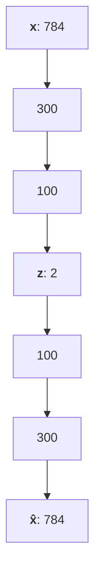
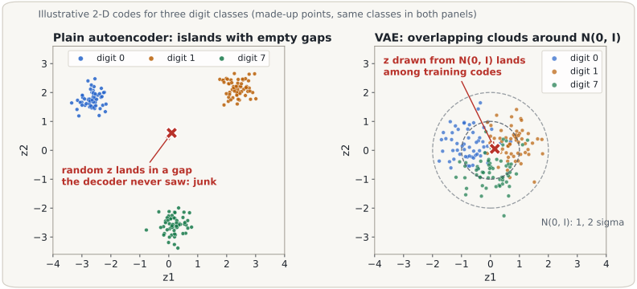

If a network has to rebuild a 784-pixel digit from only 2 numbers, those 2 numbers must hold whatever matters about the digit. An autoencoder is built around that constraint. The encoder squeezes the input down to a short code and the decoder expands the code back; training scores how far the rebuilt image lands from the original.

There are no labels anywhere, so this is unsupervised learning: the input is its own target.

> **Key Takeaways**
> - An autoencoder squeezes the input to a narrow code and rebuilds it; a denoising one is scored against the clean input.
> - A dense layer has $mn+n$ parameters, and an LSTM layer with input size $m$ and hidden size $H$ has $4(mH+H^2+H)$.
> - After training you usually keep the encoder, whose code works as a feature vector, and drop the decoder.
> - A plain autoencoder's code space has gaps where a random code decodes to junk, which is the problem the VAE addresses.

## One autoencoder, run by hand

The smallest autoencoder has two numbers in, one hidden unit and two numbers out. The input is $\mathbf x=(1,\,2)$. The encoder weights are $(0.6,\,0.4)$ and the decoder weights are $(0.5,\,0.9)$. The hidden unit uses ReLU, which keeps a positive number and turns a negative one into 0. The output layer is linear, meaning it applies no activation.

Encode: the code is the weighted sum of the input, passed through ReLU.

$$z=\text{ReLU}(0.6\cdot1+0.4\cdot2)$$

$$=\text{ReLU}(1.4)=1.4$$

Decode: each output is the code times one decoder weight. The rebuilt input is written $\widehat{\mathbf x}$, a hat because it is the network's prediction of $\mathbf x$.

$$\widehat{\mathbf x}=(0.5\cdot1.4,\ 0.9\cdot1.4)=(0.70,\ 1.26)$$

For the loss, square each difference between input and rebuild and add them up.

$$(1-0.70)^2+(2-1.26)^2$$

$$=0.09+0.5476=0.6376$$

For many examples the loss is the average of this over $N$ examples. With a length-$D$ input $\mathbf x$, a code $\mathbf z$ of length $K<D$, and $\lVert\cdot\rVert$ for the length of a vector (so $\lVert\mathbf v\rVert^2$ is the sum of its squared entries):

$$L=\frac1N\sum_{n=1}^{N}\left\lVert\mathbf x^{(n)}-\widehat{\mathbf x}^{(n)}\right\rVert^2$$

Check it on the example: $N=1$ and the squared length of $(0.30,\,0.74)$ is $0.09+0.5476=0.6376$. For a single example you can drop the $\frac1N$; just say which version you're using.

## Why the code has to be narrow

If the middle layer is as wide as the input, the network can just copy it and learn nothing. Make it narrow (undercomplete) and the network has to keep only the structure that repeats across the data. After training, the encoder is the half you keep: its code is a compact feature vector for the image, while the decoder only knows how to rebuild pixels.

Why not make the network linear? Two linear layers stack into one, because $W_2(W_1\mathbf x)=(W_2W_1)\mathbf x$ and $W_2W_1$ is just another matrix. However many linear layers you add, a linear autoencoder trained with squared error learns the same $K$-dimensional subspace as PCA, the span of the top $K$ principal directions, which is the best flat summary of the data. It needn't find the principal directions themselves, only the space they span. With non-linear activations (ReLU, sigmoid) it can fit curved data too.

The parameter count below uses this 784-300-100-2-100-300-784 network:

The encoder runs from $\mathbf x$ down to $\mathbf z$ and the decoder from $\mathbf z$ back up to $\widehat{\mathbf x}$. The narrow box in the middle, shared by both, is the bottleneck $\mathbf z$.

## Counting parameters

A dense layer with $m$ inputs and $n$ outputs has one weight for each pair plus one bias per output. With 50 inputs and 20 outputs that is $50\cdot20+20=1020$. In general

$$mn+n$$

and the $+n$ is the biases, which are easy to forget. For the 784-300-100-2-100-300-784 network:

Encoder: $784\cdot300+300=235{,}500$, then $300\cdot100+100=30{,}100$, then $100\cdot2+2=202$. The sum is $265{,}802$.

Decoder: $2\cdot100+100=300$, then $100\cdot300+300=30{,}300$, then $300\cdot784+784=235{,}984$. The sum is $266{,}584$.

The total is $265{,}802+266{,}584=532{,}386$.

## What the code space looks like

The code space, also called the latent space, is the set of all possible codes $\mathbf z$. A plain autoencoder is trained only to rebuild the training points. Nothing forces nearby codes to decode to similar images, so the codes form islands with empty gaps between them. Pick a random $\mathbf z$ and you'll usually land in a gap and decode junk, which is why you can't use a plain autoencoder as a generator. [The VAE](/blog/cse425-final-vae-encoder-reparameterization/) is built to close those gaps.

Each variant below changes one thing about the setup or the training. The [autoencoder article on Wikipedia](https://en.wikipedia.org/wiki/Autoencoder) describes more of them.

| Variant | Change | Use |
|---|---|---|
| Denoising | Corrupt the input, score against the clean target | Remove noise |
| Sparse | Hidden layer may be wider than the input, and an L1 penalty (the sum of absolute activations) keeps most units at zero | Useful features without a narrow bottleneck |
| Anomaly detection | Train on normal data only | A large reconstruction error flags something unusual |

## LSTM autoencoders for sequences

For sequences, the dense layers are replaced by LSTMs. An LSTM reads one step at a time and carries a hidden state (see the [LSTM note](/blog/cse425-mid-lstm/), or [Understanding LSTM Networks](https://colah.github.io/posts/2015-08-Understanding-LSTMs/) for a refresher on the cell and its gates). The encoder LSTM reads $T$ steps and its final hidden state, $h_T$, is the code $\mathbf z$. The decoder LSTM needs an input at every step, so a RepeatVector layer copies $\mathbf z$ onto all $T$ steps. Finally one Dense layer, applied with the same weights at every step (TimeDistributed), turns each decoder hidden state back into a feature vector. Without it you would get one output for the whole sequence instead of one per step.

For an input of 50 steps with 2 features and 100 units in each LSTM, the shapes go like this:

| Stage | Shape |
|---|---|
| input | (batch, 50, 2) |
| encoder LSTM, last state $\mathbf z$ | (batch, 100) |
| RepeatVector | (batch, 50, 100) |
| decoder LSTM, every step | (batch, 50, 100) |
| TimeDistributed Dense | (batch, 50, 2) |

Now the parameters. An LSTM layer has four blocks (forget, input, candidate and output). Each block has a matrix on the input, a matrix on the previous hidden state and a bias. With input size $m=10$ and hidden size $H=5$, a block has $10\cdot5+5\cdot5+5=80$ parameters, so the layer has $4\cdot80=320$. In general

$$4\,(mH+H^2+H)$$

For the autoencoder above, the encoder LSTM has $m=2$ and $H=100$:

$$4(2\cdot100+100^2+100)=41{,}200$$

The decoder LSTM takes the 100-wide copies of $\mathbf z$, so $m=100$:

$$4(100\cdot100+100^2+100)=80{,}400$$

The Dense layer from 100 to 2 has $100\cdot2+2=202$. RepeatVector adds none, and the Dense layer is counted once even though it is used at all 50 steps. The total is $41{,}200+80{,}400+202=121{,}802$.

## Why a denoising autoencoder works

In a denoising LSTM autoencoder the network receives a noisy step $\widetilde{x}_t=x_t+\varepsilon_t$ at each of the $T$ steps, where $\varepsilon_t$ is random noise, but the loss compares the output with the clean $x_t$:

$$L=\frac1T\sum_{t=1}^{T}\left\lVert x_t-\widehat{x}_t\right\rVert^2$$

The code $\mathbf z$ has a fixed size, so it can only hold a short description of the sequence. A smooth signal has a short description and random noise doesn't, so the noise is what gets dropped on the way through.

The forget gate helps too. If a one-off spike enters the cell state and the forget gate stays at about the same value $f$, its contribution after $k$ steps is about $f^k$. That is a simplification, since the real update also involves the input gate, but with $f=0.1$ the spike is $10^{-1},\,10^{-2},\,10^{-3},\,10^{-4},\,10^{-5}$ of its size after 1 to 5 steps.

## Practice: two counts and one design choice

A dense layer has 64 inputs and 10 outputs. How many parameters?

Answer

$$64\cdot10+10=650$$

An LSTM has input size 3 and hidden size 4. How many parameters?

Answer

$$4(3\cdot4+4^2+4)=4\cdot32=128$$

After training an autoencoder on unlabelled images, you want features for a classifier. Which half do you keep, and why?

Answer

The encoder. It maps an image to a compact code that works as the feature vector. The decoder only rebuilds pixels, so it adds nothing for classification.

