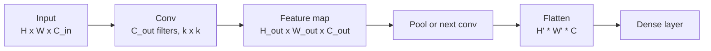

## Quick idea

Take a 225 by 225 grayscale photo. Feed it to a dense layer that outputs a 225 by 225 map and you need about 2.6 billion weights, one for every input pixel and output pixel pair. A convolution layer doing a similar job with a 3 by 3 kernel needs 9 weights and a bias.

Two changes make that possible. Each output looks only at a small patch of the input (local connectivity). And the same kernel is reused at every position (parameter sharing). A third habit, shrinking the map with stride or pooling, keeps later layers cheap.

The marks in this topic come from three skills: computing an output size without slipping by one, counting parameters without forgetting the input channels, and knowing what a given kernel detects. Everything below trains those three.

## Picture it

A kernel is a small grid of weights. Place it on a patch, multiply matching cells, add them up, and add the bias. That is one output number. Slide by the stride and repeat.

*The hand convolution from the worked example: the same nine weights slide one column and give -4, then -1.*

A layer changes the tensor shape like this, and the chain is what shape-tracing questions follow.

*Channels come from the filter count and pools cost nothing, so the conv parameters total 11,550 and the flatten length is 1250.*

## The detail

Notation follows the series table: input $n$ per side, kernel $k$, stride $s$, padding $p$, $C_{in}$ input channels, $C_{out}$ filters. A colour image has $C_{in}=3$. The number of filters equals the number of output channels, which is the depth of the next tensor.

For one filter on one input channel, the output at row $i$, column $j$ is

$$Y[i,j]=\sum_{u=0}^{k-1}\sum_{v=0}^{k-1} X[si+u,\;sj+v]\,K[u,v]+b$$

With several input channels, each channel has its own $k \times k$ slice of the kernel. You compute the sliding sum per channel, add all channels together, then add one bias. So one filter produces one 2-D map no matter how many channels went in.

Deep learning libraries do not flip the kernel before sliding. Strictly that is cross-correlation, and everyone still calls it convolution. In an exam, do not flip unless the question says "mathematical convolution". Flipping only shows up in the backward pass.

Output size per axis comes from counting window positions. After padding, the row has $n+2p$ cells. The window's left edge can start at $0, s, 2s, \dots$ as long as it still fits, so the start must be at most $n+2p-k$. The number of starts is the largest multiple of $s$ that fits, plus the first position at 0:

$$n_{out}=\left\lfloor\frac{n+2p-k}{s}\right\rfloor+1$$

That is where the floor, the $2p$ and the $+1$ come from. If $n_{out}<1$ the layer cannot be applied. With $s=1$, choosing $p=(k-1)/2$ gives $n_{out}=n$, called same padding. The full output tensor is $n_{out}\times n_{out}\times C_{out}$. If the image or kernel is not square, apply the formula separately to width (with $F_W$) and height (with $F_H$). Padding adds zeros all around, so a $6\times6$ image with $p=1$ becomes $8\times8$, and a $3\times3$ kernel then brings it back to $6\times6$. Use padding when the next layer expects a fixed size.

Parameters of a conv layer:

$$\#\text{params}=C_{out}\,(k^2\,C_{in}+1)$$

One bias per filter, not per weight. The image size never appears in this formula. A 1 by 1 conv has $C_{out}(C_{in}+1)$. Pooling has zero parameters. A dense layer with $F$ inputs and $K$ outputs has $K(F+1)$, and $F$ after flattening is $H'\times W'\times C$, channels included.

Weight sharing also gives translation equivariance: shift the input and the feature map shifts by the same amount, rather than changing completely.

## Worked example

Trace a $28\times28\times1$ image through conv (25 filters, $3\times3$, $s=1$, $p=0$), a $2\times2$ pool, conv (50 filters, $3\times3$), another $2\times2$ pool, then flatten.

$$\begin{aligned}
\text{conv 1: } & \lfloor(28-3)/1\rfloor+1=26 \to 26\times26\times25\\
\text{pool 1: } & 26/2=13 \to 13\times13\times25\\
\text{conv 2: } & 13-3+1=11 \to 11\times11\times50\\
\text{pool 2: } & \lfloor 11/2\rfloor=5 \to 5\times5\times50\\
\text{flatten: } & 5\cdot5\cdot50=1250
\end{aligned}$$

Parameters. Conv 1 has $25\,(3\cdot3\cdot1+1)=250$. Conv 2 has $50\,(3\cdot3\cdot25+1)=11{,}300$. The 25 in the second count is the channel depth coming out of conv 1, which people forget. Pools add nothing.

$$\boxed{\text{flatten length}=1250,\qquad \text{conv params}=250+11{,}300=11{,}550}$$

Why sharing matters, in numbers. Take a $6\times6$ image and a $3\times3$ kernel with $s=1$, $p=0$. The map is $4\times4$. In a dense layer each of the 16 output cells needs its own 36 weights. In a conv layer each cell sees only 9 inputs, and all 16 cells reuse the same 9 weights. With 2 filters the map has $4\cdot4\cdot2=32$ cells: a dense layer needs $36\cdot32=1152$ weights, the conv layer needs $2\cdot9=18$ (plus 2 biases).

Now one hand convolution. Input rows $[1,2,0,1]$, $[0,1,3,2]$, $[2,0,1,0]$, $[1,3,0,2]$, kernel rows $[1,0,-1]$, $[2,0,-2]$, $[1,0,-1]$, $s=1$, $p=0$. Output is $2\times2$. In the top-left window the middle kernel column is zero, so only two columns count. The left column $1,0,2$ with weights $1,2,1$ gives $1+0+2=3$. The window's right column is $0,3,1$ with weights $-1,-2,-1$, giving $-(0+6+1)=-7$. Total $3-7=-4$.

$$\boxed{\begin{bmatrix}-4&-1\\0&0\end{bmatrix}}$$

## Exam corner

Asked in past exams: CNN questions appeared in 2 of the Finals we have (one of them reuses the other's CNN questions), so treat the forms below as the likely repeats.

Shape tracing until the network breaks. One version gives a $96\times96\times1$ image, 8 filters of $5\times5$, stride 2, no padding, then repeated conv plus $2\times2$ pool. The sizes go 46, 23, 10, 5, 1, and a $2\times2$ pool cannot run on a $1\times1$ map, so two full sets run and the third breaks at its pool. A common wrong answer is 47 for the first conv. The ratio is $91/2=45.5$, floor 45, plus 1 is 46. Flatten after two sets is $5\cdot5\cdot8=200$. The other version gives an $80\times80$ image, 4 filters $3\times3$, stride 2, and asks for the flatten size after two sets. Sizes go 39, 19, 9, 4, so flatten is $4\cdot4\cdot4=64$. Writing 128 means the filters were doubled without being told. State your assumption either way.

Padding to keep the size. A layer takes a $19\times19$ map and you must keep it $19\times19$. With a $5\times5$ kernel and stride 1 you pad by 2 on each side ($23\times23$ in, 19 out). With $3\times3$ you pad by 1. Know how to read a stack of layers that way, since it is a favourite way to test the formula. A final $1\times1$ conv with one filter then gives one score per board position.

Design vertical-edge filters. You are asked for two $3\times3$ kernels, one for dark-to-light and one for light-to-dark vertical boundaries, usually with an image whose left half is a bright value and right half is 0. For an $8\times8$ image with left half 20, use rows $[1,0,-1]$ for light-left to dark-right. Each output row is $0,0,60,60,0,0$. For the opposite edge use $[-1,0,1]$, which gives $0,0,-60,-60,0,0$, and after ReLU everything is 0. Then explain sharing: the same 9 weights are tried at every position, so far fewer connections than a dense layer. Also say what the filter does: it scores how well each patch matches a pattern, and the biggest values mark where the pattern sits.

True or false items on pooling having no parameters yet still affecting backprop (false as phrased, gradients flow through it), unsupervised CNNs being possible (true, a conv autoencoder), and the 1-D conv plus linear layers that cannot tell a shifted pattern A from B.

Marks come from: writing the formula, substituting with the padding and stride you assume, flooring, and stating when the layer cannot run. For parameters, show $C_{in}$ in the product and add the bias once per filter.

Common slips: forgetting the $+1$; forgetting the floor; counting a bias per weight; leaving out $C_{in}$ in layer 2; flatten without channels; flipping the kernel; sliding a $5\times5$ kernel over a $3\times3$ map.

Cheat line: $n_{out}=\lfloor(n+2p-k)/s\rfloor+1$, params $=C_{out}(k^2C_{in}+1)$, flatten $=H'W'C$, same padding $p=(k-1)/2$.

## Check yourself

1. A $32\times32$ input goes through a $5\times5$ conv with $p=2$, $s=1$. What is the output size, and what if $p=0$?

Answer

$\lfloor(32+4-5)/1\rfloor+1=32$. With $p=0$ it is $28$.

2. How many parameters does a conv layer have if it maps 3 channels to 16 with $5\times5$ kernels and bias? Why does the image size not matter?

Answer

$16\,(25\cdot3+1)=1216$. The same kernels are reused at every position, so only $k$, $C_{in}$ and $C_{out}$ appear.

3. An $n=7$ map goes through a $3\times3$ conv with $p=1$, $s=2$. Output size?

Answer

$\lfloor(7+2-3)/2\rfloor+1=4$.

## Read more

- [CS231n notes on convolutional networks](https://cs231n.github.io/convolutional-networks/) cover filters, strides, padding and parameter counts with worked layers.
- [d2l.ai on padding and strides](https://d2l.ai/chapter_convolutional-neural-networks/padding-and-strides.html) explains the output size formula with small examples.
- [d2l.ai on convolutions for images](https://d2l.ai/chapter_convolutional-neural-networks/conv-layer.html) builds an edge detector and shows the cross-correlation point.
