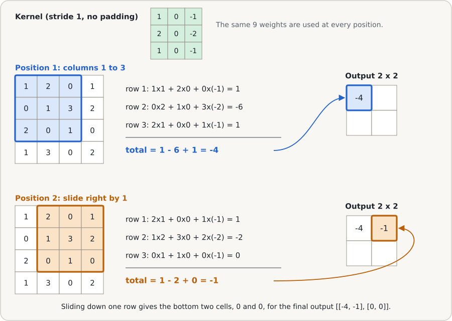
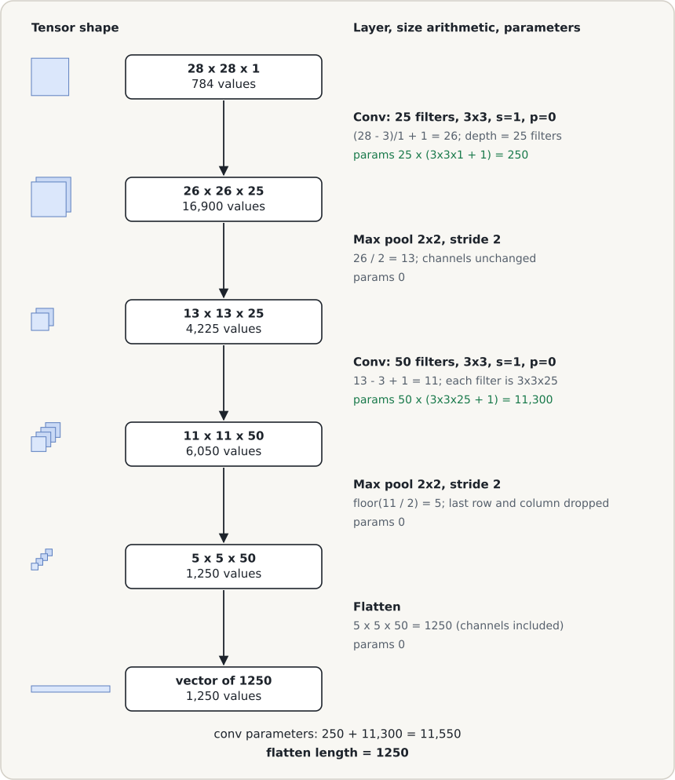

A dense layer that turns a 225 by 225 grayscale photo into a 225 by 225 map connects every input pixel to every output pixel, so it needs $225^2\times225^2=2{,}562{,}890{,}625$ weights, about 2.6 billion. A convolution layer doing a similar job with a 3 by 3 kernel needs 9 weights and one bias.

> **Key Takeaways**
> - A kernel is a small grid of weights that slides over the input and, at each position, multiplies and adds.
> - One kernel is reused at every position, so the parameter count depends on the kernel and the channels but not on the image size.
> - A conv layer's output has floor((n+2p−k)/s)+1 cells per side and one channel per filter.
> - A conv layer has C_out(k²·C_in+1) parameters, and pooling has none.

## Two ideas that remove the weights

A dense layer wastes most of its weights. To decide whether a vertical edge sits at one spot in a photo, you only need the few pixels around that spot, not pixels from the far corner. And an edge looks the same wherever it sits, so a detector that works in the top-left corner should work in the bottom-right too.

Those two observations are the design of a convolution layer. Local connectivity means each output looks only at a small patch of the input. Parameter sharing means the same small grid of weights, the kernel, is used for every patch. Parameter counts matter because every weight must be stored and learned from examples. At 4 bytes each, 2.6 billion weights take about 10 GB, and they need far more training data to pin down than 10 weights do.

## A convolution by hand

Here is a 4 by 4 input and a 3 by 3 kernel:

$$X=\begin{bmatrix}1&2&0&1\\0&1&3&2\\2&0&1&0\\1&3&0&2\end{bmatrix}$$

$$K=\begin{bmatrix}1&0&-1\\2&0&-2\\1&0&-1\end{bmatrix}$$

The kernel first sits on the top-left 3 by 3 patch of $X$. Each pair of overlapping cells is multiplied and the nine products are added. The middle kernel column is all zeros, so only the outer two columns count. The patch's left column is $1,0,2$ and meets the weights $1,2,1$:

$$1\cdot1+0\cdot2+2\cdot1=3$$

Its right column is $0,3,1$ and meets $-1,-2,-1$:

$$0\cdot(-1)+3\cdot(-2)+1\cdot(-1)=-7$$

Adding the two gives $3-7=-4$, the first output cell.

One column to the right, the left column is $2,1,0$ and the right column is $1,2,0$:

$$2\cdot1+1\cdot2+0\cdot1=4$$

$$1\cdot(-1)+2\cdot(-2)+0\cdot(-1)=-5$$

The cell is $4-5=-1$.

Sliding down a row and repeating for the last two windows gives 0 and 0 by the same method. The output is

$$\begin{bmatrix}-4&-1\\0&0\end{bmatrix}$$

It is $2\times2$ because the kernel fits in two positions across and two down. The kernel moved one cell at a time, a step called the stride, $s=1$.

Now the formula for what you just did. Write $X[r,c]$ for the input cell in row $r$ and column $c$, counting from 0, and $K[u,v]$ for the kernel cell in row $u$ and column $v$. The output cell in row $i$, column $j$ is the sum over every kernel position of input times weight, plus a bias $b$ (a single number added to the result, 0 in the example above):

$$Y[i,j]=\sum_{u=0}^{k-1}\sum_{v=0}^{k-1}X[si+u,\;sj+v]\,K[u,v]+b$$

For the first cell, $i=j=0$ and $s=1$, so it uses $X[u,v]$ times $K[u,v]$, which is exactly the nine products above. For the second cell, $j=1$, so every column index shifts right by one.

Libraries do not flip the kernel before sliding, so strictly this is cross-correlation, and nearly everyone still calls it convolution. Do not flip unless a question says "mathematical convolution". The flip only shows up in the backward pass, where the gradient with respect to the input slides the flipped kernel.

## Several channels and several filters

A colour image has 3 channels (red, green, blue), so the input is a stack of grids. The number of input channels is $C_{in}$. A kernel for such an input has its own $k\times k$ slice for each channel. You compute the sliding sum for each channel, add the channels together, then add one bias. One filter (the full set of slices) gives one 2-D map, however many channels went in.

Using $C_{out}$ filters gives $C_{out}$ maps stacked up, so the number of filters is the number of output channels, the depth of the next tensor.

## How big is the output?

The size comes from counting window positions along one side. After padding (adding $p$ rings of zeros around the input), a row has $n+2p$ cells. The kernel is $k$ wide, so its left edge can start at $0,\ s,\ 2s,\dots$ as long as it still fits, which means the start is at most $n+2p-k$. The number of starts is therefore the number of whole strides that fit into $n+2p-k$, plus the start at 0:

$$n_{out}=\left\lfloor\frac{n+2p-k}{s}\right\rfloor+1$$

On the example, $n=4$, $k=3$, $s=1$, $p=0$ gives $\lfloor1/1\rfloor+1=2$. The floor is there because a window that would hang over the edge is not used. A common mistake is leaving out the $+1$ and getting 1. If the result is below 1 the layer cannot be applied.

With $s=1$ and an odd $k$, choosing $p=(k-1)/2$ gives $n_{out}=n$, called same padding. A $6\times6$ image with $p=1$ becomes $8\times8$, and a $3\times3$ kernel then brings it back to $6\times6$. The full output tensor is $n_{out}\times n_{out}\times C_{out}$. If the image is not square, apply the formula to width and height separately. The [padding and stride chapter of Dive into Deep Learning](https://d2l.ai/chapter_convolutional-neural-networks/padding-and-strides.html) has more small examples of this formula.

## Counting parameters

A conv layer has $C_{out}$ filters, each with $k\times k\times C_{in}$ weights and one bias:

$$\#\text{params}=C_{out}\,(k^2\,C_{in}+1)$$

The bias is one per filter, not one per weight. The image size never appears. For $C_{out}=2$, $k=3$, $C_{in}=1$: $2(9+1)=20$.

A dense layer needs far more. For a $6\times6$ image and a $3\times3$ kernel with $s=1$, $p=0$, the map is $4\times4$. A dense layer would give each of the 16 output cells its own 36 weights. In a conv layer each cell sees only 9 inputs, and all 16 cells reuse the same 9 weights. With 2 filters the map has $4\cdot4\cdot2=32$ cells: a dense layer needs $36\cdot32=1152$ weights, and the conv layer needs $2\cdot9=18$ plus 2 biases.

A $1\times1$ conv has $C_{out}(C_{in}+1)$ parameters. Pooling has none, because it only keeps or averages numbers. A dense layer with $F$ inputs and $K$ outputs has $K(F+1)$, and after flattening $F$ is height times width times channels of the last map. The [CS231n notes](https://cs231n.github.io/convolutional-networks/) count filters, strides and parameters layer by layer for real networks.

## Tracing a tensor through layers

A $28\times28\times1$ image goes through a conv layer (25 filters, $3\times3$, $s=1$, $p=0$), a $2\times2$ pool, a second conv (50 filters, $3\times3$), another $2\times2$ pool, then flatten. A pool slides a window and keeps one number per window (the largest, in max pooling), stepping by the window size, so a $2\times2$ pool halves each side. [CNN Part 2: Pooling, Architectures, Backprop](/blog/cse425-final-cnn-pooling-architectures/) covers pooling properly.

Conv 1: $\lfloor(28-3)/1\rfloor+1=26$, so the tensor is $26\times26\times25$.

Pool 1: $26/2=13$, so $13\times13\times25$.

Conv 2: $13-3+1=11$, so $11\times11\times50$.

Pool 2: $\lfloor11/2\rfloor=5$, so $5\times5\times50$.

Flatten: $5\cdot5\cdot50=1250$ numbers in one long vector.

Now the parameters. Conv 1 has $25(3\cdot3\cdot1+1)=250$. Conv 2 has $50(3\cdot3\cdot25+1)=11{,}300$. That 25 is the depth coming out of conv 1, and leaving it out gives a count that is far too small. The pools add nothing, so the conv layers total 11,550.

## Designing a vertical-edge filter

An $8\times8$ image has left four columns of 20 and right four of 0, a bright-to-dark vertical boundary. A kernel with every row $(1,\,0,\,-1)$ subtracts the cell two to the right from the cell on the left, three times. In a flat region both are equal and the result is 0. Across the boundary, the first window with a 0 on its right edge sees $3(20-0)=60$.

Sliding along one row, the six windows give

$$0,\ 0,\ 60,\ 60,\ 0,\ 0$$

The 60s sit where light turns to dark. The opposite kernel, with rows $(-1,\,0,\,1)$, gives $0,\,0,\,-60,\,-60,\,0,\,0$ and after ReLU (which turns negatives to 0) everything is 0, so only the first filter responds to a light-left, dark-right edge. In words, a filter scores how well each patch matches a pattern, and the largest values mark where the pattern sits.

Since the same nine weights are tried at every position, a conv layer is translation equivariant: with stride 1, shift the input and the feature map shifts by the same amount instead of changing completely (away from the borders, where padding gets in the way).

## Stating your assumptions

When a question does not state padding or stride, say what you assume. Then write the formula, put your numbers in, floor the division, and if a layer cannot run, say so. For parameters, show $C_{in}$ inside the product and count the bias once per filter.

Check what your instructor expects for conventions such as the kernel flip and the pool stride.

## Sizes and counts to work by hand

A $32\times32$ input goes through a $5\times5$ conv with $p=2$, $s=1$. What is the output size, and what if $p=0$?

Answer

$$\lfloor(32+4-5)/1\rfloor+1=32$$

With $p=0$ it is $\lfloor27/1\rfloor+1=28$.

How many parameters does a conv layer have if it maps 3 channels to 16 with $5\times5$ kernels and a bias per filter? Why does the image size not matter?

Answer

$$16\,(25\cdot3+1)=1216$$

The same kernels are reused at every position, so only $k$, $C_{in}$ and $C_{out}$ appear.

A map with $n=7$ goes through a $3\times3$ conv with $p=1$, $s=2$. What is the output size?

Answer

$$\lfloor(7+2-3)/2\rfloor+1=4$$

A $4\times4$ input has rows $(1,3,4,2)$, $(2,5,6,3)$, $(4,5,6,3)$ and $(5,2,5,3)$. It gets one ring of zero padding and a $3\times3$ kernel whose every row is $(1,0,0)$, with stride 1. What is the output?

Answer

The size is $\lfloor(4+2-3)/1\rfloor+1=4$. Only the left column of the kernel is nonzero, so each output cell is the sum of the three cells in the column just to its left (above, level and below), with zeros outside the input. The first column of the output sees only padding.

$$\begin{bmatrix}0&3&8&10\\0&7&13&16\\0&11&12&17\\0&9&7&11\end{bmatrix}$$

For example, row 2, column 2 (counting from 1) is $1+2+4=7$.

