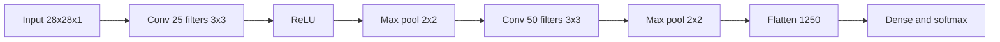
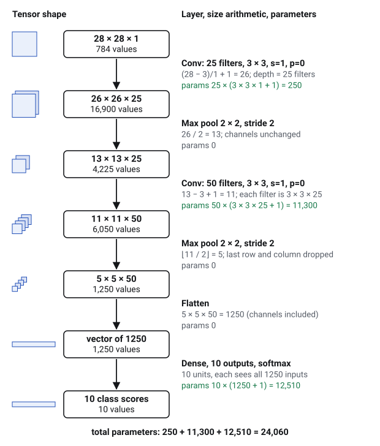

## Quick idea

A 28x28 digit goes through a 3x3 conv with 25 filters and comes out as 26x26x25. That is 16,900 numbers from 784 inputs. Pooling is how you stop the count from growing. Slide a 2x2 window over each map, keep one number per window, and the map halves in height and width: 13x13x25.

Max pooling keeps the largest value in the window, so it answers "did this pattern show up anywhere in here?" Average pooling keeps the mean. Neither has a single learnable weight, and neither touches the number of channels.

The classic slip is the true/false line "pooling has no parameters, so it does not affect backprop". It does affect backprop. Gradients still have to travel through it, and where they go is the first thing this post covers.

## Picture it

The first two stages learn features. Flatten, dense and softmax do the classifying.

*The full 28x28 chain: the dense head holds more than half of the 24,060 parameters.*

## The detail

Notation follows Lecture 00: $n$ input size, $k$ kernel, $s$ stride, $p$ padding. Pooling uses the same size formula as a conv, with the window as $k$:

$$n_{out}=\left\lfloor \frac{n+2p-k}{s}\right\rfloor+1$$

For pooling the stride defaults to the window size, so a 2x2 pool moves by 2. An odd map loses its last row and column because of the floor. A 5x5 map under 2x2 pooling becomes 2x2, not 3x3. Pooling windows are normally 2x2 or 3x3. A bigger window throws away too much, since one number then stands for 25 cells. Pooling is also called subsampling: the resolution drops but the objects stay recognisable.

Shape-tracing procedure. This is the question that keeps coming back, so do it the same way every time.

1. Write the input as $H\times W\times C$.
2. Apply the conv formula to each spatial axis. Channels become the number of filters.
3. If the result is below 1, stop. The layer cannot run, and saying so is part of the answer.
4. Apply the pool formula. Channels stay the same.
5. Repeat for each conv and pool pair, checking step 3 every time.
6. Flatten length is $H'\times W'\times C'$ from the last layer that ran. Forgetting the channels is the most common wrong flatten count.
7. State any assumption you made, such as "no padding" or "stride 1", when the question does not say.

Cascading conv layers. The second conv does not see the image, it sees the 25 maps from the first. So its filters are $3\times3\times25$, and its number of filters (say 50) is a free choice that sets the new depth. The flatten length is the last height times width times depth: $5\cdot5\cdot50=1250$. After flatten the net is an ordinary dense network, for example 1250 to a hidden layer of 100 with ReLU, then 10 outputs with softmax so the scores become probabilities. Backprop runs through all of it, back into the filters.

Parameters. A conv layer has $C_{out}(k^2C_{in}+1)$ parameters. The $C_{in}$ matters: a second conv layer sees 25 input channels, so each of its filters has $9\times25$ weights, not 9. A dense layer with $K$ outputs on $F$ inputs has $K(F+1)$. Pooling has 0. Parameter count does not depend on image size.

Backprop through pooling. In max pooling, the output equals one input cell, the winner. The gradient goes to that cell and every other cell in the window gets 0. In average pooling, each of the $k^2$ cells gets $1/k^2$ of the incoming gradient.

Backprop through a conv layer. Let $\delta=\partial L/\partial Y$ be the gradient arriving at the output map. Since $y_{ij}=\sum_{u,v}x_{i+u,j+v}k_{uv}$, differentiating gives

$$\frac{\partial L}{\partial K_{u,v}}=\sum_{i,j}\delta_{i,j}\,X_{i+u,\,j+v},\qquad \frac{\partial L}{\partial X_{p,q}}=\sum_{u,v}K_{u,v}\,\delta_{p-u,\,q-v}$$

The kernel gradient is the input correlated with $\delta$, summed over every position. That sum is the price of sharing one kernel everywhere. The input gradient is $\delta$ convolved with the flipped kernel, using full padding. Exams want you to recognise these forms rather than derive them.

Receptive field. The receptive field is the patch of the original input that can influence one output cell. With previous receptive field $RF_{l-1}$ and jump $J_{l-1}$ (input pixels between neighbouring cells):

$$RF_l=RF_{l-1}+(k_l'-1)J_{l-1},\qquad J_l=J_{l-1}s_l,\qquad k'=d(k-1)+1$$

Start from $RF_0=J_0=1$. Use the previous layer's jump, not the current one. Stacked stride-1 3x3 convs give 3, 5, 7, 9. Pooling and stride make later layers grow faster, and dilation $d$ grows the field without new weights.

Skip connections. A residual block computes $y=F(x)+x$, so

$$\frac{\partial y}{\partial x}=1+\frac{\partial F}{\partial x}$$

The 1 gives the gradient a path that cannot shrink, which is why very deep networks train. If $F$ changes the channel count, project the skip path with a 1x1 conv so the two can be added. A U-Net also uses skip connections, but it joins the encoder map to the decoder map by concatenating channels, not adding, and its decoder grows the size back with up-convolution (transposed conv), which does not recover the exact original values.

Heads and batch norm. Global average pooling averages each channel to one number, $v_c=\frac{1}{H'W'}\sum_{i,j}A_{i,j,c}$, and replaces flatten. A head for $K$ classes then costs $K(C+1)$ parameters instead of a huge dense layer. Batch norm in a CNN works per channel, taking the mean and variance over the batch and both spatial axes, then scales and shifts with 2 learned numbers per channel. It is a short aside here, since the course does not test it on CNNs.

## Worked example

Max pool on a 4x4 map with 2x2 windows, stride 2:

$$\begin{bmatrix}1&5&2&0\\3&4&1&2\\0&2&6&1\\1&1&3&2\end{bmatrix}\to\begin{bmatrix}5&2\\2&6\end{bmatrix}\ \text{(max)},\qquad \begin{bmatrix}3.25&1.25\\1&3\end{bmatrix}\ \text{(average)}$$

Now a full trace. Input 100x100x1. Layer set A: conv with 6 filters 5x5, stride 2, no padding, then 2x2 pool. Set B: conv with 12 filters 5x5, stride 2, then 2x2 pool. Set C: the same as B.

Set A conv: $\lfloor(100-5)/2\rfloor+1=\lfloor47.5\rfloor+1=48$, so 48x48x6. Pool: 24x24x6.
Set B conv: $\lfloor(24-5)/2\rfloor+1=10$, so 10x10x12. Pool: 5x5x12.
Set C conv: $\lfloor(5-5)/2\rfloor+1=1$, so 1x1x12. The 2x2 pool cannot run on a 1x1 map, so the network breaks here.

Flatten after two sets: $5\times5\times12=300$. Parameters: conv A $6(25+1)=156$, conv B $12(25\cdot6+1)=1812$, and a 10-class dense head $10(300+1)=3010$. Total 4978.

The 28x28x1 chain from the picture works the same way. Conv 1: $25(9+1)=250$. Conv 2: $50(9\cdot25+1)=11{,}300$. Flatten 1250, dense: $10(1250+1)=12{,}510$. Total 24,060.

$$\boxed{\text{flatten}=300,\ \text{params}=4978\ \text{(100x100 trace)};\quad 24{,}060\ \text{(28x28 chain)}}$$

Two smaller checks. A 3x3 stride-1 conv, a 2x2 stride-2 pool, then a 3x3 conv with dilation 2 give receptive fields 3, 4, 12 (the last: $k'=5$, jump 2, so $4+4\cdot2$). The kernel gradient for $X=\begin{bmatrix}1&2&0\\1&0&1\\2&1&1\end{bmatrix}$ and $\delta=I_2$ is $\begin{bmatrix}1&3\\2&1\end{bmatrix}$.

## Exam corner

Asked in past exams: shape tracing through repeated conv and pool layers until the network breaks appeared in 2 of the finals we have, with two different image sizes in the same paper. Marks are for each conv size, each pool size, and the final flatten count. The true/false "pooling does not affect backprop" appeared in 1 paper. Residual blocks, GAP heads and pooling of a small window show up in the typed practice set. Expect the layer-by-layer size and parameter count to be the thing you are tested on, so know each layer's output shape and parameter count before the exam. We saw no past final asking backprop through conv or batch norm for CNNs, so treat those as medium risk.

Marks come from: writing the formula, substituting for each layer, stating where the network breaks, and counting flatten as $H'W'C'$. For parameters, multiply by $C_{in}$.

Common slips:

- Rounding instead of flooring: a 61.5 must become 61 before the +1, giving 62, not 63.
- Letting pooling change the channel count.
- Assuming pool stride 1 by default.
- Padding the layer that cannot run to force it through, without saying so.
- Using the current layer's jump instead of the previous one in a receptive field.

Formula cheat line: $n_{out}=\lfloor(n+2p-k)/s\rfloor+1$, conv params $C_{out}(k^2C_{in}+1)$, dense $K(F+1)$, pool params 0, residual gradient $1+\partial F/\partial x$.

## Check yourself

1. A 64x64x3 image goes through conv with 16 filters 3x3, stride 1, p=1, then 2x2 max pool. What are the output shape and the conv parameter count?

Answer
Conv keeps 64x64 and gives 64x64x16. Pool gives 32x32x16. Parameters: $16(9\cdot3+1)=448$.

2. In a 2x2 max pool, the window values are 4, 9, 2, 7 and the incoming gradient is 0.8. What gradient does each cell get? What if it were average pooling?

Answer
Max: the cell holding 9 gets 0.8, the other three get 0. Average: each cell gets 0.8/4 = 0.2.

3. Three stride-1 convs with 5x5 kernels are stacked. What is the receptive field of one output cell?

Answer
Each layer adds $5-1=4$, so $1+4+4+4=13$.

## Read more

- [CS231n notes on convolutional networks](https://cs231n.github.io/convolutional-networks/), including the pooling layer section.
- [Pooling in Dive into Deep Learning](https://d2l.ai/chapter_convolutional-neural-networks/pooling.html).
- [Computing receptive fields of convolutional networks](https://distill.pub/2019/computing-receptive-fields/) on Distill.
- [Deep Residual Learning for Image Recognition](https://arxiv.org/abs/1512.03385), the ResNet paper.

<!-- Reviewer notes: no CNN-specific source for batch norm, kept to one aside. Source answer key for the pooling true/false was not seen; "false" is derived from the gradient routing. The digest's average-pool window example (2.75) did not match its own 4x4 map, so the average map above was recomputed (3.25, 1.25, 1, 3). Diagram placeholder cnn-shape-trace is for the diagram agent. -->
