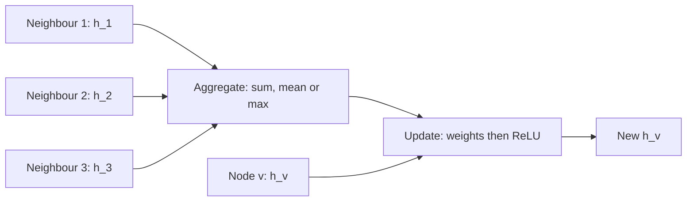
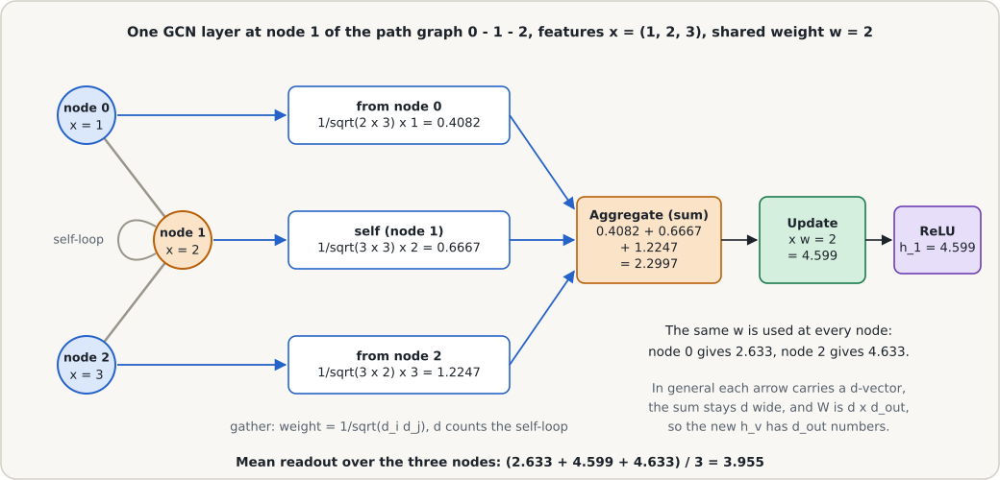

## Quick idea

A molecule with 9 atoms can be written down in 9! = 362,880 different orders. It is still the same molecule. A network that reads a list of atoms and gives a different answer for each ordering has learned nothing about chemistry.

That is the problem graph neural networks solve. A graph is a set of nodes joined by edges: atoms and bonds, people and friendships, pixels and their neighbours. There is no first node and no fixed number of neighbours, so a plain dense layer or a fixed-size kernel does not fit.

The fix is the same trick as a convolution. Each node looks at its neighbours, combines what it sees with an order-free operation like a sum or a mean, and updates its own vector. Stack a few layers and information travels further.

One thing to know before you plan revision time: this topic is on the course syllabus, but we found no past exam, quiz or practice question on it. Treat it as a low-weight theory topic and learn the one-layer calculation well.

## Picture it

Images are graphs where each pixel links to its 8 neighbours, and text is a graph that is a chain of tokens. A GNN is convolution for neighbourhoods that are not a tidy grid.

*The worked GCN example at node 1: gather with degree weights, sum, apply the shared w, then ReLU.*

## The detail

**Notation.** $h_v^{(k)}$ is the vector of node $v$ after layer $k$, and $h_v^{(0)}=x_v$ is its input features. $\mathcal N(v)$ is the set of neighbours of $v$. $A$ is the adjacency matrix ($A_{ij}=1$ if nodes $i$ and $j$ are joined). $X$ is the $N\times d$ matrix of node features. $W$ is a learned weight matrix, $\sigma$ a nonlinearity such as ReLU.

**What a graph model must respect.** Renumbering the nodes must not change the answer. Each layer is permutation equivariant: relabel the input nodes and the output rows are relabelled the same way. The final graph-level readout is permutation invariant, because a mean, sum or max over nodes ignores order.

**Storing a graph.** Keep $X$ with shape $[N,d]$ and an edge list with shape $[E,2]$. An adjacency matrix has $N^2$ entries, the edge list has $2E$. For 1000 nodes and 5000 edges that is 1,000,000 entries against 10,000.

**Message passing.** Every layer does three steps: gather the neighbour vectors, aggregate them with an order-free function, update with weights and a nonlinearity. The simplest version is

$$h_v^{(k)}=\sigma\Big(\sum_{u\in\mathcal N(v)}h_u^{(k-1)}\Big).$$

Sums are sensitive to degree. A node with 100 neighbours each holding the value 2 gets 200. A node with 2 such neighbours gets 4. Same neighbourhood quality, wildly different scale. Normalising fixes this, and there are three standard ways to do it. They are different models, and mixing up their names is the most common slip.

**GraphSAGE-mean.** Average the neighbours, give the node's own vector a separate weight:

$$h_v^{(k)}=\sigma\Big(W^{(k)}\frac{1}{|\mathcal N(v)|}\sum_{u\in\mathcal N(v)}h_u^{(k-1)}+B^{(k)}h_v^{(k-1)}\Big).$$

Some notes call this "GCN". It is not. It is GraphSAGE with a mean aggregator, and the separate $B$ means a node never mixes itself into the average.

**GCN (Kipf and Welling).** Add self-loops, then normalise by the degree at both ends. Let $\tilde A=A+I$ and let $\tilde D$ be the diagonal matrix with $\tilde D_{ii}=\sum_j\tilde A_{ij}$, the degree counting the self-loop. Then

$$H^{(k)}=\sigma\big(\hat A\,H^{(k-1)}W^{(k)}\big),\qquad \hat A=\tilde D^{-1/2}\tilde A\,\tilde D^{-1/2}.$$

Entry by entry, $\hat A_{ij}=\tilde A_{ij}/\sqrt{\tilde d_i\tilde d_j}$. Per node this reads $h_v=\sigma\big(\sum_{u\in\mathcal N(v)\cup\{v\}}\frac{1}{\sqrt{\tilde d_v\tilde d_u}}Wh_u\big)$. Self-loops let a node keep its own signal. Dividing by both degrees damps high-degree nodes at both ends of an edge, so rows of $\hat A$ need not sum to 1.

Read the matrix form in two moves: $\hat A H$ aggregates, then multiplying by $W$ transforms.

**GAT (graph attention).** Instead of fixed weights from degrees, learn how much each neighbour matters:

$$e_{vu}=\text{LeakyReLU}\big(a^\top[Wh_v\,\|\,Wh_u]\big),\qquad \alpha_{vu}=\frac{\exp e_{vu}}{\sum_{w\in\mathcal N(v)\cup\{v\}}\exp e_{vw}},\qquad h_v=\sigma\Big(\sum_u\alpha_{vu}Wh_u\Big).$$

Here $\|$ is concatenation, $a$ is a learned vector, and the softmax makes the weights over neighbours sum to 1. This is the same softmax idea as in attention, applied only over a node's neighbours.

**Readout.** For one label per graph, pool the final node vectors, for example $g=\frac1{|V|}\sum_i h_i^{(L)}$, then classify with $\hat y=\sigma(Wg+b)$. Aggregation works over a node's neighbours. Readout works over the whole graph. Do not swap them.

**Depth and cost.** After $k$ layers a node has seen its $k$-hop neighbourhood; entry $(A^k)_{ij}$ counts the walks of length $k$ between $i$ and $j$. Too many layers push all node vectors towards the same value, called oversmoothing, so two or three layers is typical. The weights are shared across nodes, so a layer from 16 to 8 features has $16\cdot8+8=136$ parameters whether the graph has 4 nodes or $10^6$. Compute still grows with the number of edges.

## Worked example

Path graph 0-1-2, scalar features $x=(1,2,3)$, weight $w=2$, ReLU, mean readout, GCN layer.

Add self-loops: $\tilde d=(2,3,2)$. Then $\hat A_{ij}=\tilde A_{ij}/\sqrt{\tilde d_i\tilde d_j}$ gives

$$\hat A=\begin{pmatrix}0.5&0.4082&0\\0.4082&0.3333&0.4082\\0&0.4082&0.5\end{pmatrix}.$$

Aggregate: $\hat Ax=(0.5+0.8165,\ 0.4082+0.6667+1.2247,\ 0.8165+1.5)=(1.3165,\ 2.2997,\ 2.3165)$.

Transform: multiply by $w=2$ to get $(2.633,\ 4.599,\ 4.633)$. All positive, so ReLU changes nothing.

Readout (mean): $g=(2.633+4.599+4.633)/3=3.955$. Sum readout would give 11.865 and max readout 4.633.

$$\boxed{g_{\text{mean}}=3.955}$$

## Exam corner

**Asked in past exams.** It appeared in 0 of the papers we have, and in 0 quizzes and 0 practice sets. The syllabus lists it, so a short theory question is possible, and whether it is examined this semester is worth asking your instructor. If it comes, expect one of: define message passing, explain why order must not matter, state how GCN differs from GAT, say what readout does.

**Marks come from.** The three steps (gather, aggregate, update). The normalised equation with every symbol defined. One numeric aggregation, shown as $\hat A H$ first and then times $W$.

**Common slips.**
- Forgetting the self-loops, so $\tilde A$ is written as $A$.
- Using $\tilde D^{-1}\tilde A$ (row normalisation) when the symmetric form $\tilde D^{-1/2}\tilde A\tilde D^{-1/2}$ is asked.
- Confusing aggregation over neighbours with readout over the whole graph.
- Calling the mean-plus-own-weight model GCN.

**Formula cheat line.** $H^{(k)}=\sigma(\tilde D^{-1/2}\tilde A\tilde D^{-1/2}H^{(k-1)}W^{(k)})$, with $\tilde A=A+I$.

## Check yourself

1. Why does a GNN layer use a sum, mean or max instead of a concatenation of neighbours?

Neighbours have no order and their number varies. Concatenation depends on order and size, while sum, mean and max give the same result for any ordering.

2. A node has 50 neighbours with value 3 and another has 5 with value 3. What does a plain sum give for each, and what does a mean give?

Sum: 150 and 15. Mean: 3 and 3. That gap is why normalisation is used.

3. For the path graph above, what is $\tilde d$ for the middle node, and why is it 3?

It has two neighbours plus its own self-loop, so $\tilde d=3$. Without self-loops it would be 2.

## Read more

- [A Gentle Introduction to Graph Neural Networks](https://distill.pub/2021/gnn-intro/), Distill's illustrated walk through graphs, message passing and readout.
- [Kipf's explainer on graph convolutional networks](https://tkipf.github.io/graph-convolutional-networks/), written by the GCN author.
- [Semi-Supervised Classification with Graph Convolutional Networks](https://arxiv.org/abs/1609.02907), the original GCN paper.
- [Graph Attention Networks](https://arxiv.org/abs/1710.10903), the original GAT paper.

<!-- Reviewer note: the digest found no past-paper, quiz or practice material on GNN, so the Exam corner uses the syllabus listing and the digest's likely theory forms only. Whether it is examined this semester is unconfirmed. Digest suggested a second diagram (gcn-matrix-trace) and k-hop growth; not added to stay within budget. -->
