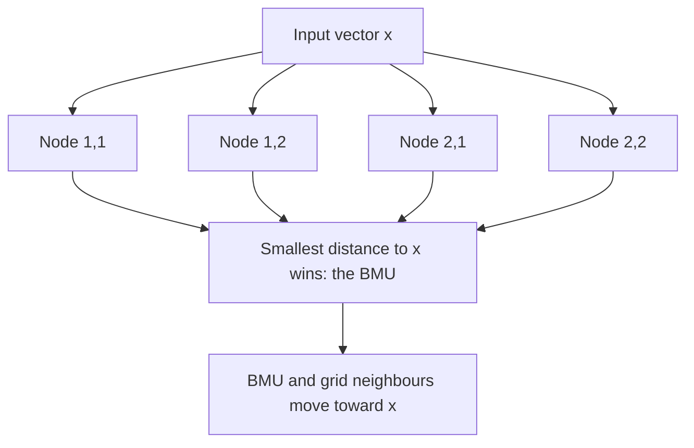

## Quick idea

Nine nodes, two numbers each, one input point. You compute nine distances, pick the smallest, and nudge four nodes toward the input. That is the whole numeric question you could be given on this topic, and it takes about five minutes once you know the routine.

A Kohonen self-organizing map (SOM) takes data with no labels and lays it out on a small grid, usually 2D, so that similar inputs land on nearby grid cells. A 10-dimensional input ends up as a position on a 3x3 or 10x10 board. Nobody tells the map what the groups are.

Two things to know before you plan revision time. This topic is the last item on the course syllabus. But it appeared in one after-mid quiz and in none of the formal exams we have, so treat it as low weight: learn the one worked example below and the short theory list.

## Picture it

Every grid node holds a weight vector as long as the input. The input connects to every node. The nodes do not connect to each other. Closeness between nodes is only a matter of where they sit on the grid.

*The worked SOM step: the BMU and its three grid neighbours each move halfway to the input, and the other five nodes stay put.*

## The detail

Notation: $t$ is the iteration and $T$ the total number of iterations. $\mathbf{x}(t)$ is the input at step $t$. $\mathbf{w}_{ij}(t)$ is the weight vector of the node in row $i$, column $j$. $\eta(t)$ is the learning rate. $\sigma(t)$ is the neighbourhood radius, measured on the grid. $d_{ij}$ is the grid distance from node $(i,j)$ to the winner. $\lambda$ is a time constant that sets how fast things decay.

Learning here is competitive, not error correction. There is no loss function and no backpropagation. For each input, all nodes compete and one wins. The winner is the best matching unit (BMU), the node whose weight vector is closest to the input in Euclidean distance:

$$\text{BMU}=\arg\min_{ij}\ \lVert \mathbf{x}-\mathbf{w}_{ij}\rVert_2$$

Ties are broken any way you like. Next, the BMU and the nodes near it on the grid move toward the input:

$$\mathbf{w}_{ij}(t+1)=\mathbf{w}_{ij}(t)+\eta(t)\,h_{ij}(t)\,\big(\mathbf{x}(t)-\mathbf{w}_{ij}(t)\big)$$

The factor $h_{ij}(t)$ is the neighbourhood function. It equals 1 at the BMU and shrinks as grid distance grows:

$$h_{ij}(t)=\exp\!\Big(-\frac{d_{ij}^2}{2\,\sigma(t)^2}\Big)$$

Learning rate and radius both decay, so the map first orders itself globally and then fine-tunes:

$$\eta(t)=\eta_0\, e^{-t/\lambda},\qquad \sigma(t)=\sigma_0\, e^{-t/\lambda}$$

Read the update as a weighted average. Since $\eta h$ lies between 0 and 1, the new weight is $(1-\eta h)\,\mathbf{w}+\eta h\,\mathbf{x}$. With $\eta h=0.5$ the node moves halfway to the input. It is the perceptron rule again: old weight plus rate times error, where the error is $\mathbf{x}-\mathbf{w}$.

A common mix-up: $\sigma$ is a radius, not a sigmoid. It only shares a letter with the activation function.

Many quiz questions use a simplified neighbourhood. Take $h=1$ for nodes inside the radius and $h=0$ outside, so the rule becomes $\mathbf{w}\leftarrow\mathbf{w}+\eta(\mathbf{x}-\mathbf{w})$ for the BMU and its neighbours only. State which version you use. Also state how you measure grid distance. Manhattan distance (rows plus columns) gives up to 4 neighbours on a rectangular grid. A hexagonal grid gives 6.

The full algorithm, in order:

1. Initialise all weight vectors randomly.
2. Pick an input.
3. Compute the distance from the input to every node.
4. Choose the BMU.
5. Find the nodes within radius $\sigma(t)$ of the BMU on the grid.
6. Update those nodes.
7. Decay $\eta$ and $\sigma$.
8. Repeat until $t=T$.

Weight count: $N$ nodes with $d$ inputs each means $N\,d$ weights. A 3x3 map on 2D input has $9\times2=18$.

## Worked example

A 3x3 map, written as (row, column). Weights:

| | col 1 | col 2 | col 3 |
|---|---|---|---|
| row 1 | (0.5, 0.2) | (0.1, 0.3) | (0.3, 0.4) |
| row 2 | (0.6, 0.5) | (0.4, 0.2) | (0.7, 0.3) |
| row 3 | (0.8, 0.6) | (0.5, 0.4) | (0.9, 0.7) |

Input $\mathbf{x}=(0.45,\,0.35)$, $\eta=0.5$, radius 1 with Manhattan distance, $h=1$ inside the radius.

Squared distances, for example node (1,2): $(0.45-0.1)^2+(0.35-0.3)^2=0.1225+0.0025=0.125$.

| Node | (1,1) | (1,2) | (1,3) | (2,1) | (2,2) | (2,3) | (3,1) | (3,2) | (3,3) |
|---|---|---|---|---|---|---|---|---|---|
| Squared distance | 0.025 | 0.125 | 0.025 | 0.045 | 0.025 | 0.065 | 0.185 | 0.005 | 0.325 |

The smallest is 0.005 at (3,2), so the BMU is (3,2) with weight (0.5, 0.4) and distance $\sqrt{0.005}\approx0.0707$. Comparing squared distances is enough to find the winner, so skip the square root until the end.

Neighbours at Manhattan distance 1 from (3,2): (2,2), (3,1), (3,3). Update each with $\mathbf{w}+0.5(\mathbf{x}-\mathbf{w})$:

- (3,2): $(0.5+0.5(-0.05),\ 0.4+0.5(-0.05))=(0.475,\ 0.375)$
- (2,2): $(0.4+0.5(0.05),\ 0.2+0.5(0.15))=(0.425,\ 0.275)$
- (3,1): $(0.8+0.5(-0.35),\ 0.6+0.5(-0.25))=(0.625,\ 0.475)$
- (3,3): $(0.9+0.5(-0.45),\ 0.7+0.5(-0.35))=(0.675,\ 0.525)$

$$\boxed{\text{BMU }(3,2);\ \text{new weights }(0.475,0.375),\ (0.425,0.275),\ (0.625,0.475),\ (0.675,0.525)}$$

The other five nodes keep their weights. One slip to avoid: it is easy to read node (1,2) as (0.4, 0.3) instead of (0.1, 0.3). That gives 0.305 instead of 0.125. It does not change the winner here, but it costs marks for a wrong table.

## Exam corner

Asked in past exams. We found no SOM question in any of the past Mids, Finals or quizzes from 2020 to 2023. The only exam-style item is one Fall 2024 after-mid quiz question: a 3x3 map, find the BMU, update the BMU and its neighbours. We saw it as a single image, and the second part was cut off, so the radius and the number of iterations in the worked example above are our best reading of it. No formal exam includes it and the typed final practice set does not either. The topic is on the syllabus, so expect it as a short question if it is asked at all.

Likely forms: a numeric BMU search plus one update step; define competitive learning, BMU and neighbourhood; explain why radius and learning rate decay; compare a SOM with an ordinary network. Marks are unknown.

Marks come from: the distance for every node shown, the minimum identified, the neighbour set stated with its distance rule, the update formula written, and the new weights for only the BMU and its neighbours.

Common slips:

- Copying a weight wrongly from the table.
- Mixing squared distances and square roots in the same comparison.
- Updating all nodes instead of the BMU and its neighbours.
- Forgetting to say whether neighbours use Manhattan or Euclidean grid distance.

SOM against an ordinary network, the usual answer: one grid layer instead of stacked layers, competitive learning instead of backpropagation, no labels, and no connections between the grid nodes.

Formula cheat line: BMU $=\arg\min\lVert\mathbf{x}-\mathbf{w}\rVert$; $\mathbf{w}\leftarrow\mathbf{w}+\eta h(\mathbf{x}-\mathbf{w})$; $h=e^{-d^2/2\sigma^2}$.

## Check yourself

1. With the same map and $\eta=0.5$, which node is the BMU for $\mathbf{x}=(0.9,0.6)$?

Node (3,3) with weight (0.9, 0.7) has squared distance $0+0.01=0.01$. Node (3,1) gives $0.01+0=0.01$ as well, so it is a tie. Either is acceptable.

2. A node sits at grid distance 2 from the BMU and $\sigma=2$. What is $h$?

$h=\exp(-4/(2\cdot4))=e^{-0.5}\approx0.607$.

3. Why do both $\eta$ and $\sigma$ shrink over time?

A large radius early on pulls whole regions of the map into a rough order. A small radius and rate later let individual nodes settle on their own part of the data without being dragged around.

## Read more

- [Self-organizing map on Wikipedia](https://en.wikipedia.org/wiki/Self-organizing_map), with the algorithm, variants and a worked outline.
- [Competitive learning on Wikipedia](https://en.wikipedia.org/wiki/Competitive_learning), the winner-takes-most idea that SOMs build on.

<!-- Reviewer note: the digest has no typed notes for this topic, so the content comes from two lectures and one quiz image. The quiz's second part is partly unreadable, so radius 1, Manhattan neighbours and eta 0.5 are partly guessed. The Kohonen 1982 paper link was dropped because the publisher page redirected to a login and could not be verified. Check-yourself question 1 was recomputed (tie between (3,3) and (3,1)). -->
