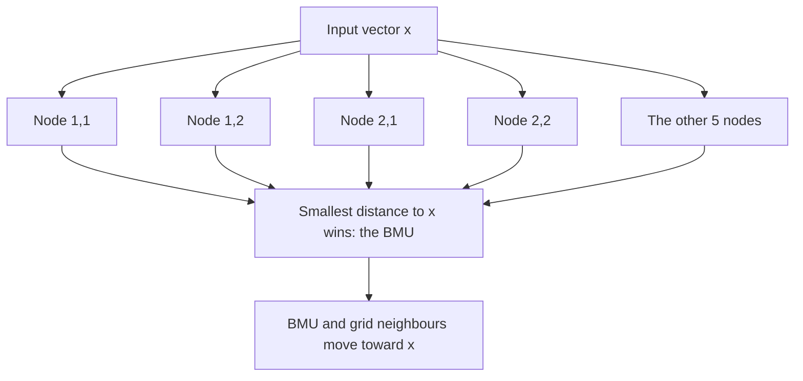

What do you do with data that has no labels and ten columns, when you can't plot ten columns? A Kohonen self-organizing map (SOM) lays out a small grid of nodes, say 3 by 3, and lets the data pull the nodes into place. When it works, inputs that are alike end up landing on nodes that are close together on the grid. Nobody tells the map what the groups are.

By hand, one step of a SOM takes nine distances to find a winner, then four small updates: the winner and its three grid neighbours.

> **Key Takeaways**
> - The best matching unit (BMU) is the node whose weight vector is closest to the input.
> - A node has a fixed place on the grid and a weight vector that learning moves.
> - The update is a weighted average of the old weight and the input.
> - A SOM learns without labels or a loss, so there's nothing to backprop.

## Two spaces, one map

Every node on the grid holds a weight vector with the same length as the input. If the input has 2 numbers, each node holds 2 numbers. A 3 by 3 map on 2D input therefore has $9\times2=18$ weights.

A node lives in two places at once. Its position on the grid, such as row 3, column 2, never changes. Its weight vector is a point in input space, and that is what learning moves. Two nodes are neighbours if their grid positions are close, whatever their weight vectors are doing.

The input is connected to every node. The nodes are not connected to each other.

## One step by hand

Here is a 3 by 3 map, with nodes written as (row, column) and weights as (first number, second number):

| | col 1 | col 2 | col 3 |
|---|---|---|---|
| row 1 | (0.5, 0.2) | (0.1, 0.3) | (0.3, 0.4) |
| row 2 | (0.6, 0.5) | (0.4, 0.2) | (0.7, 0.3) |
| row 3 | (0.8, 0.6) | (0.5, 0.4) | (0.9, 0.7) |

The input is $\mathbf{x}=(0.45,\ 0.35)$. For this example I'll use learning rate $\eta=0.5$ and update the winner plus every node one grid step away. A question will tell you its own settings.

Step 1: distance from the input to every node. For node (1,2), square each difference and add:

$$(0.45-0.1)^2+(0.35-0.3)^2$$

$$=0.1225+0.0025=0.125$$

I'm leaving out the square root. The node with the smallest squared distance also has the smallest distance, so the square root can wait until the end.

| Node | (1,1) | (1,2) | (1,3) | (2,1) | (2,2) | (2,3) | (3,1) | (3,2) | (3,3) |
|---|---|---|---|---|---|---|---|---|---|
| Squared distance | 0.025 | 0.125 | 0.025 | 0.045 | 0.025 | 0.065 | 0.185 | 0.005 | 0.325 |

Step 2: the smallest is 0.005, at node (3,2) with weight (0.5, 0.4). That node is the best matching unit, the BMU. Its real distance is $\sqrt{0.005}\approx0.0707$.

Step 3: find the neighbours. Grid distance here means steps along the grid, rows plus columns, with no diagonals. This is called Manhattan distance, after walking city blocks. The nodes one step from (3,2) are (2,2), (3,1) and (3,3). The BMU is a distance of 0 from itself, so it is updated too.

Step 4: move each of those four nodes halfway to the input, because $\eta=0.5$. Each new weight is $\mathbf{w}+0.5(\mathbf{x}-\mathbf{w})$:

Node (3,2):

$$0.5+0.5(-0.05)=0.475$$

$$0.4+0.5(-0.05)=0.375$$

Node (2,2):

$$0.4+0.5(0.05)=0.425$$

$$0.2+0.5(0.15)=0.275$$

Node (3,1):

$$0.8+0.5(-0.35)=0.625$$

$$0.6+0.5(-0.25)=0.475$$

Node (3,3):

$$0.9+0.5(-0.45)=0.675$$

$$0.7+0.5(-0.35)=0.525$$

The other five nodes keep their weights.

Answer: the BMU is (3,2), and the new weights are (0.475, 0.375), (0.425, 0.275), (0.625, 0.475) and (0.675, 0.525).

A misread weight changes the answer. Suppose you read node (1,2) as (0.4, 0.3) instead of (0.1, 0.3). Its distance becomes $0.0025+0.0025=0.005$, which ties with the real winner, and you now have two BMUs and a different update.

## The general rule

In symbols, the BMU is the node whose weight vector is closest to the input:

$$\text{BMU}=\arg\min_{ij}\ \lVert \mathbf{x}-\mathbf{w}_{ij}\rVert$$

Here $\mathbf{w}_{ij}$ is the weight vector of the node in row $i$, column $j$, and $\arg\min$ means "the node that gives the smallest value". If two nodes tie, pick either. The update for every node is

$$\mathbf{w}_{ij}\leftarrow\mathbf{w}_{ij}+\eta\,h_{ij}\,(\mathbf{x}-\mathbf{w}_{ij})$$

The number $h_{ij}$ is the neighbourhood function: 1 for the BMU, smaller for nodes further away on the grid, and near 0 for nodes far away. In the example above I used the simplest version, $h=1$ for nodes one step away or closer and $h=0$ for the rest. A common smoother choice, described on [Wikipedia's page on self-organizing maps](https://en.wikipedia.org/wiki/Self-organizing_map), is

$$h_{ij}=\exp\!\Big(-\frac{d_{ij}^2}{2\sigma^2}\Big)$$

where $d_{ij}$ is the grid distance from node $(i,j)$ to the BMU and $\sigma$ is the neighbourhood radius. This $\sigma$ has nothing to do with the sigmoid; it only shares a letter. With $\sigma=1$ the values at grid distances 0, 1 and 2 are 1, 0.607 and 0.135.

Check the rule against the example. For the BMU, $d=0$ and $h=1$, and with $\eta h=0.5$ the update becomes $\mathbf{w}+0.5(\mathbf{x}-\mathbf{w})$, which is exactly what we did.

The update is easiest to read if you rewrite it as

$$\mathbf{w}_{\text{new}}=(1-\eta h)\,\mathbf{w}+\eta h\,\mathbf{x}$$

and the new weight is a weighted average of the old weight and the input. With $\eta h=0.5$ the node goes halfway. With $\eta h=0.1$ it takes a tenth of a step. It has the same shape as earlier updates: old weight plus a rate times a gap, where the gap is $\mathbf{x}-\mathbf{w}$.

## Why both numbers shrink

Over training, $\eta$ and $\sigma$ both decay, often as

$$\eta(t)=\eta_0\,e^{-t/\lambda}\qquad\sigma(t)=\sigma_0\,e^{-t/\lambda}$$

where $t$ is the iteration and $\lambda$ sets how fast things shrink. With $\eta_0=0.5$ and $\lambda=100$, the rate is 0.5 at the start and $0.5e^{-1}=0.184$ after 100 steps.

Early on, a large radius pulls whole regions of the map into a rough order. Later, a small radius and a small rate let each node settle on its own patch of the data without being dragged around.

The full routine is: start with random weights; pick an input; find the BMU; update the nodes within the radius; shrink $\eta$ and $\sigma$; repeat until the last iteration.

## How a SOM differs from the networks so far

An ordinary network has layers, labels, a loss, and backprop adjusting weights to reduce that loss. A SOM has one grid and learns from unlabelled inputs. Its learning is competitive (see [competitive learning](https://en.wikipedia.org/wiki/Competitive_learning)): for each input the nodes compete, one wins, and the winner and its neighbours move toward the input. Who counts as a neighbour depends only on grid positions.

On a rectangular grid, Manhattan distance 1 gives at most 4 neighbours, and a hexagonal grid gives 6. If a question doesn't say how to measure grid distance, state your choice in the answer.

## Ties, h and the shrinking radius

Using the same map and $\eta=0.5$, which node is the BMU for $\mathbf{x}=(0.9,\ 0.6)$? If you take (3,3), what is its new weight?

Answer

Node (3,3) has weight (0.9, 0.7), so its squared distance is $0+0.01=0.01$. Node (3,1) has weight (0.8, 0.6), which gives $0.01+0=0.01$. It is a tie, and either is fine. All the other nodes are further away.

For (3,3), $\mathbf{w}+0.5(\mathbf{x}-\mathbf{w})$ is

$$(0.9+0.5(0),\ 0.7+0.5(-0.1))=(0.9,\ 0.65)$$

A node is at grid distance 2 from the BMU and $\sigma=2$. What is $h$?

Answer

$$h=\exp\!\Big(-\frac{2^2}{2\cdot2^2}\Big)=e^{-0.5}\approx0.607$$

Why does the radius shrink during training instead of staying large?

Answer

A large radius drags every node in the region toward each input, which orders the map roughly but blurs it. Shrinking it lets individual nodes fine-tune on their own part of the data.

