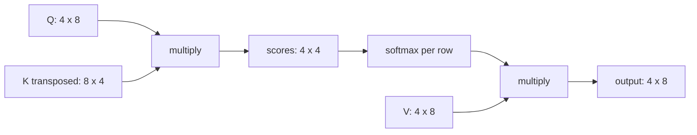
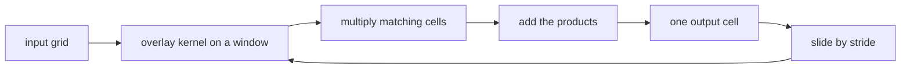

## Quick idea

The Final has no question titled "probability". But the VAE question asks you to find a KL value for $\mu = 3$, $\sigma = 1$, the attention question asks for the shape of a $4 \times 4$ score matrix, and the CNN question asks for the size of a feature map after padding. If any of those pieces is shaky, you lose marks on a topic you actually understand.

So this post collects the five small tools that sit under everything after the midterm: the Gaussian and expectation, logs and KL divergence, convolution as a sliding multiplication, softmax, and matrix shapes. Each one takes about ten minutes to learn. Each one is worth a mark or two in several questions.

The notation table below is the one used in every later post, so skim it now and come back when a symbol looks unfamiliar.

| Symbol | Meaning |
|---|---|
| $x$, $\mathbf{x}$ | input (bold for a vector) |
| $w$, $W$, $b$ | weight, weight matrix, bias |
| $z$, $a = f(z)$ | pre-activation, activation |
| $\eta$ | learning rate |
| $\odot$ | element-wise product |
| $\mu$, $\sigma^2$ | mean and variance (a VAE predicts $\log \sigma^2$) |
| $\varepsilon \sim N(0, I)$ | random noise used in the reparameterization trick |
| $q_\phi(z \mid x)$, $p_\theta(x \mid z)$, $p(z)$ | encoder, decoder, prior |
| $n, k, s, p$ | input size, kernel size, stride, padding |
| $C_{in}$, $C_{out}$ | input channels, number of filters |
| $T$, $d$ | number of tokens, key or embedding width |
| $Q, K, V$ | query, key, value matrices |
| $h_t$, $c_t$ | hidden state, cell state |

## Picture it

Attention is the clearest place where shapes decide the answer. With $T = 4$ tokens and width $d = 8$, the whole computation is a chain of matrix products where the inner sizes must match.

*The edge-detector example: one window, nine products, one output cell of 30 sitting on the bright-to-dark step.*

*Moving the mean by 1 costs 0.5 nats and halving sigma costs 0.318, both measured against N(0, 1).*

## The detail

### Gaussian and expectation

A Gaussian (normal) distribution is a bell curve described by two numbers: the mean $\mu$, which is where the centre sits, and the variance $\sigma^2$, which is how wide it is. Its density is

$$
\mathcal{N}(z;\mu,\sigma^2) = \frac{1}{\sqrt{2\pi\sigma^2}} \, e^{-(z-\mu)^2 / (2\sigma^2)}
$$

The standard normal $N(0,1)$ has $\mu = 0$ and $\sigma^2 = 1$. A VAE pushes every latent code towards this shape.

The expectation $E[g(z)]$ is a probability-weighted average of $g(z)$. For $z \sim N(\mu, \sigma^2)$ you only need three facts:

$$
E[z] = \mu, \qquad E[(z-\mu)^2] = \sigma^2, \qquad E[z^2] = \sigma^2 + \mu^2
$$

The third follows from the second: $E[z^2] = E[(z-\mu)^2] + \mu^2$. These three lines are all the calculus the VAE KL needs.

### Logs, surprise and entropy

Probabilities multiply along a sequence, and a product of many numbers below 1 underflows to zero on a computer. Taking logs turns the product into a sum, which stays well behaved. That is why every loss in the Final is written with $\log$.

The surprise of an event is $-\log P(x)$. A 10% chance of rain gives $\log_2 10 = 3.32$ bits when it rains. A fair coin landing heads gives exactly 1 bit. Rarer means more surprise.

Entropy is the average surprise under the distribution itself:

$$
H(P) = -\sum_i P_i \log P_i
$$

Use $\log_2$ when the answer should be in bits and $\ln$ when it should be in nats. The VAE material uses $\ln$.

### Cross-entropy and KL divergence

Cross-entropy is the average surprise when events really follow $P$ but you score them with $Q$:

$$
H(P,Q) = -\sum_i P_i \log Q_i
$$

KL divergence is the extra cost of using $Q$ in place of $P$:

$$
KL(P \,\|\, Q) = \sum_i P_i \log \frac{P_i}{Q_i} = H(P,Q) - H(P)
$$

It is never negative, it is zero only when $P = Q$, and it is not symmetric. Swapping $P$ and $Q$ gives a different number, which is the most common way to lose a mark here.

Classification loss is a special case. With a one-hot target, every term in $H(P,Q)$ vanishes except the true class, so the loss is $-\ln$ of the probability your network gave to the correct class.

### The Gaussian KL formula, derived

The VAE compares the encoder's Gaussian $q = N(\mu, \sigma^2)$ with the prior $p = N(0, 1)$, in one latent dimension. Start from $KL = E_q[\ln q - \ln p]$. Write both logs:

$$
\ln q = -\tfrac12 \ln 2\pi - \tfrac12 \ln \sigma^2 - \frac{(z-\mu)^2}{2\sigma^2}, \qquad \ln p = -\tfrac12 \ln 2\pi - \frac{z^2}{2}
$$

Subtract. The $\ln 2\pi$ terms cancel:

$$
\ln q - \ln p = -\tfrac12 \ln \sigma^2 - \frac{(z-\mu)^2}{2\sigma^2} + \frac{z^2}{2}
$$

Now take the expectation under $q$ using the three facts. The middle term becomes $\sigma^2 / (2\sigma^2) = \tfrac12$, and the last becomes $\tfrac12(\sigma^2 + \mu^2)$:

$$
KL = -\tfrac12 \ln \sigma^2 - \tfrac12 + \tfrac12(\sigma^2 + \mu^2) = \tfrac12\left(\mu^2 + \sigma^2 - 1 - \ln \sigma^2\right)
$$

With several latent dimensions you add this up over the dimensions. The VAE posts use it directly.

### Convolution as a sliding dot product

In a CNN, "convolution" means this: lay a small grid of weights (the kernel) over a patch of the input, multiply each pair of overlapping cells, add the results, and write that single number into the output. Then slide the kernel along and repeat. Libraries do not flip the kernel first, so strictly this is cross-correlation:

$$
(f \star k)[i,j] = \sum_{u,v} f[i+u,\, j+v]\; k[u,v]
$$

The output size comes from counting positions. After padding the input has $n + 2p$ cells, and the kernel needs $k$ of them, so there are $n + 2p - k$ cells of room to slide. Dividing by the stride $s$ counts the steps, and the starting position adds one:

$$
\text{out} = \left\lfloor \frac{n + 2p - k}{s} \right\rfloor + 1
$$

A conv layer with $C_{out}$ filters of size $k_h \times k_w$ over $C_{in}$ input channels has

$$
C_{out}\,(k_h k_w C_{in} + 1) \text{ parameters}
$$

The $+1$ is one bias per filter. A dense layer from $F$ features to $K$ units has $K(F+1)$.

### Softmax

Softmax turns any list of scores into probabilities:

$$
\text{softmax}(x)_i = \frac{e^{x_i}}{\sum_j e^{x_j}}
$$

Exponentials are positive, and dividing by the total makes the outputs sum to 1. The biggest score gets the biggest share, but nothing is forced to exactly 0 or 1. You need this before cross-entropy because $\ln$ only accepts positive numbers and $P$ must sum to 1 to be a distribution.

### Shapes

A product $(a \times b)(b \times c)$ is legal and gives $a \times c$. The inner sizes must match. For attention, $\text{softmax}(QK^\top / \sqrt{d})\,V$ gives a $T \times T$ score matrix because $Q$ is $T \times d$ and $K^\top$ is $d \times T$. The symbol $\odot$ is different: it multiplies matching cells, so both sides must have the same shape. You will see it in $z = \mu + \sigma \odot \varepsilon$ and in LSTM gates.

## Worked example

Find the KL between $N(\mu, \sigma^2)$ and $N(0,1)$ for a 2-dimensional latent code with $\mu = (3, -1)$ and $\sigma = (1, 1)$.

Dimension 1: $\mu^2 = 9$, $\sigma^2 = 1$, $\ln \sigma^2 = 0$.

$$
KL_1 = \tfrac12 (9 + 1 - 1 - 0) = 4.5
$$

Dimension 2: $\mu^2 = 1$, $\sigma^2 = 1$, $\ln \sigma^2 = 0$.

$$
KL_2 = \tfrac12 (1 + 1 - 1 - 0) = 0.5
$$

Add the dimensions:

$$
KL = 4.5 + 0.5 = \boxed{5}
$$

Two more checks you can run in your head. A code with $\mu = 0$ and $\sigma^2 = 0.25$ gives $\tfrac12(0 + 0.25 - 1 + 1.386) = 0.318$. A code with $\mu = 1$, $\sigma = 1$ gives $\tfrac12(1) = 0.5$.

Now the other numbers you should be able to reproduce.

Softmax of $[2, 1, 0.1]$: the exponentials are $7.389,\ 2.718,\ 1.105$, which sum to $11.212$. The probabilities are $0.659,\ 0.242,\ 0.099$. If the true class is the first, the cross-entropy loss is $-\ln 0.659 = 0.417$.

Convolution on a 1-D input $(1, 2, 0, 1, 3)$ with kernel $(1, 0, -1)$. The three window positions give $1 \cdot 1 + 0 \cdot 2 - 1 \cdot 0 = 1$, then $2 - 1 = 1$, then $0 - 3 = -3$. The output is $(1, 1, -3)$, and the size formula agrees: $\lfloor (5 + 0 - 3)/1 \rfloor + 1 = 3$.

An edge detector. Take a $6 \times 6$ image whose every row is $(10, 10, 10, 0, 0, 0)$ and a $3 \times 3$ kernel whose every row is $(1, 0, -1)$. In the first row of output the four windows give $0,\ 30,\ 30,\ 0$. The nonzero values sit exactly where the bright-to-dark step is. The output is $4 \times 4$ since $(6 - 3)/1 + 1 = 4$.

Discrete KL with $P = (0.7, 0.2, 0.1)$ and $Q = (0.5, 0.3, 0.2)$, in nats. The terms are $0.2355$, $-0.0811$ and $-0.0693$, so $KL = 0.0852$. In bits for $P = (0.5, 0.25, 0.25)$ and $Q = (0.25, 0.5, 0.25)$: $H(P) = 1.5$, $H(P,Q) = 1.75$, so $KL = 0.25$.

## Exam corner

Asked in past exams: this material is never a standalone question in the papers we have. It is the machinery inside numeric questions. Older papers of the Fall 2020 style have a block of 5-mark true/false statements on CNN facts, plus three or four long questions, including conv shape tracing, GRU or LSTM, and parameter sharing. The shape tracing in those leans entirely on the output size formula.

The summary notes for the Final rank the maths in two tiers. Tier 1 is conv output size, KL, attention with softmax, and conv parameter counts. Tier 2 is dense parameter counts, reparameterization, the $T \times T$ shape, global average pooling and receptive field.

Marks come from three steps: write the formula, substitute your numbers, finish the arithmetic. A correct formula with a wrong final number still earns most of the marks, and a bare number with no formula often earns very little.

Common slips:

- Dividing by $\sigma$ instead of $\sigma^2$ inside the KL formula, or forgetting that $\ln \sigma^2$ is zero when $\sigma = 1$.
- Dropping the floor in the output size, or forgetting the $+1$.
- Swapping $P$ and $Q$ in cross-entropy or KL.
- Multiplying matrices whose inner sizes do not match.
- Using $\log_{10}$ when the course uses $\ln$ for nats and $\log_2$ for bits.

Cheat line: $KL = \tfrac12(\mu^2 + \sigma^2 - 1 - \ln \sigma^2)$; out $= \lfloor (n + 2p - k)/s \rfloor + 1$; params $= C_{out}(k_h k_w C_{in} + 1)$; softmax $= e^{x_i} / \sum_j e^{x_j}$; $(a \times b)(b \times c) = a \times c$.

## Check yourself

1. A latent code has $\mu = 0.5$ and $\sigma^2 = 0.8$. What is its KL to $N(0,1)$ in nats?

Answer

$\tfrac12(0.25 + 0.8 - 1 - \ln 0.8) = \tfrac12(0.05 + 0.2231) = 0.1366$.

2. A $28 \times 28$ image goes through a $5 \times 5$ kernel with stride 1 and no padding. What is the output size, and how many parameters does a layer with 16 filters over 3 input channels have?

Answer

Output: $(28 - 5)/1 + 1 = 24$, so $24 \times 24$. Parameters: $16 \times (5 \cdot 5 \cdot 3 + 1) = 16 \times 76 = 1216$.

3. Softmax of $[2, 0]$ gives what, and what is the loss if the true class is the second one?

Answer

Probabilities $(0.8808, 0.1192)$. The loss is $-\ln 0.1192 = 2.127$, which is large because the network backed the wrong class.

## Read more

- [Convolutions for Images, from Dive into Deep Learning](https://d2l.ai/chapter_convolutional-neural-networks/conv-layer.html), for the sliding window with code you can run.
- [CS231n notes on convolutional networks](https://cs231n.github.io/convolutional-networks/), which covers the output size and parameter count formulas.
- [Kullback-Leibler divergence on Wikipedia](https://en.wikipedia.org/wiki/Kullback%E2%80%93Leibler_divergence), for the definition and the properties listed above.

<!-- Reviewer note: the digest's study guide 5x5 conv example could not be verified from text, so it is not used. The 3Blue1Brown Gaussian link returned 404 and was dropped. Exam frequency counts are not given in the digest, so none are stated. Check the 28-to-24 and 16-filter example in Check yourself is a fresh one (computed here, not from the digest). Cheat line and check items 2 recomputed in python: 24 and 1216. -->
