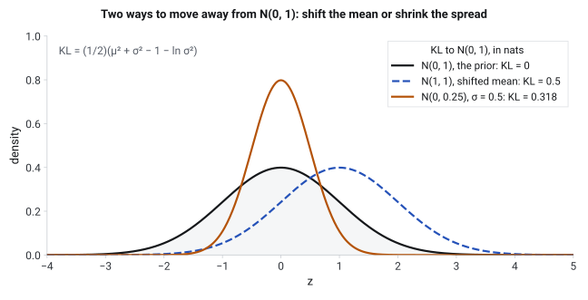
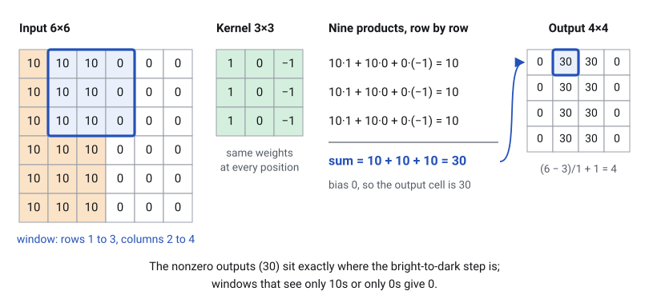

The later Final notes lean on five small pieces of maths: the Gaussian and its average, logs and KL divergence, convolution as a sliding multiplication, softmax, and matrix shapes. A VAE question, for instance, can need the KL for a mean of 3 and a spread of 1, and an attention question the shape of a 4 by 4 score matrix. When one of these pieces is shaky, the topic built on it feels harder than it is.

The note assumes you know $z=\mathbf w\cdot\mathbf x+b$, a sigmoid and a loss from the [Mid series](/blog/cse425-mid-prerequisites/).

> **Key Takeaways**
> - A Gaussian is fixed by its mean and variance, and for it $\mathbb{E}[z^2]=\sigma^2+\mu^2$.
> - KL divergence is the extra surprise from using the wrong distribution; it is never negative, is zero only when the two match, and changes if you swap them.
> - For a Gaussian against $N(0,1)$, $KL=\tfrac12(\mu^2+\sigma^2-1-\ln\sigma^2)$ per dimension.
> - A convolution output has $\lfloor(n+2p-k)/s\rfloor+1$ cells per side, and a conv layer has $C_{out}(k^2C_{in}+1)$ parameters.
> - A product of an $a\times b$ and a $b\times c$ matrix is legal and gives $a\times c$.

## Notation used in this series

The target is $y$, the network's output is $\widehat{y}$ (bold for vectors), and the error is $e=\widehat{y}-y$. A hat always means a prediction. The loss is $L$. A layer's pre-activation (the weighted sum before the activation function) is $z$, and its activation is $a=f(z)$. The learning signal at a neuron is $\delta=\partial L/\partial z$, and a weight moves by $w\leftarrow w-\eta\,\delta\,a$, where $a$ is the activation coming into that weight and $\eta$ is the learning rate.

For sequences, $t$ is the time step, $h$ is the hidden state and $H$ is the hidden size. In attention, $d_{model}$ is the width of a token's vector, $d_k$ the width of a key, $n_h$ the number of heads and $T$ the number of tokens. An average is always written $\mathbb{E}$. Every other symbol is explained in the note where it first appears.

## The Gaussian and its average

Suppose a variable $z$ is 1 half the time and 3 the other half. Its average, weighted by probability, is $\tfrac12(1)+\tfrac12(3)=2$. That weighted average is the expectation, written $\mathbb{E}[z]$.

How far does $z$ sit from its average? Always 1, so the squared distance is always 1, and $\mathbb{E}[(z-2)^2]=1$. This is the variance. Now average $z^2$ itself: $\tfrac12(1)+\tfrac12(9)=5$. And 5 is the variance 1 plus the mean squared, $2^2=4$.

Those three results are the only facts about expectations the VAE notes use. For any variable with mean $\mu$ and variance $\sigma^2$:

$$\mathbb{E}[z]=\mu$$

$$\mathbb{E}[(z-\mu)^2]=\sigma^2$$

$$\mathbb{E}[z^2]=\sigma^2+\mu^2$$

The third follows from the second, because $\mathbb{E}[z^2]=\mathbb{E}[(z-\mu)^2]+\mu^2$. The numbers above fit: $1+4=5$.

A Gaussian (normal) distribution is the bell curve with a given mean $\mu$ and variance $\sigma^2$. Its density is

$$\mathcal{N}(z;\mu,\sigma^2)=\frac{1}{\sqrt{2\pi\sigma^2}}\,e^{-(z-\mu)^2/(2\sigma^2)}$$

At the centre, $z=\mu$, the exponent is 0, so the height is $1/\sqrt{2\pi\sigma^2}$. For the standard normal $N(0,1)$ that is $0.3989$. A VAE pushes every latent code toward this standard shape.

## Logs, surprise and entropy

Probabilities multiply along a sequence, and a product of a few hundred probabilities near 0.1 is too small for a computer to store, so it rounds to 0. Logs turn that product into a sum, which stays a sensible size. That is why every loss in the Final is written with $\log$.

The surprise of an event is $-\log P$, so rarer events surprise more. Rain with a 10 percent chance gives $\log_2 10=3.32$ bits when it happens; a fair coin landing heads gives exactly 1 bit.

Entropy is the average surprise under the distribution itself. For $P=(0.5,\,0.25,\,0.25)$ the first outcome has surprise 1 bit and the other two have 2 bits each:

$$H(P)=0.5(1)+0.25(2)+0.25(2)$$

$$=1.5\text{ bits}$$

In general $H(P)=-\sum_i P_i\log P_i$. Use $\log_2$ for bits and $\ln$ for nats. The VAE notes use $\ln$.

## Cross-entropy and KL divergence

Suppose events really follow $P=(0.5,\,0.25,\,0.25)$, but you score them with a different guess $Q=(0.25,\,0.5,\,0.25)$. The average surprise is now

$$0.5(2)+0.25(1)+0.25(2)=1.75\text{ bits}$$

That is the cross-entropy $H(P,Q)=-\sum_i P_i\log Q_i$. It is 0.25 more than the 1.5 you would pay with the right distribution. That extra is the KL divergence:

$$KL(P\,\|\,Q)=\sum_i P_i\log\frac{P_i}{Q_i}$$

$$=H(P,Q)-H(P)$$

Check with the numbers: $1.75-1.5=0.25$.

KL is never negative and is zero only when $P=Q$. It is not symmetric. With $P=(0.7,\,0.2,\,0.1)$ and $Q=(0.5,\,0.3,\,0.2)$, in nats, the three terms of $KL(P\|Q)$ are $0.2355$, $-0.0811$ and $-0.0693$, which add to $0.0852$. Swapping the roles gives $KL(Q\|P)=0.0920$. A different number, so write which distribution goes first.

Classification loss is a special case. With a one-hot target, every term of $H(P,Q)$ is multiplied by 0 except the true class, so the loss is $-\ln$ of the probability the network gave the correct class.

## Softmax

A network's raw scores can be any numbers. Softmax turns a list of scores into probabilities. For the scores $[2,\,1,\,0.1]$, take $e$ to the power of each:

$$e^{2}=7.389,\quad e^{1}=2.718,\quad e^{0.1}=1.105$$

They add to $11.212$. Dividing each by the total gives $0.659$, $0.242$ and $0.099$. In general

$$\text{softmax}(\mathbf x)_i=\frac{e^{x_i}}{\sum_j e^{x_j}}$$

Exponentials are positive and dividing by the total makes the outputs sum to 1, so they form a distribution. The biggest score gets the biggest share, but nothing is forced to exactly 0 or 1. If the true class is the first one, the cross-entropy loss is $-\ln0.659=0.417$.

## The Gaussian KL formula

The VAE compares the encoder's Gaussian $N(\mu,\sigma^2)$ with the standard $N(0,1)$. The meaning is the same as in the discrete case (see the [KL divergence article](https://en.wikipedia.org/wiki/Kullback%E2%80%93Leibler_divergence) for more): how much extra surprise you pay for describing the data with the standard curve instead. For one latent dimension it works out to

$$KL=\tfrac12\left(\mu^2+\sigma^2-1-\ln\sigma^2\right)$$

[VAE Part 2: ELBO and KL Divergence](/blog/cse425-final-vae-elbo-kl/) derives this line step by step; here it is enough to use it. Three cases test it. With $\mu=1$ and $\sigma=1$, $\ln\sigma^2=0$ and the value is $\tfrac12(1+1-1-0)=0.5$. With $\mu=0$ and $\sigma^2=0.25$ it is $\tfrac12(0+0.25-1+1.386)=0.318$. With $\mu=0$ and $\sigma=1$ it is $0$, as it should be when the two curves match.

With several latent dimensions you add the per-dimension values. A 2-dimensional code with $\mu=(3,\,-1)$ and $\sigma=(1,\,1)$ works like this.

Dimension 1: $\mu^2=9$, $\sigma^2=1$, $\ln\sigma^2=0$.

$$KL_1=\tfrac12(9+1-1-0)=4.5$$

Dimension 2: $\mu^2=1$, $\sigma^2=1$, $\ln\sigma^2=0$.

$$KL_2=\tfrac12(1+1-1-0)=0.5$$

Add them: $KL=4.5+0.5=5$.

Watch the square. The formula takes $\sigma^2$, not $\sigma$. Here both are 1, so nothing changes, but in the $\sigma^2=0.25$ case above, plugging in $\sigma=0.5$ by mistake gives a different answer.

## Convolution as a sliding multiplication

A 1-D input is $(1,\,2,\,0,\,1,\,3)$ and the kernel, a small list of weights, is $(1,\,0,\,-1)$. With the kernel laid over the first three inputs, the pairs are multiplied and added:

$$1\cdot1+0\cdot2+(-1)\cdot0=1$$

Sliding one cell right each time gives the other two windows:

$$1\cdot2+0\cdot0+(-1)\cdot1=1$$

$$1\cdot0+0\cdot1+(-1)\cdot3=-3$$

The output is $(1,\,1,\,-3)$. In symbols, with kernel size $k$, the output at position $i$ is $y[i]=\sum_{u=0}^{k-1}x[i+u]\,w[u]$, and you can check it against the first window above. Libraries do not flip the kernel before sliding, so strictly this is cross-correlation, and everyone still calls it convolution. The [convolution chapter of Dive into Deep Learning](https://d2l.ai/chapter_convolutional-neural-networks/conv-layer.html) has code you can run.

How many outputs? With input length $n$, the kernel needs $k$ cells, so the window can start in $n-k$ places beyond the first. If it jumps $s$ cells at a time (the stride) and $p$ zeros pad each end, then

$$n_{out}=\left\lfloor\frac{n+2p-k}{s}\right\rfloor+1$$

Check: $n=5$, $k=3$, $s=1$, $p=0$ gives $\lfloor 2/1\rfloor+1=3$ outputs, as above. [CNN Basics: Kernels, Stride, Padding](/blog/cse425-final-cnn-basics/) goes through each piece of this formula.

In 2-D the kernel is a small grid. Here is a $6\times6$ image whose every row is $(10,\,10,\,10,\,0,\,0,\,0)$ and a $3\times3$ kernel whose every row is $(1,\,0,\,-1)$. In the first row of output the four windows give $0,\ 30,\ 30,\ 0$. The nonzero values sit exactly where the bright-to-dark step is, and the output is $4\times4$ because $(6-3)/1+1=4$.

A conv layer with $C_{out}$ filters of size $k_h\times k_w$ over $C_{in}$ input channels has $C_{out}(k_hk_wC_{in}+1)$ parameters, one bias per filter. A dense layer from $F$ features to $K$ units has $K(F+1)$. For a $5\times5$ kernel, 3 input channels and 16 filters, that is $16(25\cdot3+1)=1216$.

## Matrix shapes

A product of an $(a\times b)$ matrix and a $(b\times c)$ matrix is legal and has shape $a\times c$. The two inner sizes must match. For example $(4\times8)(8\times4)$ is $4\times4$, and $(4\times8)(4\times8)$ is not allowed.

The transpose $K^\top$ swaps rows and columns, so a $4\times8$ matrix becomes $8\times4$. That is how attention builds its score matrix. With $T=4$ tokens and key width $d_k=8$, the query matrix $Q$ is $4\times8$ and $K^\top$ is $8\times4$. Their product $QK^\top$ is $4\times4$, one score for each pair of tokens. After a softmax on each row, multiplying by $V$ (also $4\times8$) gives a $4\times8$ output. The full formula is in [Attention: Q, K, V](/blog/cse425-final-attention/).

The symbol $\odot$ is different. It multiplies matching cells, so both sides must have the same shape: $(1,\,2)\odot(3,\,4)=(3,\,8)$. You will see it in $\mathbf z=\boldsymbol\mu+\boldsymbol\sigma\odot\boldsymbol\varepsilon$ in the VAE notes and in the LSTM gates.

## Practice on KL, output size and softmax loss

A latent code has $\mu=0.5$ and $\sigma^2=0.8$. What is its KL to $N(0,1)$ in nats?

Answer

$$KL=\tfrac12(0.25+0.8-1-\ln0.8)$$

$$=\tfrac12(0.05+0.2231)=0.1366$$

A $28\times28$ image goes through a $5\times5$ kernel with stride 1 and no padding. What is the output size?

Answer

$$(28-5)/1+1=24$$

The output is $24\times24$.

Softmax of $[2,\,0]$ gives what, and what is the loss if the true class is the second one?

Answer

The probabilities are $(0.8808,\ 0.1192)$. The loss is $-\ln0.1192=2.127$, which is large because the network backed the wrong class.

