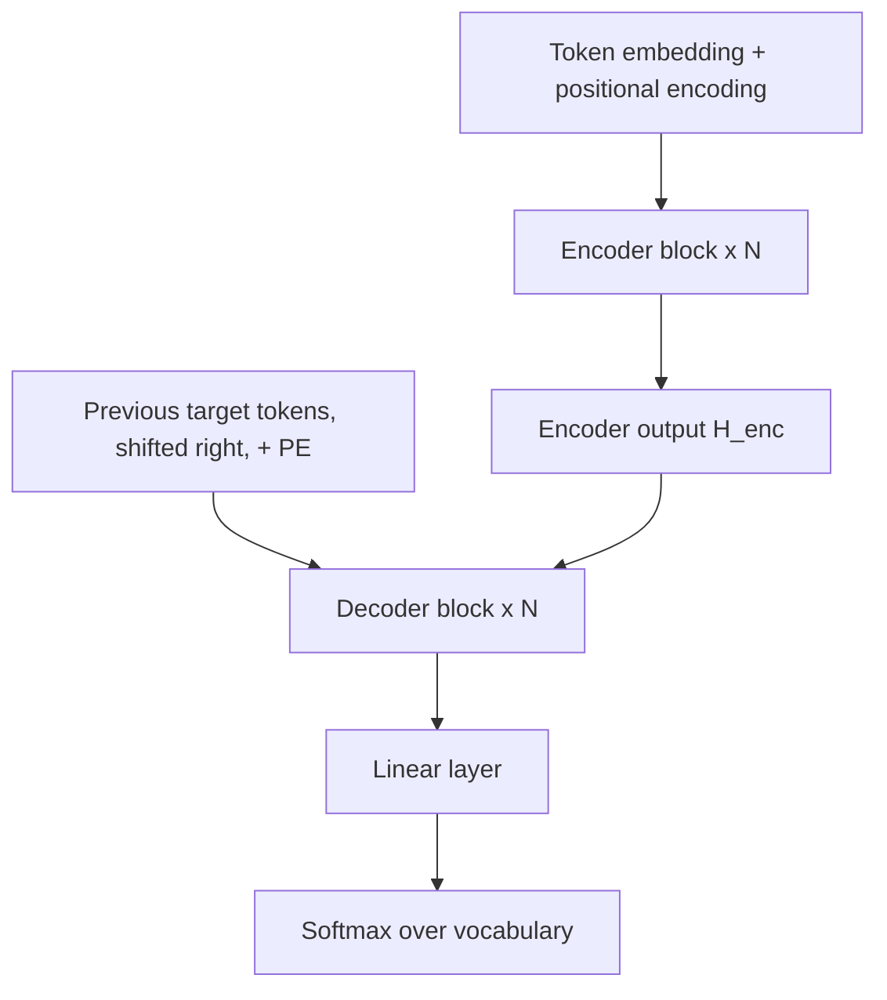
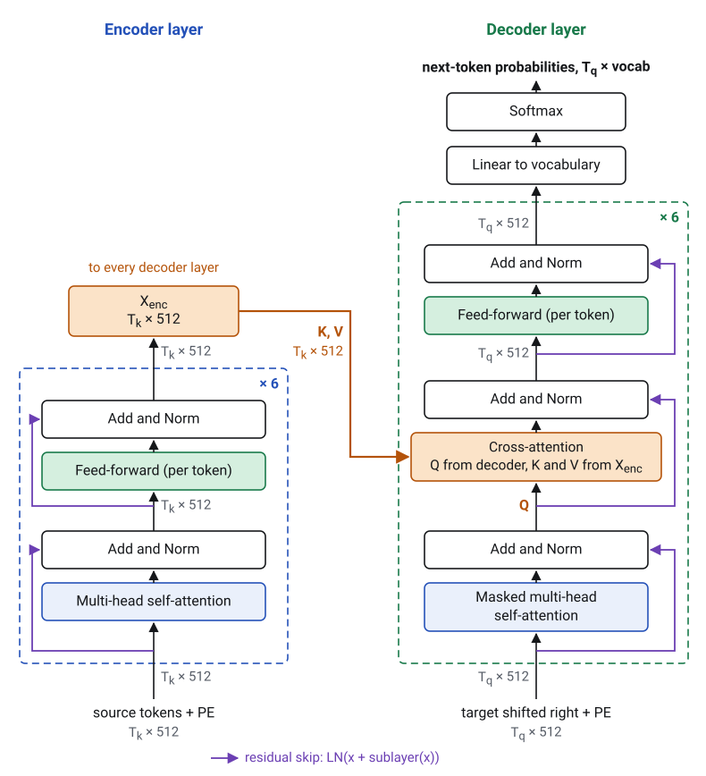

A single attention layer has an odd limitation. Its output for each token is a weighted average of value vectors, so it is a linear mix no matter how sharp the softmax looks. Stack ten of them with nothing in between and you have not added much expressive power.

The Transformer fixes that by wrapping attention in a small repeating block: attention to mix tokens, a feed-forward layer to add the nonlinearity, and a residual connection plus normalisation around each. The original model uses 6 of these blocks as an encoder and 6 as a decoder. Everything in this post is about what sits inside one block and how the blocks connect.

## Picture it

The encoder block has two sublayers and the decoder block has three. The decoder's extra pieces are the mask and the look at the encoder.

*Every sublayer keeps the width at 512 so the residual add works; the encoder output feeds K and V to the cross-attention in all 6 decoder layers.*

## The detail

**Shapes stay fixed.** Every layer takes a $S\times d_{model}$ matrix ($S$ tokens) and returns one of the same shape. That is what lets blocks stack and lets a residual addition make sense. For $S=16$, $d_{model}=512$, $h=8$ heads: $X$ is $16\times512$, each head's $Q,K,V$ is $16\times64$, scores are $8\times16\times16$, per-head outputs $8\times16\times64$, concatenated back to $16\times512$, and $W^O$ keeps it $16\times512$.

**Encoder block.** Self-attention is unmasked, so every token sees every other token.

$$\tilde X=\mathrm{LN}\big(X+\mathrm{MHA}(X,X,X)\big),\qquad X'=\mathrm{LN}\big(\tilde X+\mathrm{FFN}(\tilde X)\big)$$

**Decoder block.** Three sublayers: masked self-attention over the target so far, cross-attention with queries from the decoder and keys and values from $H_{enc}$, then the feed-forward layer.

$$\tilde Y=\mathrm{LN}\big(Y+\mathrm{MHA}_{mask}(Y,Y,Y)\big),\qquad \hat Y=\mathrm{LN}\big(\tilde Y+\mathrm{MHA}_{cross}(\tilde Y,H_{enc},H_{enc})\big)$$

$$Y'=\mathrm{LN}\big(\hat Y+\mathrm{FFN}(\hat Y)\big)$$

**Feed-forward layer.** The same two-layer network is applied to each token separately, with the same weights at every position and no mixing between tokens.

$$\mathrm{FFN}(h)=\max(0,\,hW_1+b_1)\,W_2+b_2$$

Division of labour: attention moves information between tokens, the FFN transforms each token on its own.

**Residual connections.** For $y=x+f(x)$ the gradient is $\partial y/\partial x=1+\partial f/\partial x$. The 1 gives gradients a direct path back through many layers, even when $\partial f/\partial x$ is tiny.

**Layer norm.** It normalises one token across its own $d_{model}$ features, with learned scale $\gamma$ and shift $\beta$, and $\odot$ is element-wise product.

$$\mathrm{LN}(x)=\gamma\odot\frac{x-\mu}{\sqrt{\sigma^2+\epsilon}}+\beta$$

Here $\mu,\sigma^2$ are the mean and variance of that single token's features. Nothing depends on the batch, which suits sentences of different lengths, unlike batch norm from the earlier part of the course. By hand with $\gamma=1$, $\beta=0$, $\epsilon=10^{-5}$: a token plus sublayer sum $[1.5,1.0,3.2,4.8]$ has mean 2.625 and variance 2.2419, giving $[-0.751,-1.085,0.384,1.453]$.

**Output.** After the last decoder block, a linear layer maps each position to vocabulary size and softmax gives next-token probabilities, $P_t=\mathrm{softmax}(Y^{(L)}_tW_o+b_o)$. The loss per position is $-\log P(\text{correct token})$, summed over positions.

**Training versus inference.** The next two points are standard material rather than something the typed course notes spell out. In training, the decoder input is the correct target sequence shifted right by one (teacher forcing). The causal mask stops each position from peeking ahead, so all positions train in parallel. At inference there is no target. Start from a begin token, predict one token, append it, and repeat until the end token. That loop is sequential, which is the cost of generation.

**Counting parameters.** Heads add none: eight heads of width 64 use the same weights as one head of width 512. Multi-head attention has four $d_{model}\times d_{model}$ matrices with biases.

$$4\,(512\cdot512+512)=1{,}050{,}624$$

Feed-forward width $d_{ff}=2048$ is the original paper's choice, so an exam would need to give it. Then the FFN has $512\cdot2048+2048+2048\cdot512+512=2{,}099{,}712$ parameters, and each layer norm has $2\cdot512=1024$.

| Piece | Parameters |
|---|---|
| Encoder layer (1 attention, FFN, 2 norms) | 3,152,384 |
| Decoder layer (2 attentions, FFN, 3 norms) | 4,204,032 |
| 6 encoder layers | 18,914,304 |
| 6 decoder layers | 25,224,192 |
| Both stacks | 44,138,496 |

Embedding tables and the output layer come on top. A vocabulary of 50,000 at width 512 is 25,600,000 for the table alone.

**BERT and GPT.** These keep one half of the Transformer.

| Model | Stack | Attention direction | Training objective | Typical use |
|---|---|---|---|---|
| Transformer | Encoder + decoder | Encoder both ways, decoder causal | Cross-entropy on target tokens | Translation |
| BERT | Encoder only | Both ways | Predict masked tokens | Understanding tasks |
| GPT | Decoder only | Causal | Predict next token | Generation |

BERT base has 12 layers, 12 heads and about 110 million parameters. It learns its position embeddings instead of using fixed sinusoids. In its masked-token task, 15 percent of tokens are picked, and of those 80 percent become a mask symbol, 10 percent a random word and 10 percent stay unchanged. For fine-tuning, the final state of the first token feeds one extra output layer. GPT cannot simply replace BERT for understanding tasks because it only looks left.

*BERT looks both ways, GPT only left, and the original Transformer uses one of each.*

## Worked example

One decoder step, cross-attention then output. Encoder output rows $[1.0,0.5]$ and $[0.3,1.2]$. The current decoder state is $q=[1,1]$. $d_k=2$. Output layer $W_o=\begin{bmatrix}1&0&1\\0&1&-1\end{bmatrix}$ for a three-word vocabulary. To keep the numbers small, take $K=V=H_{enc}$.

Scores: $q\cdot[1.0,0.5]=1.5$ and $q\cdot[0.3,1.2]=1.5$.

Scaled: $1.5/1.4142=1.0607$ for both, so weights $[0.5,\,0.5]$.

Context: $0.5[1.0,0.5]+0.5[0.3,1.2]=[0.65,\,0.85]$.

Logits: $[0.65,\;0.85,\;0.65\cdot1-0.85\cdot1]=[0.65,\;0.85,\;-0.20]$.

Softmax: $e^{0.65}=1.9155$, $e^{0.85}=2.3396$, $e^{-0.20}=0.8187$, sum $5.0738$, so $[0.3775,\;0.4611,\;0.1614]$.

$$\boxed{\text{predicted token = word 2, probability } 0.461}$$

## Exam corner

Asked in past exams: transformers did not appear in any past paper we have. Older finals are CNN, recurrent networks and backprop. The weight here comes from the typed practice set and mock paper, which test: writing multi-head attention, writing the Add and Norm update, naming the sublayers of each block, one benefit each of residuals and layer norm, parallelism versus recurrence, the $T^2$ cost, head-dimension arithmetic, and the shape of $XW^Q$. One study-guide problem asks why GPT is not a drop-in BERT replacement (attention direction).

Marks come from: stating each block's sublayers in order, writing $\mathrm{LN}(x+\mathrm{sublayer}(x))$, showing shapes at each step, and for parameter counts writing the formula before the arithmetic.

Common slips: masking the encoder. Saying layer norm averages across the batch. Thinking the FFN mixes tokens. Taking cross-attention keys and values from the decoder instead of the encoder. Mixing up teacher forcing (training) with the token-by-token loop (inference). Claiming more heads means more parameters.

Cheat line: encoder $=$ self-attn, FFN. Decoder $=$ masked self-attn, cross-attn, FFN. Each wrapped as $\mathrm{LN}(x+f(x))$.

## Check yourself

1. Why must every sublayer output have the same width as its input?

Answer
The residual adds the input to the output, which needs matching shapes. It also lets identical blocks stack.

2. In the decoder's cross-attention, which sequence supplies $Q$ and which supplies $K$ and $V$?

Answer
$Q$ comes from the decoder, $K$ and $V$ from the encoder output.

3. With $d_{model}=512$, how many parameters does multi-head attention have with biases, and does it change from 1 head to 8?

Answer
$4(512^2+512)=1{,}050{,}624$. It does not change, because heads split the width rather than add to it.

## Read more

- [The Illustrated Transformer by Jay Alammar](https://jalammar.github.io/illustrated-transformer/), the encoder and decoder walked through with pictures.
- [Attention Is All You Need on arXiv](https://arxiv.org/abs/1706.03762), the original architecture.
- [BERT paper on arXiv](https://arxiv.org/abs/1810.04805), for the masked-token objective and the encoder-only design.

<!-- Reviewer note: training, teacher forcing and the feed-forward width 2048 are not in the typed course sources; flagged in the text as standard or from the original paper. Digest flagged errors in student decks (GPT-3 "combines encoding and decoding", 470x parameter claim, slide softmax rounding) and they were not used. Worked example uses K=V=H_enc and the classroom-rounded input embedding was avoided. Zero past papers cover this topic. -->
