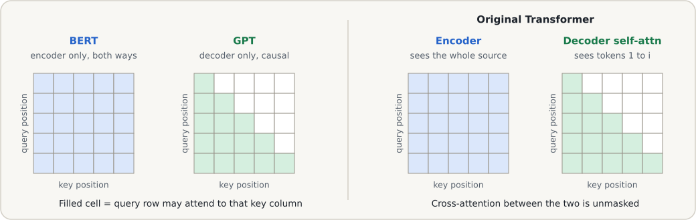

A common first picture of a Transformer is a tall stack of attention layers and nothing else. Attention on its own only averages: each token's output is a weighted average of value vectors. The only ReLU in a block sits in a small feed-forward layer that works on each token's own vector, and the rest of the block (residual connections and normalisation) is there to make deep stacks trainable.

The original model uses 6 blocks as an encoder and 6 as a decoder. Most of this note is the inside of one block; BERT and GPT come at the end, since each keeps only one half. It assumes [Attention: Q, K, V](/blog/cse425-final-attention/), where queries, keys and values and the mask were built up from numbers. To keep symbols few, $T_k$ is the number of source tokens and $T_q$ the number of target tokens, the same names as in cross-attention, and $n_h$ is the number of heads.

> **Key Takeaways**
> - An encoder block has two sublayers (self-attention, feed-forward) and a decoder block has three (masked self-attention, cross-attention, feed-forward).
> - Every sublayer is wrapped as LN(x + sublayer(x)), so its output must have the same width as its input.
> - Attention moves information between tokens, and the feed-forward layer transforms each token on its own with the same weights at every position.
> - Heads add no parameters: 8 heads of width 64 use as many weights as one head of width 512.
> - BERT keeps the encoder and looks both ways, GPT keeps the decoder and looks only left.

## The shape of a block

Every layer takes a matrix with one row per token and returns a matrix of the same shape. With $T=16$ tokens, $d_{model}=512$ and $n_h=8$ heads, $X$ is $16\times512$. Each head's $Q$, $K$ and $V$ is $16\times64$ (since $512/8=64$), the scores are $8$ matrices of size $16\times16$, the per-head outputs are $8$ matrices of $16\times64$, concatenating them gives $16\times512$ again, and $W^O$ keeps it $16\times512$. Same shape out as in, which is why you can put another block on top.

The encoder block has two sublayers and the decoder block has three. The decoder's extra pieces are the mask and the look at the encoder.

## The feed-forward layer, with numbers

The feed-forward layer is a small two-layer network applied to each token's vector separately. Say one token is $x=[1,2]$, with a first weight matrix that widens it from 2 to 3 numbers and a second that brings it back to 2 (biases 0 here):

$$W_1=\begin{bmatrix}1&0&-1\\1&1&0\end{bmatrix}$$

$$xW_1=[1+2,\ 0+2,\ -1+0]=[3,\ 2,\ -1]$$

ReLU, which turns any negative number into 0, gives $[3,2,0]$. Then

$$W_2=\begin{bmatrix}1&0\\0&1\\1&1\end{bmatrix}$$

$$[3,2,0]\,W_2=[3,\ 2]$$

In symbols, for a token vector $x$:

$$\mathrm{FFN}(x)=\max(0,\,xW_1+b_1)\,W_2+b_2$$

The same $W_1$, $W_2$ are used for every token, and no token sees another here. In the original model $d_{model}=512$ is widened to $d_{ff}=2048$ and back. Attention is the only step where tokens mix.

## Residual connections and layer norm

A residual connection adds a layer's input to its output, $y=x+f(x)$. With $x=[1,2]$ and $f(x)=[0.1,-0.2]$, the result is $[1.1,1.8]$. The gradient shows why this helps: $\partial y/\partial x=I+\partial f/\partial x$, with $I$ the identity matrix. The $I$ gives gradients a direct path back through many layers, even when $\partial f/\partial x$ is tiny. It also means $f(x)$ must have the same width as $x$.

Layer norm then rescales each token. It is like [batch norm](/blog/cse425-mid-batch-norm/), but the mean and spread are taken over one token's own $d_{model}$ numbers, not over a batch, so a token's result doesn't depend on which other sentences share its batch or how long they are. Say a token plus sublayer sum is $[1.5,\ 1.0,\ 3.2,\ 4.8]$, with $\gamma=1$, $\beta=0$ and $\epsilon=10^{-5}$:

$$\mu=\frac{1.5+1.0+3.2+4.8}{4}=2.625$$

$$\sigma^2=\frac{1.125^2+1.625^2+0.575^2+2.175^2}{4}$$

$$=2.2419$$

$$\frac{x-\mu}{\sqrt{\sigma^2+\epsilon}}=[-0.751,\ -1.085,\ 0.384,\ 1.453]$$

The general form, with learned scale $\gamma$ and shift $\beta$ and $\odot$ for entry-by-entry multiplication:

$$\mathrm{LN}(x)=\gamma\odot\frac{x-\mu}{\sqrt{\sigma^2+\epsilon}}+\beta$$

Here $\mu$ and $\sigma^2$ are the mean and variance of that single token's features, as computed above.

## The encoder and decoder blocks

The encoder block's self-attention is unmasked, so every token sees every other token. Writing $X'$ for the output of the first sublayer and $X_{out}$ for the block's output:

$$X'=\mathrm{LN}\big(X+\mathrm{MHA}(X,X,X)\big)$$

$$X_{out}=\mathrm{LN}\big(X'+\mathrm{FFN}(X')\big)$$

The decoder block has three sublayers: masked self-attention over the target so far, cross-attention with queries from the decoder and keys and values from the encoder output $X_{enc}$, then the feed-forward layer. Each sublayer's output gets one more prime:

$$Y'=\mathrm{LN}\big(Y+\mathrm{MHA}_{mask}(Y,Y,Y)\big)$$

$$Y^{\prime\prime}=\mathrm{LN}\big(Y'+\mathrm{MHA}_{cross}(Y',X_{enc},X_{enc})\big)$$

$$Y_{out}=\mathrm{LN}\big(Y^{\prime\prime}+\mathrm{FFN}(Y^{\prime\prime})\big)$$

The encoder output feeds the keys and values of the cross-attention in every one of the 6 decoder blocks.

## One decoder step by hand

Suppose the encoder has produced two source vectors, the rows of $X_{enc}$: $[1.0,\ 0.5]$ and $[0.3,\ 1.2]$. The decoder's current vector is the query $q=[1,3]$, and $d_k=2$. To keep the numbers small, the example uses $K=V=X_{enc}$ (no projection matrices) and one head. A score is a dot product:

$$q\cdot[1.0,0.5]=1+1.5=2.5$$

$$q\cdot[0.3,1.2]=0.3+3.6=3.9$$

Dividing by $\sqrt{d_k}=1.4142$ gives $[1.7678,\ 2.7577]$. Softmax: $e^{1.7678}=5.858$ and $e^{2.7577}=15.764$, total $21.622$, so the weights are $[0.2709,\ 0.7291]$. Nearly three quarters of the weight goes to the second source vector, the one with the bigger score. The context is the weighted sum of the rows:

$$0.2709[1.0,0.5]+0.7291[0.3,1.2]$$

$$=[0.2709+0.2187,\ 0.1355+0.8749]$$

$$=[0.4896,\ 1.0104]$$

Now the output layer. In a real decoder block the context would still go through $W^O$, Add and Norm and the feed-forward layer first; here it goes straight to the output layer to keep the arithmetic short. Suppose the vocabulary has three words and the output matrix is

$$W_{vocab}=\begin{bmatrix}1&0&1\\0&1&-1\end{bmatrix}$$

The logits (raw scores, one per word) are the context times $W_{vocab}$:

$$[0.4896,\ 1.0104,\ 0.4896-1.0104]$$

$$=[0.4896,\ 1.0104,\ -0.5208]$$

Softmax: $e^{0.4896}=1.6316$, $e^{1.0104}=2.7467$, $e^{-0.5208}=0.5940$, total $4.9724$, so the probabilities are $[0.3281,\ 0.5524,\ 0.1195]$. The predicted token is word 2, with probability 0.552. If word 2 were the correct token, the loss for this position would be $-\ln0.5524=0.593$.

## The output layer, in general

After the last decoder block, a linear layer maps each position to the vocabulary size and softmax gives next-token probabilities:

$$P_t=\mathrm{softmax}(Y_{out,t}\,W_{vocab}+b)$$

The loss at position $t$ is $-\log P_t(\text{correct token})$, as computed above, summed over positions. The example had one position with word 2 as the correct token, so its loss was 0.593.

## Training and generating

In training, the decoder input is the correct target sequence shifted right by one, the same idea as teacher forcing in the [RNN note](/blog/cse425-mid-rnn-basics/). The causal mask stops each position from seeing the tokens after it, so all positions can be trained in parallel. At generation time there is no target. The model starts from a begin token, predicts one token, appends it and repeats until an end token. Each new token waits for the one before it, so this part can't be done in parallel.

## Counting parameters

Heads add none: eight heads of width 64 use the same weights as one head of width 512. Multi-head attention has four $d_{model}\times d_{model}$ matrices ($W^Q$, $W^K$, $W^V$ and $W^O$) with biases:

$$4\,(512\cdot512+512)=1{,}050{,}624$$

The feed-forward width $d_{ff}=2048$ is the original paper's choice and doesn't follow from $d_{model}$, so state it before using it. The feed-forward layer has two weight matrices and two bias vectors:

$$512\cdot2048+2048$$

$$+\,2048\cdot512+512=2{,}099{,}712$$

Each layer norm has $2\cdot512=1024$ (a $\gamma$ and a $\beta$ per feature).

| Piece | Parameters |
|---|---|
| Encoder layer (1 attention, FFN, 2 norms) | 3,152,384 |
| Decoder layer (2 attentions, FFN, 3 norms) | 4,204,032 |
| 6 encoder layers | 18,914,304 |
| 6 decoder layers | 25,224,192 |
| Both stacks | 44,138,496 |

Embedding tables and the output layer come on top. A vocabulary of 50,000 at width 512 is 25,600,000 for the table alone.

## BERT and GPT

| Model | Stack | Attention | Trained to |
|---|---|---|---|
| Transformer | Encoder + decoder | Encoder both ways, decoder causal | Predict target tokens (translation) |
| BERT | Encoder | Both ways | Predict masked tokens, plus next-sentence prediction |
| GPT | Decoder | Causal, left only | Predict the next token |

BERT base has 12 layers, 12 heads and about 110 million parameters. It learns its position embeddings instead of using fixed sinusoids. In its masked-token task, 15 percent of tokens are picked, and of those 80 percent become a mask symbol, 10 percent a random word and 10 percent stay unchanged. For fine-tuning on a classification task, the final state of the first token (a special [CLS] token) feeds one extra output layer. BERT is used for understanding tasks such as classification; GPT is used for generation. GPT reads only leftwards, so for a task that needs the whole sentence at once it sees less of the context than BERT does.

For a visual walk-through see [The Illustrated Transformer](https://jalammar.github.io/illustrated-transformer/), and for the original design [Attention Is All You Need](https://arxiv.org/abs/1706.03762). The [BERT paper](https://arxiv.org/abs/1810.04805) has the masked-token objective and the encoder-only design.

## Writing the answer

A good answer lists each block's sublayers in order, writes $\mathrm{LN}(x+\mathrm{sublayer}(x))$, and shows shapes at each step. For parameter counts, write the formula before the arithmetic. Other things worth being able to explain: the benefit of residuals and of layer norm, parallelism against recurrence, the $T^2$ cost of attention, and head-width arithmetic such as $d_{model}=768$ with $n_h=12$ giving $d_k=64$.

## Questions on the block

Why must every sublayer output have the same width as its input?

Answer

The residual adds the input to the output, which needs matching shapes. It also lets identical blocks stack.

In the decoder's cross-attention, which sequence supplies $Q$ and which supplies $K$ and $V$?

Answer

$Q$ comes from the decoder, $K$ and $V$ from the encoder output $X_{enc}$.

With $d_{model}=512$, how many parameters does multi-head attention have with biases, and does it change from 1 head to 8?

Answer

$4(512^2+512)=1{,}050{,}624$. It does not change, because heads split the width rather than add to it.

Using the decoder step above, the query changes to $q=[3,1]$. Which source vector gets the bigger weight?

Answer

The scores are $q\cdot[1.0,0.5]=3.5$ and $q\cdot[0.3,1.2]=2.1$, so the first source vector wins (weights $[0.7291,\ 0.2709]$ after scaling and softmax, by the same arithmetic as before with the two scores swapped).

