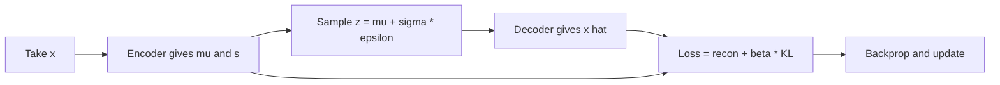
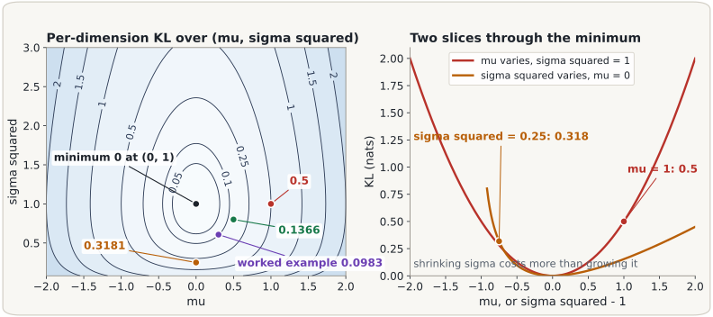

## Quick idea

Set the KL term in a VAE's loss to zero and you have trained an ordinary autoencoder with some noise on top. The clouds shrink to dots, drift apart, and the space between them goes back to being useless for generation. Turn the KL weight up too far and the opposite happens: every input gets the same cloud, the decoder ignores $z$, and every output is a blurry average.

The loss is a tug of war between two terms. One says "reconstruct $x$ well". The other says "keep each cloud close to a standard normal". The balance is the whole design. This post gives the loss its name (the ELBO), shows where it comes from, and then does the arithmetic that exams actually test: the KL between two Gaussians in closed form.

## Picture it

*KL is zero only at mu 0, sigma squared 1, and shrinking the variance gets expensive faster than growing it.*

## The detail

Why not maximise $\log p_\theta(x)$ directly. The model's likelihood is

$$p_\theta(x)=\int p_\theta(x|z)\,p(z)\,dz$$

and with a neural-network decoder this integral has no closed form. So we add the encoder $q_\phi(z|x)$ as a stand-in for the true posterior $p_\theta(z|x)$ and work with a quantity we can compute.

The identity. Since $\log p_\theta(x)$ does not depend on $z$, write it as an average over $q$:

$$\log p_\theta(x)=\mathbb E_{q}\!\left[\log\frac{p_\theta(x,z)}{p_\theta(z|x)}\right]$$

Multiply and divide by $q_\phi(z|x)$ inside the log and split it into two expectations:

$$\log p_\theta(x)=\underbrace{\mathbb E_{q}\!\left[\log\frac{p_\theta(x,z)}{q_\phi(z|x)}\right]}_{\mathrm{ELBO}}+KL\big(q_\phi(z|x)\,\|\,p_\theta(z|x)\big)$$

KL is never negative, so $\log p_\theta(x)\ge\mathrm{ELBO}$. The ELBO (evidence lower bound) is a floor under the thing we want. Because $\log p_\theta(x)$ is fixed for a given model, pushing the ELBO up squeezes the gap, which is the KL to the true posterior.

The trainable form. Expand the joint as $p_\theta(x|z)\,p(z)$:

$$\mathrm{ELBO}=\mathbb E_{q_\phi(z|x)}\big[\log p_\theta(x|z)\big]-KL\big(q_\phi(z|x)\,\|\,p(z)\big)$$

The first term is reconstruction quality. The second is the distance from the encoder's cloud to the prior $N(0,I)$.

This is the most common trap in the topic. There are two different KLs. The one in the identity compares $q$ with the true posterior $p_\theta(z|x)$, and you cannot compute it. The one in the trainable ELBO compares $q$ with the prior $p(z)$, and for Gaussians it has a closed form. Write the second one when asked for the loss.

Reconstruction term. For pixels in $[0,1]$ with a Bernoulli decoder:

$$\log p_\theta(x|z)=\sum_i\big[x_i\ln\hat x_i+(1-x_i)\ln(1-\hat x_i)\big]$$

With a Gaussian decoder of fixed variance it reduces to a negative squared error, so you use MSE. In both cases the sum runs over the pixels, and one sampled $z$ stands in for the expectation. The loss to minimise is

$$L=L_{recon}+\beta\,KL$$

with $L_{recon}$ the negative log-likelihood, and $\beta=1$ in the plain VAE. Average $L$ over the mini-batch, not sum.

Closed form of the KL. Take one latent dimension, $q=N(\mu,\sigma^2)$ and $p=N(0,1)$.

$$KL=\mathbb E_q[\ln q(z)-\ln p(z)]$$

$$\ln q(z)=-\tfrac12\ln(2\pi)-\tfrac12\ln\sigma^2-\frac{(z-\mu)^2}{2\sigma^2},\qquad \ln p(z)=-\tfrac12\ln(2\pi)-\frac{z^2}{2}$$

The $\ln2\pi$ terms cancel. What is left:

$$\ln q-\ln p=-\tfrac12\ln\sigma^2-\frac{(z-\mu)^2}{2\sigma^2}+\frac{z^2}{2}$$

Now take the expectation under $q$ using $\mathbb E[(z-\mu)^2]=\sigma^2$ and $\mathbb E[z^2]=\sigma^2+\mu^2$:

$$KL=-\tfrac12\ln\sigma^2-\tfrac12+\tfrac12(\sigma^2+\mu^2)=\tfrac12\big(\mu^2+\sigma^2-1-\ln\sigma^2\big)$$

For a diagonal Gaussian the latent dimensions are independent, so there are no cross terms and you sum this over the $K$ dimensions. If the encoder gives $s=\ln\sigma^2$, each dimension is $\tfrac12(\mu^2+e^{s}-1-s)$. Do not take a log of $s$.

Three shortcuts save time. With $\sigma=1$, $KL=\tfrac12\sum\mu_i^2$. With $\mu=0$, $KL=\tfrac12\sum(\sigma_i^2-1-\ln\sigma_i^2)$. With $\mu=0$ and $\sigma=1$ it is exactly 0.

## Worked example

One input $x=(1,0)$. The encoder gives $\mu=0.3$, $s=-0.5$ with a one-dimensional latent. The decoder, run on the sampled $z$, returns $\hat x=(0.7,0.4)$. Use the Bernoulli reconstruction and $\beta=1$. Natural logs throughout.

Reconstruction log-likelihood:

$$\ln p(x|z)=1\cdot\ln0.7+(1-0)\ln(1-0.4)=\ln0.7+\ln0.6=-0.3567-0.5108=-0.8675$$

KL, with $\sigma^2=e^{-0.5}=0.6065$:

$$KL=\tfrac12\big(0.09+0.6065-1-(-0.5)\big)=\tfrac12(0.1965)=0.0983$$

ELBO and loss:

$$\mathrm{ELBO}=-0.8675-0.0983=-0.9658,\qquad L=0.9658$$

$$\boxed{KL=0.0983,\quad \mathrm{ELBO}=-0.9658,\quad L=0.9658}$$

Now a quick multi-dimension KL, since that is the other common form. Take $\mu=(0,1)$ and $\sigma=(1,2)$. The first dimension is the prior itself, so it contributes 0. The second gives $\tfrac12(1+4-1-\ln4)=\tfrac12(4-1.3863)=1.3069$. Total $KL=1.3069$.

And a check on why the second dimension of $(\mu=(0.5,-1,0.2),\ \sigma=(1.2,0.5,0.8))$ dominates: the three terms are $0.1627$, $0.8181$ and $0.0631$, total $1.0440$. A narrow $\sigma=0.5$ and a shifted $\mu=-1$ both cost.

## Exam corner

Asked in past exams: VAE did not appear in any of the past papers we have. Those lean on CNN, recurrent networks, backprop and separability. The weight for this topic comes from the typed prep set, the mock paper and the practice questions. The mock paper has a 6-mark question asking you to derive the Gaussian KL and a 7-mark question combining a sampled $z$ with a KL value. The practice set has about 25 VAE items, mostly numeric KL.

Forms to expect: compute KL for given $\mu$ and $\sigma$ (or $s$); write the ELBO and label both terms; derive the closed form; explain what happens when the KL weight is 0 or very large; explain why the loss uses $KL(q\|p(z))$ and not the posterior; say what each part of the VAE is used for after training.

Marks come from: writing the closed-form formula first, substituting per dimension, summing the dimensions, and stating the final value with the right sign and units (nats). For the derivation, graders look for the $\ln 2\pi$ cancellation and for the two expectation facts, $\mathbb E[(z-\mu)^2]=\sigma^2$ and $\mathbb E[z^2]=\sigma^2+\mu^2$.

Common slips: swapping the two KLs; taking a log of $s$ when $s$ is already a log-variance; dropping the $\tfrac12$; omitting the $-1$ or counting $\mu^2$ twice; dividing by $\sigma$ when the formula uses $\sigma^2$; summing instead of averaging over the batch; claiming KL can be negative (it cannot, though a sampled estimate of it can dip below zero).

Cheat line: $KL=\tfrac12\sum(\mu^2+\sigma^2-1-\ln\sigma^2)$, $\ \mathrm{ELBO}=\mathbb E_q[\ln p(x|z)]-KL(q\|p(z))$, $\ L=L_{recon}+\beta KL$.

## Check yourself

1. $\mu=(3,-1)$, $\sigma=(1,1)$. What is the KL to $N(0,I)$?

Answer

With $\sigma=1$ the shortcut gives $\tfrac12(9+1)=5$.

2. What does the encoder learn if the KL weight is 0, and if it is very large?

Answer

At 0 you get a plain autoencoder: tight, separated clouds and poor samples from the prior. Very large gives posterior collapse: $q$ matches the prior for every $x$, so the decoder ignores $z$ and outputs a blurry generic image.

3. A single pixel has $x=1$. Compare the reconstruction loss for $\hat x=0.9$ and $\hat x=0.1$.

Answer

$-\ln0.9=0.1054$ and $-\ln0.1=2.3026$. A confident wrong pixel costs about 22 times more.

## Read more

- [Auto-Encoding Variational Bayes](https://arxiv.org/abs/1312.6114), the paper where the ELBO and the Gaussian KL appear.
- [Evidence lower bound on Wikipedia](https://en.wikipedia.org/wiki/Evidence_lower_bound), for the derivation by both routes.
- [From Autoencoder to Beta-VAE](https://lilianweng.github.io/posts/2018-08-12-vae/), including how changing $\beta$ changes the latent space.
