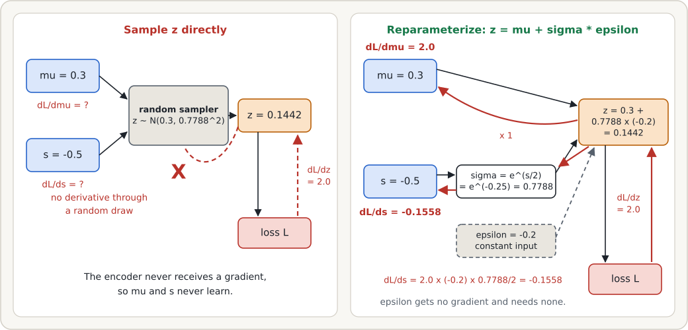

## Quick idea

Feed a plain autoencoder a picture of a 7 and it hands back one exact point in latent space. Pick a point between two such codes and the decoder often produces garbage, because nothing ever trained it on the gaps.

A variational autoencoder fixes this by making the encoder describe a small cloud instead of a point. For each input the encoder outputs a centre $\mu$ and a spread, and the code you pass to the decoder is a random draw from that cloud. Train on enough clouds that overlap and the gaps fill in. You can then throw away the encoder, draw $z$ from a standard normal, and the decoder generates something new.

The catch is the random draw. A random draw has no derivative, so backprop stalls at it. The reparameterization trick is the fix, and it is the part of the VAE that gets asked as a numeric.

## Picture it

*Every solid edge carries gradient back to the encoder; only the noise input, which has no weights, is cut off.*

*Same z, same loss gradient; only the reparameterized version can pass dL/dmu = 2.0 and dL/ds = -0.1558 back to the encoder.*

## The detail

Notation follows the series table: encoder $q_\phi(z|x)$, decoder $p_\theta(x|z)$, prior $p(z)=N(0,I)$, $\odot$ for element-wise product.

Two heads. Say the latent vector has $K$ dimensions. The encoder body ends in two separate layers. One outputs $\mu\in\mathbb R^K$. The other outputs $s=\log\sigma^2\in\mathbb R^K$. So the encoder emits $2K$ numbers per input, and the cloud it describes is a Gaussian with a diagonal covariance: each latent dimension has its own mean and its own variance, and dimensions are independent.

Why log-variance. A variance must be positive. A layer's raw output can be any real number, including negative ones. If the network predicted $\sigma^2$ directly you would need a constraint or a clamp. Predicting $s$ removes the problem, because

$$\sigma=e^{s/2}$$

is positive for every real $s$. A raw output of $0$ means $\sigma=1$, which is exactly the prior's spread, so a freshly initialised encoder starts near a sensible cloud. Keep the half in the exponent: $\sigma^2=e^s$, so $\sigma=e^{s/2}$.

The sampling problem. The decoder needs one concrete $z$. The obvious step is "draw $z\sim N(\mu,\sigma^2)$". But then $z$ is the output of a random number generator. Ask for $\partial z/\partial\mu$ and there is no function to differentiate, so no gradient reaches the encoder and it never learns.

The trick. Pull the randomness out into a variable that has no parameters. Draw $\varepsilon\sim N(0,I)$ and compute

$$z=\mu+\sigma\odot\varepsilon$$

$z$ has exactly the distribution $N(\mu,\sigma^2)$, because scaling a standard normal by $\sigma$ and shifting by $\mu$ gives that Gaussian. But now $z$ is an ordinary function of $\mu$ and $\sigma$, with $\varepsilon$ treated as a number that was handed in.

The gradients are then simple:

$$\frac{\partial z}{\partial\mu}=1,\qquad \frac{\partial z}{\partial\sigma}=\varepsilon,\qquad \frac{\partial z}{\partial s}=\varepsilon\cdot\frac{\sigma}{2}$$

The last one is the chain rule through $\sigma=e^{s/2}$, where $\partial\sigma/\partial s=\sigma/2$. Nothing flows back into $\varepsilon$, since it has no weights. It is sampled once per forward pass and held fixed during the backward pass.

After training. The same network gets used three ways. To embed an input, run the encoder and keep $\mu$. To generate, skip the encoder, draw $z\sim N(0,I)$, and run only the decoder. To reconstruct or interpolate between two inputs, use both. The encoder is scaffolding for training the generator.

What makes generation work is the prior. The loss (Part 2) pulls every cloud toward $N(0,I)$, so a draw from $N(0,I)$ lands somewhere the decoder has seen.

## Worked example

Encoder outputs for one input: $\mu=0.3$, $s=-0.5$. The noise draw is $\varepsilon=-0.2$.

Step 1, the spread: $\sigma=e^{s/2}=e^{-0.25}=0.7788$.

Step 2, the sample: $z=0.3+0.7788\times(-0.2)=0.3-0.1558=0.1442$.

Now suppose backprop delivers $\partial L/\partial z=2.0$ from the decoder. Then:

$$\frac{\partial L}{\partial\mu}=2.0\times1=2.0$$

$$\frac{\partial L}{\partial s}=2.0\times\varepsilon\frac{\sigma}{2}=2.0\times(-0.2)(0.3894)=-0.1558$$

$$\boxed{z=0.1442,\quad \partial L/\partial\mu=2.0,\quad \partial L/\partial s=-0.1558}$$

A two-dimensional check: $\mu=(0.5,-0.5)$, $s=(0,0)$, $\varepsilon=(1,-1)$. Both $\sigma$ values are $e^0=1$, so $z=(0.5+1,\,-0.5-1)=(1.5,-1.5)$.

## Exam corner

Asked in past exams: VAE did not appear in any of the past papers we have. Those papers lean on CNN shapes, GRU and LSTM, backprop and separability. The weight for this topic comes from the typed prep set, the mock paper and the practice questions. The mock paper has a 7-mark question that combines a reparameterization numeric with a KL calculation, and the practice set has roughly two dozen VAE items. VAE and KL rank among the top five maths areas for the Final in the typed prep material.

Question forms to expect: compute $z$ from given $\mu$, $s$, $\varepsilon$; explain why the encoder predicts $\log\sigma^2$; explain why sampling blocks backprop and how the trick fixes it; say what you keep after training for embedding versus generation.

Marks come from: writing $\sigma=e^{s/2}$ as its own step, writing $z=\mu+\sigma\odot\varepsilon$ before substituting, and stating that $\varepsilon$ carries the randomness and has no parameters.

Common slips: using $\sigma=e^{s}$ and forgetting the half; treating $s$ as $\sigma^2$ and multiplying $\varepsilon$ by $s$ directly; saying $\varepsilon$ is learned; saying the decoder is dropped after training when it is the encoder that is dropped for generation.

Cheat line: $\sigma=e^{s/2},\quad z=\mu+\sigma\odot\varepsilon,\quad \varepsilon\sim N(0,I)$, and the encoder emits $2K$ numbers for $K$ latent dimensions.

## Check yourself

1. $\mu=0.5$, $s=-1.2$, $\varepsilon=1$. What is $z$?

Answer

$\sigma=e^{-0.6}=0.5488$, so $z=0.5+0.5488=1.0488$.

2. Why can't backprop pass through "draw $z$ from $N(\mu,\sigma^2)$" directly?

Answer

A random draw is not a differentiable function of $\mu$ and $\sigma$, so there is no $\partial z/\partial\mu$ to pass back. Writing $z=\mu+\sigma\varepsilon$ moves the randomness into $\varepsilon$, which needs no gradient.

3. A latent space has $K=16$ dimensions. How many numbers does the encoder's last stage output per input?

Answer

32: 16 means and 16 log-variances.

## Read more

- [Auto-Encoding Variational Bayes](https://arxiv.org/abs/1312.6114), the original paper that introduced the trick.
- [From Autoencoder to Beta-VAE](https://lilianweng.github.io/posts/2018-08-12-vae/), a blog walk-through of the encoder, sampling and loss.
- [Variational autoencoder on Wikipedia](https://en.wikipedia.org/wiki/Variational_autoencoder), for definitions and the reparameterization section.
