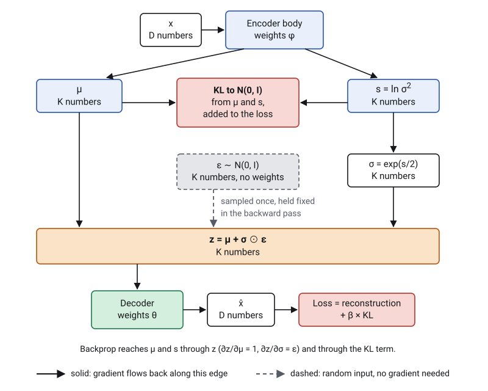

A variational autoencoder (VAE) is an autoencoder whose encoder describes a small cloud of possible codes instead of a single point, and whose decoder is trained on random draws from that cloud. The draw is what makes generation possible, and it is also what makes training awkward, because a random draw has no derivative. The reparameterisation trick gets around this by moving the randomness into a separate noise variable.

> **Key Takeaways**
>
> - The encoder outputs a mean $\mu$ and a log-variance $s=\ln\sigma^2$ per latent dimension, so $2K$ numbers for $K$ dimensions.
> - The spread is $\sigma=e^{s/2}$, positive for every real $s$, and $s=0$ means $\sigma=1$.
> - The sample is $\mathbf z=\boldsymbol\mu+\boldsymbol\sigma\odot\boldsymbol\varepsilon$ with $\boldsymbol\varepsilon\sim N(0,I)$; gradients reach $\mu$ and $s$ but not $\varepsilon$.
> - After training, generation needs only the decoder, fed with draws from $N(0,I)$.

## From a point to a cloud

A plain [autoencoder](/blog/cse425-final-autoencoders/) hands back one exact point in code space for a picture of a 7. Pick a point between two such codes and the decoder often produces garbage, because nothing ever trained it on the gaps.

A VAE makes the encoder describe a cloud. For each input it outputs a centre $\boldsymbol\mu$ and a spread, and the code passed to the decoder is a random draw from that cloud. Train on enough clouds that overlap and the gaps fill in. You can then drop the encoder, draw $\mathbf z$ from a standard normal, and the decoder generates something new.

In symbols, the encoder is written $q_\phi(\mathbf z|\mathbf x)$: the distribution over codes $\mathbf z$ for an input $\mathbf x$, where $\phi$ stands for the encoder's weights. The decoder is $p_\theta(\mathbf x|\mathbf z)$, the distribution over images for a code, with weights $\theta$. The prior $p(\mathbf z)=N(0,I)$ is the standard bell curve in every dimension, where $I$ is the identity matrix: every dimension has variance 1 and the dimensions are independent.

## What the encoder outputs

Say the code has $K$ dimensions. The body of the encoder ends in two separate layers. One outputs the means $\boldsymbol\mu\in\mathbb R^K$. The other outputs $\mathbf s=\ln\boldsymbol\sigma^2\in\mathbb R^K$, one log-variance per dimension. The encoder therefore emits $2K$ numbers per input. Each dimension has its own mean and its own variance, and the dimensions are independent (a diagonal covariance).

Why predict the log of the variance and not the variance? A variance must be positive, but the raw output of a layer can be any real number, negative ones included. Predicting $s$ gets around that, because

$$\sigma=e^{s/2}$$

is positive whatever $s$ is. Keep the half in the exponent: $\sigma^2=e^{s}$, so $\sigma=e^{s/2}$. An output of $s=0$ means $\sigma=1$, exactly the prior's spread, so an encoder whose log-variance layer starts out giving values near 0 starts with clouds about as wide as the prior. As a number, $s=-0.5$ gives $\sigma^2=e^{-0.5}=0.6065$ and $\sigma=e^{-0.25}=0.7788$.

## One sample, with gradients

Suppose the encoder gives $\mu=0.3$ and $s=-0.5$ for one latent dimension, and the noise draw is $\varepsilon=-0.2$.

Step 1, the spread: $\sigma=e^{s/2}=e^{-0.25}=0.7788$.

Step 2, the sample: the noise is scaled by the spread and shifted by the centre.

$$z=0.3+0.7788\times(-0.2)$$

$$=0.3-0.1558=0.1442$$

Now suppose backprop delivers $\partial L/\partial z=2.0$ from the decoder, meaning the loss rises by 2 for each unit that $z$ rises. How much of that belongs to $\mu$ and to $s$? Moving $\mu$ by 1 moves $z$ by 1, so

$$\frac{\partial L}{\partial\mu}=2.0\times1=2.0$$

Moving $s$ changes $\sigma$, which changes $z$ by $\varepsilon$ times that change. Since $\sigma=e^{s/2}$, the slope of $\sigma$ with respect to $s$ is $\sigma/2=0.3894$. Chaining the three links:

$$\frac{\partial L}{\partial s}=2.0\times(-0.2)\times0.3894=-0.1558$$

## The rule behind the numbers

The obvious way to get $z$ is "draw $z$ from $N(\mu,\sigma^2)$". But then $z$ comes straight out of a random number generator. Ask for $\partial z/\partial\mu$ and there is no function to differentiate, so no gradient reaches the encoder and it never learns.

The reparameterisation trick, from [Auto-Encoding Variational Bayes](https://arxiv.org/abs/1312.6114), pulls the randomness out into a variable with no parameters. It draws $\boldsymbol\varepsilon\sim N(0,I)$, a standard normal in every dimension, and computes

$$\mathbf z=\boldsymbol\mu+\boldsymbol\sigma\odot\boldsymbol\varepsilon$$

Here $\odot$ multiplies matching entries. Scaling a standard normal by $\sigma$ and shifting it by $\mu$ gives a bell curve centred at $\mu$ with spread $\sigma$, so $\mathbf z$ still has the distribution $N(\boldsymbol\mu,\boldsymbol\sigma^2)$. But now $\mathbf z$ is an ordinary function of $\boldsymbol\mu$ and $\boldsymbol\sigma$, with $\boldsymbol\varepsilon$ treated as a number that was handed in.

The gradients for one dimension are

$$\frac{\partial z}{\partial\mu}=1,\qquad\frac{\partial z}{\partial\sigma}=\varepsilon,\qquad\frac{\partial z}{\partial s}=\varepsilon\cdot\frac{\sigma}{2}$$

The last is the chain rule through $\sigma=e^{s/2}$. These agree with the numbers above: $1$, then $-0.2\times0.3894=-0.0779$ per unit of loss gradient, which times 2.0 gives $-0.1558$. Nothing flows back into $\varepsilon$, since it has no weights. It is drawn once per forward pass and held fixed in the backward pass.

For two latent dimensions, $\boldsymbol\mu=(0.5,\,-0.5)$, $\mathbf s=(0,\,0)$ and $\boldsymbol\varepsilon=(1,\,-1)$ give $\sigma=e^0=1$ in both, so $\mathbf z=(0.5+1,\ -0.5-1)=(1.5,\ -1.5)$.

## After training

Once trained, the two halves can be used apart. To embed an input you only need the encoder, and $\boldsymbol\mu$ is its code. Generating needs only the decoder, fed with $\mathbf z$ drawn from $N(0,I)$. Rebuilding an input uses both, and so does blending two inputs by decoding points between their codes.

Generation only works because of the prior: the loss ([VAE loss by hand: ELBO and the Gaussian KL derivation](/blog/cse425-final-vae-elbo-kl/)) pulls every cloud towards $N(0,I)$, so a draw from $N(0,I)$ lands somewhere the decoder has seen. [From Autoencoder to Beta-VAE](https://lilianweng.github.io/posts/2018-08-12-vae/) walks through the encoder, the sampling and the loss in one place.

## Practice: sampling

$\mu=0.5$, $s=-1.2$, $\varepsilon=1$. What is $z$?

Answer

$$\sigma=e^{-0.6}=0.5488$$

$$z=0.5+0.5488\cdot1=1.0488$$

Why can't backprop pass through "draw $z$ from $N(\mu,\sigma^2)$" directly?

Answer

A random draw is not a differentiable function of $\mu$ and $\sigma$, so there is no $\partial z/\partial\mu$ to pass back. Writing $z=\mu+\sigma\varepsilon$ moves the randomness into $\varepsilon$, which needs no gradient.

A latent space has $K=16$ dimensions. How many numbers does the encoder's last stage output per input?

Answer

32, which is 16 means and 16 log-variances.

