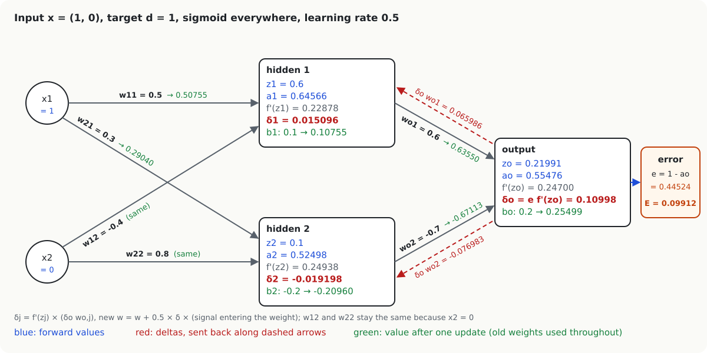

A hidden neuron gets no target from the training data, so it cannot measure its own error directly. It finds out from the neurons it feeds. Those do know how far off they were, and each one reports back through the weight that connects them.

Below, that report becomes a rule, and then one complete training step runs on a small network. It picks up from [the output layer](/blog/cse425-mid-backprop-output-layer/), which defined the delta and found it for the last layer.

> **Key Takeaways**
> - A hidden neuron's delta is $\delta_j=f'(z_j)\sum_k\delta_k\,w_{kj}$, summed over the neurons it feeds.
> - Deltas run from the last layer back to the first, and weights update only after all of them are known.
> - A weight whose incoming signal is 0 does not move in that step.
> - Comparing backprop's gradient with a finite-difference nudge catches sign and index mistakes.

## The forward pass

The network has 2 inputs, 2 hidden neurons and 1 output, with a sigmoid on every neuron. The input is $\mathbf x=(1,0)$, the target is $y=1$ and $\eta=0.5$. The weights are

| Neuron | weights from its inputs | bias |
|---|---|---|
| hidden 1 | $w_{11}=0.5,\ w_{12}=-0.4$ | $b_1=0.1$ |
| hidden 2 | $w_{21}=0.3,\ w_{22}=0.8$ | $b_2=-0.2$ |
| output | $w_{o1}=0.6,\ w_{o2}=-0.7$ | $b_o=0.2$ |

Here $w_{ji}$ goes from input $i$ into hidden neuron $j$, and $w_{o1}$ and $w_{o2}$ come from the two hidden neurons. The forward pass computes and stores every pre-activation $z$ and every output $a=f(z)$:

$$z_1=0.5(1)-0.4(0)+0.1=0.6$$

$$a_1=0.64566$$

$$z_2=0.3(1)+0.8(0)-0.2=0.1$$

$$a_2=0.52498$$

$$z_o=0.6(0.64566)-0.7(0.52498)+0.2$$

$$=0.21991$$

$$\widehat{y}=a_o=0.55476$$

The error is $e=\widehat{y}-y=0.55476-1=-0.44524$ and the loss is $L=\tfrac12(0.44524)^2=0.09912$. This is the same output neuron as in the previous note, so its delta is already known:

$$\delta_o=e\,f'(z_o)=-0.44524\times0.24700$$

$$=-0.10998$$

## Passing the delta back

The delta of a neuron is $\delta=\partial L/\partial z$, the change in loss per unit nudge of that neuron's weighted sum. For the hidden neurons we need a value of it without a target. Suppose the output $a_1$ of hidden neuron 1 is nudged upward. Its only route to the loss is through the output neuron: $z_o$ moves by $w_{o1}$ times the nudge, and $z_o$ moves the loss by $\delta_o$ per unit. Together that changes the loss by

$$\delta_o\,w_{o1}=-0.10998\times0.6=-0.06599$$

per unit nudge of $a_1$. A numerical test agrees: raising $a_1$ by 0.001 changes the loss by $-0.0000660$. That covers the step from $a_1$ to the loss. The step from $z_1$ to $a_1$ is the neuron's own slope, $f'(z_1)=0.64566(1-0.64566)$ $=0.22878$, so

$$\delta_1=0.22878\times(-0.06599)=-0.015096$$

Hidden neuron 2 works the same way through its weight $w_{o2}=-0.7$ and its slope $f'(z_2)=0.52498(1-0.52498)$ $=0.24938$:

$$\delta_2=0.24938\times(-0.10998\times(-0.7))$$

$$=0.019198$$

The two hidden neurons get opposite signs because their weights into the output have opposite signs.

Now the general rule. Let neuron $j$ feed several neurons $k$ in the next layer, through weights $w_{kj}$ (the first index is the destination). The loss depends on $a_j$ along every one of those routes, and the routes add:

$$\frac{\partial L}{\partial a_j}=\sum_k\frac{\partial L}{\partial z_k}\cdot\frac{\partial z_k}{\partial a_j}$$

Each $z_k=\sum_{j'} w_{kj'}a_{j'}+b_k$ contains $a_j$ in one term only, so $\partial z_k/\partial a_j=w_{kj}$. The first factor is the delta of neuron $k$. Then the slope of $f$ converts a nudge of $a_j$ into a nudge of $z_j$:

$$\delta_j=f'(z_j)\sum_k\delta_k\,w_{kj}$$

With one output neuron the sum has a single term, which is the calculation above. The update has the same form as before, with $a_i$ the signal that enters the weight (for the first hidden layer, that is the network input $x_i$):

$$w_{ji}\leftarrow w_{ji}-\eta\,\delta_j\,a_i$$

$$b_j\leftarrow b_j-\eta\,\delta_j$$

The formula repeats down the stack. In a four-layer chain with layers named $m\to p\to q\to k$, you compute $\delta_k=e_k\,f'(z_k)$, then $\delta_q=f'(z_q)\sum_k\delta_kw_{kq}$, then $\delta_p=f'(z_p)\sum_q\delta_qw_{qp}$, then $\delta_m=f'(z_m)\sum_p\delta_pw_{pm}$. Each line needs the one before it. If a neuron connects to only some neurons of the next layer, sum over those only. Some course papers write $d$, $v$ and $\varphi$ for the target, pre-activation and activation function, and define $\delta$ as $-\partial E/\partial z$ with the error taken as target minus output. Every delta in those papers has the opposite sign to the ones here, and the updates come out the same. The [CS231n notes on backpropagation](https://cs231n.github.io/optimization-2/) show the same flow of gradients through small circuits, and [d2l.ai](https://d2l.ai/chapter_multilayer-perceptrons/backprop.html) gives the one-hidden-layer derivation in matrix form.

## The updates

Training has two phases. The forward pass computes and stores every $z$ and $a$. The backward pass computes all the deltas, and only then do you update. Every update uses the old weights, because an early update would change a $w_{kj}$ that a later delta still needs.

With $\eta=0.5$:

| Update | New value |
|---|---|
| $w_{o1}=0.6-0.5(-0.10998)(0.64566)$ | 0.63550 |
| $w_{o2}=-0.7-0.5(-0.10998)(0.52498)$ | −0.67113 |
| $b_o=0.2-0.5(-0.10998)$ | 0.25499 |
| $w_{11}=0.5-0.5(-0.015096)(1)$ | 0.50755 |
| $w_{12}$: input is 0, so no change | −0.4 |
| $b_1=0.1-0.5(-0.015096)$ | 0.10755 |
| $w_{21}=0.3-0.5(0.019198)(1)$ | 0.29040 |
| $w_{22}$: input is 0, so no change | 0.8 |
| $b_2=-0.2-0.5(0.019198)$ | −0.20960 |

A weight on an input of 0 never moves in this step, because its gradient $\delta\,a$ is multiplied by that 0.

## Checking the step

Run the forward pass again with the new weights. The output becomes $\widehat{y}=0.57893$ and the loss $0.08865$, down from $0.09912$. The prediction moved towards 1.

That shows the step went downhill, but not that the gradients were right. For that, use finite differences: nudge one weight by $\pm10^{-6}$, recompute $L$, and divide the change by $2\times10^{-6}$. This gives $\partial L/\partial w_{o1}=-0.071007$ and $\partial L/\partial w_{11}=-0.015096$. Backprop gives $\delta_o\,a_1=-0.10998(0.64566)=-0.071007$ and $\delta_1\,x_1=-0.015096$. They agree to the digits shown. A flipped sign or a swapped index in the backward pass would make the two numbers differ.

## Practice: hidden deltas

A hidden neuron feeds two outputs whose deltas are $-0.2$ and $0.1$, through weights $0.5$ and $0.4$. Its own output is $a=0.5$. What is its delta?

Answer

The sum is $(-0.2)(0.5)+(0.1)(0.4)=-0.06$. The slope is $0.5(1-0.5)=0.25$.

$$\delta=0.25\times(-0.06)=-0.015$$

In the worked example, why do $w_{12}$ and $w_{22}$ stay put?

Answer

Their incoming signal is $x_2=0$, and the change is $-\eta\,\delta\,x_2=0$.

Why is the order of computing deltas fixed, and why update only after all deltas are ready?

Answer

$\delta_j$ needs the deltas of the next layer, so you go from the output back. Updating early would change a $w_{kj}$ that a later delta still needs.

