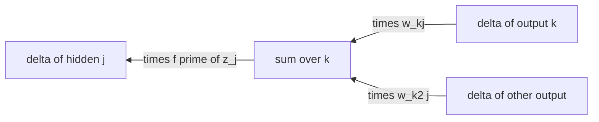

## Quick idea

A hidden neuron has no target, so it has no error of its own. The only way to know whether it helped or hurt is to ask the neurons it feeds. Each of them reports its delta, scaled by the weight that connects them, and the hidden neuron adds those reports up.

A concrete case: a hidden neuron sends weight $+0.6$ to an output whose delta is $0.11$. It gets $0.066$ of blame from that output. If it also fed a second output with weight $-0.7$ and delta $0.11$, it would get $-0.077$ from that one, and the two partly cancel. Then its own slope scales the total. That is the entire recursion.

## Picture it

Deltas are computed from the last layer to the first, because each layer needs the one after it.

## The detail

Same notation as Part 1: $z$ weighted sum, $a=f(z)$, $e_k=d_k-a_k$, $E=\tfrac12\sum_k e_k^2$, $\delta=-\partial E/\partial z$, $w_{kj}$ from neuron $j$ to neuron $k$. The sum index $k$ runs over the neurons in the next layer that neuron $j$ feeds.

Derivation of the hidden delta, every step.

Step 1. Apply the definition and split off the activation:

$$\delta_j=-\frac{\partial E}{\partial z_j}=-\frac{\partial E}{\partial a_j}\,f'(z_j)$$

Step 2. The output $a_j$ feeds several neurons $k$, so the loss depends on it along several paths. The sum stays:

$$\frac{\partial E}{\partial a_j}=\sum_k e_k\frac{\partial e_k}{\partial a_j}$$

Step 3. Each $e_k=d_k-f(z_k)$ with $z_k=\sum_j w_{kj}a_j+b_k$. Only the term $w_{kj}a_j$ depends on $a_j$, so

$$\frac{\partial e_k}{\partial a_j}=\frac{\partial e_k}{\partial z_k}\frac{\partial z_k}{\partial a_j}=-f'(z_k)\,w_{kj}$$

Step 4. Substitute and use $\delta_k=e_kf'(z_k)$ from Part 1:

$$-\frac{\partial E}{\partial a_j}=\sum_k e_kf'(z_k)w_{kj}=\sum_k\delta_k w_{kj}$$

Step 5. Put it back in Step 1:

$$\boxed{\delta_j=f'(z_j)\sum_k\delta_k\,w_{kj}}$$

The update is unchanged: $\Delta w_{ji}=\eta\,\delta_j\,a_i$ and $\Delta b_j=\eta\delta_j$, where $a_i$ is the signal entering $w_{ji}$. For the first hidden layer, $a_i$ is the network input $x_i$.

The formula repeats down the stack. For a four-layer chain with layers $m\to p\to h\to f$, the exam version is $\delta_f=e_ff'(z_f)$, then $\delta_h=f'(z_h)\sum_f\delta_fw_{fh}$, then $\delta_p=f'(z_p)\sum_h\delta_hw_{hp}$, then $\delta_m=f'(z_m)\sum_p\delta_pw_{pm}$. You cannot get $\delta_m$ without the three before it. If a neuron connects to only some neurons of the next layer, sum over those only.

A printing quirk in some papers writes the output as $y_f=\varphi'(v_f)$. The output is $\varphi(v_f)$, and $\varphi'$ is its slope. Treat $f$ as the same function in every layer.

Training is two phases. The forward pass computes and stores every $z$ and $a$. The backward pass computes all deltas, and only then do you update. Every update uses the old weights.

## Worked example

Network 2-2-1, sigmoid everywhere, $\eta=0.5$, input $\mathbf x=(1,0)$, target $d=1$.

| Neuron | weights from inputs or hidden | bias |
|---|---|---|
| hidden 1 | $w_{11}=0.5,\ w_{12}=-0.4$ | $b_1=0.1$ |
| hidden 2 | $w_{21}=0.3,\ w_{22}=0.8$ | $b_2=-0.2$ |
| output | $w_{o1}=0.6,\ w_{o2}=-0.7$ | $b_o=0.2$ |

*One training step: the output delta 0.10998 travels back through wo1 = 0.6 and wo2 = -0.7, and each hidden unit scales it by its own slope.*

Forward pass.

$$z_1=0.5(1)-0.4(0)+0.1=0.6,\quad a_1=f(0.6)=0.64566$$

$$z_2=0.3(1)+0.8(0)-0.2=0.1,\quad a_2=f(0.1)=0.52498$$

$$z_o=0.6(0.64566)-0.7(0.52498)+0.2=0.21991,\quad a_o=0.55476$$

Error $e=1-0.55476=0.44524$ and $E=\tfrac12(0.44524)^2=0.09912$.

Backward pass. Slopes come from stored outputs: $f'(z_o)=0.55476(0.44524)=0.24700$, $f'(z_1)=0.64566(0.35434)=0.22878$, $f'(z_2)=0.52498(0.47502)=0.24938$.

$$\delta_o=0.44524\times0.24700=0.10998$$

$$\delta_1=0.22878\times(0.10998\times0.6)=0.015096$$

$$\delta_2=0.24938\times(0.10998\times(-0.7))=-0.019198$$

Updates with $\eta=0.5$, using the old weights throughout:

| Weight | Rule | New value |
|---|---|---|
| $w_{o1}$ | $0.6+0.5(0.10998)(0.64566)$ | 0.63550 |
| $w_{o2}$ | $-0.7+0.5(0.10998)(0.52498)$ | $-0.67113$ |
| $b_o$ | $0.2+0.5(0.10998)$ | 0.25499 |
| $w_{11}$ | $0.5+0.5(0.015096)(1)$ | 0.50755 |
| $w_{12}$ | input is 0, so $\Delta=0$ | $-0.4$ |
| $b_1$ | $0.1+0.5(0.015096)$ | 0.10755 |
| $w_{21}$ | $0.3+0.5(-0.019198)(1)$ | 0.29040 |
| $w_{22}$ | input is 0, so $\Delta=0$ | 0.8 |
| $b_2$ | $-0.2+0.5(-0.019198)$ | $-0.20960$ |

A weight on an input of 0 never moves in this step. Its blame is real, but the signal that would carry it is zero.

Check by forward pass with the new weights: $a_o=0.57893$ and $E=0.08865$, down from $0.09912$. The prediction moved towards 1.

Check by finite differences. Nudge one weight by $\pm10^{-6}$, recompute $E$, and divide the change by $2\times10^{-6}$. This gives $\partial E/\partial w_{o1}=-0.071007$ and $\partial E/\partial w_{11}=-0.015096$. Backprop gives $-\delta_oa_1=-0.10998(0.64566)=-0.071007$ and $-\delta_1x_1=-0.015096$. They agree to the digits shown, which is how you catch a sign or index slip.

$$\boxed{\delta_o=0.10998,\ \delta_1=0.015096,\ \delta_2=-0.019198,\ E:\ 0.09912\to0.08865}$$

## Exam corner

Asked in past exams. Two forms. First, the "compute the local induced gradient for the first layer of a four-layer network" question, with $z=\sum wa$, $e=d-a$ and $E=\tfrac12\sum e^2$ given: it appeared in 2 distinct quiz sittings. Second, a Fall 2021 Mid question showing the signal-flow graph that returns $\delta_j f'(z_j)$ from the next layer's deltas through $w_{1j},w_{kj},w_{mj}$, asking which direction it flows and when it occurs (the backward pass, after the forward pass). That is about 3 appearances in 2 semesters of papers. No numeric 2-2-1 question turned up in past Mids, but numeric 2-2-2 questions are in the practice material, so the example above is worth redoing from scratch.

Marks come from: stating what $\delta$ means, the chain rule steps, the sum over $k$ with the factor $w_{kj}$, the hidden neuron's own $f'$, the final formula, and correct layer indices.

Common slips: dropping the sum; writing $w_{jk}$ for $w_{kj}$; forgetting the hidden neuron's $f'$; using $y-d$ so the update runs the wrong way (a sign slip in $\partial e/\partial a$ showed up in one student script); updating before all deltas are done.

Formula cheat line: $\delta_k=e_kf'(z_k)$, $\delta_j=f'(z_j)\sum_k\delta_kw_{kj}$, $\Delta w_{ji}=\eta\delta_ja_i$, $f'=a(1-a)$.

## Check yourself

A hidden neuron feeds two outputs with $\delta=0.2$ and $\delta=-0.1$ through weights $0.5$ and $0.4$. Its $a=0.5$. What is its delta?

Answer

Sum $=0.2(0.5)+(-0.1)(0.4)=0.06$. Slope $=0.5(0.5)=0.25$. So $\delta=0.015$.

In the worked example, why do $w_{12}$ and $w_{22}$ stay put?

Answer

Their incoming signal is $x_2=0$, and $\Delta w=\eta\delta x_2=0$.

Why is the order of computing deltas fixed, and why update only after all deltas are ready?

Answer

$\delta_j$ needs the deltas of the next layer, so you go from output back. Updating early would change a $w_{kj}$ that a later delta still needs.

## Read more

- [CS231n notes on backpropagation and the chain rule](https://cs231n.github.io/optimization-2/) for gradient flow through gates.
- [D2L: Forward propagation, backward propagation and computational graphs](https://d2l.ai/chapter_multilayer-perceptrons/backprop.html) for the one-hidden-layer derivation in matrix form.
- [3Blue1Brown: What is backpropagation really doing?](https://www.3blue1brown.com/lessons/backpropagation) for the intuition behind the sums over next-layer neurons.

<!-- Reviewer: digest had no numeric past-Mid 2-2-1 question, so the example is a new one. Nielsen's backprop chapter failed a certificate check on fetch and was dropped. -->
