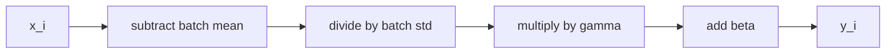

## Quick idea

Take a layer whose pre-activations in one batch are 2, 4, 6, 8. Feed 80 and 90 into a sigmoid and the output is stuck near 1 with a gradient near 0. Learning stalls, and the only cure is a tiny learning rate. As earlier layers change during training, the numbers reaching later layers keep moving, so every layer is chasing a target that shifts.

Batch normalization fixes the scale of what each layer sees. For every feature, it subtracts the batch mean and divides by the batch standard deviation. Then it lets the network re-introduce a scale $\gamma$ and shift $\beta$ if it wants them. You get larger safe learning rates and less sensitivity to weight initialization.

## Picture it

Training and test use the same last two steps but get the mean and variance from different places.

![Two columns: training normalizes the batch [2, 4, 6, 8] with its own mean 5 and variance 5 and updates running averages; test normalizes a single input 6 with the stored averages; both use gamma 1.2 and beta 0.3](img/batch-norm-bn-train-test-flow.svg)

*Training uses the batch's own mean and variance and updates the running averages. Test reuses those stored averages with the same gamma and beta.*

## The detail

Notation follows the series: $z=w\cdot x+b$ and $a=f(z)$. Batch norm acts on one feature at a time across a mini-batch of $m$ values $x_1,\dots,x_m$. Here $x_i$ is that feature's value for sample $i$, typically the pre-activation $z$.

$$\mu_B=\frac1m\sum_{i=1}^m x_i,\qquad \sigma_B^2=\frac1m\sum_{i=1}^m (x_i-\mu_B)^2$$

Note the divisor $m$, not $m-1$. Then standardize and rescale:

$$\hat x_i=\frac{x_i-\mu_B}{\sqrt{\sigma_B^2+\epsilon}},\qquad y_i=\gamma\,\hat x_i+\beta$$

The small constant $\epsilon$ (about $10^{-5}$) stops a division by zero when every value in the batch is equal. Many problems set $\epsilon=0$. If a question says nothing, keep $\epsilon$ in the formula and state that you drop it for the arithmetic.

Why add $\gamma$ and $\beta$ at all? Standardized values always have mean 0 and variance 1, and a sigmoid fed only those values stays near its straight middle part. That limits what the layer can express. With learnable $\gamma$ and $\beta$ the layer can pick its own mean and spread. It can even undo the normalization. Put $\gamma=\sigma_B$ and $\beta=\mu_B$ (taking $\epsilon=0$):

$$y_i=\sigma_B\cdot\frac{x_i-\mu_B}{\sigma_B}+\mu_B=x_i$$

So the network can choose "fully normalized", "unchanged", or anything between, and gradient descent picks.

Gradients of the two new parameters. Let $L$ be the loss and $\partial L/\partial y_i$ the error arriving from above. Since $\partial y_i/\partial\beta=1$ and $\partial y_i/\partial\gamma=\hat x_i$, and the same $\gamma,\beta$ are used by every sample in the batch, the chain rule sums over samples:

$$\frac{\partial L}{\partial\beta}=\sum_{i}\frac{\partial L}{\partial y_i},\qquad \frac{\partial L}{\partial\gamma}=\sum_{i}\frac{\partial L}{\partial y_i}\,\hat x_i,\qquad \frac{\partial L}{\partial\hat x_i}=\gamma\,\frac{\partial L}{\partial y_i}$$

So $\beta$ behaves like a bias and $\gamma$ like a weight whose input is $\hat x_i$. The update is the usual $\gamma\leftarrow\gamma-\eta\,\partial L/\partial\gamma$, and the same for $\beta$. Passing the gradient on to $x_i$ also has to go through $\mu_B$ and $\sigma_B$, which depend on every sample. That full expression is longer, and the practice material stops at $\partial L/\partial\hat x_i$.

Training versus test. During training the statistics come from the current mini-batch, and the layer also keeps running averages with a momentum $\alpha$:

$$\mathrm{EMA}_\mu\leftarrow(1-\alpha)\,\mathrm{EMA}_\mu+\alpha\,\mu_B,\qquad \mathrm{EMA}_{\sigma^2}\leftarrow(1-\alpha)\,\mathrm{EMA}_{\sigma^2}+\alpha\,\sigma_B^2$$

At test time one input has no meaningful batch variance, and a prediction should not change depending on which other samples happen to be in the batch. So the layer uses the stored averages together with the learned $\gamma,\beta$:

$$y=\gamma\,\frac{x-\mathrm{EMA}_\mu}{\sqrt{\mathrm{EMA}_{\sigma^2}+\epsilon}}+\beta$$

Matrices. If a batch is a matrix with rows as samples and columns as features, statistics are taken down each column, and each column $j$ has its own $\gamma_j$ and $\beta_j$.

Batch size 1 gives variance 0 and a useless $\hat x$. At training time the real fix is a normalization that does not use the batch, such as layer norm or group norm. Running statistics solve the problem only at inference.

Placement. The original paper puts batch norm after the linear (or convolution) step and before the activation. Placing it after the activation is also seen in practice. Either answer earns marks if you give a reason.

## Worked example

Batch $x=[2,4,6,8]$, $\epsilon=0$, $\gamma=1.2$, $\beta=0.3$. Upstream errors $\partial L/\partial y=[0.5,-0.5,1,-1]$, learning rate $\eta=0.1$.

Mean: $\mu_B=(2+4+6+8)/4=5$. Variance: $\sigma_B^2=(9+1+1+9)/4=5$, so $\sigma_B=\sqrt5=2.236$.

Normalized: $\hat x=[-3,-1,1,3]/2.236=[-1.342,-0.447,0.447,1.342]$.

Output: $y=1.2\hat x+0.3=[-1.31,-0.24,0.84,1.91]$.

Gradient for $\beta$: $0.5-0.5+1-1=0$. Gradient for $\gamma$: $0.5(-1.342)-0.5(-0.447)+1(0.447)-1(1.342)=-1.342$.

Updates: $\gamma_{new}=1.2-0.1(-1.342)=1.334$ and $\beta_{new}=0.3-0.1(0)=0.3$. Also $\partial L/\partial\hat x=1.2\times[0.5,-0.5,1,-1]=[0.6,-0.6,1.2,-1.2]$.

$$\boxed{\hat x=[-1.342,-0.447,0.447,1.342],\ y=[-1.31,-0.24,0.84,1.91],\ \gamma_{new}=1.334,\ \beta_{new}=0.3}$$

$\partial L/\partial\beta$ came out as 0 only because these upstream errors happen to sum to zero. It is not zero in general.

A test-time check with the same settings: stored mean 5 and variance 5, a single input 6 gives $1.2\,(6-5)/\sqrt5+0.3=0.837$.

## Exam corner

Asked in past exams: batch norm did not appear in any of the past Mid or quiz papers we have (0 papers). It shows up in a solved quiz and in the practice problem set, so treat it as a quiz and practice topic. Expect a numeric matrix batch, a derivation of the $\beta$ and $\gamma$ gradients, and short explanations of why $\gamma,\beta$ are learnable, what changes at test time, and why batch size 1 is trouble.

Marks come from: writing the formula before substituting, computing the mean and variance per column, showing $\hat x$ before applying $\gamma$ and $\beta$, and stating where test-time statistics come from.

Common slips:
- Dividing the variance by $m-1$ when the course uses $m$.
- Leaving $\epsilon$ outside the square root.
- Taking row statistics on a matrix batch instead of column statistics.
- Using batch statistics at test time.
- Writing $\partial L/\partial\gamma$ as a plain sum of upstream errors and forgetting to weight by $\hat x_i$.

Cheat line: $y=\gamma\frac{x-\mu_B}{\sqrt{\sigma_B^2+\epsilon}}+\beta$; $\partial L/\partial\beta=\sum\delta_i$; $\partial L/\partial\gamma=\sum\delta_i\hat x_i$.

## Check yourself

1. If every $\partial L/\partial y_i$ equals $c$ in a batch of $m$, what are $\partial L/\partial\beta$ and $\partial L/\partial\gamma$?

Answer

$\partial L/\partial\beta=mc$. $\partial L/\partial\gamma=c\sum\hat x_i=0$, because standardized values sum to zero.

2. Features are $x=[1,3,5,7]$ with $\epsilon=0$. What is $\hat x$?

Answer

Mean 4, variance $(9+1+1+9)/4=5$, so $\hat x=[-3,-1,1,3]/\sqrt5=[-1.342,-0.447,0.447,1.342]$.

3. A single test image arrives. Which mean and variance does the layer use, and why?

Answer

The running averages saved during training. One sample has no usable batch variance, and the output should not depend on other samples.

## Read more

- [Original batch normalization paper by Ioffe and Szegedy](https://arxiv.org/abs/1502.03167)
- [d2l.ai chapter on batch normalization](https://d2l.ai/chapter_convolutional-modern/batch-norm.html)

<!-- Reviewer note: the slides motivate batch norm with internal covariate shift; later research disputes that as the main reason it works. Kept to a light mention. No past-paper material exists for this topic, so the exam corner reports 0 papers. -->
