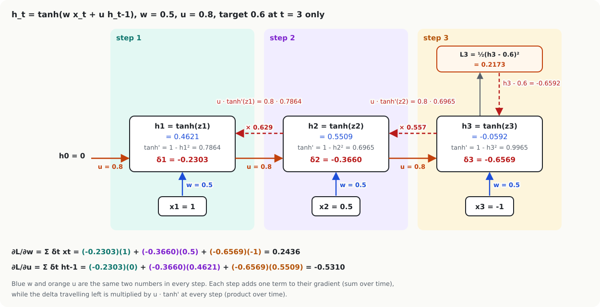

Say a network reads three words in a row and only the last one gets graded. The error has to travel back to the first word. Each step back multiplies it by 0.8 and by a slope that is never above 1. By the time it reaches word one, an error of 0.66 has become 0.23. Any long chain of multiplications does this, and it's the reason plain RNNs struggle with long sequences.

Backpropagation through time (BPTT) is ordinary backprop applied to the [unrolled RNN](/blog/cse425-mid-rnn-basics/). The only new facts are that one weight is used many times, and that the error passes through that weight again and again on its way back.

> **Key Takeaways**
> - On a one-unit, three-step RNN, every forward value, delta and shared-weight gradient fits on paper.
> - A shared weight's gradient is a sum of one term per step, while the error travelling back is multiplied once per step.
> - A per-step factor below 1 vanishes and one above 1 explodes: $0.9^{20}\approx0.12$ against $1.1^{20}\approx6.7$.
> - Clipping shortens a gradient that is too long, and truncation stops the error from travelling past a fixed window.

## One tiny RNN, three steps

The smallest RNN that shows everything has one hidden unit, one input per step and no output layer. At each step it adds the new input and its own previous value, each times a weight, and passes the sum through tanh, which keeps the result between −1 and 1. In symbols, the hidden value at step $t$ is

$$h_t=\tanh(w\,x_t+u\,h_{t-1})$$

Here $w$ is the weight on the input and $u$ is the weight on the previous hidden value. These are the scalar versions of $W_{xh}$ and $W_{hh}$. The same $w$ and the same $u$ are used at every step. Start with $h_0=0$.

Let $w=0.5$, $u=0.8$, inputs $x=(1,\ 0.5,\ -1)$, and a target $y=0.6$ that is checked only at step 3. The loss is $L=\tfrac12(h_3-y)^2$.

Forward pass, one step at a time:

$$h_1=\tanh(0.5\cdot1+0.8\cdot0)$$

$$=\tanh(0.5)=0.4621$$

$$h_2=\tanh(0.5\cdot0.5+0.8\cdot0.4621)$$

$$=\tanh(0.6197)=0.5509$$

$$h_3=\tanh(0.5\cdot(-1)+0.8\cdot0.5509)$$

$$=\tanh(-0.0593)=-0.0592$$

$$L=\tfrac12(-0.0592-0.6)^2=0.2173$$

## Sending the error back

Backprop needs one number per step: how much the loss changes if you nudge the sum going into tanh at that step, $z_t=w\,x_t+u\,h_{t-1}$. Call it $\delta_t$. The tanh slope is how much $h_t$ moves per unit nudge of $z_t$, and it equals $1-h_t^2$. Here the three slopes are 0.7864, 0.6965 and 0.9965.

At step 3 the loss depends on $h_3$ directly. Its derivative is $h_3-y=-0.6592$, and passing it through the tanh slope gives

$$\delta_3=-0.6592\times0.9965=-0.6569$$

Step 2 can only affect the loss by changing $z_3$. A nudge to $z_2$ moves $h_2$ by the slope 0.6965, that moves $z_3$ by $u=0.8$ times as much, and $z_3$ affects the loss through $\delta_3$. The error from step 3 therefore gets multiplied by $u$ and by the slope at step 2:

$$\delta_2=\delta_3\cdot0.8\cdot0.6965=-0.3660$$

$$\delta_1=\delta_2\cdot0.8\cdot0.7864=-0.2303$$

Going back from step 3 to step 2 costs a factor of $0.8\times0.6965=0.557$, and from step 2 to step 1 a factor of $0.8\times0.7864=0.629$. Those are the only multiplications that happen. After just two steps back, the signal is down to about a third of its size.

## The weight gradients are sums

The weight $w$ appears in $z_1$, $z_2$ and $z_3$. Nudging $w$ by a small amount nudges each $z_t$ by $x_t$ times that amount, and each of those nudges changes the loss through its own $\delta_t$. The contributions add:

$$\frac{\partial L}{\partial w}=\delta_3x_3+\delta_2x_2+\delta_1x_1$$

$$=0.6569-0.1830-0.2303=0.2436$$

The weight $u$ multiplies $h_{t-1}$ at each step, so the same argument gives

$$\frac{\partial L}{\partial u}=\delta_3h_2+\delta_2h_1+\delta_1h_0$$

$$=-0.3619-0.1691-0=-0.5310$$

The last term is zero only because $h_0=0$.

If you doubt this, nudge $w$ from 0.5 to 0.501 and rerun the forward pass. The loss rises by 0.000244, and $0.2436\times0.001=0.000244$. The same check works for $u$.

One gradient step with learning rate $\eta=0.5$ gives $w=0.5-0.5(0.2436)=0.3782$ and $u=0.8+0.5(0.5310)=1.0655$.

A common mistake is to use only the last step's term, as if $w$ were used once. It is used three times, so you add three terms.

## The same thing for a real RNN

In the full RNN from the previous note the hidden state is a vector, there is an output $\widehat{\mathbf y}_t$ at each step, and the loss is the sum $L=\sum_t L_t$. The recipe is the same, with matrices in place of the scalars. Write $\mathbf e_t=\widehat{\mathbf y}_t-\mathbf y_t$ for the error at the output of step $t$. For softmax with cross-entropy, the derivative of the loss with respect to the output scores comes out as exactly this difference, so you can use it directly. Then, working from $t=T$ down to 1:

$$\mathbf s_t=W_{hh}^{\top}\boldsymbol\delta_{t+1}$$

$$\mathbf r_t=W_{hy}^{\top}\mathbf e_t+\mathbf s_t$$

$$\boldsymbol\delta_t=(1-\mathbf h_t^2)\odot\mathbf r_t$$

with $\boldsymbol\delta_{T+1}=\mathbf 0$. Here $\mathbf s_t$ is the part that comes back from the next step, and $\mathbf r_t$ adds the step's own output error to it, so together they cover the two ways step $t$ can affect the loss. The last line passes that through the tanh slope, one entry at a time ($\odot$ means entry-by-entry multiplication). In the scalar example the only output error was $h_3-y$ at step 3, which made $r_3=h_3-y$ and $r_t=u\,\delta_{t+1}$ for the earlier steps.

The shared matrices again collect one term per step:

$$\frac{\partial L}{\partial W_{hh}}=\sum_{t=1}^{T}\boldsymbol\delta_t\,\mathbf h_{t-1}^{\top}$$

$$\frac{\partial L}{\partial W_{xh}}=\sum_{t=1}^{T}\boldsymbol\delta_t\,\mathbf x_t^{\top}$$

$$\frac{\partial L}{\partial \mathbf b_h}=\sum_{t=1}^{T}\boldsymbol\delta_t$$

Set $T=3$ and all sizes to 1 and these are the sums you just computed.

## Why the signal dies or blows up

Look at how much the hidden state at step $j$ changes when the hidden state at step $j-1$ changes. For a vector state this is a table of numbers called the one-step Jacobian, and it is

$$\frac{\partial \mathbf h_j}{\partial \mathbf h_{j-1}}=\mathrm{diag}\big(1-\mathbf h_j^2\big)\,W_{hh}$$

In the scalar case it is the factor $u\cdot\text{slope}$ you met above. To go back $k$ steps you multiply $k$ of these. How big can the product get? Let $\sigma_{\max}$ be the largest singular value of $W_{hh}$, which is the most that the matrix can stretch any vector. For a matrix, $\lVert\cdot\rVert$ below means that same stretch factor (the spectral norm), so $\lVert W_{hh}\rVert=\sigma_{\max}$. The diagonal tanh-slope matrix has entries at most 1, so it can't stretch anything. Then

$$\Big\|\frac{\partial \mathbf h_t}{\partial \mathbf h_i}\Big\|\le(\sigma_{\max})^{\,t-i}$$

where a $\sigma_{\max}$ below 1 pulls the bound towards 0 and one above 1 lets it grow. In the scalar case, leaving out the slopes, the factor is just $u^k$ after $k$ steps:

| $k$ | $0.9^k$ | $1.1^k$ |
|---|---|---|
| 5 | 0.5905 | 1.6105 |
| 10 | 0.3487 | 2.5937 |
| 20 | 0.1216 | 6.7275 |
| 50 | 0.0052 | 117.39 |

Real tanh slopes are below 1, which makes shrinking worse: with a slope of 0.7, ten steps back gives $(0.9\times0.7)^{10}=0.0098$.

Vanishing means the early steps get almost no learning signal, so the network can't connect a word at step 1 to a loss at step 20. Exploding is the other side: one update can throw the weights far away.

## Clipping and truncation

Clipping handles explosions (it comes from [Pascanu, Mikolov and Bengio](https://arxiv.org/abs/1211.5063), who also analyse the vanishing and exploding cases). If the gradient's norm is above a limit $c$, scale it down to length $c$ and keep its direction:

$$\mathbf g\leftarrow c\,\frac{\mathbf g}{\lVert\mathbf g\rVert}\quad\text{if }\lVert\mathbf g\rVert>c$$

With $\mathbf g=(30,40)$ the norm is 50. For $c=5$ you get $5\cdot(30,40)/50=(3,4)$. Clipping does nothing for vanishing, because there is no big number to cut. Gated cells fix vanishing, and the [LSTM](/blog/cse425-mid-lstm/) and [GRU](/blog/cse425-mid-gru/) notes show how.

Truncated BPTT limits how far back the error travels. With window $\tau$, you keep the terms where the loss step $t$ and the earlier step $i$ are at most $\tau$ apart, and drop the ones with $t-i>\tau$. In practice you run the forward pass over the whole sequence but cut the gradient at the window edge. It saves time and memory; [d2l.ai](https://d2l.ai/chapter_recurrent-neural-networks/bptt.html) works through the idea with code. The cost is that a dependency longer than $\tau$ never gets any gradient, so the network can't learn it.

Try it on the example with $\tau=1$. The loss is at step 3, so the terms from steps 3 and 2 stay, and the step-1 terms go:

$$\frac{\partial L}{\partial w}=0.6569-0.1830=0.4739$$

The full answer was 0.2436, so dropping step 1 here nearly doubles the gradient for $w$. The gradient for $u$ stays at $-0.5310$ because its step-1 term was already zero.

## In the exam: writing out a BPTT answer

When I work a numeric BPTT problem, I show the forward values, the slopes and each $\delta$ before I get to the shared weights, and write each weight's sum out term by term. To explain vanishing gradients, draw the unrolled network, write the product of one-step Jacobians, and finish with a number such as $0.9^{20}\approx0.12$ against $1.1^{20}\approx6.7$.

## Practice: sum or product, clipping, truncation

Why is the gradient for $W_{hh}$ a sum over time, but the signal from step $t$ back to step $i$ a product?

Answer

The same weight is used at every step, so each use contributes its own term and they add. The signal from $t$ back to $i$ passes through $t-i$ steps in a chain, and chained derivatives multiply.

A gradient is $\mathbf g=(12,5)$ and the clip limit is $c=6.5$. What is the clipped gradient?

Answer

The norm is $\sqrt{144+25}=13$, which is above 6.5, so scale by $6.5/13=0.5$.

$$\mathbf g\leftarrow0.5\cdot(12,5)=(6,\ 2.5)$$

The direction is the same and the new norm is 6.5.

With $\tau=1$ on this three-step sequence, which terms are dropped? Why can't truncation help a network learn that the word at step 1 decides the answer at step 10?

Answer

Terms with $t-i>1$ are dropped. For the loss at step 3 that is the step-1 terms. A dependency spanning 9 steps is longer than any $\tau$ below 9, and error that never travels that far never produces a gradient for it.

