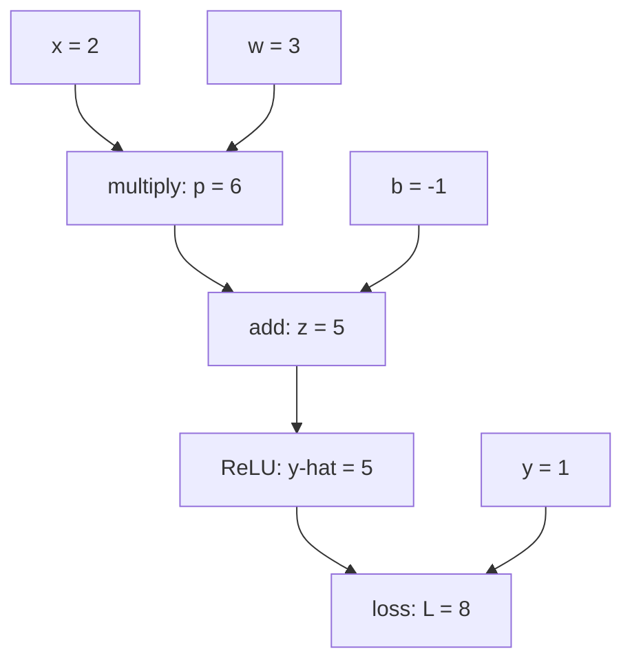

With $x=2$, $w=3$, $b=-1$ and a target of $y=5$, a ReLU neuron outputs $\max(0,\,3\cdot2-1)=5$ and its loss is exactly 0. Every gradient is 0 too. Any other answer for $\partial L/\partial w$ is an arithmetic mistake, and a graph is the quickest way to find where it entered, because you can watch each value travel back through the same boxes it came forward through.

A computation graph is a formula drawn so that every single operation gets its own box. Backprop on a big network is the chain rule applied hundreds of times, and the graph turns that into a routine with one small derivative per arrow. PyTorch and TensorFlow compute your gradients the same way.

> **Key Takeaways**
> - Going forward you fill in a value at every node and keep it. Going backward you start at the loss with gradient 1 and multiply by a local derivative along each arrow.
> - If a value feeds two later nodes, the gradients arriving from both routes add.
> - An add node passes the gradient on unchanged, a multiply node swaps the two inputs, and a ReLU node passes it only if $z>0$.
> - One backward sweep gives the gradient of the loss with respect to every input at once.

## One neuron as a graph

Change the target to $y=1$ and the gradients stop being zero. The neuron's formula is $p=wx$, then $z=p+b$, then the output $\widehat{y}=\max(0,z)$, then the loss $L=\tfrac12(\widehat{y}-y)^2$. Each operation is a node, and the forward values are

$$p=3\cdot2=6,\qquad z=6-1=5$$

$$\widehat{y}=\max(0,5)=5$$

$$L=\tfrac12(5-1)^2=8$$

The backward pass starts at the loss with the gradient of $L$ with respect to itself, which is 1. At each node, the gradient arriving from the right is multiplied by that node's local derivative, meaning the derivative of its output with respect to one of its inputs:

- Loss node: $\partial L/\partial\widehat{y}=\widehat{y}-y=4$.
- ReLU node: since $z=5>0$ the slope is 1, so $\partial L/\partial z=4$. If $z$ had been 0 or negative the slope would be 0 and the gradient would stop here.
- Add node: its local derivatives are both 1, so the gradient is copied to both inputs, $\partial L/\partial b=4$ and $\partial L/\partial p=4$.
- Multiply node: the derivative of $p=wx$ with respect to $w$ is $x$, and with respect to $x$ is $w$. So $\partial L/\partial w=4\cdot x=8$ and $\partial L/\partial x=4\cdot w=12$.

Answer: $\partial L/\partial w=8$, $\partial L/\partial b=4$ and $\partial L/\partial x=12$.

## The rules, written once

The local derivative of one operation is its derivative with respect to one input. When an operation takes vectors in or gives vectors out, the table of all those derivatives is called its Jacobian. Every node in this note holds a single number, so each Jacobian is just one number per arrow, written $\partial v/\partial u$ for an arrow from node $u$ into node $v$. For the neuron above:

| Arrow | Relation | Local derivative |
|---|---|---|
| $\widehat{y}\to L$ | $L=\tfrac12(\widehat{y}-y)^2$ | $\widehat{y}-y$ |
| $z\to\widehat{y}$ | $\widehat{y}=\max(0,z)$ | 1 if $z>0$, else 0 |
| $b\to z$ and $p\to z$ | $z=p+b$ | 1 |
| $w\to p$ | $p=wx$ | $x$ |
| $x\to p$ | $p=wx$ | $w$ |

The backward rule is one line. For any node $u$ with children $v$ (the nodes it feeds):

$$\frac{\partial L}{\partial u}=\sum_{v}\frac{\partial L}{\partial v}\,\frac{\partial v}{\partial u}$$

The sum is the fork rule: if a value feeds two later nodes, both routes carry gradient back and you add them. For example, take $u=x^2$, $v=3x$ and $L=u+v$. The node $x$ has two children, so $\partial L/\partial x=2x+3$, which is 7 at $x=2$. Drop one branch and you get 4 or 3 instead, and neither looks obviously wrong.

At exactly $z=0$ the ReLU slope is taken as 0 by convention. Make sure you test $z>0$ on $z$ itself; it's easy to test $p$ by accident, and $p$ and $z$ differ whenever $b\ne0$. (The target's own gradient is $-(\widehat{y}-y)$, the opposite of the output's, though you rarely need it.)

Now flip the signs: $x=2$, $w=-3$, $b=1$ and $y=4$. The forward values are $p=-6$, $z=-5$, $\widehat{y}=0$ and $L=8$. Since $z\le0$ the ReLU blocks the path, so every gradient is 0 even though the loss is large. If $z$ stays negative for every training example, the neuron never gets a gradient again. That's a dead ReLU.

## A logistic neuron

A logistic neuron has a pre-activation $z=\mathbf w\cdot\mathbf x+b$, an output $\widehat{y}=\sigma(z)$ and the cross-entropy loss, which suits a 0 or 1 target by punishing confident wrong answers heavily:

$$L=-\big[y\,\ln\widehat{y}+(1-y)\,\ln(1-\widehat{y})\big]$$

Two local derivatives matter. Differentiating $L$ with respect to $\widehat{y}$ and putting the two terms over one denominator gives

$$\frac{\partial L}{\partial\widehat{y}}=\frac{\widehat{y}-y}{\widehat{y}(1-\widehat{y})}$$

and the sigmoid gives $\partial\widehat{y}/\partial z=\widehat{y}(1-\widehat{y})$. Multiplying them, the denominators cancel:

$$\frac{\partial L}{\partial z}=\widehat{y}-y$$

From there the dot-product node sends $(\widehat{y}-y)\,\mathbf x$ to $\mathbf w$ and $(\widehat{y}-y)\,\mathbf w$ to $\mathbf x$. Both branches start from the same $\widehat{y}-y$; each one is then scaled by the other input.

Put in $\mathbf x=(1,2)$, $\mathbf w=(0.5,-1)$, $b=0$ and $y=1$. Then $z=0.5-2=-1.5$, $\widehat{y}=0.1824$ and $L=1.7014$. Then $\partial L/\partial z=0.1824-1=-0.8176$. The weights get $-0.8176$ times $\mathbf x=(1,2)$, the bias gets $-0.8176$, and the input gets $-0.8176$ times $\mathbf w=(0.5,-1)$:

$$\frac{\partial L}{\partial\mathbf w}=(-0.8176,\ -1.6352)$$

$$\frac{\partial L}{\partial b}=-0.8176$$

$$\frac{\partial L}{\partial\mathbf x}=(-0.4088,\ 0.8176)$$

## Why backward, and a bigger graph

Why go backward and not forward? One backward sweep gives the gradient of one scalar loss with respect to every input. Going forward needs a separate pass per input, and a network has millions of them. Forward only wins when inputs are few and outputs many.

PyTorch builds a fresh graph on every forward pass, so loops and if-statements just work. When the same weight is used many times, as in a batch or an RNN across time, each use is a branch, and the gradients add at the weight node. [Colah's walk through forward and reverse mode](https://colah.github.io/posts/2015-08-Backprop/) draws small graphs like these, and [d2l.ai](https://d2l.ai/chapter_preliminaries/autograd.html) shows how PyTorch records and replays one.

A harder case is $f=x^2y\sin x+2y^2\cos x$, with $f$ standing in for the loss. It breaks into nine nodes: $t_1=\sin x$, $t_2=xy$, $t_3=x\,t_2$, $t_4=t_3t_1$, $t_5=\cos x$, $t_6=2t_5$, $t_7=y\,y$, $t_8=t_7t_6$ and $t_9=t_4+t_8=f$. The figure shows every forward value (blue) and every backward gradient (red) at $x=1$, $y=2$.

The red numbers fill in from right to left. The add node $t_9$ passes 1 to both $t_4$ and $t_8$. The multiply node $t_4=t_3t_1$ swaps: $t_3$ receives $t_1=0.84147$ and $t_1$ receives $t_3=2$. The rest follow the same two rules.

The node $x$ feeds four nodes, $t_1$, $t_2$, $t_3$ and $t_5$, so four gradients arrive and all four are added. Each one is the gradient at that node times the local derivative:

- through $t_1=\sin x$: $2\cos1=1.08060$
- through $t_2=xy$: $0.84147\cdot2=1.68294$
- through $t_3=x\,t_2$: $0.84147\cdot2=1.68294$
- through $t_5=\cos x$: $8\cdot(-\sin1)=-6.73177$

$$\frac{\partial f}{\partial x}=1.08060+1.68294$$

$$+1.68294-6.73177=-2.28528$$

The node $y$ feeds $t_2$ and both inputs of $t_7$, giving $0.84147\cdot1=0.84147$ from $t_2$ and $1.08060\cdot2\cdot2=4.32242$ from $t_7$, which add to 5.16389.

## Gradients to work out by hand

Take $L=(y-\widehat{y})^2$ with $\widehat{y}=wx$, $w=3$, $x=2$ and $y=5$. What is $\partial L/\partial w$?

Answer

$\widehat{y}=6$ and $L=1$. There is no $\tfrac12$ here, so the slope of $L$ with respect to $\widehat{y}$ is $2(\widehat{y}-y)=2$.

$$\frac{\partial L}{\partial w}=2\cdot x=2\cdot2=4$$

In the nine-node graph, $x$ feeds $t_1$, $t_2$, $t_3$ and $t_5$. What do you do with the four gradients that arrive at $x$?

Answer

Add them. The total at $x=1$, $y=2$ is $-2.2853$.

A ReLU neuron has $z=-0.2$ for one example. What is $\partial L/\partial w$ for that example, and when would the neuron count as a dead ReLU?

Answer

It is 0, because the ReLU blocks the gradient when $z\le0$. The neuron is dead only if $z\le0$ for every training example, so it never gets a gradient again; one blocked example is normal.

