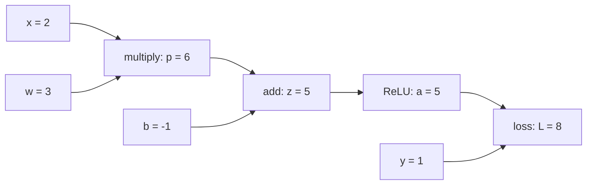
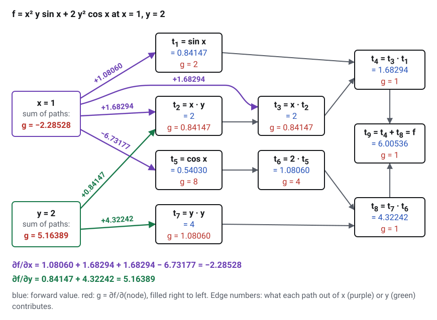

A neuron with $x=2$, $w=3$, $b=-1$ and target $y=5$ has a loss of exactly 0. Every gradient is 0 too. A student who gets a nonzero $\partial L/\partial w$ here has made an arithmetic slip, and the graph is the fastest way to catch it, because you can see where the 0 enters and watch it travel back.

## Quick idea

A computation graph is a formula drawn so that every single operation gets its own node. Values sit on the nodes. Going forward you fill them in and keep them. Going backward you start at the loss with gradient 1 and send gradients along the same edges in reverse, multiplying by a small local derivative at each step.

The reason to bother is bookkeeping. Backprop on a big network is the chain rule applied hundreds of times. The graph turns that into a routine: one local derivative per edge, one sum per fork. It is also how PyTorch and TensorFlow compute gradients for you.

## Picture it

The single ReLU neuron from the opening, with target changed to $y=1$ so the gradients are not all zero. Forward values are on the nodes.

## The detail

Write the graph as a list of nodes. Here $p=wx$, $z=p+b$, $a=\max(0,z)$ and $L=\tfrac12(a-y)^2$. Each edge from a node $u$ into a node $v$ has a local Jacobian $J_{v,u}=\partial v/\partial u$, the derivative of the output of that one operation with respect to that one input.

| Edge | Relation | Local derivative |
|---|---|---|
| $a\to L$ | $L=\tfrac12(a-y)^2$ | $a-y$ |
| $z\to a$ | $a=\max(0,z)$ | $1$ if $z>0$, else $0$ |
| $b\to z$ | $z=p+b$ | $1$ |
| $p\to z$ | $z=p+b$ | $1$ |
| $w\to p$ | $p=wx$ | $x$ |
| $x\to p$ | $p=wx$ | $w$ |

The backward rule is one line. For any node $u$ with children $v$:

$$\frac{\partial L}{\partial u}=\sum_{v\in\text{children}(u)}\frac{\partial L}{\partial v}\,J_{v,u}$$

The sum is the fork rule. If a value feeds two later nodes, both routes carry gradient back and you add them. Forgetting one branch is the most common slip on this topic.

Three node types cover most questions. An add node passes the incoming gradient unchanged to each input. A multiply node gives each input the incoming gradient times the other input's value, so the inputs swap. A ReLU node passes the gradient through if $z>0$ and blocks it if $z\le0$. At exactly $z=0$ we take the derivative as 0 by convention.

Fork example: $u=x^2$, $v=3x$, $L=u+v$. The node $x$ has two children, so $\partial L/\partial x=2x+3$, which is 7 at $x=2$.

Logistic neuron: $s=\mathbf{w}^\top\mathbf{x}+b$, $\hat y=\sigma(s)$, $L=-[y\ln\hat y+(1-y)\ln(1-\hat y)]$. Two local derivatives matter:

$$\frac{\partial L}{\partial\hat y}=\frac{\hat y-y}{\hat y(1-\hat y)},\qquad\frac{\partial\hat y}{\partial s}=\hat y(1-\hat y)$$

Multiply them. The denominators cancel and you get $\partial L/\partial s=\hat y-y$. From there the dot-product node sends $(\hat y-y)\,\mathbf{x}$ to $\mathbf{w}$ and $(\hat y-y)\,\mathbf{w}$ to $\mathbf{x}$. Same incoming scalar, different gradients, because each branch is scaled by the other input.

Why backward and not forward? One backward sweep gives the gradient of one scalar loss with respect to every input. Forward mode needs a separate pass per input, and a network has millions. Forward mode only wins when inputs are few and outputs many.

PyTorch builds a fresh graph on every forward pass, so loops and if-statements just work. When the same weight is used many times, as in a batch or an RNN across time, each use is a branch, and their gradients add at the weight node.

For a harder one, the formula $f=x^2y\sin x+2y^2\cos x$ breaks into nine nodes, and $x$ has four outgoing paths that must all be summed.

*Forward values fill left to right and gradients fill right to left. The four paths out of x add to -2.28528 and the two out of y add to 5.16389.*

The numbers at $x=1$, $y=2$ are worked out below.

## Worked example

Same neuron as the picture: $x=2$, $w=3$, $b=-1$, $y=1$.

Forward: $p=6$, $z=5$, $a=5$, $L=\tfrac12(5-1)^2=8$.

Backward, starting from $\partial L/\partial L=1$:

$\partial L/\partial a=a-y=4$. Since $z=5>0$, the ReLU passes it on: $\partial L/\partial z=4$.

The add node copies it: $\partial L/\partial b=4$ and $\partial L/\partial p=4$.

The multiply node swaps: $\partial L/\partial w=4\cdot x=8$ and $\partial L/\partial x=4\cdot w=12$.

$$\boxed{\partial L/\partial w=8,\quad \partial L/\partial b=4,\quad \partial L/\partial x=12}$$

Dead case: $x=2$, $w=-3$, $b=1$, $y=4$ gives $p=-6$, $z=-5$, $a=0$, $L=8$. Since $z\le0$ the ReLU blocks the path, so every gradient is 0 even though the loss is large. That is a dead ReLU: the neuron is wrong and cannot hear about it.

Logistic check with $\mathbf{x}=(1,2)$, $\mathbf{w}=(0.5,-1)$, $b=0$, $y=1$: $s=-1.5$, $\hat y=0.1824$, $L=1.7014$. Then $\partial L/\partial s=-0.8176$, $\partial L/\partial\mathbf{w}=(-0.8176,-1.6352)$, $\partial L/\partial b=-0.8176$, $\partial L/\partial\mathbf{x}=(-0.4088,0.8176)$.

## Exam corner

Asked in past exams: the computation graph appeared as one quiz in our set (10 marks per question, split as 3 for the Jacobians, 4 for a numeric run, 3 for an explanation). It appeared in 0 of the Mids we have. The two quiz questions were a ReLU neuron where you must explain what happens when $z\le0$, and a logistic neuron where you must explain why the two branches of the dot-product node get different gradients. Our practice set has 10 items on it: nodes, reverse mode, ReLU derivative, sum node, fork, batch accumulation, dynamic graphs.

Marks come from: the edge and Jacobian table, forward values written down and stored, backward values in order, the sum at every fork, and one sentence on the dead ReLU or the swap rule.

Common slips:

- Missing a branch at a fork, most often one of the four paths out of $x$.
- Giving a multiply node the wrong swap, for example sending $x$ back to $x$.
- Applying the indicator $\mathbf{1}[z>0]$ to $a$ or $p$ instead of $z$.
- Getting the sign of $\partial L/\partial y$ wrong: it is $-(a-y)$, the opposite of $\partial L/\partial a$.

Formula line: $\partial L/\partial u=\sum_v(\partial L/\partial v)\,J_{v,u}$; logistic with cross-entropy gives $\partial L/\partial s=\hat y-y$.

## Check yourself

1. $L=(y-\hat y)^2$, $\hat y=wx$, with $w=3$, $x=2$, $y=5$. What is $\partial L/\partial w$?
2. In the board graph, $x$ feeds $t_1$, $t_2$, $t_3$ and $t_5$. What do you do with the four gradients that arrive at $x$?
3. A ReLU neuron has $z=-0.2$. What is $\partial L/\partial w$, and what is this situation called?

Answers

1. $\hat y=6$, $L=1$, $\partial L/\partial w=2x(wx-y)=2\cdot2\cdot1=4$.
2. Add them. The total at $x=1$, $y=2$ is $-2.2853$.
3. It is 0, because the ReLU blocks the gradient when $z\le0$. This is a dead ReLU.

## Read more

- [Calculus on Computational Graphs: Backpropagation](https://colah.github.io/posts/2015-08-Backprop/), a clear walk through forward and reverse mode on small graphs.
- [CS231n notes on backpropagation and the chain rule](https://cs231n.github.io/optimization-2/), circuit-style examples including the sigmoid neuron.
- [Automatic differentiation in Dive into Deep Learning](https://d2l.ai/chapter_preliminaries/autograd.html), how PyTorch records and replays the graph.
