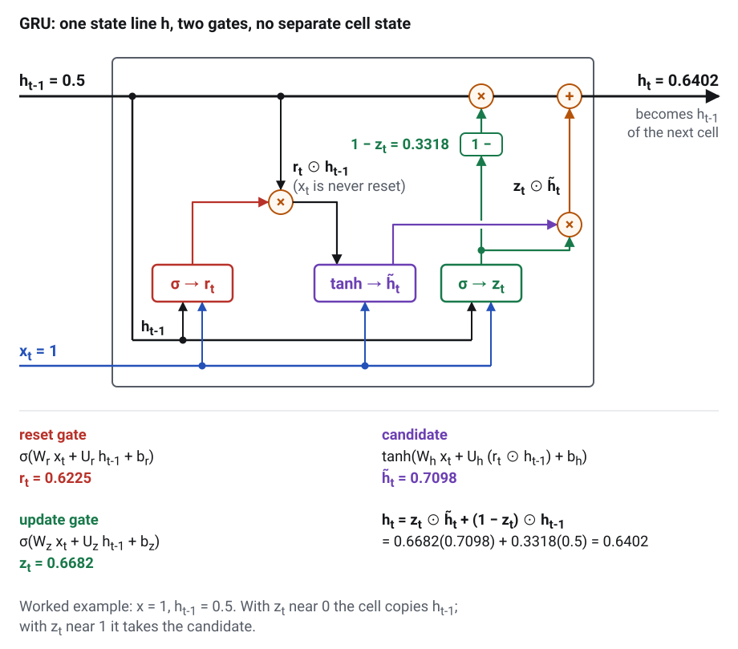

A GRU is an LSTM with the cell state folded into the hidden state and the three gates cut to two. There is one memory line, $h_t$, and two gates: an update gate that decides how much of the old state to keep, and a reset gate that decides how much of the old state a fresh candidate is allowed to see. With fewer gates there are fewer weight matrices, so a GRU has 75% of the parameters of an LSTM of the same size, and it still gives the gradient a clean path through time.

The reset gate is the part that gets mixed up with the LSTM's forget gate, though the two act in different places. This note assumes the [LSTM](/blog/cse425-mid-lstm/) note, in particular what a gate is: a set of numbers between 0 and 1 that multiply something, where 0 keeps none of it and 1 keeps all of it.

> **Key Takeaways**
> - A GRU has no cell state, only $h_t$, and two gates: the update gate $z_t$ and the reset gate $r_t$.
> - The new state is $h_t=z_t\odot\tilde h_t+(1-z_t)\odot h_{t-1}$, a blend whose two weights add to 1.
> - The reset gate scales only $h_{t-1}$ inside the candidate, never the input.
> - A GRU has three weight blocks to the LSTM's four, so 75% of the LSTM's parameters at the same sizes.

## One step by hand

In the smallest case the state is a single number ($H=1$), with an update gate $z=0.5$, an old state $h_{t-1}=2$ and a candidate $\tilde h=0$. The new state is half candidate and half old state, $0.5\cdot0+0.5\cdot2=1$. With $z=0.5$ the answer is the same in either convention for the blend (there are two, see the general equations).

Now a full step with $x_t=1$, $h_{t-1}=0.5$, and one number for the input and one for the state, so each gate is $\sigma(w\,x_t+u\,h_{t-1}+b)$, where $\sigma$ is the sigmoid that squeezes any number into 0 to 1. The weights $(w,u,b)$ are $(0.5,0.4,0)$ for the update gate, $(0.3,0.2,0.1)$ for the reset gate and $(0.8,0.6,-0.1)$ for the candidate.

The update gate and the reset gate first:

$$z=\sigma(0.5+0.4\cdot0.5)=\sigma(0.7)=0.6682$$

$$r=\sigma(0.3+0.2\cdot0.5+0.1)$$

$$=\sigma(0.5)=0.6225$$

The candidate is a plain RNN step with one change: the old state is first multiplied by the reset gate, so $h_{t-1}$ contributes $0.6\cdot(0.6225\cdot0.5)$ and not $0.6\cdot0.5$.

$$\tilde h=\tanh(0.8+0.6\cdot0.6225\cdot0.5-0.1)$$

$$\tilde h=\tanh(0.8867)=0.7098$$

The update gate then blends the candidate with the old state:

$$h_t=0.6682\cdot0.7098+(1-0.6682)\cdot0.5$$

$$h_t=0.4743+0.1659=0.6402$$

## The general equations

Now the same step for any sizes. The symbols: $\sigma$ is the sigmoid, $\odot$ is entry-by-entry multiplication, $x_t$ is the input at step $t$ (size $D$) and $h_{t-1}$ the previous hidden state (size $H$). The matrices $W$ act on the input and the matrices $U$ on the hidden state, and each block has a bias $b$. The [LSTM](/blog/cse425-mid-lstm/) note stacked $[h_{t-1},x_t]$ under one matrix; $W_zx_t+U_zh_{t-1}$ is the same thing split in two, and here the split is worth keeping because the reset gate touches only the $h_{t-1}$ part.

$$z_t=\sigma(W_zx_t+U_zh_{t-1}+b_z)$$

$$r_t=\sigma(W_rx_t+U_rh_{t-1}+b_r)$$

$$\tilde h_t=\tanh\big(W_hx_t+U_h(r_t\odot h_{t-1})+b_h\big)$$

$$h_t=z_t\odot\tilde h_t+(1-z_t)\odot h_{t-1}$$

Here $z_t$ is the value of the update gate, a number between 0 and 1, not a pre-activation; the [RNN note](/blog/cse425-mid-rnn-basics/) used $\mathbf z_t$ for the sum before tanh, and the two should not be mixed up. With $H=D=1$ and the numbers from above, the update gate is $\sigma(0.5\cdot1+0.4\cdot0.5)$, exactly what was computed above. The candidate is a plain RNN step in which the old state is first scaled by $r_t$. If $r_t$ is 0 the candidate is built from $x_t$ alone, and if it is 1 the candidate sees the full past. The reset multiplies $h_{t-1}$ only, never $x_t$.

The last line is a blend whose two weights add to 1. With $z_t\approx0$ the cell copies its old state, $h_t\approx h_{t-1}$, and with $z_t\approx1$ it overwrites, $h_t\approx\tilde h_t$. This is the convention used in this note. Some books and PyTorch swap the roles, $h_t=(1-z_t)\odot\tilde h_t+z_t\odot h_{t-1}$. On the example this gives $0.3318\cdot0.7098+0.6682\cdot0.5=0.5696$ instead of $0.6402$, so a question about "$z$ near 0 or 1" depends on which one is used. Say which you use.

The shapes: $W_z,W_r,W_h$ are $H\times D$, $U_z,U_r,U_h$ are $H\times H$, and the biases, $z_t$, $r_t$, $\tilde h_t$ and $h_t$ all have $H$ entries. With a 5-dimensional input and a 5-dimensional state every matrix happens to be $5\times5$; with $D=10$ and $H=20$ the $W$s are $20\times10$ and the $U$s $20\times20$. The output $h_t$ becomes $h_{t-1}$ of the next cell, and the same equations repeat with $t+1$.

## Why the gradient survives

When one step is differentiated, $\partial h_t/\partial h_{t-1}$ contains the term $(1-z_t)$ from the copy path. Suppose $z_t=0.01$ at every step. Then each step back keeps $0.99$ of the signal, and over 45 steps $0.99^{45}=0.636$ is left. That's the LSTM cell-state idea again, an additive path with no weight matrix or tanh slope on it, and to remember something the network just keeps $z$ near 0.

## GRU against LSTM

Parameter counts, with $D$ inputs and $H$ hidden units and one bias per block: a plain RNN has $H(H+D)+H$, a GRU three times that and an LSTM four times. For $D=10$, $H=20$: RNN $20\cdot30+20=620$, GRU $1860$, LSTM $2480$. For $D=100$, $H=64$: RNN 10560, GRU 31680, LSTM 42240.

| | LSTM | GRU |
|---|---|---|
| Gates | 3: forget, input, output | 2: update, reset |
| Separate cell state $c_t$ | yes | no, only $h_t$ |
| State blend | two separate gates, $f$ on the old cell and $i$ on the candidate | one gate, $1-z$ on the old state and $z$ on the candidate, weights add to 1 |
| Output gate | yes, $o$ scales $\tanh(c_t)$ | none, $h_t$ is exposed fully |
| Where the past is suppressed | forget gate scales the old cell state directly | reset gate scales the old state only inside the candidate |
| Weight blocks per step | 4 | 3 |
| Speed per step | slower, four blocks | faster, three blocks |
| Variant | peephole: gates also see $c$ | none, there is no cell to peek at |

The update gate is roughly the forget and input gates merged: $1-z$ plays the part of forget and $z$ the part of input. Nothing in a GRU matches the output gate. Reset looks like forget, but forget acts on the memory itself, while reset only changes what feeds the candidate.

If asked why a GRU is faster, compare it with an LSTM: three weight blocks instead of four, and no separate cell to carry. Against a plain RNN a GRU does more work per step; what it buys is better gradient flow and, usually, quicker progress in training.

For a "compare" question I'd write the equations for $z_t$, $r_t$ and the blend, say that the state and gates all have the same length, and put "no cell state, two gates" somewhere obvious.

The [GRU chapter of Dive into Deep Learning](https://d2l.ai/chapter_recurrent-modern/gru.html) builds one from scratch in code, and an [empirical comparison by Chung and colleagues](https://arxiv.org/abs/1412.3555) found the GRU about as good as the LSTM on the sequence tasks they tried.

## Practice: the blend and the gates

With $H=1$, $z=0.5$, $h_{t-1}=2$ and $\tilde h=0$, what is $h_t$?

Answer

$$h_t=0.5\cdot0+0.5\cdot2=1$$

Which LSTM gates does the update gate combine, and which GRU gate has no direct twin?

Answer

It combines forget and input. The reset gate has no direct twin.

In this note's convention, what does $z_t$ close to 0 do to $h_t$?

Answer

$h_t\approx h_{t-1}$, so the cell copies its old state and the gradient passes through almost unchanged.

