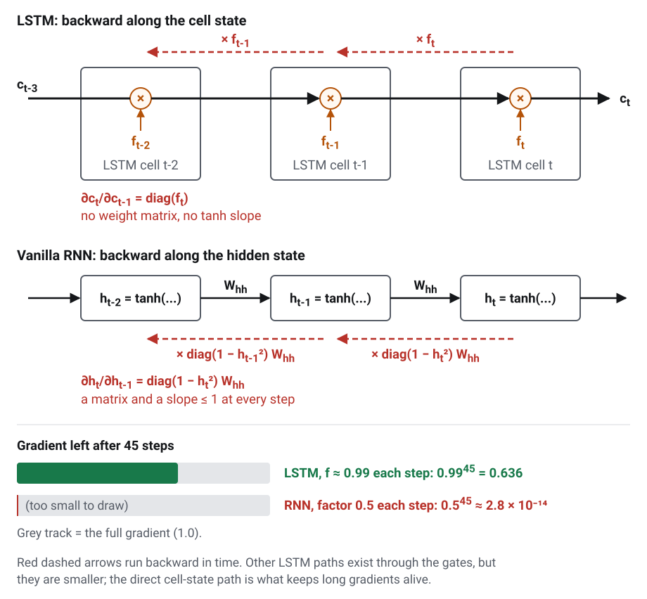

After 45 steps, a signal that halves at every step is down to $2.8\times10^{-14}$ of its size, while one that loses 1% per step still has 64%. Suppose the network has to carry one token from step 5 to step 50. A plain RNN passes the error back through 45 steps, and if each step halves it, nothing gets learned. The LSTM adds a path where each step shrinks it only a little.

It does this by adding a second memory line, the cell state $c_t$, which runs through time next to the hidden state $h_t$. The cell state is changed only by an entry-by-entry multiply and an entry-by-entry add. Three gates control that line. A gate is a set of numbers between 0 and 1 that multiply something: 0 keeps none of it, 1 keeps all of it, and 0.65 keeps 65%.

> **Key Takeaways**
> - The cell state changes only by $c_t=f_t\odot c_{t-1}+i_t\odot\tilde c_t$: one multiply and one add.
> - Three sigmoid gates (forget, input, output) and one tanh candidate all read $[h_{t-1},x_t]$.
> - Four weight blocks give $4H(H+D+1)$ parameters; a GRU of the same size has 75% of that.
> - Along the cell state the gradient is multiplied by $f_t$ once per step, so $f_t$ near 1 keeps it alive.

## The pieces

The forget gate $f_t$ decides how much of the old memory stays. How much new information gets written is up to the input gate $i_t$, and the output gate $o_t$ picks how much of the memory shows up in the hidden state $h_t$. The new information itself is a candidate $\tilde c_t$, a number between $-1$ and 1 from a tanh (a function that squashes any number into that range). The hidden state changes fast and the cell state changes slowly; the longer memory lives in the slow one. [Understanding LSTM Networks](https://colah.github.io/posts/2015-08-Understanding-LSTMs/) draws each of these pieces one at a time, and the [d2l.ai chapter on LSTM](https://d2l.ai/chapter_recurrent-modern/lstm.html) builds them in code.

![LSTM cell: cell state along the top through a forget multiply and an input add; forget, input and output gates and the tanh candidate read [h_t-1, x_t], each with its equation and worked-example value](img/lstm-lstm-cell.svg)

Every gate and the candidate read the same input, the previous hidden state $h_{t-1}$ with the current input $x_t$ stacked on top of each other. Stacking just means writing one vector after the other. With a hidden size $H=2$ and an input size $D=3$, take $h_{t-1}=(0.5,\,-0.2)$ and $x_t=(1,\,0,\,2)$. The stacked vector $[h_{t-1},x_t]$ is

$$[h_{t-1},x_t]=(0.5,\ -0.2,\ 1,\ 0,\ 2)$$

which has $H+D=5$ entries. Suppose one row of the forget gate's weight matrix is $(0.1,\ 0.2,\ 0.3,\ -0.1,\ 0.4)$. Its product with the stacked vector is

$$0.05-0.04+0.3+0+0.8=1.11$$

This is the same as using two separate matrices: the first two weights times $h_{t-1}$ give $0.01$ and the last three times $x_t$ give $1.1$, and $0.01+1.1=1.11$. One big matrix $W$ is just a neater way to write "a matrix on $h$ plus a matrix on $x$".

## One step by hand

The example uses a single memory slot $(H=D=1)$, so every vector is one number. The input is $x=1$, the previous hidden state is $h_{t-1}=0.5$ and the previous cell state is $c_{t-1}=0.4$. Each gate is $\sigma(w\,x+u\,h_{t-1}+b)$, where $\sigma$ is the sigmoid, which squeezes any number into 0 to 1. The weights $(w,u,b)$ are $(0.5,0.4,1.0)$ for forget, $(0.6,0.2,0)$ for input, $(0.8,0.6,-0.1)$ for the candidate (a tanh) and $(0.3,0.5,0)$ for output. The start values are picked for easy arithmetic, not taken from a real previous step: a real cell gives $|h_{t-1}|\le\tanh|c_{t-1}|=0.38$, so $h_{t-1}=0.5$ with $c_{t-1}=0.4$ couldn't happen. The equations don't care, so the step below still works.

The forget and input gates and the candidate:

$$f_t=\sigma(0.5+0.2+1.0)=\sigma(1.7)=0.8455$$

$$i_t=\sigma(0.6+0.1)=\sigma(0.7)=0.6682$$

$$\tilde c_t=\tanh(0.8+0.3-0.1)=\tanh(1.0)$$

$$=0.7616$$

The new cell state keeps part of the old one and adds part of the candidate:

$$c_t=0.8455(0.4)+0.6682(0.7616)$$

$$c_t=0.3382+0.5089=0.8471$$

Then the output gate and the hidden state:

$$o_t=\sigma(0.3+0.25)=\sigma(0.55)=0.6341$$

$$h_t=0.6341\cdot\tanh(0.8471)$$

$$=0.6341\cdot0.6896=0.4373$$

## The general equations

Now the same step for any sizes. The symbols: $\sigma$ is the sigmoid, $\odot$ is entry-by-entry multiplication, $[h_{t-1},x_t]$ is the stacked vector from above with $H+D$ entries, every weight matrix $W$ is $H\times(H+D)$, and every bias $b$ has $H$ entries.

$$f_t=\sigma(W_f[h_{t-1},x_t]+b_f)$$

$$i_t=\sigma(W_i[h_{t-1},x_t]+b_i)$$

$$o_t=\sigma(W_o[h_{t-1},x_t]+b_o)$$

$$\tilde c_t=\tanh(W_c[h_{t-1},x_t]+b_c)$$

$$c_t=f_t\odot c_{t-1}+i_t\odot\tilde c_t$$

$$h_t=o_t\odot\tanh(c_t)$$

Check against the numbers: with $H=D=1$ the stacked vector is $(0.5,\,1)$ and the forget row is $(0.4,\,0.5)$, giving $0.2+0.5+1.0=1.7$ with the bias, as before. If a prediction is needed, $\widehat{\mathbf y}_t=\mathrm{softmax}(W_yh_t+b_y)$.

That makes four small layers reading the same stacked vector: three sigmoid gates and one tanh candidate. It's easy to write "four gates"; the candidate isn't a gate, since it doesn't multiply anything between 0 and 1. In matrix form the four pre-activations are computed in parallel, the first three go through sigmoid and the candidate through tanh, and then the two lines for $c_t$ and $h_t$ are applied.

The candidate uses tanh and not ReLU because tanh is signed and bounded in $(-1,1)$, so a candidate can push a memory up or down by a limited amount. A ReLU candidate is never negative, so the write could only push the memory up, and with no upper bound the cell state could grow without limit.

## Peephole version

In a peephole LSTM the gates are allowed to look at the cell state. The forget and input gates see the old cell $c_{t-1}$, and the output gate sees the new cell $c_t$, because it is computed after the update. Everything else is unchanged. Two forms are common, so say which one you write.

In the full-matrix form the cell state is stacked in as well:

$$f_t=\sigma(W_f[c_{t-1},h_{t-1},x_t]+b_f)$$

$$o_t=\sigma(W_o[c_t,h_{t-1},x_t]+b_o)$$

with $i_t$ like $f_t$. Each $W$ grows to $H\times(2H+D)$, adding $3H^2$ weights in total. In the diagonal form from the original peephole paper, each gate has a weight vector of size $H$ ($p_f,p_i,p_o$) that multiplies the cell state entry by entry:

$$f_t=\sigma(W_f[h_{t-1},x_t]+p_f\odot c_{t-1}+b_f)$$

$$o_t=\sigma(W_o[h_{t-1},x_t]+p_o\odot c_t+b_o)$$

with $i_t$ again like $f_t$. This adds only $3H$ weights. Mixing the two forms gives a wrong answer, and in both of them the output gate reads the new cell $c_t$. Watch out for [Wikipedia's page on LSTM](https://en.wikipedia.org/wiki/Long_short-term_memory): its peephole equations are a third version, where $c_{t-1}$ replaces $h_{t-1}$ in every gate, the output gate included.

Here is the diagonal form on the example, with a peephole weight of 0.5 on every gate. The forget gate sees $c_{t-1}=0.4$:

$$f_t=\sigma(1.7+0.5\cdot0.4)=0.8699$$

$$i_t=\sigma(0.7+0.2)=0.7109$$

$$c_t=0.8699(0.4)+0.7109(0.7616)$$

$$=0.8894$$

The output gate uses the new cell:

$$o_t=\sigma(0.55+0.5\cdot0.8894)=0.7300$$

$$h_t=0.7300\cdot\tanh(0.8894)=0.5191$$

## Counting parameters

One block (one gate or the candidate) has $H(H+D)$ weights and $H$ biases, $H(H+D+1)$ in all. A plain RNN has one block, a GRU three and an LSTM four:

$$\text{LSTM}=4H(H+D+1)$$

For $D=10$ and $H=20$ a block has $20\cdot31=620$ parameters, so a plain RNN has 620, a GRU 1860, an LSTM 2480, and a diagonal-peephole LSTM 2540 (the extra $3H=60$). For $D=100$, $H=64$, an LSTM has $4\cdot64\cdot165=42240$. An LSTM has four times a plain RNN's parameters, and a [GRU](/blog/cse425-mid-gru/), which does the same job with fewer parts, has 75% of an LSTM's.

## Why the gradient survives

Look at one memory slot. At each step it keeps a fraction $f$ of its old value and adds something new. If $f$ is 0.99, then 45 steps later about 64% of the old value is still there, since $0.99^{45}=0.636$. In a plain RNN the same trip costs a matrix multiplication and a tanh slope at every step, so the signal dies. For the LSTM to keep a long memory, it has to learn to hold $f$ near 1.

The same fact in symbols. For a plain RNN, $h_t=\tanh(W_{hh}h_{t-1}+\dots)$ gives one step back a factor

$$\frac{\partial h_t}{\partial h_{t-1}}=\mathrm{diag}(1-h_t^2)\,W_{hh}$$

(this matrix of how each entry of $h_t$ responds to each entry of $h_{t-1}$ is called the Jacobian). Over $k$ steps the gradient is a product of $k$ of these. If each one shrinks a vector by at least a factor $r<1$, the product shrinks like $r^k$.

For the LSTM, $c_t=f_t\odot c_{t-1}+i_t\odot\tilde c_t$, so along the cell state one step back costs

$$\frac{\partial c_t}{\partial c_{t-1}}=\mathrm{diag}(f_t)$$

and $k$ steps back costs $\prod_jf_j$, with no weight matrix and no tanh slope on the way. In the single-slot example this is $0.8455$ per step.

That is the direct path. There are three more terms, because $f_t$, $i_t$ and $\tilde c_t$ also depend on $h_{t-1}$, which depends on $c_{t-1}$ through $h_{t-1}=o_{t-1}\tanh(c_{t-1})$. Writing them out for the single slot, with $\tfrac{\partial h_{t-1}}{\partial c_{t-1}}=o_{t-1}(1-\tanh^2c_{t-1})$:

$$\frac{\partial c_t}{\partial c_{t-1}}=f_t+c_{t-1}\frac{\partial f_t}{\partial c_{t-1}}$$

$$+\tilde c_t\frac{\partial i_t}{\partial c_{t-1}}+i_t\frac{\partial\tilde c_t}{\partial c_{t-1}}$$

Each extra term has a gate slope ($f(1-f)$ for a sigmoid, $1-\tilde c^2$ for tanh), a recurrent weight $u$ and the factor $\partial h_{t-1}/\partial c_{t-1}$. Put in the example's numbers, taking $o_{t-1}\le1$ and $1-\tanh^2(0.4)=0.8556$:

$$0.4\cdot(0.8455\cdot0.1545)\cdot0.4\cdot0.8556$$

$$=0.018$$

$$0.7616\cdot(0.6682\cdot0.3318)\cdot0.2\cdot0.8556$$

$$=0.029$$

$$0.6682\cdot(1-0.7616^2)\cdot0.6\cdot0.8556$$

$$=0.144$$

Together they're at most about 0.19, against 0.8455 for the direct term. So "the other terms are smaller" is true here, by roughly a factor of four, but they aren't zero.

Two special cases: $f\approx1,\ i\approx0$ gives $c_t=c_{t-1}$, so the memory is frozen, and $f\approx0,\ i\approx1$ overwrites it. Gates can saturate and gradients can still explode, which is why gradient clipping is still used. If a question asks what fixes vanishing gradients, name the additive cell path with its forget gate. Swapping in a different sigmoid or tanh wouldn't do it.

## Variants

A bidirectional LSTM runs one LSTM forwards and one backwards over the sequence and concatenates their hidden states, giving $2H$ numbers per step. In a stacked LSTM layer $l+1$ reads layer $l$'s hidden state $h_t$ as its input. The final hidden state $h_T$ for a batch of $B$ sequences has shape $(B,H)$, and the embedding size does not change that. If the gates saturate (stuck near 0 or 1), the sigmoid slope $f(1-f)$ is near zero, so the gates' own weights get almost no gradient and the loss can go flat.

## In the exam: a full LSTM answer

A full answer gives the equations for all three gates and the candidate using $[h_{t-1},x_t]$, the $c_t$ update and $h_t$, and a labelled diagram with the multiply on $c_{t-1}$. For the vanishing-gradient question, add one sentence tying the additive $c_t$ to the gradient. The output gate is $o_t$, not $r_t$, since $r_t$ is the GRU's reset gate.

## Practice: frozen memory, counts and the 45-step copy

With $f=1$, $i=0$ and $c_{t-1}=3$, what is $c_t$, and what is the memory doing?

Answer

$$c_t=1\cdot3+0\cdot\tilde c_t=3$$

The memory is frozen.

An LSTM has $D=10$ and $H=20$. How many parameters, and how many for a GRU of the same size?

Answer

LSTM: $4\cdot20\cdot31=2480$. GRU: $3\cdot20\cdot31=1860$, which is 75% of the LSTM.

Why does a task that copies a token 45 steps later favour an LSTM?

Answer

The direct cell path multiplies only forget gates, for example $0.99^{45}=0.636$. A plain RNN with a factor of 0.5 per step gives $0.5^{45}\approx2.8\times10^{-14}$.

