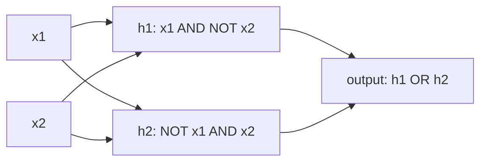
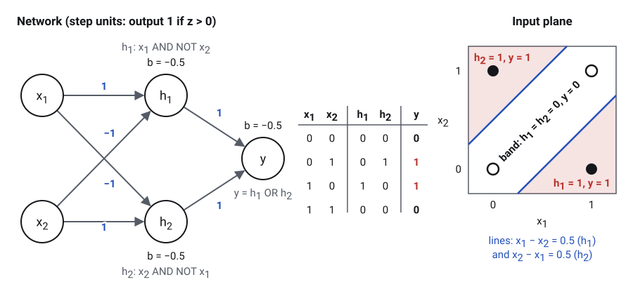
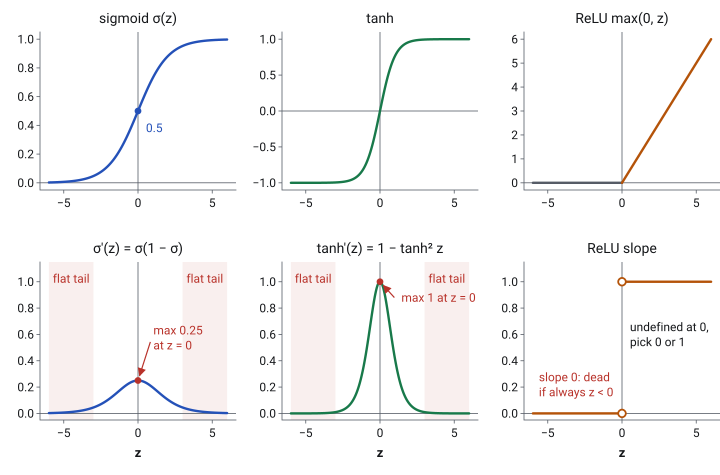

A single perceptron fails on all four XOR rows. Put two neurons in front of it and the same four rows pass. The two extra neurons each draw their own line, and the last neuron combines them: "x1 and not x2" OR "x2 and not x1".

## Quick idea

A multilayer perceptron stacks layers of neurons. Inputs go in, hidden layers transform them, and an output layer gives the answer. Every neuron feeds every neuron in the next layer, and information only moves forward.

Two details carry the marks. First, a layer is a matrix multiply plus a bias, followed by an activation function applied to each number separately. Second, that activation has to be nonlinear, or the whole stack is secretly one layer. The activation also has to have a slope, because training steers by slopes.

## Picture it

*Each hidden unit cuts off one corner of the square. The output fires in either corner and stays 0 in the band between the two lines.*

*Sigmoid's slope never goes above 0.25 and both sigmoid and tanh go flat in the tails. ReLU keeps slope 1 for every positive input.*

## The detail

Notation from the prerequisites post. Layer $l$ has $n_l$ neurons, $\mathbf a^{(0)}=\mathbf x$, and

$$
\mathbf z^{(l)}=W^{(l)}\mathbf a^{(l-1)}+\mathbf b^{(l)},\qquad \mathbf a^{(l)}=f\!\left(\mathbf z^{(l)}\right).
$$

Here $W^{(l)}$ has shape $n_l\times n_{l-1}$ (out by in), $\mathbf b^{(l)}$ has $n_l$ entries, and $f$ acts on each entry. Some lecture material stores $W$ as in by out and transposes; pick one and keep it. For a batch, put samples in columns: $Z=WX+\mathbf b\mathbf 1^\top$.

**Parameter count.** Each neuron in layer $l$ has $n_{l-1}$ weights and one bias, so the total is $\sum_l n_l(n_{l-1}+1)$. A $2\to3\to1$ network has $3\cdot3+1\cdot4=13$. A $4\to5\to3$ network has $W^{(1)}$ of shape $5\times4$, $W^{(2)}$ of shape $3\times5$, and $25+18=43$ parameters. A $3\to4\to3\to2$ network has 30 weights and 39 parameters with biases.

**Why nonlinearity.** Without $f$, two layers give $W_2(W_1\mathbf x)=(W_2W_1)\mathbf x$, one matrix. With $W_1=\begin{pmatrix}1&2\\0&1\end{pmatrix}$ and $W_2=(3\ \ -1)$ the product is $(3\ \ 5)$: a hundred such layers would still be one line. The XOR network above is the counterexample, because its hidden step function breaks the collapse.

**The three activations.**

| | formula | range | slope | notes |
|---|---|---|---|---|
| sigmoid | $\sigma(z)=\dfrac1{1+e^{-z}}$ | $(0,1)$ | $\sigma(1-\sigma)\le0.25$ | flat tails, not zero-centred |
| tanh | $\dfrac{e^z-e^{-z}}{e^z+e^{-z}}$ | $(-1,1)$ | $1-\tanh^2\le1$ | zero-centred, still flat tails |
| ReLU | $\max(0,z)$ | $[0,\infty)$ | 1 if $z>0$, 0 if $z<0$ | slope at 0 undefined, choose 0 or 1 |

Tanh is a rescaled sigmoid: $\tanh z=2\sigma(2z)-1$ (at $z=1.3$ both give 0.8617). The sigmoid slope proof is in the prerequisites post. For tanh, the quotient rule gives

$$
\tanh'(z)=\frac{(e^z+e^{-z})^2-(e^z-e^{-z})^2}{(e^z+e^{-z})^2}=1-\tanh^2(z).
$$

The lecture version of sigmoid has a steepness $a$: $\varphi(v)=1/(1+e^{-av})$ with $\varphi'=a\varphi(1-\varphi)$. As $a\to\infty$ it turns into a step.

**Vanishing gradients.** Training multiplies one slope per layer. If every layer is sigmoid, the product is at most $0.25^n$: $0.25^5\approx9.8\times10^{-4}$ and $0.25^{10}\approx9.5\times10^{-7}$, and that is the best case before the weights enter. ReLU passes slope 1 for positive inputs, which is why it is the usual hidden choice. Its weakness is a dead unit: if the input is negative for every example, the slope is 0 and the neuron never changes. One zero output on one example is not dead.

**Universal approximation, informally.** One hidden layer with enough neurons and a non-polynomial activation can approximate any continuous function on a bounded region. The intuition: two sigmoids subtract to a bump, and bumps of different heights add up to a curve. For $x=0,\dots,5$, $\sigma(10(x-1.5))-\sigma(10(x-3.5))$ gives $0,\ 0.0067,\ 0.9933,\ 0.9933,\ 0.0067,\ 0$. It is an existence statement. It gives no size bound and no promise that training finds the weights, and that is the limitation to quote.

## Worked example

Network $2\to2\to1$, sigmoid everywhere, $\mathbf x=(1,\ 0.5)$,

$$
W^{(1)}=\begin{pmatrix}0.4&-0.2\\0.3&0.8\end{pmatrix},\ \mathbf b^{(1)}=\begin{pmatrix}0.1\\-0.1\end{pmatrix},\ W^{(2)}=(0.5\ \ -0.6),\ b^{(2)}=0.2.
$$

Shapes: $(2\times2)(2\times1)\to2\times1$, then $(1\times2)(2\times1)\to1\times1$.

1. $\mathbf z^{(1)}=(0.4-0.1+0.1,\ 0.3+0.4-0.1)=(0.4,\ 0.6)$.
2. $\mathbf a^{(1)}=(\sigma(0.4),\sigma(0.6))=(0.5987,\ 0.6457)$.
3. $z^{(2)}=0.5(0.5987)-0.6(0.6457)+0.2=0.1120$.
4. $\hat y=\sigma(0.1120)=0.5280$.

$$
\boxed{\hat y\approx 0.528}
$$

Put the columns $(1,0.5)$, $(0,1)$, $(1,0)$ side by side as $X$ and the same network gives $\hat y=(0.528,\ 0.5091,\ 0.5452)$ in one pass.

For the XOR network with step neurons ($z>0\to1$), $W^{(1)}=\begin{pmatrix}1&-1\\-1&1\end{pmatrix}$, $\mathbf b^{(1)}=(-0.5,-0.5)$, $W^{(2)}=(1\ \ 1)$, $b^{(2)}=-0.5$, the inputs $00,01,10,11$ give hidden outputs $(0,0),(0,1),(1,0),(0,0)$ and final outputs $0,1,1,0$. For XNOR, use $h_1=\mathrm{AND}$ ($\mathbf w=(1,1)$, $b=-1.5$), $h_2=\mathrm{NOR}$ ($\mathbf w=(-1,-1)$, $b=0.5$) and an OR output.

Activation values at $z=-2,0,3$:

| $z$ | ReLU | $\sigma$ | $\sigma'$ | tanh | $\tanh'$ |
|---|---|---|---|---|---|
| $-2$ | 0 | 0.1192 | 0.105 | $-0.964$ | 0.0707 |
| $0$ | 0 | 0.5 | 0.25 | 0 | 1 |
| $3$ | 3 | 0.9526 | 0.0452 | 0.9951 | 0.0099 |

## Exam corner

**Asked in past exams.** The sigmoid derivative proof $\Phi'=\Phi(1-\Phi)$ appeared in the first quiz of 2 past papers. The local-gradient question on a four-layer network sits in the same quizzes and is covered in the backpropagation posts. Plain architecture questions were not set as separate items in the Mid papers we have. They do recur in the practice set, in these forms: count the parameters of a $2\to3\to1$ network, draw a $4\to5\to3$ network with its matrix shapes, say in one sentence what a hidden layer does for XOR, apply ReLU to a vector, explain vanishing gradients and why ReLU helps, state universal approximation with one limitation, and diagnose training loss falling while validation loss rises.

**Marks come from.** Writing the shape of every matrix before multiplying. Counting biases. Showing the sigmoid derivative with the intermediate step $e^{-z}/(1+e^{-z})=1-\sigma$. Naming the limitation of universal approximation.

**Common slips.** Transposed shapes. Forgetting biases in the count. Writing $\sigma'$ as $\sigma'(1-\sigma')$ instead of $\sigma(1-\sigma)$. Stating the ReLU slope at 0 as definitely 0.

**Cheat line.** $\mathbf z^{(l)}=W^{(l)}\mathbf a^{(l-1)}+\mathbf b^{(l)}$, $W^{(l)}$ is $n_l\times n_{l-1}$; $\sigma'=\sigma(1-\sigma)\le0.25$; $\tanh'=1-\tanh^2$; parameters $\sum n_l(n_{l-1}+1)$.

## Check yourself

1. How many parameters does a $5\to4\to2$ network have?

Answer

$4(5+1)+2(4+1)=24+10=34$. Shapes: $W^{(1)}$ is $4\times5$ and $W^{(2)}$ is $2\times4$.

2. Why can a ten-layer network with no activation function not learn XOR?

Answer

Ten matrices multiply into one matrix, so the network is a single linear map plus bias. It draws one line, and XOR cannot be separated by one line.

3. Give the best-case size of the gradient signal after 5 sigmoid layers and say what changes with ReLU.

Answer

At most $0.25^5\approx9.8\times10^{-4}$. With ReLU the slope is 1 where the input is positive, so the product does not shrink from the activations alone.

## Read more

- [d2l.ai: Multilayer Perceptrons](https://d2l.ai/chapter_multilayer-perceptrons/mlp.html) for hidden layers and the activation functions with plots.
- [CS231n notes on neural networks](https://cs231n.github.io/neural-networks-1/) for activation choices and why bigger networks are regularized rather than shrunk.
- [Wikipedia: Universal approximation theorem](https://en.wikipedia.org/wiki/Universal_approximation_theorem) for the precise statements.
- [3Blue1Brown: But what is a neural network?](https://www.3blue1brown.com/lessons/neural-networks) for the layer picture.
