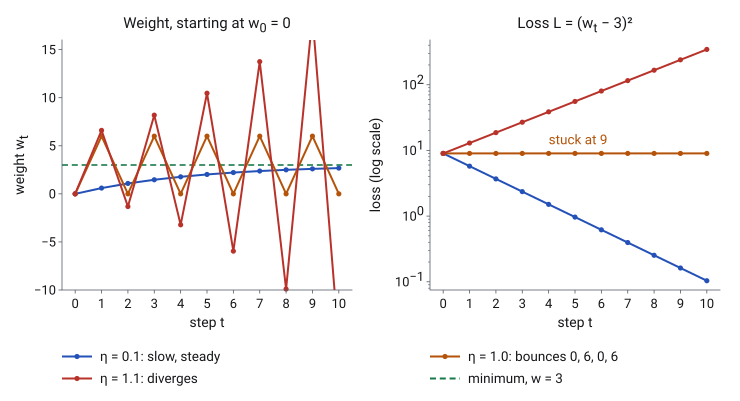
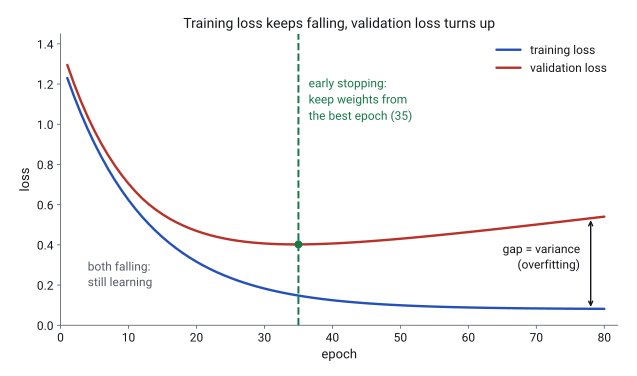

Gradient descent on a loss with a single weight, $L=(w-3)^2$, started at $w=0$, ends ten steps later at 2.68 when the learning rate is $\eta=0.1$, at 0 when it is $1.0$, and at $-15.6$ when it is $1.1$. The best weight is 3. Only $\eta$ changed, and the same update rule went from crawling towards the answer to bouncing back and forth to flying off.

Getting to a low training loss quickly and without blowing up is optimisation, and it's the first half of this note. The second half starts from a different symptom. A network scores 99% on its training data and 62% on validation data. The code is fine and the network has memorised the training set. Regularisation is the set of ways to make a low training loss carry over to data the network has not seen.

> **Key Takeaways**
> - Gradient descent steps by $-\eta\,g$; on $L=(w-3)^2$ a small $\eta$ crawls and one above 1 diverges.
> - Momentum adds up past gradients, so a steady direction speeds up and steps that flip sign cancel.
> - Adam divides a smoothed gradient by a smoothed gradient size, and corrects both for starting at zero.
> - L2 shrinks each weight by $(1-\eta\lambda)$ per step, L1 can reach exactly zero, and dropout divides survivors by $1-p$.

## One weight, three learning rates

Notation: $w$ is the weight, $L$ the loss and $g=\partial L/\partial w$ the gradient, the slope of the loss at the current weight. A negative slope means the loss falls if $w$ increases. Gradient descent steps against the slope:

$$w\leftarrow w-\eta\,g$$

For $L=(w-3)^2$ the slope is $g=2(w-3)$. At $w=0$ that is $-6$. A quick check that the slope is right: nudge $w$ to 0.01 and the loss goes from 9 to $(-2.99)^2=8.9401$, a drop of 0.0599, which is about $6\times0.01$.

With $\eta=0.1$ the first step is $w_1=0-0.1(-6)=0.6$. The next steps are 1.08, 1.464, 1.771. Each step is smaller than the last because the slope shrinks as $w$ nears 3, which is why ten steps only get it to 2.68.

With $\eta=1.0$ the step is $w-2(w-3)=6-w$. From 0 that gives 6, then 0, then 6. The weight bounces forever and the loss stays at 9.

Push it to $\eta=1.1$ and the weight goes 6.6, $-1.32$, 8.184, $-3.221$, landing further from 3 every time. That's divergence.

Forgetting the minus sign in the update sends you uphill. In practice $g$ comes from a small random batch of examples (mini-batch SGD) instead of the whole training set. That makes it a noisy estimate of the full gradient, but you get many cheap updates, and the noise can shake the weights off flat spots. The full-batch gradient is exact but costs more memory per update and gives fewer updates.

| Symptom | Likely cause | What to try |
|---|---|---|
| Loss jumps up and down, or becomes NaN | Learning rate too high | Lower $\eta$, clip gradients, lower momentum |
| Loss barely moves | Learning rate too low, or a plateau | Raise $\eta$, add momentum or Adam |
| Train 99%, validation 62% | Overfitting (high variance) | More data, L2, dropout, early stopping |
| Both poor | Underfitting (high bias) | Bigger model, train longer |

The [Stanford CS231n notes on training](https://cs231n.github.io/neural-networks-3/) go through these checks in practice.

## Momentum

Plain gradient descent only looks at the current slope. Momentum also keeps a velocity $u$ built from earlier gradients. On the same loss, with $\eta=0.1$, a memory factor $\beta=0.9$ and $u_0=0$:

$$u_1=-6,\qquad w_1=0-0.1(-6)=0.6$$

$$u_2=0.9(-6)+2(0.6-3)=-10.2$$

$$w_2=0.6-0.1(-10.2)=1.62$$

$$u_3=0.9(-10.2)+2(1.62-3)=-11.94$$

$$w_3=1.62+1.194=2.814$$

$$u_4=0.9(-11.94)+2(2.814-3)$$

$$=-11.118$$

$$w_4=2.814+1.1118=3.926$$

The rule used each time is

$$u_{t+1}=\beta u_t+g_t,\qquad w_{t+1}=w_t-\eta\,u_{t+1}$$

where $\beta$ (often 0.9) is the share of the old velocity that survives. Check it against the first lines: with $u_0=0$ the first velocity is just the first gradient, $-6$. In the lines above the velocity grew in size from 6 to 11.9 because the gradient kept pointing the same way. With many weights, a gradient component that flips sign from step to step partly cancels inside $u$, so steps that flip direction get damped while the steady direction speeds up.

The cost is overshoot: at step 4 the weight is 3.926, past the minimum at 3, which plain SGD at $\eta=0.1$ never does. In exchange it had passed 3 after four steps, where plain SGD with the same $\eta$ was only at 2.68 after ten. Some books write $(1-\beta)g_t$ in the velocity line instead, which scales everything differently, so state the form you use.

## Adam

Adam gives each weight its own step size. It keeps two running averages of the gradient $g_t$. The first, $m_t$, tracks the average gradient, and the second, $v_t$, tracks the average squared gradient, which measures how large the gradients are, ignoring sign:

$$m_t=\beta_1m_{t-1}+(1-\beta_1)g_t$$

$$v_t=\beta_2v_{t-1}+(1-\beta_2)g_t^2$$

The usual choices are $\beta_1=0.9$ and $\beta_2=0.999$. Both averages start at 0, and that causes a problem which a tiny case shows. On the same loss, at $w_0=0$ the first gradient is $g_1=-6$:

$$m_1=0.9(0)+0.1(-6)=-0.6$$

$$v_1=0.999(0)+0.001(36)=0.036$$

A good smoothed gradient should be about $-6$, but $m_1$ is only a tenth of that, because 90% of the average is still the zero it started from. Likewise $v_1$ is a thousandth of 36. Dividing by how much of the average is real so far corrects this:

$$\bar m_t=\frac{m_t}{1-\beta_1^t},\qquad\bar v_t=\frac{v_t}{1-\beta_2^t}$$

The bar marks a corrected value. At $t=1$ the divisors are $1-0.9=0.1$ and $1-0.999=0.001$:

$$\bar m_1=\frac{-0.6}{0.1}=-6,\qquad\bar v_1=\frac{0.036}{0.001}=36$$

Those are exactly the gradient and its square, as they should be after one observation. The step is

$$w_{t+1}=w_t-\eta\,\frac{\bar m_t}{\sqrt{\bar v_t}+\epsilon}$$

with a tiny $\epsilon=10^{-8}$ that only stops division by zero. At $t=1$ the ratio is $-6/\sqrt{36}=-1$, so the weight moves by $0.1\times1=0.1$ to $w_1=0.1$. Without the correction the ratio would be $-0.6/\sqrt{0.036}=-3.16$ and the step 0.316, three times too big.

By $t=2$ the correction has almost nothing left to fix. The new gradient is $g_2=2(0.1-3)=-5.8$:

$$m_2=0.9(-0.6)+0.1(-5.8)=-1.12$$

$$v_2=0.999(0.036)+0.001(33.64)$$

$$=0.0696$$

$$\bar m_2=\frac{-1.12}{1-0.81}=-5.895$$

$$\bar v_2=\frac{0.0696}{1-0.998001}=34.82$$

The ratio is $-5.895/\sqrt{34.82}=-0.999$ and the step is 0.0999. Dividing by $\sqrt{\bar v}$ means weights with large gradients take smaller steps and rarely updated ones take larger steps, and the first steps have size about $\eta$ whatever the gradient size. Early on the averages are rough, which is one reason learning-rate warmup (a small $\eta$ that grows over the first steps) is common, especially for transformers. The [Adam paper](https://arxiv.org/abs/1412.6980) gives the full algorithm, and the [d2l.ai chapter on optimisation algorithms](https://d2l.ai/chapter_optimization/index.html) sets it beside momentum and plain SGD.

## Overfitting and weight decay

The gap between 99% on training data and 62% on validation data is overfitting, also called high variance: the network fits quirks of the training set. If both numbers are poor the problem is the opposite, high bias or underfitting. The methods below all give up a little fit on the training set (more bias) in return for lower variance.

L2 regularisation adds a penalty on the squared weights to the loss. The new gradient has an extra $\lambda w$ ($\lambda$ sets how strong the penalty is):

$$L_{\text{total}}=L_{\text{data}}+\frac{\lambda}{2}\lVert w\rVert_2^2$$

The extra gradient goes into the SGD step:

$$w\leftarrow w-\eta(\nabla L_{\text{data}}+\lambda w)$$

$$w\leftarrow(1-\eta\lambda)\,w-\eta\nabla L_{\text{data}}$$

Every step first shrinks the weight by the factor $(1-\eta\lambda)$, which is why this is called weight decay. With $\eta=0.1$ and $\lambda=0.5$ the factor is $1-0.05=0.95$, so a weight of 2 becomes 1.9 before the data gradient is applied.

L1 uses $\lambda\lVert w\rVert_1$ instead, whose gradient is $\lambda\,\mathrm{sign}(w)$, a fixed size whatever the weight. Compare the shrink per step with $\eta=0.1$, $\lambda=0.5$ at a weight of 0.2: L2 removes $0.1\times0.5\times0.2=0.01$ and L1 removes $0.1\times0.5=0.05$. At a weight of 0.02, L2 removes 0.001 and L1 would still remove 0.05, which is more than the weight itself. The L2 pull fades as the weight shrinks, so weights get small but rarely exactly zero. The L1 pull does not fade, so small weights get pushed all the way to zero, which gives sparse models. (A plain L1 step would carry 0.02 past zero to $-0.03$; to land on exactly zero, implementations clip the weight at 0 when the step would cross it.)

AdamW applies the decay step $w\leftarrow w-\eta\lambda w$ directly to the weights, separate from the Adam step. A penalty placed inside the loss would be divided by Adam's per-weight scale and distorted.

Early stopping watches the validation loss. When it has not improved for a set number of epochs (the patience), training stops or the best saved weights are restored.

## Dropout

During training, dropout zeroes each unit with probability $p$ and scales the survivors up. Say a layer has outputs $h=[2,4,6,8]$ and $p=0.5$. If the random mask keeps the first and third units, the layer passes on $[2,0,6,0]$ divided by $1-p=0.5$:

$$\tilde h=[4,\ 0,\ 12,\ 0]$$

With $p=0.8$ and the same mask, survivors are divided by 0.2, giving $[10,0,30,0]$.

In symbols, with a mask value $r_i$ that is 1 (keep) with probability $1-p$ and 0 otherwise:

$$\tilde h_i=\frac{r_i\,h_i}{1-p}$$

Why divide? The average of $\tilde h_i$ over many random masks is

$$\mathbb{E}[\tilde h_i]=\frac{(1-p)\,h_i}{1-p}=h_i$$

so the layer's average output is unchanged, and at test time you can run the full network with no mask and no rescaling. Dropout stops units from relying on particular partners being present, which is called co-adaptation (the [dropout paper](https://jmlr.org/papers/v15/srivastava14a.html) explains the idea at length). Here "rate" means the drop probability $p$, as in PyTorch's `nn.Dropout(p)` and Keras's `Dropout(rate)`. The dropout paper uses $p$ the other way round, for the keep probability, and scales the weights at test time instead of the survivors during training. At $p=0.5$ the keep and drop probabilities are equal and hide any mix-up.

Label smoothing (the true class gets a little less than 1 and the others share the rest) and max-norm (force $\lVert w\rVert_2$ below a limit after each step) are two other regularisers you may see named.

## In the exam: updates, diagnoses and dropout

Write the update rule with the minus sign and say what each symbol is. If the question describes a train/validation gap, name the diagnosis (high variance or high bias) before any remedy, and give one reason per remedy. Dropout answers need two things stated outright: which probability "rate" means, and whether the rescaling happens at train time or test time.

## Practice: learning rates, L1, dropout and Adam

Gradient descent on $L=(w-3)^2$ from $w_0=0$ sends $w$ back and forth between 0 and 6 forever. What is $\eta$, and why?

Answer

$\eta=1$. Each step maps $w$ to $w-2(w-3)=6-w$, so $0\to6\to0$. Anything above 1 diverges.

Why does L1 produce exact zeros but L2 does not?

Answer

L1 pulls with constant size $\lambda$ regardless of how small the weight is. L2 pulls with size $\lambda|w|$, which shrinks to nothing as $w\to0$.

You use dropout with $p=0.8$ on $h=[1,2,3,4,5]$ and the mask keeps units 2 and 5. What is $\tilde h$, and what do you do at test time?

Answer

Divide survivors by 0.2.

$$\tilde h=[0,\ 10,\ 0,\ 0,\ 25]$$

At test time use the full layer with no mask and no rescaling.

Adam is at its third step and the stored first average is $m_3=-1.568$. What is $\bar m_3$?

Answer

The divisor is $1-0.9^3=0.271$, so

$$\bar m_3=\frac{-1.568}{0.271}=-5.786$$

