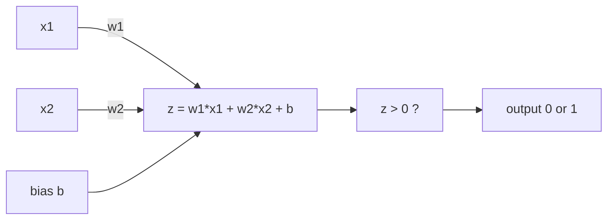
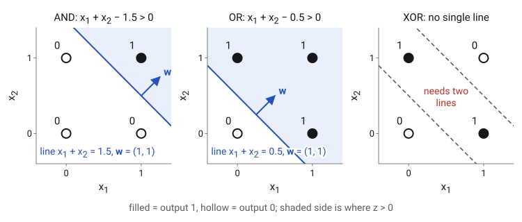

Take the point $(1, 3)$ and the rule "add $2x_1 - x_2 - 1$ and say yes if the total is positive". The total is $2 - 3 - 1 = -2$, so the answer is no. That is the entire perceptron: a weighted sum, a bias, and a yes/no cut. The interesting part is that it can fix its own weights when it says no and should have said yes.

## Quick idea

A perceptron is one neuron with a hard threshold. It multiplies each input by a weight, adds a bias, and outputs 1 if the result is positive and 0 otherwise. Geometrically it draws one straight line through the input plane and calls everything on one side "1".

It matters for two reasons. It learns from mistakes with a rule simple enough to run by hand, which is why it shows up in exams. And its failures (XOR above all) are the reason we stack neurons into layers in the next post.

## Picture it

*AND and OR each need one line. XOR puts its two 1s on opposite corners, so no single line can split them.*

## The detail

Notation follows the prerequisites post: $z=\mathbf w\cdot\mathbf x+b$, output $\hat y=1$ if $z>0$ and $\hat y=0$ otherwise, target $t$, learning rate $\eta$. Some papers fire on $z\ge 0$. Only inputs sitting exactly on the line change, so state which one you use.

**Bias and threshold.** A threshold $\theta$ means "fire if $\sum w_ix_i\ge\theta$". Move $\theta$ to the left and you get $\sum w_ix_i-\theta\ge 0$, so $b=-\theta$. Some lecture versions write the bias as an extra input $x_0=-1$ with weight $\theta$. Same line, different bookkeeping.

**The boundary.** The line $\mathbf w\cdot\mathbf x+b=0$ has $\mathbf w$ pointing at right angles to it, towards the side where $z$ is positive. For $3x_1-4x_2+12=0$ the intercepts are $x_1=-4$ (set $x_2=0$) and $x_2=3$ (set $x_1=0$).

**The learning rule.** After each example, compute $\hat y$ and update

$$
w_i \leftarrow w_i+\eta\,(t-\hat y)\,x_i,\qquad b\leftarrow b+\eta\,(t-\hat y).
$$

If the answer was right, $t-\hat y=0$ and nothing moves. If it said 0 but should say 1, we add $\eta x_i$ to each weight. Why this helps: the new sum is $z+\eta(t-\hat y)\|\mathbf x\|^2+\eta(t-\hat y)$, which moves $z$ in the right direction for that example. With labels $\pm1$ the rule on a mistake is $\mathbf w\leftarrow\mathbf w+\eta\,t\,\mathbf x$.

**Convergence.** If a line exists that separates the classes, the rule makes only finitely many mistakes. With $\pm1$ labels, bias folded into $\mathbf x$, $R=\max\|\mathbf x\|$ and margin $\gamma$ (the gap between the closest point and a separating line), the number of mistakes is at most $(R/\gamma)^2$. If no line exists, it never settles.

**What one perceptron can do.** AND, OR and NOT, yes. A valid AND is $\mathbf w=(1,1)$, $b=-1.5$. A valid OR is $\mathbf w=(1,1)$, $b=-0.5$.

**Why XOR is impossible.** XOR needs, row by row,

$$
b\le 0,\qquad w_1+b>0,\qquad w_2+b>0,\qquad w_1+w_2+b\le 0 .
$$

Add the middle two: $w_1+w_2+2b>0$. But the last row says $w_1+w_2+b\le 0$ and the first says $b\le 0$, so $w_1+w_2+2b\le 0$. Contradiction. The same trick works in three inputs: if $f(010)=f(101)=1$ and $f(011)=f(100)=0$, both pairs sum to the same input $(1,1,1)$ in weight space, so the two 1-rows would need a total above the two 0-rows' total, and they cannot.

**Counting.** There are $2^{2^n}$ Boolean functions of $n$ inputs. The linearly separable ones are:

| $n$ | functions $2^{2^n}$ | separable | not separable |
|---|---|---|---|
| 1 | 4 | 4 | 0 |
| 2 | 16 | 14 | 2 |
| 3 | 256 | 104 | 152 |
| 4 | 65536 | 1882 | 63654 |
| 5 | 4294967296 | 94572 | 4294872724 |

Not separable equals $2^{2^n}$ minus separable. We recomputed $n=1$ to $4$ by enumeration; the $n=5$ count is the standard published value. For $n=2$ the two failures are XOR and XNOR. The share of separable functions collapses fast, which is the argument for needing more than one neuron.

**Beyond one line.** Two repairs. A feature map adds a product input: with $\phi=(x_1,x_2,x_1x_2)$, XOR is $x_1+x_2-2x_1x_2$, linear in $\phi$. Or add a hidden layer, which is the next post. Any Boolean function can be built from AND, OR and NOT neurons, so a two-layer network of perceptrons can compute any of them.

## Worked example

Learn AND from $\mathbf w=(0,0)$, $b=0$, $\eta=1$, visiting $00,01,10,11$ in that order, firing when $z>0$.

Epoch 1: only $11$ is wrong ($z=0$, target 1). Update by $(1,1)$ and $b+1$: $\mathbf w=(1,1)$, $b=1$.
Epoch 2: $00$ gives $z=1$, wrong. Update: $\mathbf w=(1,1)$, $b=0$. Then $01$ gives $z=1$, wrong (target 0). Update by $-(0,1)$: $\mathbf w=(1,0)$, $b=-1$. Then $10$ gives $z=0$, fine. Then $11$ gives $z=0$, wrong. Update: $\mathbf w=(2,1)$, $b=0$.
Epochs 3 to 5 make 3, 2 and 1 corrections respectively (same rule, same order).
Epoch 6: no mistakes. Final $\mathbf w=(2,1)$, $b=-2$.

Check: $z(11)=2+1-2=1>0$, $z(10)=0$, $z(01)=-1$, $z(00)=-2$. Only $11$ fires.

$$
\boxed{\mathbf w=(2,1),\quad b=-2,\quad\text{six passes}}
$$

This is not the textbook $(1,1,-1.5)$. That one is a valid AND, but it is not what the rule produces from zero. Different start or visiting order gives a different valid answer. OR from the same start ends at $\mathbf w=(1,1)$, $b=0$ after four passes (the last one clean). XOR from zero cycles through the same weights forever.

## Exam corner

**Asked in past exams.** Four past papers: two Mids and the first quiz of two different sittings. One Mid asks for the counting table for $n=2$ to $5$, plus a two-layer threshold network for a four-term Boolean expression, then "is it linearly separable?". The other Mid asks you to draw an AND/OR/NOT network for another three-input expression. The quizzes repeat the network question and add "choose the weights and bias for AND from three options", plus proving $\Phi'=\Phi(1-\Phi)$ for the sigmoid.

**Marks come from.** The truth table written out. Simplifying the expression first. Each gate's weights with a threshold check on every row it matters for. A verdict with a reason (the sum argument above, not "it looks like XOR").

**Common slips.** Calling the network XOR without a table. Weights that fail one row. Mixing $>$ and $\ge$ halfway through. Forgetting the bias update. Saying "a perceptron cannot do XOR, so it cannot do this function" without checking whether the function is a two-layer network.

**Cheat line.** $\hat y=[\mathbf w\cdot\mathbf x+b>0]$; update $\eta(t-\hat y)x_i$ and $\eta(t-\hat y)$; AND $(1,1,-1.5)$; OR $(1,1,-0.5)$; counts $4,14,104,1882,94572$.

## Check yourself

1. $\mathbf w=(2,-1)$, $b=-1$, input $(1,3)$. What does the perceptron output?

Answer

$z=2-3-1=-2$, so the output is 0 (or $-1$ in a $\pm1$ convention).

2. A function has $f(010)=f(101)=1$ and $f(011)=f(100)=0$. Why is it not linearly separable?

Answer

Both pairs of inputs add up to $(1,1,1)$, so $z(010)+z(101)=z(011)+z(100)=w_1+w_2+w_3+2b$. The two 1-rows need a positive total and the two 0-rows need a total of at most 0, yet the totals are equal.

3. Training never reaches zero errors. Give two reasons.

Answer

The data is not linearly separable (XOR-style), or the labels contain noise or a mistake. A bug in the update sign also does it.

## Read more

- [Wikipedia: Perceptron](https://en.wikipedia.org/wiki/Perceptron) for the convergence theorem and the XOR history.
- [CS231n notes on the neuron model](https://cs231n.github.io/neural-networks-1/) for the biological picture and how neurons combine into layers.
