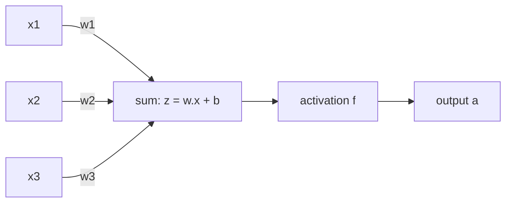

A single sigmoid neuron with $x=2$, $w=0.5$ and $b=0$ gives an output of 0.7311. If the target was 1, the neuron is wrong by 0.2689, and one small nudge to $w$ moves it to 0.5529. That one calculation is most of the Mid. Backprop, RNNs, LSTMs and GRUs are this same calculation, repeated and stacked.

So this post does two jobs. It gives you the handful of maths tools that calculation uses, and it fixes the symbols so that every later post reads the same way. Nothing here needs more than school algebra and one idea from calculus.

## Quick idea

A neuron takes some numbers in, multiplies each by a weight, adds a bias, and pushes the total through a squashing function. That is the whole recipe:

$$z=\mathbf w\cdot\mathbf x+b,\qquad a=f(z)$$

A network is many of these wired together. Training is the search for weights that make the network's answers close to the right ones. The search works by measuring how wrong the network is, working out which way each weight should move, and moving it a little. The tools in this post are exactly what you need for those three steps: dot products and matrices for the neuron, a loss for "how wrong", and derivatives for "which way".

## Picture it

First the biology, because the vocabulary came from there. A real neuron receives signals on its dendrites, adds them up in the cell body, and sends a pulse down the axon if the total passes a threshold. Below the threshold it stays silent. Above it, it fires fully. There is no half-firing.

| Biological neuron | Artificial neuron |
|---|---|
| Dendrites receive signals | Inputs $x_i$ |
| Strength of each synapse | Weights $w_i$ |
| Excitatory or inhibitory synapse | Positive or negative weight |
| Cell body sums the signals | $z=\sum_i w_ix_i+b$ |
| Firing threshold | Bias $b$ (threshold with the sign flipped) |
| All-or-none pulse on the axon | Activation $a=f(z)$ |

Here is the same thing as a diagram.

Two things to keep: a neuron fires only past a threshold, and the weights and threshold are what you can tune. The perceptron in the next post is this picture with a hard threshold.

### A short history

You do not need dates for the exam, but the story explains why the course starts where it does.

| Year | Event |
|---|---|
| 1943 | McCulloch and Pitts describe neurons as simple logic circuits |
| 1949 | Hebb proposes that pathways used together get stronger |
| 1956 | The Dartmouth workshop names the field of artificial intelligence |
| 1958 | Rosenblatt builds the perceptron in hardware |
| 1959 | Widrow and Hoff build ADALINE, used to cancel echo on phone lines |
| 1969 | Minsky and Papert show a single perceptron cannot learn XOR; funding dries up |
| 1982 | Hopfield's work revives interest |
| 1986 | Rumelhart, Hinton and Williams popularise backpropagation |
| 1997 | LSTM is introduced |
| 1998 | LeCun's group reads handwritten digits with a trained convolutional network |

Two ideas from this history matter for you: the perceptron (post 01) and its XOR failure are why we need hidden layers (post 02), and backprop (posts 03a and 03b) is what made training those layers practical.

Supervised learning uses labelled examples (spam or not spam). Unsupervised learning has no labels and looks for clusters. The Mid is almost entirely supervised.

## The detail

### Notation used in every post

One notation throughout. When a source writes something different, the right-hand column tells you the translation.

| Symbol | Meaning | Other names you may see |
|---|---|---|
| $x_i$, $\mathbf x$ | input, input vector (bold means vector) | |
| $w_i$, $\mathbf w$, $W$, $b$ | weight, weight vector, weight matrix, bias | |
| $z=\mathbf w\cdot\mathbf x+b$ | pre-activation | $v_j$, induced local field |
| $a=f(z)$ | activation | $\varphi(v_j)$, $y_j$ |
| $t$ | target | $d_j$ |
| $\hat y$ | network output | $y$ in the perceptron slides |
| $e=t-\hat y$ | error, target minus output | |
| $\eta$ | learning rate | LR |
| $\odot$ | element-wise product | |
| $W^{(l)},\mathbf b^{(l)},\mathbf z^{(l)},\mathbf a^{(l)}$ | layer $l$ quantities; $\mathbf a^{(0)}=\mathbf x$ | |
| $\delta$ | local gradient, $\partial E/\partial z$ | $\delta_j$ |
| $E$ | loss | |

### Vectors and the dot product

A vector is an ordered list of numbers. The dot product multiplies matching entries and adds the results:

$$\mathbf w\cdot\mathbf x=\sum_i w_ix_i$$

For $\mathbf a=(2,-1,3)$ and $\mathbf b=(4,0,1)$ it is $8+0+3=11$. The result is large and positive when the two vectors point the same way, near zero when they are unrelated, and negative when they oppose. So $\mathbf w\cdot\mathbf x$ reads as "how much evidence, weighted by how much we trust each input".

### Matrices

A matrix times a vector is a stack of dot products, one per row. If $W$ has shape $m\times n$ and $\mathbf x$ has $n$ entries, then $W\mathbf x$ has $m$ entries. The inner sizes must match. Shape mismatches are the most common slip in matrix questions, so write the shapes beside the equation before you multiply.

For a layer, we write $\mathbf z=W\mathbf x+\mathbf b$. Row $j$ of $W$ holds the weights of neuron $j$. Our convention is that $W^{(l)}$ has shape (neurons in layer $l$) by (neurons in layer $l-1$).

### Derivatives and the chain rule

The derivative $\frac{dy}{dx}$ is the slope: how far $y$ moves per unit nudge of $x$. The chain rule says slopes multiply along a chain. If $y$ depends on $u$ and $u$ depends on $x$:

$$\frac{dy}{dx}=\frac{dy}{du}\cdot\frac{du}{dx}$$

A partial derivative $\frac{\partial f}{\partial w}$ does the same while holding every other variable fixed. The gradient is the vector of all the partials, and it points uphill. To reduce a loss, you step against it. Backpropagation is nothing more than this chain rule applied layer by layer.

### Sigmoid

$$\sigma(z)=\frac{1}{1+e^{-z}}$$

It squashes any real number into $(0,1)$. Its derivative has a tidy form. Write $\sigma=(1+e^{-z})^{-1}$, then

$$\sigma'(z)=e^{-z}(1+e^{-z})^{-2}=\sigma\cdot\frac{e^{-z}}{1+e^{-z}}=\sigma(1-\sigma)$$

The last step holds because $\frac{e^{-z}}{1+e^{-z}}=1-\sigma$. The maximum slope is 0.25, at $z=0$, and it flattens out in both tails:

| $z$ | $-4$ | $-2$ | $0$ | $2$ | $4$ |
|---|---|---|---|---|---|
| $\sigma(z)$ | 0.0180 | 0.1192 | 0.5000 | 0.8808 | 0.9820 |
| $\sigma'(z)$ | 0.0177 | 0.1050 | 0.2500 | 0.1050 | 0.0177 |

That 0.25 ceiling returns in the RNN posts, where many small slopes multiplied together shrink the gradient to almost nothing.

### Loss: mean squared error

A loss turns "how wrong is the network" into one number. For $N$ samples:

$$E=\frac{1}{2N}\sum_{p=1}^{N}\left(t^p-\hat y^p\right)^2$$

We square the gaps because plain differences cancel (a miss of $+1$ and a miss of $-1$ would total zero), and squaring also punishes big misses more. The $\tfrac12$ is there only so the derivative comes out clean. For one sample, $\partial E/\partial\hat y=\hat y-t$. Some books leave the $\tfrac12$ out, which doubles every gradient. Always state which you are using, and never drop it halfway through an answer.

### Training as gradient descent

Training repeats three steps: compute the loss, compute its gradient, move each weight a small step downhill.

$$w\leftarrow w-\eta\,\frac{\partial E}{\partial w}$$

Too large an $\eta$ overshoots; too small crawls. The perceptron rule in post 01 is a special case that needs no calculus. Multilayer networks use the full gradient version.

### Bias and variance

Bias is the error from a model too simple to capture the pattern, such as a straight line through a curve. Variance is the error from a model so flexible that it chases noise in the particular training set. Simple models have high bias and low variance, and they underfit. Flexible models have low bias and high variance, and they overfit. Expected error is bias squared plus variance plus irreducible noise. The tell-tale sign of overfitting is training loss still falling while validation loss rises. Regularization, dropout and early stopping (post 06) accept a little extra bias to buy a lot less variance.

### One neuron, derived end to end

Take $E=\tfrac12(t-a)^2$, $a=\sigma(z)$, $z=wx+b$. The chain rule gives three factors:

$$\frac{\partial E}{\partial w}=\frac{\partial E}{\partial a}\cdot\frac{\partial a}{\partial z}\cdot\frac{\partial z}{\partial w}=-(t-a)\cdot a(1-a)\cdot x$$

The first factor is $-(t-a)$ because $E$ changes by that much per unit change in $a$. The second is the sigmoid slope. The third is $x$ because $z=wx+b$ is linear in $w$. Every backprop derivation in this series is a longer version of this line.

## Worked example

Neuron with $x=2$, target $t=1$, $w=0.5$, $b=0$, $\eta=0.5$, sigmoid activation, loss $E=\tfrac12(t-a)^2$.

$$\begin{aligned}
z&=0.5\cdot2+0=1\\
a&=\sigma(1)=0.7311\\
E&=\tfrac12(1-0.7311)^2=0.03616\\
\frac{\partial E}{\partial w}&=-(1-0.7311)(0.7311)(1-0.7311)(2)=-0.10575\\
w_\text{new}&=0.5-0.5(-0.10575)=0.5529
\end{aligned}$$

$$\boxed{w_\text{new}=0.5529}$$

Check: with the new weight $a=0.7513$, closer to the target of 1.

A second tiny case, to see the step rule at work. Minimise $E=(w-3)^2$ from $w_0=0$ with $\eta=0.1$. The gradient is $2(w-3)$.

| Step | Gradient | New $w$ |
|---|---|---|
| 1 | $-6$ | 0.6 |
| 2 | $-4.8$ | 1.08 |
| 3 | $-3.84$ | 1.464 |

Each step closes 20% of the remaining gap to 3. The steps shrink as the slope flattens, which is why gradient descent settles down on its own near a minimum.

## Exam corner

Asked in past exams: this material is never a question on its own. It is the machinery inside other questions. In the practice set it appears as deriving $\partial L/\partial w=(\hat y-y)x$ for log-loss, finding $\partial L/\partial\hat y$ for a given target and output (for $t=5$, $\hat y=2$ with $L=\tfrac12(t-\hat y)^2$ it is $-3$), diagnosing overfitting from a training-down, validation-up curve, and a softmax with cross-entropy item.

Marks come from: writing the formula, substituting the numbers, and finishing the arithmetic. A correct formula with a wrong substitution still earns the first mark.

Common slips:

1. Dropping the $\tfrac12$ in one line and keeping it in the next.
2. Using $t-\hat y$ in the error but $\hat y-t$ in the update, which sends the weight uphill. The sign must match the update direction.
3. Multiplying matrices whose inner sizes differ.
4. Forgetting the $a(1-a)$ factor when differentiating a sigmoid output.

Formula cheat line: $z=\mathbf w\cdot\mathbf x+b$; $\sigma'=\sigma(1-\sigma)\le0.25$; $E=\tfrac12(t-\hat y)^2$; $\partial E/\partial\hat y=\hat y-t$; $w\leftarrow w-\eta\,\partial E/\partial w$.

## Check yourself

Question 1. Compute $\mathbf w\cdot\mathbf x+b$ for $\mathbf w=(1,-2,0.5)$, $\mathbf x=(4,1,2)$, $b=-1$.

Answer

$4-2+1-1=2$.

Question 2. A sigmoid neuron outputs $a=0.8$ for a target of 1, with $E=\tfrac12(t-a)^2$. What is $\partial E/\partial z$?

Answer

$-(t-a)\cdot a(1-a)=-(0.2)(0.8)(0.2)=-0.032$.

## Read more

- [d2l.ai chapter on multilayer perceptrons](https://d2l.ai/chapter_multilayer-perceptrons/mlp.html), a textbook treatment you can reread after post 02.
- [3Blue1Brown, But what is a neural network](https://www.3blue1brown.com/lessons/neural-networks), the best visual introduction to the neuron picture.
- [Wikipedia on the bias-variance tradeoff](https://en.wikipedia.org/wiki/Bias%E2%80%93variance_tradeoff), for the full decomposition behind the paragraph above.

## How to use this series

Read the posts in order the first time. Each one assumes the one before it, and the symbols never change, so a symbol you do not recognise is defined in this post.

Every post has the same layout so you can skim. The quick idea and the picture are for understanding. The detail and the worked example are the rigorous part, and you should be able to reproduce the derivation with the book closed. The exam corner tells you what the question looks like and where the marks are. The check-yourself questions are quick, so try them before opening the answers.

The most useful habit is to redo each worked example with new numbers on paper. Change $x$ or $t$, recompute, and compare your result against the pattern. If you only read the arithmetic, it feels easy and then disappears under exam pressure.

The week before the Mid, read the exam corners and the clinic post, and go back only when a step stops making sense.

Order: [Perceptron](/blog/cse425-mid-perceptron/), [MLP and activations](/blog/cse425-mid-mlp-activations/), backprop in two parts ([output layer](/blog/cse425-mid-backprop-output-layer/), [hidden layers](/blog/cse425-mid-backprop-hidden-layers/)), [computation graphs](/blog/cse425-mid-computation-graphs/), [batch normalization](/blog/cse425-mid-batch-norm/), [optimization and regularization](/blog/cse425-mid-optimization-regularization/), RNNs in two parts ([unrolling](/blog/cse425-mid-rnn-basics/), [BPTT](/blog/cse425-mid-bptt/)), [LSTM](/blog/cse425-mid-lstm/), [GRU](/blog/cse425-mid-gru/), then the [exam clinic](/blog/cse425-mid-exam-clinic/). The final-exam series starts at [its own prerequisites post](/blog/cse425-final-prerequisites/).

<!-- Reviewer notes: no past-paper counts were available in the digest for this topic, so the exam corner gives patterns only. The perceptron-slide sign convention (e=t-y with +eta*e*x) is mentioned in the notation table only; post 01 should state the update rule explicitly. The Hopfield 1982 and Dartmouth 1956 rows come from the digest and general knowledge; the optional gradient-descent and sigmoid plots were replaced by tables. -->
