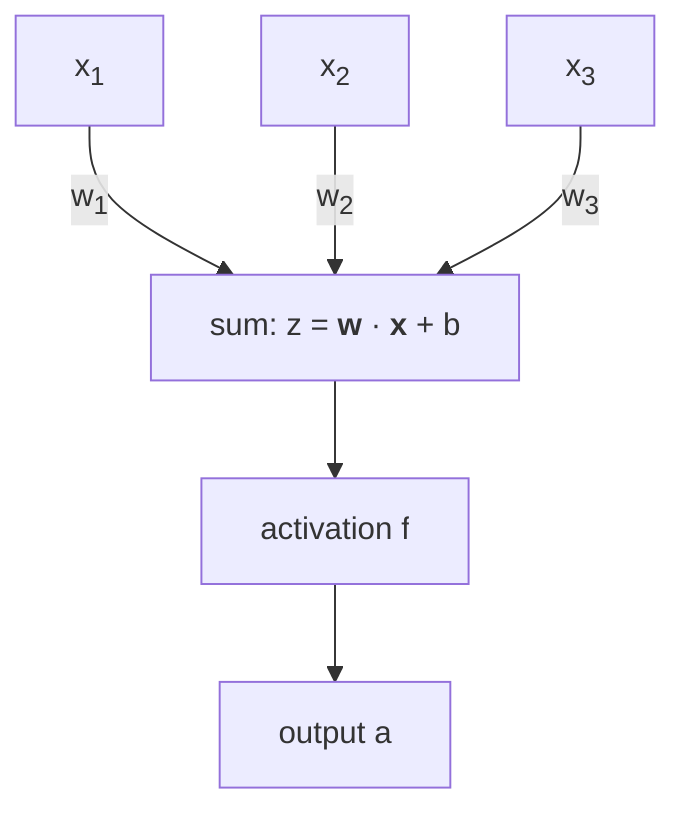

A single sigmoid neuron with input 2, weight 0.5 and bias 0 gives an output of 0.7311. If the right answer was 1, it is short by 0.2689, and one small nudge to the weight moves the output up to 0.7513. Most of the Mid is that calculation. Backprop, RNNs, LSTMs and GRUs repeat it and stack it in different ways.

This note collects the few maths tools that calculation uses, and fixes the symbols so that every later note reads the same way. It needs school algebra and one idea from calculus.

> **Key Takeaways**
> - A neuron multiplies each input by a weight, adds a bias, and passes the total through a squashing function.
> - Training moves each weight a small step in the direction that lowers the loss, over and over.
> - The chain rule says slopes multiply along a chain, and backprop is that rule applied layer by layer.
> - Across the series the error is $e=\widehat{y}-y$, the loss is $L$, and the update is $w\leftarrow w-\eta\,\delta\,a$.

## What one neuron computes

Start with the numbers. The input is $x=2$, the weight is $w=0.5$ and the bias is $b=0$. A weight says how much the neuron cares about its input, and a bias is a fixed amount added regardless of the input. The neuron first forms the weighted total

$$z=wx+b=0.5\cdot2+0=1$$

and then passes $z$ through an activation function $f$. The activation is a squashing function: it takes any number, however large or small, and squeezes it into a fixed range. Here $f$ is the sigmoid, which squeezes into the range 0 to 1:

$$a=f(z)=\frac{1}{1+e^{-z}}=0.7311$$

With several inputs, each input gets its own weight and the total becomes a sum over all of them:

$$z=\mathbf w\cdot\mathbf x+b,\qquad a=f(z)$$

Bold letters are lists of numbers (vectors), and the dot between $\mathbf w$ and $\mathbf x$ is explained a little further down. The total $z$ is called the pre-activation, because it is the number just before the activation function is applied. The word "neuron" comes from biology, where a cell adds up incoming signals and fires only if the total passes a threshold. The artificial version borrows the add-then-fire shape and very little else.

A network is many neurons wired together, with the outputs of some becoming the inputs of others. Training is the search for weights that make the network's answers close to the right ones. That needs a single number for how wrong the network is (the loss) and, for each weight, the direction in which the loss gets smaller (a derivative).

## Where the course starts

The perceptron, a neuron that outputs a hard yes or no, was described in 1958. In 1969 Minsky and Papert showed that one perceptron cannot learn the XOR function, and funding for the field dried up. Backpropagation, popularised in 1986 by Rumelhart, Hinton and Williams, made it practical to train the stacked layers that fix that weakness. The LSTM followed in 1997 and a trained convolutional network read handwritten digits by 1998. That order is the order of this series: the [perceptron](/blog/cse425-mid-perceptron/), then [layers of neurons](/blog/cse425-mid-mlp-activations/), then backprop.

Supervised learning uses labelled examples, such as emails marked spam or not spam. Unsupervised learning has no labels and looks for structure, for example clusters. The Mid is almost entirely supervised.

## Vectors and the dot product

A vector is an ordered list of numbers. The dot product multiplies matching entries and adds the results:

$$\mathbf w\cdot\mathbf x=\sum_i w_ix_i$$

For $\mathbf u=(2,-1,3)$ and $\mathbf v=(4,0,1)$ it is $8+0+3=11$. The result is large and positive when the two vectors point the same way, near zero when they are close to perpendicular and negative when they oppose. In a neuron, $\mathbf w\cdot\mathbf x$ is the evidence in favour, with each input counted as much as its weight says it should be.

## Matrices

A matrix times a vector is a stack of dot products, one per row. If $W$ has $m$ rows and $n$ columns (shape $m\times n$) and $\mathbf x$ has $n$ entries, then $W\mathbf x$ has $m$ entries. The inner sizes, both $n$, must match. A misread shape changes the answer. I write the shapes beside the equation before multiplying anything.

A whole layer of neurons is then written $\mathbf z=W\mathbf x+\mathbf b$. Row $j$ of $W$ holds the weights of neuron $j$, so $W$ has one row per neuron in this layer and one column per neuron in the layer before.

## Slopes and the chain rule

The derivative $\frac{dy}{dx}$ is the slope: how far $y$ moves per unit nudge of $x$. If $y=x^2$ then the slope at $x=3$ is 6, so a nudge of 0.01 in $x$ moves $y$ by about 0.06.

The chain rule is about two steps in a row. If $y$ depends on $u$ and $u$ depends on $x$, a nudge to $x$ moves $u$, and that moves $y$. The slopes multiply:

$$\frac{dy}{dx}=\frac{dy}{du}\cdot\frac{du}{dx}$$

For $y=u^2$ and $u=3x$ at $x=1$: $dy/du=2u=6$ and $du/dx=3$, so $dy/dx=18$. Checking directly, $y=9x^2$ has slope $18x=18$.

A partial derivative $\frac{\partial L}{\partial w}$ is the same slope with every other variable held fixed. The gradient is the list of all the partial derivatives, and it points uphill. To make a loss smaller you step against it.

## The sigmoid and its slope

The sigmoid $\sigma(z)=1/(1+e^{-z})$ squashes any real number into the range between 0 and 1. Its slope has a tidy form. Write $\sigma=(1+e^{-z})^{-1}$ and differentiate:

$$\sigma'(z)=e^{-z}(1+e^{-z})^{-2}$$

$$=\sigma\cdot\frac{e^{-z}}{1+e^{-z}}$$

The last fraction equals $1-\sigma$, because $1-\sigma=\frac{1+e^{-z}-1}{1+e^{-z}}$. That gives

$$\sigma'(z)=\sigma(z)\,\big(1-\sigma(z)\big)$$

The slope is at most 0.25, reached at $z=0$, and it flattens out in both tails:

| $z$ | $\sigma(z)$ | $\sigma'(z)$ |
|---|---|---|
| $-4$ | 0.0180 | 0.0177 |
| $-2$ | 0.1192 | 0.1050 |
| $0$ | 0.5000 | 0.2500 |
| $2$ | 0.8808 | 0.1050 |
| $4$ | 0.9820 | 0.0177 |

That 0.25 ceiling returns in the RNN notes, where many small slopes multiplied together shrink a gradient to almost nothing.

## Loss and one step of gradient descent

A loss turns "how wrong is the network" into one number. Call the right answer the target $y$ and the network's answer the output $\widehat{y}$ (the hat always marks a prediction). The error is the output minus the target, $e=\widehat{y}-y$, and the loss for one example is half its square:

$$L=\tfrac12\,(\widehat{y}-y)^2$$

Without the square, a miss of $+1$ and a miss of $-1$ would cancel when you add them up. Squaring also punishes a big miss much more than a small one. The $\tfrac12$ is there so that the 2 from differentiating cancels, which gives $\partial L/\partial\widehat{y}=\widehat{y}-y=e$. Some books leave the $\tfrac12$ out, which doubles every gradient, so state which one you use and keep it for the whole answer. For several examples the loss is the average of these per-example values.

Now the neuron from the start, with target $y=1$. Its output is $\widehat{y}=a=0.7311$, so $e=0.7311-1=-0.2689$ and $L=\tfrac12(0.2689)^2=0.03616$. To change $w$ we need $\partial L/\partial w$. The weight affects $z$, then $z$ affects $a$, then $a$ affects $L$, so the chain rule gives three factors:

$$\frac{\partial L}{\partial w}=\frac{\partial L}{\partial a}\cdot\frac{\partial a}{\partial z}\cdot\frac{\partial z}{\partial w}$$

$$=e\cdot a(1-a)\cdot x$$

The first factor is $e$ because that is how fast $L$ changes with the output. The second is the sigmoid slope. The third is $x$ because $z=wx+b$ is a straight line in $w$ with slope $x$. Each factor has a number:

$$e=-0.2689,\qquad x=2$$

$$a(1-a)=0.7311\times0.2689=0.19661$$

$$\frac{\partial L}{\partial w}=-0.2689\times0.19661\times2=-0.10575$$

The gradient is negative, which says that raising $w$ lowers the loss. Gradient descent moves each weight a small step against its gradient. The size of the step is set by the learning rate $\eta$:

$$w\leftarrow w-\eta\,\frac{\partial L}{\partial w}$$

With $\eta=0.5$:

$$w_\text{new}=0.5-0.5\times(-0.10575)=0.5529$$

As a check, rerun the neuron with the new weight. Now $z=0.5529\times2=1.1058$, the output is 0.7513 and the loss is 0.0309, both better than before. Pick $\eta$ with some care: too large and the step overshoots, too small and training crawls. The backprop derivations later in the series are longer versions of the same chain-rule line.

A second case shows the step rule on its own. Minimise $L=(w-3)^2$ from $w=0$ with $\eta=0.1$. The gradient is $2(w-3)$.

| Step | Gradient | New $w$ |
|---|---|---|
| 1 | $-6$ | 0.6 |
| 2 | $-4.8$ | 1.08 |
| 3 | $-3.84$ | 1.464 |

Each step closes 20% of the remaining gap to 3. Nobody shrinks the step size here; it shrinks because the slope gets flatter near the minimum.

## Bias and variance

Bias here means the error from a model too simple to capture the pattern, such as a straight line through a curve. Variance is the error from a model so flexible that it chases the noise in one particular training set. Simple models have high bias and low variance, and they underfit. Flexible models have low bias and high variance, and they overfit. For squared-error loss, the expected error splits into bias squared, variance and irreducible noise (see [the Wikipedia article](https://en.wikipedia.org/wiki/Bias%E2%80%93variance_tradeoff) for the derivation). The sign of overfitting is training loss still falling while validation loss rises. Regularisation, dropout and early stopping, all in the [optimisation note](/blog/cse425-mid-optimization-regularization/), add a little bias in exchange for lower variance.

## The notation every note uses

One notation runs through the whole series, so that a symbol means one thing everywhere. The input is $\mathbf x$, a weight is $w$ (a matrix of them is $W$) and a bias is $b$. The pre-activation is $z$ and the activation is $a=f(z)$. For a layer, a superscript in brackets names the layer: $W^{(l)}$, $\mathbf b^{(l)}$, $\mathbf z^{(l)}$ and $\mathbf a^{(l)}$ belong to layer $l$, and $\mathbf a^{(0)}=\mathbf x$. The matrix $W^{(l)}$ has one row per neuron in layer $l$ and one column per neuron in layer $l-1$.

The target is $y$ and the network's output is $\widehat{y}$. A hat always means a prediction. The error is $e=\widehat{y}-y$, the loss is $L$, and the learning rate is $\eta$. The local gradient of a neuron is $\delta=\partial L/\partial z$, the slope of the loss with respect to that neuron's pre-activation. The weight update is $w\leftarrow w-\eta\,\delta\,a$, where $a$ is the signal arriving on that weight. In the recurrent notes $t$ is the time step, $h$ is the hidden state and $H$ is the hidden size. An expectation is always written $\mathbb{E}$, and $\odot$ means entry-by-entry multiplication.

Course papers often use other letters for the same things: $d$ for the target, $v$ for the pre-activation and $\varphi$ for the activation function. Some of them also define the error as target minus output and $\delta$ as $-\partial E/\partial z$, which flips the sign of every $\delta$ but gives exactly the same weight updates. The perceptron slides call the output $y$. The translation is always letter for letter, so if you meet a different symbol, match it to the role it plays.

## Reading order

The notes assume the ones before them. [The perceptron](/blog/cse425-mid-perceptron/) and [layers with activations](/blog/cse425-mid-mlp-activations/) come first, then backprop in two parts ([output layer](/blog/cse425-mid-backprop-output-layer/) and [hidden layers](/blog/cse425-mid-backprop-hidden-layers/)) and [computation graphs](/blog/cse425-mid-computation-graphs/). After those come [batch normalisation](/blog/cse425-mid-batch-norm/) and [optimisation and regularisation](/blog/cse425-mid-optimization-regularization/), then recurrent networks in two parts ([unrolling](/blog/cse425-mid-rnn-basics/) and [BPTT](/blog/cse425-mid-bptt/)), the [LSTM](/blog/cse425-mid-lstm/) and the [GRU](/blog/cse425-mid-gru/). The [Mid practice problems](/blog/cse425-mid-exam-clinic/) collect worked patterns for revision. The Final series starts at [its own prerequisites note](/blog/cse425-final-prerequisites/).

Following a worked example and doing one are different skills. Redo each one on paper with a changed input or target, then compare your working with the note. For a visual version of the neuron picture, [3Blue1Brown](https://www.3blue1brown.com/lessons/neural-networks) is hard to beat, and the [d2l.ai chapter on multilayer perceptrons](https://d2l.ai/chapter_multilayer-perceptrons/mlp.html) rewards a second read after the layers note.

## Practice: dot products and gradients

Compute $\mathbf w\cdot\mathbf x+b$ for $\mathbf w=(1,-2,0.5)$, $\mathbf x=(4,1,2)$ and $b=-1$.

Answer

$$4-2+1-1=2$$

A sigmoid neuron outputs $a=0.8$ for a target of $y=1$, with $L=\tfrac12(\widehat{y}-y)^2$. What is $\partial L/\partial z$?

Answer

The error is $e=0.8-1=-0.2$ and the sigmoid slope is $0.8(1-0.8)=0.16$.

$$\frac{\partial L}{\partial z}=e\cdot a(1-a)$$

$$=-0.2\times0.16=-0.032$$

In the descent example, $w=1.464$ after step 3. What are the gradient and the new $w$ at step 4?

Answer

$$2(1.464-3)=-3.072$$

$$w=1.464-0.1\times(-3.072)=1.7712$$

