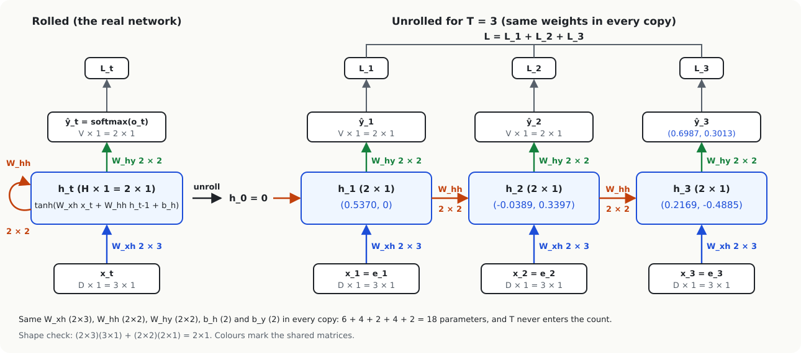

An RNN that reads 50 words has exactly as many weights as one that reads 5. Its weights do not grow with the length of the sequence, because the same few matrices are used again at every step. Once you see that, parameter-counting questions get quick, since the sequence length never enters the count.

The reason to want one at all is that an ordinary network (an MLP) takes a fixed-size input and has no memory. Show it the numbers 5, 10, 15, 20 one at a time and ask for the next number: when it sees 20, it has no idea what came before. A sentence like "I moved to France years ago, so I need to speak ___" has the same problem, because the answer depends on a word far back. A recurrent network fixes this by feeding its own previous hidden state back in as an extra input at the next step. The hidden state is the network's memory of everything so far, squeezed into $H$ numbers.

> **Key Takeaways**
> - An RNN reuses the same weight matrices at every step, so its parameter count does not depend on the sequence length $T$.
> - The hidden state $\mathbf h_t$ comes from the current input and $\mathbf h_{t-1}$, which is how earlier steps reach later ones.
> - With one-hot inputs, multiplying by $W_{xh}$ picks out one column of it.
> - Teacher forcing feeds the true previous output in training; at test time the model must use its own.

## A small RNN, run by hand

Everything below is small enough to compute by hand. The network has three possible inputs, written as one-hot vectors: a list of numbers with a single 1 and the rest 0, so category 1 is $(1,0,0)$, category 2 is $(0,1,0)$ and category 3 is $(0,0,1)$. The hidden state has two numbers, and so does the output. Three weight matrices (and two bias vectors) do all the work:

$$W_{xh}=\begin{pmatrix}0.5&-0.3&0.2\\0.1&0.4&-0.6\end{pmatrix}$$

$$W_{hh}=\begin{pmatrix}0.3&-0.2\\0.1&0.5\end{pmatrix}$$

$$W_{hy}=\begin{pmatrix}1&-1\\0.5&0.5\end{pmatrix}$$

The bias for the hidden layer is $\mathbf b_h=(0.1,\,-0.1)$ and the output bias is $\mathbf b_y=\mathbf 0$. The inputs are the three categories in turn, $\mathbf x_1=(1,0,0)$, $\mathbf x_2=(0,1,0)$, $\mathbf x_3=(0,0,1)$, and the hidden state starts at $\mathbf h_0=(0,0)$.

Every step is the same calculation. Multiply the input by $W_{xh}$ and the previous hidden state by $W_{hh}$, add the two results and the bias $\mathbf b_h$, then pass the total through $\tanh$, which squashes any number into the range $-1$ to $1$ (small numbers pass almost unchanged, large ones are pushed towards $\pm1$). Call the total before squashing $\mathbf z_t$.

Step 1. Multiplying $W_{xh}$ by $(1,0,0)$ picks out column 1, which is $(0.5,\,0.1)$. The previous state is zero, so its part is zero too:

$$\mathbf z_1=(0.5,\,0.1)+(0,\,0)+(0.1,\,-0.1)$$

$$=(0.6,\,0)$$

$$\mathbf h_1=(\tanh0.6,\ \tanh0)=(0.5370,\ 0)$$

Step 2. The input picks out column 2, $(-0.3,\,0.4)$. The previous state now matters. The second entry of $\mathbf h_1$ is 0, so only the first column of $W_{hh}$ counts:

$$W_{hh}\mathbf h_1=(0.3\cdot0.5370,\ 0.1\cdot0.5370)$$

$$=(0.1611,\ 0.0537)$$

Adding the input part, this and $\mathbf b_h$, entry by entry:

$$-0.3+0.1611+0.1=-0.0389$$

$$0.4+0.0537-0.1=0.3537$$

$$\mathbf z_2=(-0.0389,\ 0.3537)$$

$$\mathbf h_2=\tanh(\mathbf z_2)=(-0.0389,\ 0.3397)$$

Step 3. Column 3 is $(0.2,\,-0.6)$. Both entries of $\mathbf h_2$ are nonzero now, so both columns of $W_{hh}$ count. One entry at a time:

$$0.3(-0.0389)-0.2(0.3397)=-0.0796$$

$$0.1(-0.0389)+0.5(0.3397)=0.1659$$

$$W_{hh}\mathbf h_2=(-0.0796,\ 0.1659)$$

Adding the input part and $\mathbf b_h$ in the same way:

$$0.2-0.0796+0.1=0.2204$$

$$-0.6+0.1659-0.1=-0.5341$$

$$\mathbf z_3=(0.2204,\ -0.5341)$$

$$\mathbf h_3=\tanh(\mathbf z_3)=(0.2169,\ -0.4885)$$

Now the output. $W_{hy}$ times $\mathbf h_3$ gives two scores, and softmax turns the scores into probabilities: it makes each score positive (by taking $e$ to its power) and divides by the total so the results add up to 1.

$$\mathbf o_3=W_{hy}\mathbf h_3$$

$$=(0.2169+0.4885,\ \ 0.1085-0.2443)$$

$$\mathbf o_3=(0.7054,\ -0.1358)$$

$$\widehat{\mathbf y}_3=\mathrm{softmax}(\mathbf o_3)=(0.6987,\ 0.3013)$$

Parameters: $W_{xh}$ has 6 entries, $W_{hh}$ has 4, $\mathbf b_h$ has 2, $W_{hy}$ has 4 and $\mathbf b_y$ has 2, so $6+4+2+4+2=18$. The loop on the left of the figure is the real network. The chain on the right draws one copy per time step, which is what unrolling means, and every copy uses the same 18 numbers.

## The general rule

Now the same thing for any sizes. Write the input at step $t$ as a column vector $\mathbf x_t$ with $D$ entries, the hidden state $\mathbf h_t$ with $H$ entries (the hidden size), and the output scores $\mathbf o_t$ with $V$ entries. The target at step $t$ is $\mathbf y_t$ and the network's prediction is $\widehat{\mathbf y}_t$.

$$\mathbf z_t=W_{xh}\mathbf x_t+W_{hh}\mathbf h_{t-1}+\mathbf b_h$$

$$\mathbf h_t=\tanh(\mathbf z_t),\qquad\mathbf h_0=\mathbf 0$$

$$\mathbf o_t=W_{hy}\mathbf h_t+\mathbf b_y$$

$$\widehat{\mathbf y}_t=\mathrm{softmax}(\mathbf o_t)$$

The loss is $L=\sum_{t=1}^{T}L_t$, where $L_t$ compares $\widehat{\mathbf y}_t$ with $\mathbf y_t$ (cross-entropy for classes) and $T$ is the number of steps. How the gradient of this sum flows back through the steps is the subject of [Backpropagation through time](/blog/cse425-mid-bptt/). Check the first lines against the example: $W_{xh}\mathbf x_1=(0.5,0.1)$, $W_{hh}\mathbf h_0=\mathbf 0$ and adding $\mathbf b_h$ gave $(0.6,0)$, as above.

The sizes have to fit, and a mismatch is an easy way to get a wrong answer. $W_{xh}$ is $H\times D$, $W_{hh}$ is $H\times H$, $W_{hy}$ is $V\times H$, $\mathbf b_h$ has $H$ entries and $\mathbf b_y$ has $V$. The addition works because

$$(H\times D)(D\times1)+(H\times H)(H\times1)=H\times1$$

In the example $H=2$, $D=3$ and $V=2$: $(2\times3)(3\times1)+(2\times2)(2\times1)=2\times1$. Some course slides use row vectors, $\mathbf x_tW_x+\mathbf h_{t-1}W_h$, where every matrix is the transpose of the one above (so the sizes are $D\times H$ and $H\times H$). Both forms are correct. Say which you use and keep it for the whole answer.

Counting parameters uses the same sizes. The weights are $HD+H^2+VH$ and the biases are $H+V$:

$$HD+H^2+H+VH+V$$

For the example, $6+4+2+4+2=18$. There is no $T$ in the formula, so a question that gives $T=50$ and asks for the number of parameters is giving you a number you do not need. A bigger case: $D=10$, $H=20$, $V=5$ gives $200+400+20+100+5=725$. A character model with $H=128$ and 27 characters in and out has $W_{xh}=27\cdot128=3456$, $W_{hh}=128^2=16384$, $W_{hy}=27\cdot128=3456$ and biases $128+27=155$, in total $23{,}451$.

In libraries such as Keras the data comes as (batch, time steps, features), so a batch has a time axis that an MLP never had. The [d2l.ai chapter on recurrent networks](https://d2l.ai/chapter_recurrent-neural-networks/rnn.html) builds the same hidden-state update in code.

## One-hot inputs are a lookup

When the inputs are categories (a colour, a weather, a character), each is encoded as a one-hot vector. The example showed what happens: $W_{xh}\mathbf x$ with a single 1 in position $k$ is just column $k$ of $W_{xh}$. The input matrix is a lookup table, and each column holds what that category does to the hidden state.

A one-hot vector stops being one-hot the moment you add two of them, since you get a 2 somewhere. Any design that adds one-hot vectors needs a step that cleans the result back up.

If you draw a network by hand and write rows as "from" and columns as "to", the matrix that multiplies a column vector is the transpose of what you wrote.

## Different input and output patterns

The same cell fits several tasks. One-to-many is image captioning, with one input and a sequence out. Many-to-one is sentiment, with a sentence in and one label from the last hidden state. Many-to-many is translation or labelling every step, with a loss at every $t$. [Karpathy's post on recurrent networks](https://karpathy.github.io/2015/05/21/rnn-effectiveness/) shows examples of all three.

## Teacher forcing

When the network generates a sequence, its output at step $t$ becomes its input at step $t+1$. During training there is a choice: feed in the network's own previous guess, or feed in the true previous output from the data. Feeding the truth is called teacher forcing. It trains faster, because one early mistake does not push every later step off course. The trouble comes at test time, when there is no truth to feed and the network must use its own outputs. It has never practised on its own mistakes, so an early error can snowball, a problem called exposure bias.

In the sequence 5, 10, 15, 20, during training the step after the network predicts the second number is always fed the true 10. At test time, if the network predicted 11 there, the next step is fed 11. [Scheduled sampling](https://arxiv.org/abs/1506.03099) is one proposed remedy: during training it sometimes feeds the network its own guess instead of the truth.

## Designing a small RNN by hand

Questions of this type ask you to build the weights for a simple rule rather than train them. The hand-built units below use ReLU, which is $\max(0,\cdot)$: it passes a positive number and turns a negative one into 0.

Four cloth colours, labelled B, g, P and W, come in a cycle (after W it goes back to B). The rule for this example: if the weather is sunny the next colour is the next one in the cycle, and if it is windy the colour stays the same. The input is the colour (one-hot, 4 entries) and the weather (one-hot, 2 entries), so $D=6$.

The hidden layer has 8 units, one for each (colour, weather) pair, built to fire only when both of its inputs are 1:

$$h_{c,w}=\mathrm{ReLU}(x_c+s_w-1)$$

Here $x_c$ is the colour input and $s_w$ the weather input. If both are 1 the unit gets $1+1-1=1$, and if either is 0 it gets 0 or less, which ReLU turns into 0. Each output colour then adds the unit that keeps it (the windy unit for that colour) and the unit that moves into it (the sunny unit of the colour before it in the cycle). Each output is 0 or 1, so the result is already one-hot and needs no clean-up. The output colour is fed back as the next input colour, which is the recurrence.

As a test, take colour P and sunny weather: $x_P=1$ and $s_{\text{sunny}}=1$, so $h_{P,\text{sunny}}=\mathrm{ReLU}(1+1-1)=1$. Every other unit is 0: for $h_{P,\text{windy}}$ we get $1+0-1=0$ and for $h_{B,\text{sunny}}$ we get $0+1-1=0$. That one unit feeds the output for W, the colour after P. Answer: W.

The same method works for four foods (chicken, burger, pizza, ice cream) where sunny means the same food and rainy means the next. Starting from chicken with the weather rainy, rainy, sunny, rainy, rainy, the outputs are burger, pizza, pizza, ice cream, chicken. The hidden width is always the number of colours (or foods) times the number of weathers: $4\times2=8$ here, $3\times2=6$ for three foods and two weathers, and $4\times3=12$ for four foods and three weathers.

A second pattern: detect two 1s in a row with $h_t=\mathrm{ReLU}(x_t+x_{t-1}-1)$. Input 0,1,1,0,1,1,1,0 gives 0,0,1,0,0,1,1,0. Three in a row needs $\mathrm{ReLU}(x_t+x_{t-1}+x_{t-2}-2)$, so the state has to remember two past inputs. The same input gives 0,0,0,0,0,0,1,0.

For a design question, write down the input and output vectors with their sizes and the weight matrices the right way round, show the hidden activations, then run one test sequence through step by step.

## Practice: sizes, lookups and teacher forcing

With $D=10$, $H=20$, $V=5$ and $T=100$, how many parameters?

Answer

$$20\cdot10+400+20+5\cdot20+5=725$$

$T$ does not appear.

Why is $W_{hh}$ square?

Answer

It maps the $H$-entry hidden state to a new $H$-entry hidden state, so it is $H\times H$. That is also what lets one step's hidden state become the next step's input.

The one-hot input $(0,1,0)$ is multiplied by $W_{xh}$. What do you get?

Answer

Column 2 of $W_{xh}$.

Why does teacher forcing leave the model unprepared at test time?

Answer

In training it always sees the true previous output, but at test time it sees its own, which may be wrong in ways it never practised on.

