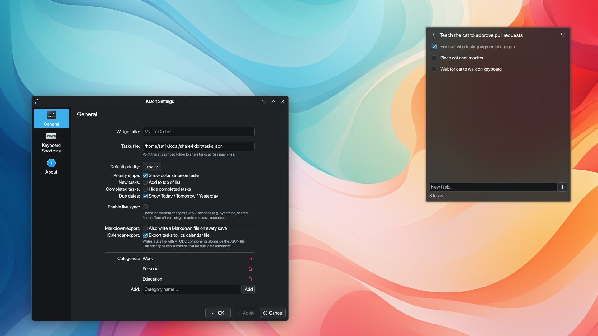

I wanted a to-do widget for my KDE Plasma 6 desktop that just worked. No build steps, no dependencies, no fuss. So I built KDoit, a pure-QML plasmoid that lives right on your desktop panel.

> **Key Takeaways**
>
> - Pure QML, zero build steps, no cmake or npm required
> - Priorities, due dates, categories, drag-and-drop, and multi-select out of the box
> - Markdown and iCalendar export with live file sync for external editors



## What it does

KDoit handles the basics: create tasks, mark them done, reorder with drag-and-drop. It goes further than most desktop widgets, though.

Priorities show up as color-coded stripes: red for high, yellow for medium, grey for low. Due dates display verbosely, so you see "Today" or "Tomorrow" instead of a raw date. Overdue items turn red. Categories let you filter by Work, Personal, or Education, and you can manage your own. Nested sublists go one level deep.

## Under the hood

Everything is QML, targeting Qt 6 and KDE Plasma 6's PlasmoidItem API. There's no cmake, no npm, no external dependencies. You install it with a single command:

```
kpackagetool6 -t Plasma/Applet -i KDoit/
```

It uses Kirigami for the UI layer and Plasma Components 3.0 for native look and feel. The widget works on both Wayland and X11.

Dual-write keeps things fast: data goes to both a JSON file and KConfig, so startup is instant without reading the full task list from disk. A 3-second poll watches the JSON file for changes, so if you edit tasks in another app, KDoit picks them up automatically.

## Export and sync

Markdown export produces Obsidian Tasks-compatible output, which is handy if you want to review your tasks in a note-taking app. iCalendar export follows RFC 5545 VTODO, so you can import into calendar apps that support it.

The live file sync uses UUID-based merge with mtime detection. Edit the JSON file externally, and KDoit reflects your changes within seconds. No manual refresh needed.

## Details that matter

Multi-select works with Ctrl+click for individual items and Shift+click for range selection. There's a 5-second undo window if you change your mind. Sorting covers priority, due date, name, completion status, and creation date.

KDoit ships with five demo tasks, including "Exit vim" with nested subtasks. It's a small touch, but it sets the tone.

## Wrapping up

KDoit started because I couldn't find a to-do widget that fit my workflow. Building something for yourself is the best way to understand what actually matters. The features that seemed nice-to-have, like live file sync and Markdown export, ended up being the ones I use most. You build what you need, and sometimes other people need it too.
