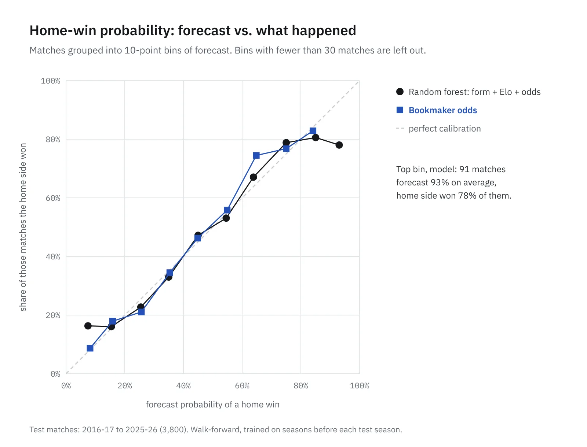
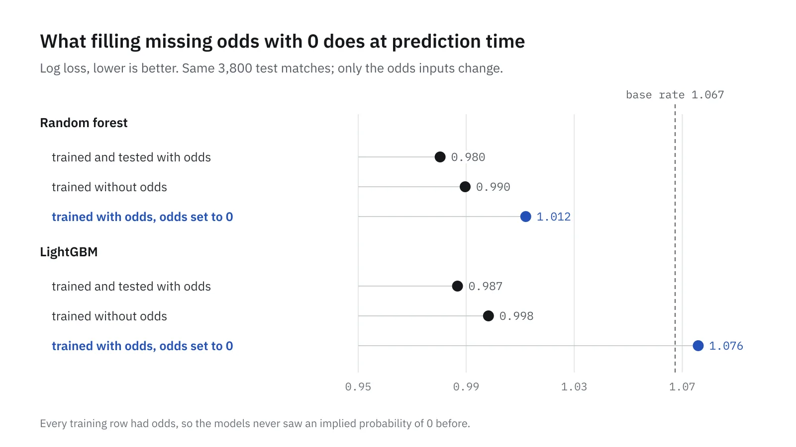

For CSE437 at BRAC University I built a pipeline that predicts La Liga matches as a home win, a draw or an away win. The course wanted that three-way classification, so that's the target throughout.

My notes from the project cover the design in detail but don't record a single result. The code isn't on this machine either. So for this post I rebuilt the pipeline from the notes, ran it on public data and scored it properly. Every number below comes from that rebuild, run on 23 October 2026.

> **Key Takeaways**
>
> - Tested season by season on 3,800 matches (2016-17 to 2025-26), the best model reached a log loss of 0.980 and 53.4% accuracy. The bookmakers' own odds scored 0.967 and 53.8%.
> - Without odds as an input, the random forest scored 0.990. Picking a home win every time is right 45.5% of the time.
> - Filling missing odds with 0 at prediction time made every model worse than leaving odds out entirely. LightGBM dropped below the base rate.


## What's a rebuild and what's from the notes

The notes are my working logs from late April 2026. I did the refactor with GitHub Copilot in VS Code, one change at a time, and the logs record each step. They give me the design: the folder layout, the modules, the Elo settings, the features, the models and the evaluation plan.

They don't give me the code or any metrics. Where the notes leave a setting open, I picked one and say so below. This was coursework, so the post shares the approach and the numbers, not the submitted code.

## The data

The CSVs are football-data.co.uk's [Spanish first division files](https://www.football-data.co.uk/spainm.php), one per season, the same files my notes describe. The 2000-01 file has exactly the odds columns the notes mention (`GBH`, `IWH`, `LBH`, `SBH`, `WHH` and their draw and away pairs). I downloaded 2000-01 to 2025-26.

After dropping rows with no score, that's 9,768 matches. Home sides won 47.1% of them, 25.2% were draws and 27.7% were away wins.

Two quirks from the notes still apply. Older files use two-digit years (`09/09/00`) and newer ones four (`15/08/2024`), so dates are parsed with both formats. Shots, shots on target and corners only start in 2005-06, so the first five seasons have no shot data at all.

## Elo ratings

Each team carries a rating that moves after every match. The settings come straight from the notes: K of 25, a home advantage of 65 points, a soft reset between seasons that keeps 85% of each team's distance from the 1,500 mean, and a margin multiplier of ln(1 + goal difference).

```python
expected_home = 1 / (1 + 10 ** ((away - (home + 65)) / 400))
mult = math.log(1 + abs(home_goals - away_goals))
change = 25 * mult * (actual_home - expected_home)
home, away = home + change, away - change
```

Written that way, the multiplier is 0 for a draw, so draws never move a rating, and a one-goal win counts as 0.69 of a full update. I checked whether that matters by also running a version that floors the multiplier at 1. It barely did: the mean squared error of Elo's expected score over the test seasons went from 0.1508 to 0.1501. I kept the formula as written.

The notes planned a search over K, home advantage and decay. I didn't run one, so these are untuned values.

## Form features

Each team gets exponentially weighted averages of its recent goals for and against, shots, shots on target, corners and points. The notes don't record the smoothing span, so I used 5 matches. Every average is shifted by one match, so a row only sees games played before it.

On top of that: days since the last match, current win and loss streaks, and the team's win rate in its last five meetings with that opponent.

The model works on match rows, not team rows. Each row has the home side's features, the away side's, the difference between them, and both Elo ratings. The notes dropped label-encoded team IDs, since a number like "Team 14" gives a tree arbitrary splits to learn, and I left them out too.

For the seasons with no shot data, a missing flag goes in first and the gap is filled with 0 after. Without the flag, a 0 reads as a team that never had a shot.

## Odds as a feature

The later version of the pipeline adds the bookmakers' view. For each bookmaker in a row, 1 divided by each price gives three implied probabilities. I scale those to sum to 1, which removes the bookmaker's margin, then average across every bookmaker in that row. Across the 26 files there are 20 bookmakers, never all in the same season.

The same averaged probabilities also serve as a benchmark on their own: if a model can't beat them, it isn't adding anything the market didn't already know.

## How I tested it

Walk-forward, one season at a time. To predict 2016-17, every model trains on 2001-02 to 2015-16. To predict 2017-18, it trains on everything up to 2016-17, and so on to 2025-26. The 2000-01 season only warms up the Elo ratings and form averages.

That gives 3,800 test matches, each predicted by a model that never saw anything after it.

Accuracy alone hides too much here, so each forecast gets four scores:

- Log loss: how much probability the forecast put on what actually happened. Lower is better.
- Brier score: squared error between the three probabilities and the result, summed over the three outcomes. Lower is better.
- Accuracy, and balanced accuracy, which averages the hit rate per outcome so draws count as much as home wins.

The models are a random forest (200 trees, depth 12, from the notes), a calibrated random forest (300 trees, balanced class weights, isotonic calibration over three time-ordered folds, also from the notes) and LightGBM with settings I picked and didn't tune.

## Results

| Forecast | Log loss | Brier | Accuracy |
| --- | --- | --- | --- |
| Bookmaker odds | 0.967 | 0.575 | 53.8% |
| Random forest, form + Elo + odds | 0.980 | 0.581 | 53.4% |
| Calibrated random forest, form + Elo + odds | 0.985 | 0.585 | 52.9% |
| LightGBM, form + Elo + odds | 0.987 | 0.585 | 52.6% |
| Random forest, form + Elo | 0.990 | 0.587 | 52.3% |
| Calibrated random forest, form + Elo | 0.998 | 0.595 | 51.3% |
| LightGBM, form + Elo | 0.998 | 0.593 | 51.7% |
| Base rate (past result shares) | 1.067 | 0.645 | 45.5% |

The bookmakers won. Their odds had a lower log loss than the best model in 9 of the 10 test seasons. Across all 3,800 matches the gap is 0.013, and resampling the matches 2,000 times puts it between 0.007 and 0.019, so it isn't noise.

Odds still help the model. The random forest went from 0.990 to 0.980 with them, a gap that stays between 0.003 and 0.015 under the same resampling. Without odds it sits well clear of the base rate, which is what the form and Elo features are worth on their own.

The upgrades the notes expected to help didn't. The calibrated forest with balanced class weights scored worse than the plain one, and untuned LightGBM didn't beat it either.

Draws are where every forecast struggles. 26.2% of the test matches were draws. The plain random forest made a draw its top pick in 0.8% of matches, and the bookmakers in 0.1%. Even in a close match, a draw is rarely the single most likely result, which is why balanced accuracy stays between 0.42 and 0.47 for every model.

## Calibration

A forecast that says 60% should come true about 60% of the time. Grouping the home-win probabilities into 10-point bins shows how close each one gets.



Between 20% and 80% the model tracks the diagonal about as well as the bookmakers. It goes wrong at the ends. In its top bin it forecast a home win at 93% on average, and the home side won 78% of those 91 matches. In its bottom bin it said 7%, and the home side won 16% of 49 matches. The bookmakers rarely went that far: only 6 of their forecasts were above 90%.

## The fill-with-0 mismatch

The last change in my notes made prediction for upcoming matches fill any missing feature with 0, "so it won't crash if you don't supply market odds". The notes never added a way to supply odds for an upcoming match, so every upcoming prediction ran with all three implied probabilities set to 0.

In training, only 2 of 9,768 matches lacked odds. So the model learned on rows where those three probabilities always sum to 1, and was then asked about rows where they sum to 0.

To measure what that does, I took the models trained with odds and scored them again on the same 3,800 matches with the odds set to 0.



Every model got worse than one that never saw odds at all. The random forest went to 1.012, and LightGBM to 1.076, worse than just predicting the base rate.

The fix is to match the model to the inputs you have. When odds are available, use the model trained with them. When they aren't, use the model trained without them. On these test matches that takes the random forest from 1.012 back to 0.990 and LightGBM from 1.076 to 0.998.

## What I'd do next

The two pieces of the plan I didn't get to are the ones most likely to matter. A walk-forward search over the Elo settings would test whether 25, 65 and 0.85 are any good for this league. And predicting each side's goals with a Poisson model, then adding up the drawing scorelines, gives a draw probability built from the scoreline, not from a class the trees rarely pick. The notes set that aside because the course required win/draw/loss, but it can still produce those three numbers at the end.

For the record, the rebuild ran on Python 3.14 with pandas 3.1.0, scikit-learn 1.9.1 and LightGBM 4.7.0, with a fixed random seed of 42. The data was downloaded on the day of the run, so the 2025-26 file is the complete season.
