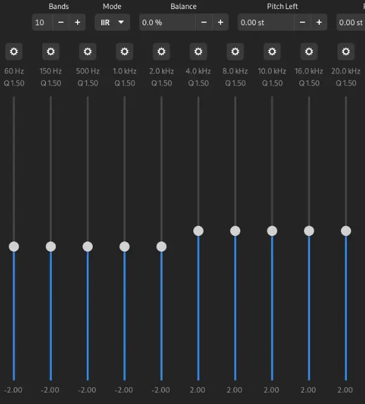

I keep a folder of short Linux notes: fixes I wrote down so I wouldn't have to search for them twice. Four of them are here, from an Arch ThinkPad and the CachyOS desktop I use now.

Each one has the symptom, the cause, the fix, and the catch I didn't write down the first time. I checked what I could on the desktop with read-only commands on 23 October 2026, and checked each fix against the upstream docs linked in its section.

> **Key Takeaways**
>
> - Easy Effects can make thin laptop speakers usable. A preset made for your model beats a hand-made EQ, and a limiter belongs at the end of the chain.
> - `--password-store=basic` stops Brave's keyring prompt by keeping saved passwords and the cookie key unencrypted on disk. Unlocking the keyring at login is the better fix.
> - In kitty, Ctrl+Backspace sends `^H`, which bash treats as a one-letter delete. Mapping it to send `^W` turns it into a word delete.
> - pacman and AUR helpers never clean their own caches. On my desktop the AUR helper's clone folder alone was 52G.

## Thin, quiet laptop speakers

**Symptom.** The built-in speakers on my ThinkPad were quiet and sounded thin on Linux.

**Cause.** My note files ThinkPads under "laptops with Dolby Access": on Windows they ship with Dolby's processing on the speaker output. On Linux nothing was doing that job, so the small speakers got the plain signal.

**Fix.** [Easy Effects](https://github.com/wwmm/easyeffects) runs audio effects on PipeWire's output. Install it from your distro's repos (the desktop has `easyeffects` 8.3.0) or from [Flathub](https://flathub.org/apps/com.github.wwmm.easyeffects), then load a preset made for your laptop.

For ThinkPads I used [sebastian-de's preset](https://github.com/sebastian-de/easyeffects-thinkpad-unsuck). It was built for the ThinkPad P14s Gen 2 AMD, and my note lists it as working on a T480, a T14s Gen 1 and a T14s Gen 4. It started as a [gist](https://gist.github.com/sebastian-de/648555c1233fdc6688c0a224fc2fca7e), but use the repository: the gist notes that Easy Effects 7.0.8 changed the Filter effect and points there for the updated preset.

The [community presets page](https://github.com/wwmm/easyeffects/wiki/Community-presets) lists presets by model. Use the Import Preset button, or copy the file in by hand:

```text
~/.local/share/easyeffects/output                          # distro package
~/.var/app/com.github.wwmm.easyeffects/config/easyeffects  # Flatpak
```

When no preset helped, my fallback was a gentle tilt in the equalizer: ten bands, -2 dB from 60 Hz to 2 kHz, +2 dB from 4 kHz to 20 kHz, Q 1.50 on each.



**The catch.** The Easy Effects manual's own [guide to notebook speakers](https://wwmm.github.io/easyeffects/guides/guide_1.html) argues against an equalizer: it says an EQ tends to make small speakers worse, and turning the volume up to make up for it leads to distortion. It puts a limiter last in the chain at a 0 dB threshold so nothing clips at the sound card. If you use my EQ, add that limiter after it.

The ThinkPad preset has its own catch. Its README says bass-heavy music can distort, and the fix is to lower the Amount on the Bass Enhancer.

The screenshot is also from an older release. Version 8 is built on Qt and Kirigami (`pacman -Qi easyeffects` lists both as dependencies), so the window looks different now.

## Brave and the keyring prompt

**Symptom.** My note kept the fix but not the error. The flag in it is the [Arch Wiki's answer](https://wiki.archlinux.org/title/Chromium#Password_prompt_on_every_start_with_GNOME_Keyring) to "Password prompt on every start with GNOME Keyring": the browser asks for the keyring's password each time it opens.

**Cause.** Chromium-based browsers, Brave included, keep saved passwords and the "Safe Storage" key that encrypts cookies in the desktop's password store: GNOME Keyring through libsecret, or KDE Wallet. If that store is still locked when the browser starts, it asks you to unlock it. The [GNOME Keyring page](https://wiki.archlinux.org/title/GNOME/Keyring#PAM_step) explains that the login keyring only unlocks itself at login when its password matches your account password.

**Fix from my note.** Make Brave use its plain-text store instead:

```bash
brave --password-store=basic
```

To make it stick, my note had two options: edit the `Exec=` line in a copy of `brave-browser.desktop` under `~/.local/share/applications/`, or add a shell alias. The alias only covers launches from a terminal, not from the app menu.

With the AUR `brave-bin` package there's a cleaner way. Its `brave` command is a [wrapper script](https://aur.archlinux.org/cgit/aur.git/plain/brave-bin.sh?h=brave-bin) that reads extra flags, one per line, from `~/.config/brave-flags.conf`, so this covers the menu and the terminal:

```text
--password-store=basic
```

**The catch: what `basic` exposes.** Chromium's [Linux password storage doc](https://chromium.googlesource.com/chromium/src/+/main/docs/linux/password_storage.md) puts it plainly: "Passwords stored in plain text are not encrypted." The [Arch Wiki](https://wiki.archlinux.org/title/Chromium#Force_a_password_store) adds that `basic` keeps the passwords and the cookies' encryption key as plain text in the profile's `Login Data` file.

So anyone who gets a copy of `~/.config/BraveSoftware/Brave-Browser/` can read every saved password and decrypt the cookies that keep you logged in. That copy could be a backup, a synced folder, or the disk of a lost laptop without disk encryption. With the keyring, the key sits in a file encrypted with your password.

It's worth being exact about the limit, too. The [GNOME Keyring page](https://wiki.archlinux.org/title/GNOME/Keyring#Protection_against_malicious_application) notes that any program running as you can read an unlocked keyring (CVE-2018-19358). The keyring protects your data on disk, not from something already running in your session.

**The safer fix.** Keep the keyring and get it unlocked at login. On GNOME, set the login keyring's password to your account password in Passwords and Keys (Seahorse). GDM, LightDM, LXDM and SDDM already have the PAM step that unlocks it, per the same wiki page.

Automatic login breaks this, because there's no password typed to unlock with. The wiki's workaround is a blank keyring password, which stores the keyring unencrypted: no better than `basic`. I'd turn automatic login off instead.

On KDE, install `kwallet-pam` and give the wallet the same password as your account ([KDE Wallet](https://wiki.archlinux.org/title/KDE_Wallet#Unlock_KDE_Wallet_automatically_on_login)). If Brave picks the wrong store, force the right one with `--password-store=kwallet6` or `--password-store=gnome-libsecret`.

Two more things to know. Chromium falls back to `basic` when the store it asked for isn't available, according to its own doc. And the Arch Wiki warns that changing stores can make saved passwords and cookies look lost, so expect to sign in again after changing the flag in either direction.

## Ctrl+Backspace in kitty deletes one letter

**Symptom.** In bash inside kitty, Ctrl+Backspace deleted one character instead of the last word.

**Cause.** In its default (legacy) key encoding, kitty sends `0x08` (`^H`) for Ctrl+Backspace and `0x7f` for plain Backspace, per the [keyboard protocol docs](https://sw.kovidgoyal.net/kitty/keyboard-protocol/). Bash binds `^H` to a one-character delete:

```bash
bind -p | grep -E '"\\C-(h|w)"'
```

```text
"\C-h": backward-delete-char
"\C-w": unix-word-rubout
```

The usual word delete, Ctrl+W, wasn't reaching bash either, because my kitty config maps it to closing the window. kitty's own default for that is Ctrl+Shift+W.

**Fix.** These two lines are still in my `~/.config/kitty/kitty.conf`:

```text
map ctrl+w close_window
map ctrl+backspace send_text all \x17
```

`send_text` sends text when the key is pressed, decodes escapes like `\x17`, and `all` means it works in every keyboard mode ([kitty.conf docs](https://sw.kovidgoyal.net/kitty/conf/)). `\x17` is `^W`, so Ctrl+Backspace now runs bash's `unix-word-rubout`.

**The catch.** The bash man page says `unix-word-rubout` uses white space as the word boundary. Ctrl+Backspace on `~/.config/kitty/kitty.conf` removes the whole path, not just the last part.

The mapping also sends `^W` to every program running in kitty, not only bash, so you get whatever that program does with `^W`. And with Ctrl+W bound to `close_window`, the old habit of pressing Ctrl+W to delete a word closes the window instead.

## A package cache that only grows

**Symptom.** Disk space going nowhere obvious. On the desktop today, `/var/cache/pacman/pkg` is at least 15G (`du` couldn't read a few of pacman's temporary download folders without root). paru's clone folder is 52G, and its two biggest entries are `visual-studio-code-bin` at 13G and `google-chrome` at 8.2G.

**Cause.** pacman never removes old or uninstalled package versions from its cache. The [pacman page](https://wiki.archlinux.org/title/Pacman#Cleaning_the_package_cache) says that's on purpose: the cache lets you downgrade or reinstall without downloading again. AUR helpers keep each package's clone with its downloaded sources and built packages.

**Fix.** My note had three commands:

```bash
sudo pacman -Rns $(pacman -Qdtq)  # remove orphans
sudo paccache -r                  # keep the 3 newest versions of each package
yay -Sc                           # clean yay's cache and build files
```

I use paru now. `paru -Sc` does the same job: its man page says it cleans pacman's cache plus cached AUR packages and untracked files in its clone folder. `paccache` comes from `pacman-contrib`.

Before deleting anything, `paccache -d` does a dry run and needs no root. On the desktop:

```bash
paccache -d
paccache -dk1
```

```text
==> finished dry run: 23 candidates (disk space saved: 685.98 MiB)
==> finished dry run: 1345 candidates (disk space saved: 8.01 GiB)
```

Keeping three versions frees under 1 GiB here. Keeping one frees 8 GiB.

To stop thinking about it, enable `paccache.timer`, which runs weekly; its arguments go in `/etc/conf.d/pacman-contrib`. It's disabled on my desktop. paru also has a `CleanAfter` option that removes untracked files after each install; it's commented out in my `/etc/paru.conf`.

**The catch.** The cache is your downgrade path. With `-k1` you have one older version to roll back to, and nothing older without the [Arch Linux Archive](https://wiki.archlinux.org/title/Arch_Linux_Archive).

For orphans, the [wiki's version](https://wiki.archlinux.org/title/Pacman/Tips_and_tricks#Removing_unused_packages_(orphans)) is `pacman -Qdtq | pacman -Rns -`. When there are none it prints `error: argument '-' specified with empty stdin`, which is expected; my desktop had none today. Read the list before you confirm: if something on it is a package you want, mark it with `pacman -D --asexplicit` and it drops off.

`paru -Sc` also deletes downloaded sources, so the next update of those AUR packages downloads them again. Its man page says it keeps sources for VCS packages.
