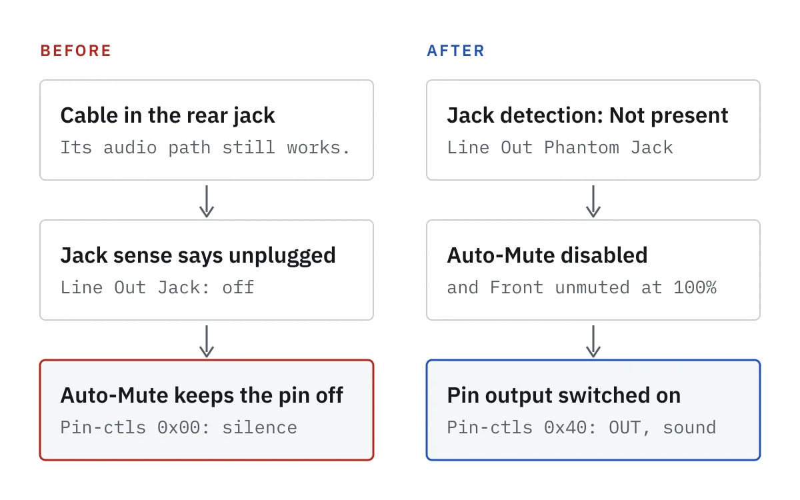

Headphones in the front panel of my desktop worked. Plugged into the green Line Out port at the back, they played nothing. The sound settings listed the rear port as "Line Out (unplugged)" with a cable sitting in it.

The board is an ASUS PRIME B450M-A II with a Realtek ALC887-VD codec, running CachyOS. The fix took two parts, and the first one on its own doesn't bring the sound back.

> **Key Takeaways**
>
> - The rear jack's plug sensor read "unplugged" with a cable in it, and Auto-Mute kept the port off.
> - `hdajackretask` with "Jack detection: Not present" makes the port always count as connected, but on its own it leaves the pin's output switched off.
> - Turning Auto-Mute off switches the pin on for good. After that, the rear port plays whenever the Line Out port is selected in the sound settings.



## Find the card and the pin

Start with the card list:

```bash
aplay -l
```

On my machine the onboard audio is card 2, with the ID `Generic`, after a USB microphone (card 0) and the graphics card's HDMI audio (card 1). Card numbers follow the order the devices come up, so a USB device can shift them. `amixer` and `/proc/asound/` also take the card ID, which stays put, so the commands below use `-c Generic`. Swap in your own card's ID or number.

```bash
grep -H "Codec:" /proc/asound/card*/codec#0
```

```text
/proc/asound/card1/codec#0:Codec: Nvidia GPU 9e HDMI/DP
/proc/asound/card2/codec#0:Codec: Realtek ALC887-VD
```

The codec dump lists every pin. The rear green Line Out is node `0x14`:

```bash
grep -A10 '^Node 0x14' /proc/asound/Generic/codec#0
```

```text
Node 0x14 [Pin Complex] wcaps 0x40058d: Stereo Amp-Out
  Control: name="Front Playback Switch", index=0, device=0
  ...
  Pincap 0x0001003e: IN OUT HP EAPD Detect Trigger
  ...
  Pin Default 0x01014010: [Jack] Line Out at Ext Rear
    Conn = 1/8, Color = Green
  ...
  Pin-ctls: 0x40: OUT
```

Three lines matter. `Detect Trigger` means the pin can sense a plug. The mixer control on this pin is called `Front`, even though it's the rear port. And `Pin-ctls` says whether the pin's output is switched on: `0x40: OUT` is on, `0x00` is off.

## The jack that never sensed a plug

ALSA exposes each jack's plug sensor as a control. The rear one read off with a cable in it:

```bash
amixer -c Generic cget numid=39   # 'Line Out Jack' -> values=off
```

The kernel log was clean: no quirks, no errors, a normal autoconfig. The driver was reporting what the hardware told it. The sensor in the rear jack is faulty, and with `Auto-Mute Mode` enabled, a port that says it's unplugged stays off. That's the silence.

## Part 1: tell the driver the jack is always there

`hdajackretask` comes with `alsa-tools`. It overrides how the driver sees each pin. For pin `0x14`, "Green Line Out, Rear side", I kept the defaults (Jack, Rear, Line Out, 3.5mm, Green) and changed one setting: **Jack detection: Not present**. That makes it a "phantom" jack, one the driver treats as always connected.

It writes two files and applies after a reboot:

- `/etc/modprobe.d/hda-jack-retask.conf`
- `/usr/lib/firmware/hda-jack-retask.fw`

The override is one bit in the pin's default config. The kernel keeps the value from the board (`init`) and the override (`user`) side by side:

```bash
grep 0x14 /sys/class/sound/hwC2D0/{init,user}_pin_configs
```

```text
/sys/class/sound/hwC2D0/user_pin_configs:0x14 0x01014110
/sys/class/sound/hwC2D0/init_pin_configs:0x14 0x01014010
```

The jack control changes name too, and now always reads on:

```text
numid=39,iface=CARD,name='Line Out Phantom Jack'
  ; type=BOOLEAN,access=r-------,values=1
  : values=on
```

Still no sound.

## Part 2: the output that never switched on

With Auto-Mute on, the driver switches a pin's output on and off as plugs go in and out. A phantom jack never sends that event, so the pin's output stayed off. Even while audio was playing to it, the pin read `Pin-ctls: 0x00`.

Turning Auto-Mute off and unmuting `Front` fixed it:

```bash
amixer -c Generic sset 'Auto-Mute Mode' Disabled
amixer -c Generic sset 'Front' unmute 100%
```

The same dump then showed `Pin-ctls: 0x40: OUT`, and the rear port played.

## Make it survive a reboot

The jack override is already permanent. To keep the mixer setting, save it:

```bash
sudo alsactl store
```

That writes the mixer state to `/var/lib/alsa/asound.state`. On CachyOS, `alsa-restore.service` runs `alsactl restore` at boot and `alsactl store` again at every shutdown, so whatever the mixer looks like when you shut down is what comes back.

That matters for `Front`, because the sound server moves it too. PipeWire's mixer path for the Headphones port has `switch = off` for `Front`, and its Line Out path unmutes it. With headphones in the front panel, PipeWire picks the Headphones port (it has the higher priority), `Front` reads `[off]`, and that state gets saved at shutdown. That's expected. Auto-Mute is the part that has to stay off, and it does.

So the last step is in the sound settings. In KDE Plasma, use the "Analog Stereo Output" profile on the HD Audio Controller and pick the Line Out port. Not "Duplex", which also turns on the analog inputs, and not "Digital (IEC958)", which is the S/PDIF output.

## Check it after a reboot or a kernel update

The override still applies two months and a few kernel updates later. Three quick checks. First, that the kernel loaded the patch:

```bash
journalctl -k -b -o cat | grep retask
```

```text
snd_hda_intel 0000:09:00.1: Applying patch firmware 'hda-jack-retask.fw'
snd_hda_intel 0000:0b:00.4: Applying patch firmware 'hda-jack-retask.fw'
```

It shows up for both sound controllers because the modprobe file lists the patch once per card slot, so it doesn't depend on which number the onboard audio gets. The patch file only describes the Realtek codec, by the same vendor and subsystem IDs the codec dump shows (`0x10ec0887`, `0x104386c7`).

Then, that Auto-Mute is still off and the pin is on:

```bash
amixer -c Generic sget 'Auto-Mute Mode' | grep Item0
grep -A10 '^Node 0x14' /proc/asound/Generic/codec#0 | grep Pin-ctls
```

```text
  Item0: 'Disabled'
  Pin-ctls: 0x40: OUT
```

## The catch

The plug sensor is still broken. The rear port now counts as permanently connected, so it won't switch on its own when you plug or unplug something. Getting that back means fixing the hardware. Before you blame the jack, try a plain 3-pole TRS cable with no adapter, in case the plug is the problem rather than the port.

If you need to dig into an HDA codec like this again, these commands do most of the work:

```bash
aplay -l
cat /proc/asound/Generic/codec#0
amixer -c Generic controls
journalctl -k -b | grep -iE "hda|realtek|alc887"
cat /sys/class/sound/hwC2D0/{init,user,driver}_pin_configs
```

The `hwC2D0` path uses the card number (`C2`) and codec address (`D0`), so check `aplay -l` first.
