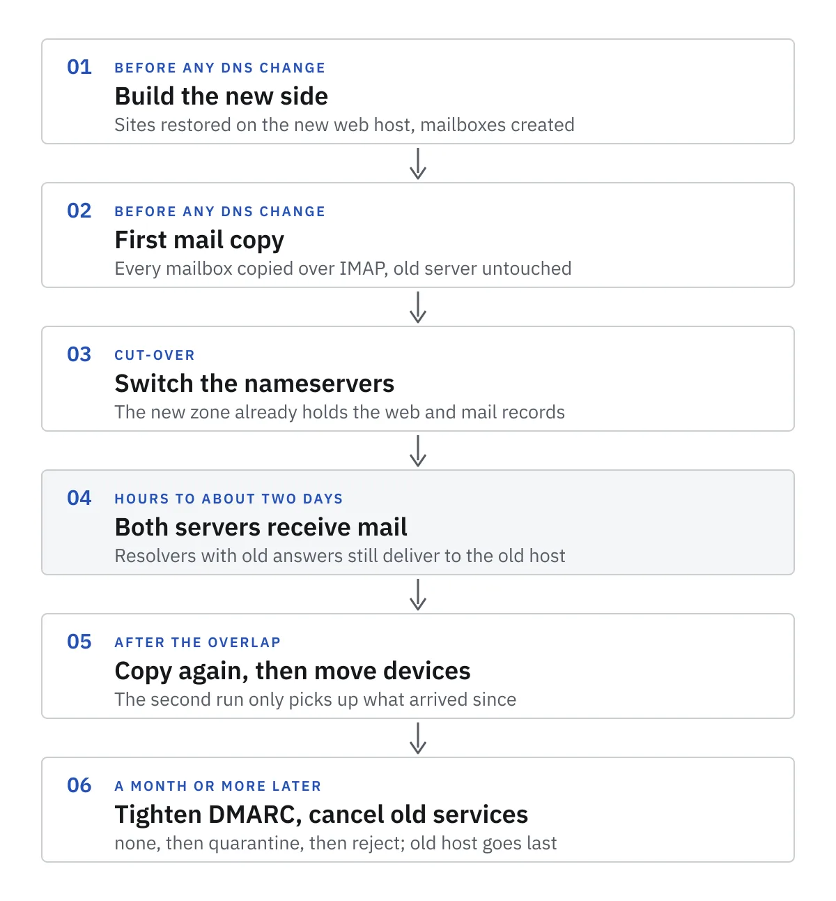

_The client isn't named. Every domain, address and IP below is a documentation example, not theirs._

A small business client had their WordPress sites and their mail spread across two accounts at one host: the websites on an older hosting platform, the mailboxes on a newer one. I moved everything to a layout with one job per provider: a web host for the sites, MXroute for mail, and Cloudflare for DNS.

Moving the websites is the easy half. You can test a restored site before anyone sees it. Mail is different, because the moment DNS changes, other people's servers start making decisions about where your client's mail goes. This post is the order of operations I'd hand to another freelancer, and the reason behind every record.

> **Key Takeaways**
>
> - Mail rarely bounces during a move. It gets delivered, just to the old server you're about to cancel. Plan around that.
> - Copy every mailbox before you touch DNS, keep the old mailboxes running, and copy again once the overlap is over.
> - Mail records in Cloudflare are always DNS-only. Point MX at the mail host's own hostnames, not a name of yours.
> - Publish SPF with `-all` only after you've listed everything that sends as the domain. Start DMARC at `p=none` and tighten it in steps.

## Why mail goes missing in a move

SMTP is patient when a server is down. If a sending server can't connect, [RFC 5321](https://www.rfc-editor.org/rfc/rfc5321#section-4.5.4.1) says it retries at least 30 minutes apart and keeps going for "at least 4-5 days". A short outage only delays mail.

The real risk is a server that's up and accepting mail, just not the one you want. When you change nameservers, resolvers that cached the old answers keep using them until their cache runs out. Here's the delegation the `.com` registry hands out, straight from one of its servers:

```bash
$ dig @a.gtld-servers.net NS example.com +noall +authority
example.com.		172800	IN	NS	hera.ns.cloudflare.com.
example.com.		172800	IN	NS	elliott.ns.cloudflare.com.
```

That `172800` is two days in seconds, and you can't change it: the registry sets it. On top of that, [Cloudflare's setup guide](https://developers.cloudflare.com/dns/zone-setups/full-setup/setup/) says to "wait up to 24 hours" for the registrar to apply the nameserver change at all.

So for a while, some senders deliver to the new mail host and some still deliver to the old one. Nothing bounces. Mail just lands in a mailbox nobody is watching anymore.


Everything below is built around that overlap.

## The order of operations



### 1. Make an inventory

List every domain, every mailbox, and everything that sends mail as the domain: contact forms, WooCommerce order emails, newsletters, a booking tool. You'll need that list twice, once for the mailboxes and again for SPF.

Export the old DNS zone too. When you add a domain, Cloudflare scans for existing records, but its own docs warn: "the quick scan is not guaranteed to find all existing DNS records". Compare the scan against your export line by line.

### 2. Build the new side first

For the sites, I took full backups of the WordPress files and databases from the old host, installed fresh WordPress on the new host and restored onto it. The new host ran PHP 8.4, and one plugin didn't support it, so I swapped it for one that did. Then SSL. The checklist in my workplan after a restore: internal links, contact forms, the media library and plugins.

For mail, I created the mailboxes on MXroute. MXroute's [migration guide](https://docs.mxroute.com/docs/migrate-to-mxroute.html) puts it plainly: "Ensure your MXroute account is fully configured before beginning migration."

I set up the Cloudflare zones and then moved the Cloudflare account into the client's ownership. DNS is the one thing that should never be locked inside a freelancer's login.

### 3. Copy the mail before DNS changes

I copied the existing mail from the old server to MXroute over IMAP, server to server. If you're doing this yourself, [imapsync](https://imapsync.lamiral.info/) is the usual tool, and it's the one MXroute's guide points to.

This is the shape of a run, with the options checked against imapsync's own README:

```bash
imapsync \
  --host1 imap.old-host.example --ssl1 --user1 info@example.com --passfile1 ./old.pass \
  --host2 imap.new-host.example --ssl2 --user2 info@example.com --passfile2 ./new.pass \
  --automap --dry
```

`--dry` prints what it would do without copying anything. `--automap` matches folders like Sent and Trash, which different servers name differently. The password files keep secrets out of your shell history. Once the dry run looks right, drop `--dry` and run it for real.

Do this while the old server is still the only one receiving mail. Nobody's mail is at risk yet, and you have time to check folder counts.

### 4. Switch the nameservers

By now the Cloudflare zone holds every record the domain needs at its new home: web records pointing at the new host, mail records pointing at MXroute. Switching the nameservers changes everything in one move.

Two checks first. If the domain has DNSSEC on, [turn it off at the registrar](https://developers.cloudflare.com/dns/zone-setups/full-setup/setup/) before you change nameservers, or the domain can stop resolving. And if you can edit the old zone, lower its TTLs a day ahead, so answers cached from the old nameservers expire sooner. It won't shorten the registry's delegation TTL, but it helps the records themselves.

### 5. Copy again after the overlap

This step is the safety net for the diagram above. Run the same imapsync command again for every mailbox once the overlap has passed.

It won't create duplicates. imapsync's [FAQ on duplicates](https://imapsync.lamiral.info/FAQ.d/FAQ.Duplicates.txt) explains that it identifies messages by their `Message-Id` and `Received` headers, so a second run only copies what arrived since the first. Whatever landed on the old host during the overlap comes across.

Then move phones and mail apps to the new IMAP and SMTP settings. If you move devices before the second copy, someone sends a reply from the old server and you've created a third place for mail to live.

### 6. Tighten, then cancel

My workplan said the old services would only be cancelled once the new setup was confirmed stable: mail flowing both ways, valid certificates on every site. I'd add one more check: nothing new arriving at the old server. Cancel them last. MXroute's guide says the same: keep the old service running for a transition period.

DMARC tightening comes after that, over weeks, and it gets its own section below.

## The records, and why each looks the way it does

This is the shape of a domain after the move. The values are documentation examples, and `mailhost.example` stands in for the hostnames MXroute gives you.

```text
; Web: proxied through Cloudflare
example.com.               A      203.0.113.10
www.example.com.           CNAME  example.com.

; Mail: DNS-only, always
example.com.               MX     10 server.mailhost.example.
example.com.               MX     20 server-relay.mailhost.example.
example.com.               TXT    "v=spf1 include:spf.mailhost.example -all"
x._domainkey.example.com.  TXT    "v=DKIM1; k=rsa; p=MIIBIjANBgkqh..."
_dmarc.example.com.        TXT    "v=DMARC1; p=none; sp=none; adkim=r; aspf=r;"
```

### MX: two hosts, and their names, not yours

MXroute gives two MX hosts, a primary at priority 10 and a relay at 20. [RFC 5321](https://www.rfc-editor.org/rfc/rfc5321#section-5.1) says "Lower numbers are more preferred than higher ones", so senders try the 10 first and only fall back to the 20 when it can't be reached.

Use the provider's hostnames as they are. It's tempting to make `mail.example.com` point at the provider's IP so the MX looks tidy. MXroute's welcome email warns against exactly that: if their server IP changes, they won't tell you, and your custom name keeps pointing at the old address.

### Proxy status: grey cloud for anything mail

Cloudflare's proxy only handles web traffic. [Its docs](https://developers.cloudflare.com/dns/proxy-status/) say only A, AAAA and CNAME records can be proxied, and "other record types (such as MX or TXT) are always DNS-only." The mail records above are safe by default.

The trap is an A record you add for mail, like that `mail.example.com`. If it's proxied, it resolves to Cloudflare's IPs, and mail clients and servers get nowhere. Keep any such record DNS-only, or better, don't create it.

### SPF: one record, and `-all` only when the list is complete

SPF lists the servers allowed to send as the domain. A few rules from [RFC 7208](https://www.rfc-editor.org/rfc/rfc7208):

- One SPF record per domain. Two records make the check fail with "permerror" ([section 3.2](https://www.rfc-editor.org/rfc/rfc7208#section-3.2)). If another service sends for the domain, add its `include:` to the same record.
- Every `include`, `a`, `mx`, `ptr` and `exists`, plus a `redirect`, costs a DNS lookup, and the total is capped at 10 ([section 4.6.4](https://www.rfc-editor.org/rfc/rfc7208#section-4.6.4)). Long chains of includes hit that sooner than you'd expect.
- `-all` at the end means any sender not listed gets a "fail" result ([section 4.6.2](https://www.rfc-editor.org/rfc/rfc7208#section-4.6.2)).

This is where the inventory from step 1 pays off. The classic miss on a WordPress site is the contact form. By default WordPress hands mail to PHP on the web server, and the web server isn't in the SPF record, so with `-all` those messages fail. Point WordPress at the real mailbox with an SMTP plugin, so form mail goes out through the mail host like everything else.

### DKIM: a per-domain key under the `x` selector

DKIM signs each outgoing message, and receivers check the signature against a public key in DNS. The key lives at `<selector>._domainkey.<domain>`. [RFC 6376](https://www.rfc-editor.org/rfc/rfc6376#section-3.1) explains that selectors exist so one domain can have several keys at once.

MXroute uses the selector `x`. Its [DKIM docs](https://docs.mxroute.com/docs/dns/dkim.html) say each domain has its own key: you copy it from the control panel and publish it as a TXT record named `x._domainkey`. It's a long value, so paste it in one go and check the record afterwards with `dig +short TXT x._domainkey.example.com`.

### DMARC: start at none, then tighten in steps

DMARC tells receivers what to do when a message fails both SPF and DKIM alignment, and where to send reports. I started with the record [MXroute suggests](https://docs.mxroute.com/docs/dns/dmarc.html): `p=none` with relaxed alignment. It monitors, and it doesn't affect delivery.

The current DMARC spec is [RFC 9989](https://www.rfc-editor.org/rfc/rfc9989), published in May 2026, which replaced RFC 7489. Two parts of it matter when you tighten:

- Reports only come if you ask. Without an `rua=` address, receivers "MUST NOT generate aggregate feedback reports" ([section 4.7](https://www.rfc-editor.org/rfc/rfc9989#section-4.7)). So `p=none` on its own tells you nothing. Add `rua=mailto:dmarc@example.com` before you plan to change the policy.
- Go one step at a time. [Section 7.4](https://www.rfc-editor.org/rfc/rfc9989#section-7.4) suggests `p=none` for at least a month, then `p=quarantine` for just as long, comparing the reports, and only then `p=reject`.

One detail if you follow older guides, including MXroute's: they suggest ramping up with `pct=10`. RFC 9989 removed the `pct` tag ([appendix A.6](https://www.rfc-editor.org/rfc/rfc9989#appendix-A.6)). Its replacement for a trial run is `t=y`, test mode.

### Domains that send no mail

An inventory often turns up a domain that only hosts a website, or doesn't even do that. Those should say so in DNS, or anyone can send mail that claims to come from them. `example.com` itself is a good model. Here's what it publishes, queried on 23 October 2026:

```bash
$ dig +short MX example.com
0 .
$ dig +short TXT example.com | grep spf1
"v=spf1 -all"
$ dig +short TXT _dmarc.example.com
"v=DMARC1;p=reject;sp=reject;adkim=s;aspf=s"
```

`0 .` is a null MX, defined in [RFC 7505](https://www.rfc-editor.org/rfc/rfc7505): this domain accepts no mail. `v=spf1 -all` authorises no senders at all. And DMARC at `p=reject` with strict alignment tells receivers to refuse anything that claims to be from it. For a domain with no mail, you can go straight to this: there's no real mail to lose.

## Checking it worked

The records are easy to check from any terminal:

```bash
dig +short MX example.com
dig +short TXT example.com
dig +short TXT x._domainkey.example.com
dig +short TXT _dmarc.example.com
```

Then send a message from each mailbox to an outside address you control, and read the full headers of what arrives. The `Authentication-Results` header shows a pass or fail for SPF, DKIM and DMARC. Reply to it too, so you know inbound mail reaches the new host.

Do the same with the website's contact form. It's the sender most likely to have been forgotten, and with `-all` in place it's the one that fails.

## The short version

1. Inventory domains, mailboxes and every sender.
2. Build the new web host, mail host and DNS zone. Nothing public changes.
3. Copy all mail over IMAP.
4. Turn off DNSSEC if it's on, then switch nameservers.
5. Keep the old mailboxes running. Copy again after the overlap, then move devices.
6. Confirm mail flows both ways, then cancel the old services.
7. Add DMARC reporting and move from `none` to `quarantine` to `reject`, a month or more at each step.
