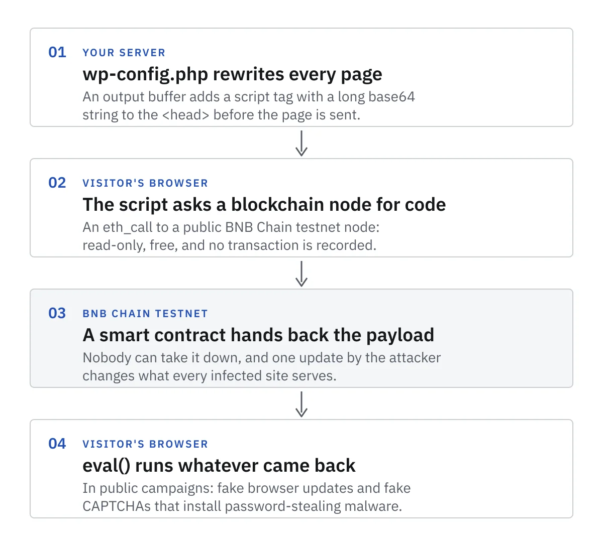

_The client's name, the site's subject and location, and a few other details have been changed to keep the client anonymous. The malware and the cleanup are described as we found them._

A client's WooCommerce site started showing a browser warning: their antivirus blocked it as dangerous. The client had a full backup of the hosting account, several gigabytes and tens of thousands of files, and asked us to clean it so they could upload it over FTP and move on.

The cleanup was straightforward in the end. The interesting part was how many separate footholds the attacker had left, and how little it would have taken to stop all of them.

> **Key Takeaways**
>
> - WordPress core and all eleven wordpress.org plugins matched the official checksums, apart from one readme file. The infection lived entirely in added files, one edited config file and the database.
> - The attacker came back at least six times over five months. Cleaning only the files would have lost the fight within weeks.
> - 939 of the site's 1,074 blog posts were casino spam. Hidden spam widgets inside the homepage layout crashed the site after the files were clean, and 15 more pages carried invisible link blocks.
> - Most of this is preventable with updates, fewer plugins, file-integrity checks and an alert whenever a new administrator appears.

## Step one: trust nothing, verify against the source

We extracted the archive into an isolated directory, never executed anything, and started with the cheapest question: which files differ from the official releases?

WordPress publishes checksums for core, and wordpress.org does the same for every hosted plugin and theme:

```bash
wp core verify-checksums
wp plugin verify-checksums --all
```

Core was byte-for-byte identical to the official release. So were eleven plugins (one readme file aside), including WooCommerce, Elementor and Yoast. That narrowed the problem to files that should not exist, plus a few that had been edited.

Checksums have a blind spot worth knowing. `wp core verify-checksums` only checks the files WordPress ships, so it never looks at `wp-config.php` or anything in `wp-content` ([WP-CLI docs](https://developer.wordpress.org/cli/commands/core/verify-checksums/)). `wp plugin verify-checksums` can't check premium plugins or anything not hosted on wordpress.org, and prints a "could not retrieve the checksums" warning instead. On a hacked site, each of those warnings is a lead: a fake plugin has no official checksums either.

## What the antivirus was actually flagging

The detection came from `wp-config.php`. A few lines had been added at the very top, before the real configuration. They started an output buffer and rewrote every page before it reached the visitor, inserting a script tag into the head containing a long base64 string.

Decoded as plain text, the script was short. It made an `eth_call` request to a public BNB Chain testnet node and passed the result to `eval()`.

This technique is called EtherHiding. Guardio Labs named it in October 2023, when a campaign called ClearFake used it on hacked WordPress sites to show visitors a fake "update your browser" screen that installed password-stealing malware ([Guardio Labs](https://guard.io/labs/etherhiding-hiding-web2-malicious-code-in-web3-smart-contracts)).

The malicious payload is not stored on the website at all. It sits in a smart contract on a blockchain. Reading it with `eth_call` is free and records no transaction, nobody can take the contract down, and the attacker can change what every infected site serves by updating one contract. Static scanners only see a harmless-looking loader. Whatever the contract returns runs in your visitors' browsers.



It has spread since. By June 2025, Google's threat intelligence team had counted about 14,000 web pages carrying one group's injected loader, which had moved on to fake CAPTCHA pages that talk people into running a command through the Windows Run box ([Google Threat Intelligence](https://cloud.google.com/blog/topics/threat-intelligence/unc5142-etherhiding-distribute-malware)). In September 2026, Netskope reported more than 5,400 hacked sites, mostly WordPress, reading their payload from the BNB Chain testnet, the same free network this site was calling ([BleepingComputer](https://www.bleepingcomputer.com/news/security/over-5-400-hacked-sites-serve-clickfix-payloads-stored-on-the-blockchain/)).

## Everything else we found

Once we knew what to look for, the same fingerprints appeared across the account.

- **A theme file with 700 extra lines.** The `functions.php` of the active theme had obfuscated code appended after the last legitimate line. A diff against the official theme made it obvious.
- **A 250 KB `db.php`.** Files named like cache drop-ins load on every request. This one was not a cache. It carried the same marker comments as the theme injection.
- **About ten fake plugins.** Names such as "Manage Security" and "Wordpress Sucuri" sounded legitimate. Several created administrator accounts on every request, with the passwords hard-coded in the source, and hid those accounts from the Users screen. Others removed themselves from the plugin list.
- **Must-use plugins.** Three extra files in `mu-plugins`, which WordPress loads automatically and which cannot be disabled from the dashboard. One was disguised with WooCommerce text, one rendered the spam into the homepage and one was a 1.8 MB obfuscated file.
- **A spam endpoint with shell functions.** A standalone PHP file accepted requests to publish content and referenced command-execution functions. It is the likely reason search and browser reputation systems had started marking the domain as spam.
- **Several files with identical timestamps.** A group of the malicious files shared the same modification time to the minute. That points to an automated dropper, not a person typing.

None of this was subtle once it was compared against a known-good copy.

It isn't unusual either. Sucuri documented a very similar setup in September 2026: copies of one payload in `db.php`, `advanced-cache.php`, must-use plugins and the database, a hidden administrator, and commands read from a blockchain contract. Their warning applies here too. Delete the files in the wrong order and the copies you missed write them back ([Sucuri](https://blog.sucuri.net/2026/09/sc-wordpress-malware-a-self-healing-mesh-of-loaders-drop-ins-and-a-blockchain-controlled-backdoor.html)).

## The database was compromised too

Cleaning files is half the job. We opened the database and found the other half.

- Nine administrator accounts. One belonged to the owner. Eight did not. They had been created on different dates, going back five months, which means the attacker lost access and got back in repeatedly.
- A single options entry of about 95 KB holding 144 spam placements that the spam endpoint injected into the homepage.
- An active snippet in a code-snippets plugin with a harmless name. It was a backdoor stored in the database, so it would survive any file cleanup.
- 939 published blog posts that the owner never wrote. The site is a local business's guide on a subject far from gambling. These posts were casino, betting, forex and adult-content guides in Russian, Polish, Turkish, French, Greek and a dozen other languages.

A site restored from a clean file backup but connected to this database would be re-infected within hours.

### Separating 939 spam posts from 135 real ones

Keyword matching gets you most of the way, but casino spam in Cyrillic or Greek slips past an English word list. The reliable signal was the author column. Every real post belonged to the owner's account. Every spam post had `post_author = 0`, an author ID no WordPress user can have, because the malware inserted rows straight into the database instead of going through the editor:

```sql
SELECT post_author, post_status, COUNT(*)
FROM wp_posts WHERE post_type = 'post'
GROUP BY post_author, post_status;
```

Not one of the 939 author-zero posts mentioned the business's subject or any of the towns it serves. All 135 owner posts did. The spam started months earlier with a handful a month, then jumped to over 300 in a single month and stayed above 200 a month near the end, the same months the rogue administrators appeared.

One lesson from our own cleanup: when we deleted the rogue users we reassigned their content to the owner, which erased the clearest clue about who wrote what. Classify content before you delete the accounts behind it. The database export we took first is what let us recover that information.

## What it took to fix

We rebuilt the site from verified sources instead of trying to scrub files in place:

1. Kept official core and the eleven verified plugins as they were.
2. Replaced the edited theme file with the official one and stripped the injected block from `wp-config.php`.
3. Dropped every fake plugin, the extra mu-plugins, the drop-in, the dotfiles and the spam endpoint.
4. Took a full database export, then deleted the eight rogue users, the spam option and the backdoor snippet.
5. Rotated the database password and all authentication salts, and invalidated the owner's existing sessions.
6. Uploaded the clean tree, then compared every file on the server against the local copy by size.
7. Removed two spam widgets from the homepage layout and ten infected revisions of that page.
8. Moved the 939 author-zero spam posts to the trash rather than deleting them outright, so a wrongly caught post can still be restored.
9. Stripped hidden link blocks from 15 pages and 37 of their revisions, then re-crawled every public URL.

The upload was the slowest part. The server accepted only plain FTP, capped connections per account and was a long round trip away, so moving tens of thousands of files took hours. Resume mode and fewer, steadier connections beat more parallelism.

## The crash that was not the plugin

With every file verified, the homepage still returned "There has been a critical error on this website." The stack trace pointed into Elementor:

```text
Uncaught Error: Call to a member function get_default_args() on array
in wp-content/plugins/elementor/includes/managers/elements.php:88
```

The obvious suspect was the premium Elementor add-on, which was months older than the free plugin. Replacing it did not help, because the problem was data, not code. Elementor stores each page layout as JSON in post meta. Buried in the homepage layout was an element marked as a widget but with no `widgetType`, so Elementor could not find a class for it and crashed. Its only content was an HTML block of about 140 casino links, each positioned 11,000 pixels off-screen so visitors would never see them but search engines would.

Removing that one element brought the site back. A second widget on the same page was quieter: a zero-height, zero-width box holding a single link to a casino site. It rendered without error, so we only found it by scanning the homepage for outbound links. Ten saved revisions of the page held copies of the injected layout, so those went too. Otherwise, a single "restore revision" click would have brought the spam back.

If a WordPress site crashes only after a malware cleanup, check the content, not just the code. Search page-builder data for hidden positioning such as `left:-` or `height:0` next to outbound links.

## The spam that only search could see

With the homepage fixed and every public URL loading cleanly, a final pass still turned up casino links. The contact page and 14 of the site's location pages had blocks of gambling copy appended to their content, wrapped in a `position: fixed` box placed thousands of pixels off-screen. Several of those blocks were nested inside one another, and 37 saved revisions carried the same text.

Visitors never saw them. Elementor builds these pages from its own layout data and ignores the classic `post_content` field, which is exactly where the spam sat. Search engines and WordPress's own site search read that field, though, so a search for "casino" on a local business's site returned the owner's own location pages.

Because every block used the same inline style, one pattern match removed them all while leaving the real headings and contact details in place. Two lessons: a page that renders cleanly can still hold spam, so search the raw database as well as the rendered HTML. And after any bulk write, count the matching rows again. Our database tool offered a "simulate" button beside the real one, and only the follow-up count showed that the first run had changed nothing.

## A quick check for your own site

An EtherHiding loader has to reach a blockchain node, so the node's address is a good thing to search for. From the site root, look for `eth_call`, BNB Chain testnet hosts such as `data-seed-prebsc` and `bsc-testnet`, and `eval(atob(`, then run the same search over the database:

```bash
grep -rlE "eth_call|prebsc|bsc-testnet|bsc-dataseed|eval\(atob\(" \
  --include='*.php' --include='*.js' .
wp db search "eth_call" --all-tables
```

A clean result isn't proof. The payload is fetched at runtime and some campaigns show it only to certain visitors, so a page that looks fine in your browser can still be infected.

## How this could have been prevented

We never found the original entry point. The account had old backup plugins, a file-manager plugin remnant and an out-of-date premium plugin, any of which is a plausible route. These are the controls that would have mattered:

- **Update everything, including premium plugins.** The premium page-builder add-on was months behind the free plugin it extends. Versions that drift apart are a sign nobody is maintaining the site.
- **Watch your own content.** Over 900 spam posts went up without the owner noticing. A weekly glance at the post count, or an alert for posts with no author, would have caught it in the first week.
- **Delete what you do not use.** Unused plugins and old file managers are the most common way in. An inactive plugin is still executable code.
- **Check integrity on a schedule.** Run the two checksum commands above weekly and alert on any difference. They cover core and wordpress.org plugins only, so pair them with a file-change monitor on `wp-config.php` and `wp-content`, where nearly all of this infection lived.
- **Alert on new administrators.** A single notification when an admin account is created would have caught six separate intrusions.
- **Lock down file changes.** `define('DISALLOW_FILE_EDIT', true);` switches off the dashboard's code editor. `DISALLOW_FILE_MODS` goes further and blocks plugin installs and updates from the dashboard too, so use it only if you update another way, such as WP-CLI or your host ([WordPress docs](https://developer.wordpress.org/advanced-administration/security/hardening/)). Neither stops someone who already has file access, so also watch `mu-plugins`, `db.php` and `advanced-cache.php`, which load on every request without appearing in the plugin list.
- **Keep backups out of the web root.** This account stored gigabytes of backups, database dumps and customer export files inside `wp-content`. Even when protected, they are a gift to anyone who gets a foothold. Send them off-site.
- **Use SFTP or FTPS only.** Plain FTP sends the password in clear text. If your host only offers it, ask them to enable the secure option.
- **Use unique passwords and two-factor login** for WordPress, hosting and FTP, and keep the administrator count to the people who actually need it.

## The takeaway

The file cleanup was quick because every piece of the infection was easy to spot once we compared against official sources. The database took longer: rogue users, a backdoor snippet, spam hidden inside page layouts and page content, and 939 spam posts. What makes a WordPress compromise expensive is not the sophistication of the malware. It is that nobody was looking, so the attacker had five months and six re-entries to dig in. A weekly checksum run and a new-admin alert would have turned this into a five-minute fix.

If your site is flagged by antivirus or search engines, do not just delete the file you can see. Verify against checksums, audit the database directly and assume there is more than one way back in.
