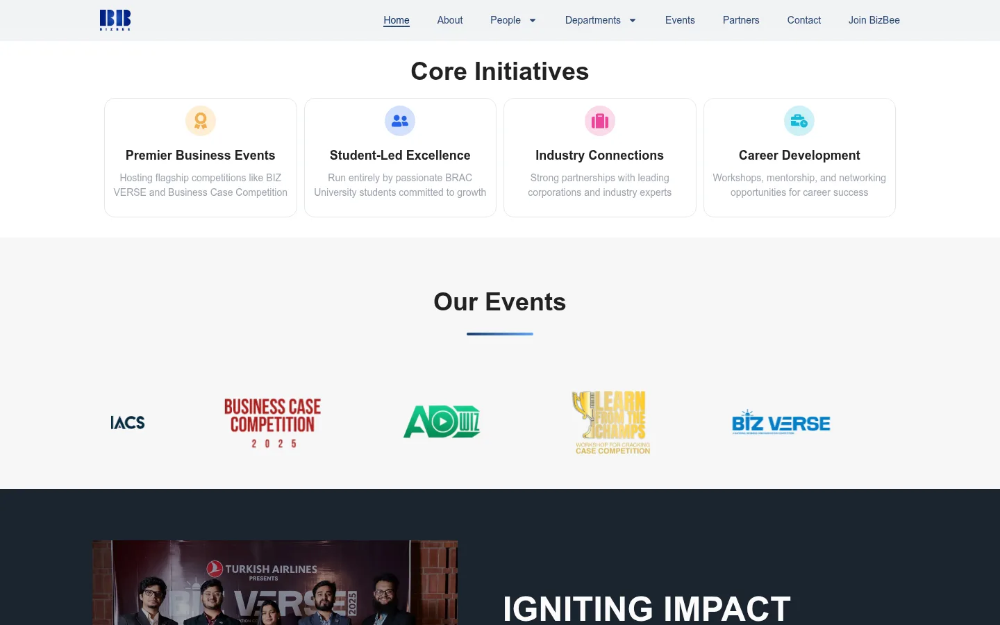
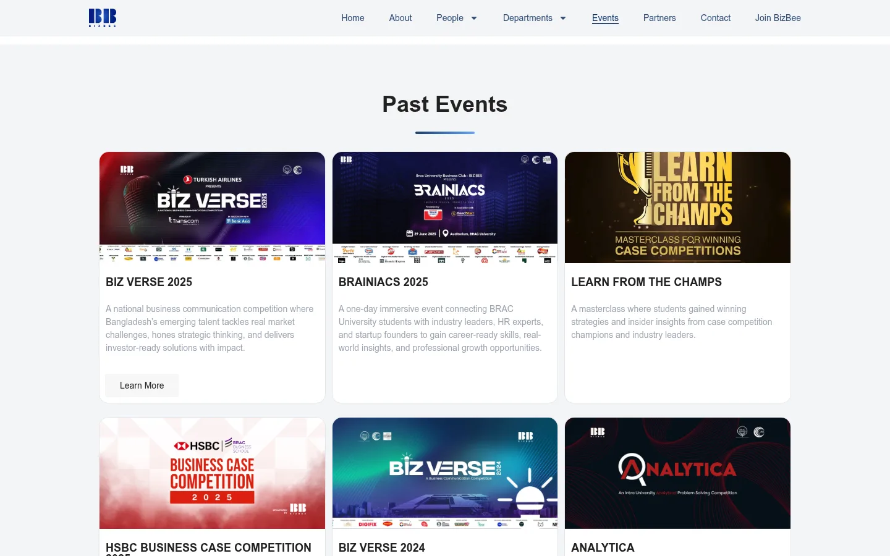
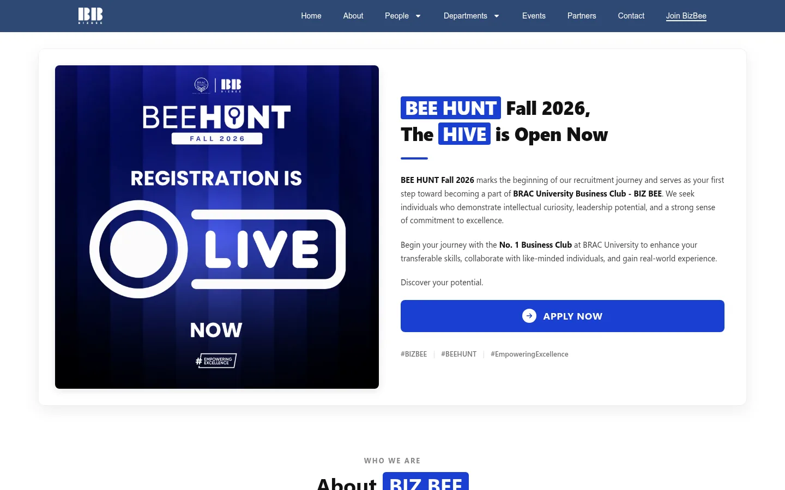
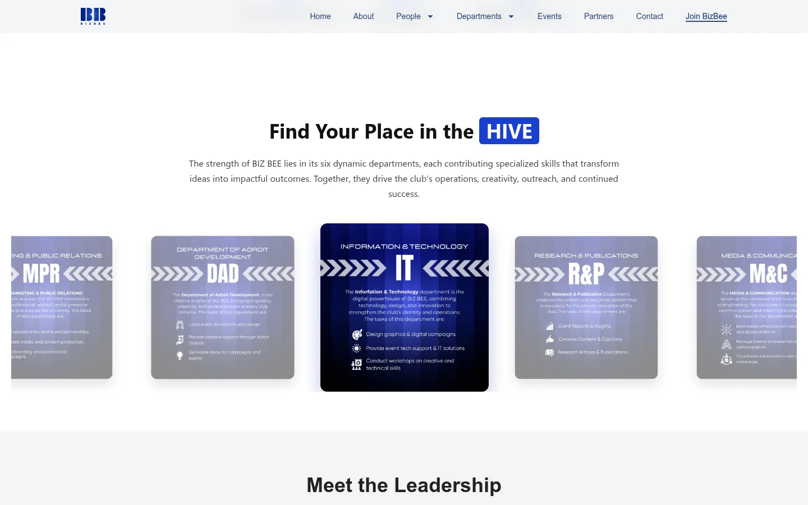
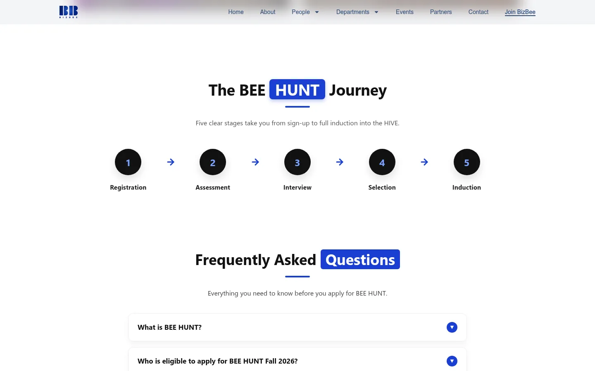
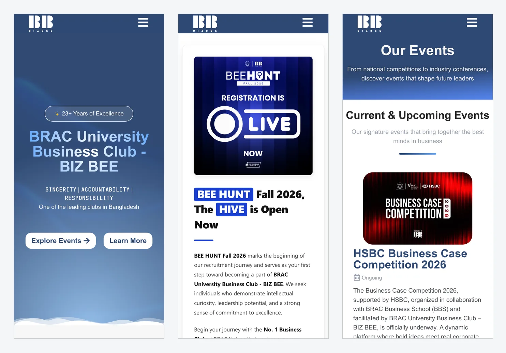

BIZ BEE is the business club at BRAC University in Dhaka. It was set up in 2003. I designed and built its website, [bizbeebracu.org](https://bizbeebracu.org/), on WordPress with the Elementor page builder.

The club holds business competitions and workshops, is run by six departments and recruits new members through BEE HUNT. The site has a page for each of those.

> **Key Takeaways**
>
> - Pages for the club, its people, the six departments, events, partners and contact, all built in Elementor.
> - The BEE HUNT recruitment page is my own HTML and CSS inside Elementor: department cards, a five-step timeline, an FAQ and an Apply Now button that opens the club's Google Form.
> - The header stays fixed with a blurred, see-through background, the fonts load from the site's own server and the images are WebP.

## What the site covers

The menu has Home, About, People, Departments, Events, Partners, Contact and Join BizBee. People opens onto Leadership, Faculty Advisor and Alumni. Leadership shows the governing body as photo cards, each with a LinkedIn link.

Departments lists the six teams: Marketing & Public Relations, Organising & Management, Media & Communications, Research & Publication, Information Technology, and the Department of Adroit Development. Each has its own page saying what the team does and who leads it.

The homepage opens on a blue gradient hero with a wave along the bottom edge. Below it come a short history, four cards for the club's core initiatives and a strip of event logos. Then a dark band with the club's line "Igniting impact, inspiring excellence" next to a team photo.

## Events

The Events page puts the current event first, with a status label. When I wrote this it was the HSBC Business Case Competition 2026, marked Ongoing.

Past events sit underneath in a grid of cards: BIZ VERSE, BRAINIACS, Analytica, Casessination, Adwiz and a few more. Two of them link to a write-up on the site, the HSBC Business Case Competition 2025 and the Learn From The Champs masterclass.

## The recruitment page

BEE HUNT is how the club recruits, and its page is the one I wrote most of by hand. The page is still an Elementor page, but its sections are HTML widgets holding my own markup, styles and a little JavaScript.

It opens with the BEE HUNT Fall 2026 poster and an Apply Now button that goes to the club's Google Form.

"Find your place in the HIVE" shows the six departments as a sliding row of cards with one in focus. Each card links to that department's page.

Further down is the recruitment process as five numbered steps (Registration, Assessment, Interview, Selection, Induction), then an FAQ. Each question is a button. Clicking it opens the answer and tells screen readers that it's open.

## Forms

Both forms use Elementor's form widget. The contact form asks for a name, email, subject and message, and a type: General, Recruitment or Sponsorship. The Partners page has its own form for companies, with the company name, a contact person, email, phone and the kind of partnership they want.

## On phones

Pages drop to one column. The menu turns into a button that opens a full-screen list of every page, and the hero, buttons and event cards shrink to fit.

## Under the hood

The theme is Hello Elementor, a bare theme that leaves the layout to Elementor. The header is fixed to the top of the window and blurs whatever scrolls behind it. Sections fade or zoom in as they come into view.

The fonts are served from the site's own server instead of Google's, the images are WebP, and Autoptimize combines the CSS.
