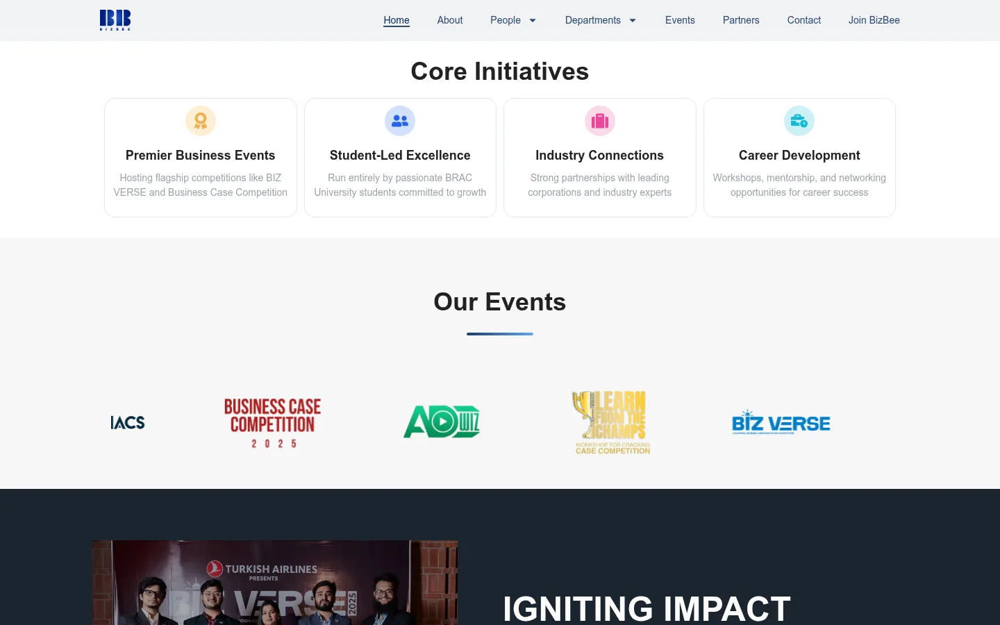
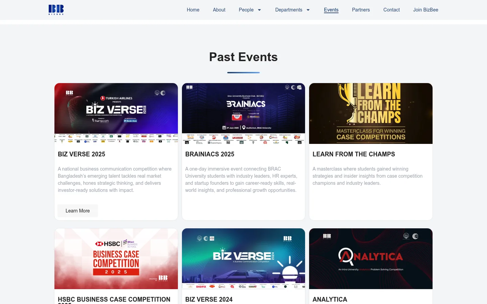
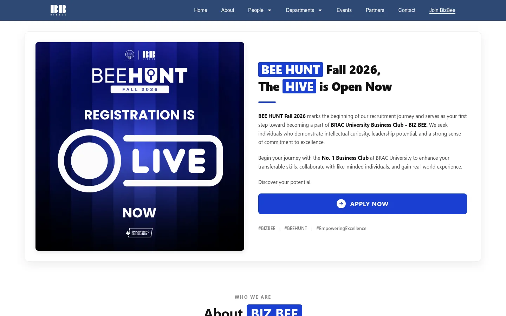
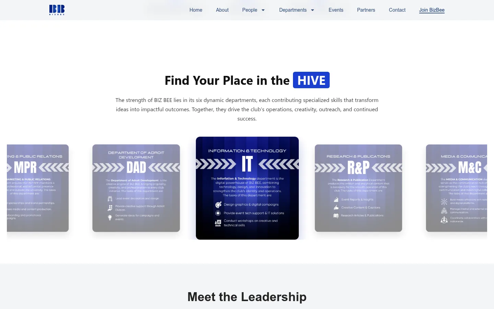
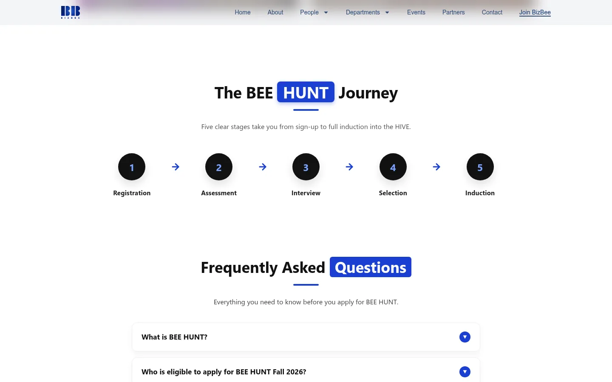
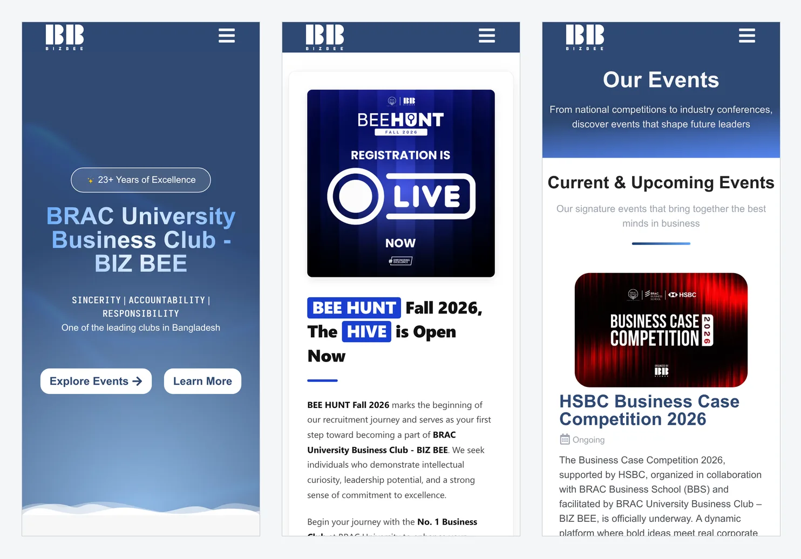

BIZ BEE is the business club at BRAC University in Dhaka, founded in 2003. I designed and built its website, [bizbeebracu.org](https://bizbeebracu.org/), on WordPress with the Elementor page builder.

The club runs national competitions, has six departments and recruits new members through BEE HUNT. The site covers all three: what the club does, who runs it, and how to join.

> **Key Takeaways**
>
> - The site has pages for the club, its people, six departments, events with write-ups, partners and contact, all built as Elementor pages.
> - The BEE HUNT recruitment page is hand-written HTML inside Elementor: department cards, a five-stage timeline, an FAQ and an Apply button to the club's form.
> - Under the hood: a fixed frosted-glass header, fonts served from the site itself, WebP images, combined CSS and hardened default WordPress paths.

## What the site covers

The menu has Home, About, People, Departments, Events, Partners, Contact and Join BizBee. People opens onto Leadership, Faculty Advisor and Alumni. Leadership shows the governing body as photo cards, each with a LinkedIn link.

Departments lists the six teams: Marketing & Public Relations, Organising & Management, Media & Communications, Research & Publication, Information Technology, and the Department of Adroit Development. Each one has its own page with what the team does and who leads it.

The homepage opens on a blue gradient hero with a wave divider at the bottom. Below it: a short history, the four core initiatives as cards, a strip of event logos, and a leadership quote over a photo of the club.

## Events

The Events page puts the current event first, with a status label. At the time of writing it's the HSBC Business Case Competition 2026, marked Ongoing.

Below that, past events sit in a grid of cards: BIZ VERSE, BRAINIACS, Analytica, Casessination and others. Some link to a write-up of the event, such as the HSBC Case Competition 2025 and the Learn From The Champs masterclass.

## The recruitment page

BEE HUNT is the club's recruitment drive, and its page is the one I built most by hand. Each section is an Elementor HTML widget with its own markup, inside an otherwise normal Elementor page.

It opens with the BEE HUNT Fall 2026 poster and an Apply Now button that goes to the club's Google Form.

"Find your place in the HIVE" shows the six departments as cards in a row, one in focus. Each card links to that department's page.

Then the five stages of recruitment as a numbered timeline, from registration to induction, and an FAQ. Each question is a button that opens its answer and tells screen readers whether it's open.

## Forms

There are two forms, both built with Elementor's form widget. The contact form asks for a name, email, subject and message, plus a type: General, Recruitment or Sponsorship. The Partners page has its own form for companies, asking for the company name, a contact person and the partnership they have in mind.

## On phones

The pages stack to one column. The menu collapses to a button that opens a full-screen list of every page, and the hero, buttons and event cards resize to fit.

## Under the hood

- **Theme.** Hello Elementor, a bare theme that leaves the layout to Elementor.
- **Header.** Fixed to the top, with a frosted-glass background that blurs the page behind it.
- **Motion.** Sections fade or zoom in as they scroll into view.
- **Fonts and images.** The fonts are served from the site itself rather than Google's servers, and the images are WebP.
- **CSS.** Combined with Autoptimize.
- **Security.** The default WordPress paths are hardened.
