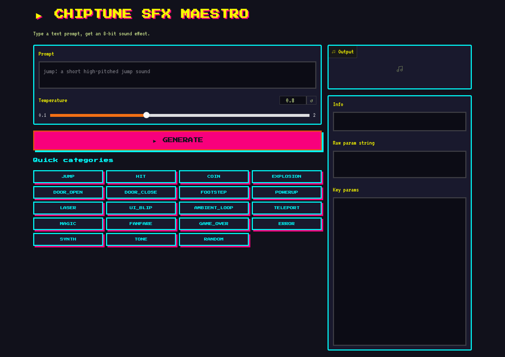

I built a system that turns text like "retro coin pickup" into playable 8-bit sound effects. No pre-recorded samples, no external APIs. Just a small text-to-parameter tool.

> **Key Takeaways**
>
> - An 11M-param system converts prompts into sfxr parameter strings
> - A built-in jsfxr-compatible synthesizer renders those params to 16-bit WAV audio at 44100 Hz
> - The whole pipeline runs locally in Python with zero third-party audio dependencies

## The core idea

Most sound effect tools generate raw waveforms. Cool, but impractical for retro games. Developers don't want a 44.1kHz waveform blob, they want a compact parameter set they can tweak. So I flipped the problem: instead of generating audio, the system outputs sfxr-compatible parameter strings (wave shape, frequency, ADSR envelope, vibrato, arpeggio, the works). A jsfxr-compatible synthesizer then renders those params to playable WAV.

This keeps the output tiny, editable, and compatible with existing retro game toolchains.

## Building the pipeline

The project is a from-scratch sequence engine. No Lightning, no high-level wrappers. Raw PyTorch, 6 layers, 6 heads, 384 dim, about 11 million parameters.

I started with dataset generation, which turned out to be the hardest part. I needed thousands of (text prompt, param string) pairs. I built a heuristic random-parameter labeler, ported some jsfxr presets, and curated sfxr/bfxr packs from OpenGameArt. Then I trained a byte-level BPE tokenizer with four reserved special tokens.

The code is a decoder-only engine that takes tokenized prompt text and generates the param string step by step. Training used EMA, cosine learning rate scheduling, and early stopping. I ran 23 experiments before landing on the final config.



## The retro interface

I couldn't resist building a retro arcade UI for it. The interface uses Press Start 2P pixel fonts, a CRT scanline overlay, and a neon NES/Game Boy color palette. It's silly, it's fun, and it actually works well for testing prompts.

You type "laser zap", hit generate, and get a WAV file you can download and drop straight into a game engine. The CLI version works the same way:

```bash
python -m chiptune_sfx.render --prompt 'retro coin pickup' --out coin.wav
```

## What I learned

The biggest lesson: dataset quality matters more than scale. My first 50 training runs produced garbage because the param distributions were wrong. Once I fixed the labeler and added curated presets, the system improved in a fraction of the time. Sometimes the boring data work is where the real progress happens.
