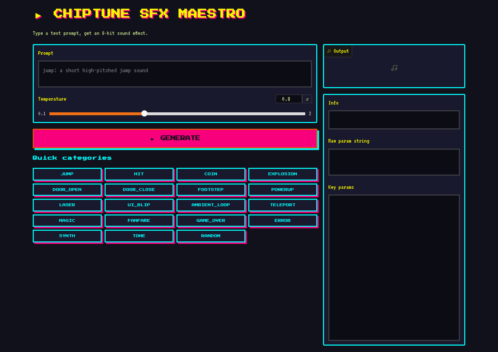

I built a tool for retro game developers that turns text like "retro coin pickup" into a playable 8-bit sound effect. It writes sfxr parameters, not audio, and a built-in synthesizer renders them to WAV. No pre-recorded samples, no external APIs.

> **Key Takeaways**
>
> - A system of about 11 million parameters, trained from scratch, converts prompts into sfxr parameter strings.
> - A built-in jsfxr-compatible synthesizer renders those params to 16-bit WAV audio at 44100 Hz.
> - The whole pipeline runs locally in Python with zero third-party audio dependencies.

## The core idea

Most sound effect tools generate raw waveforms. Cool, but impractical for retro games. Developers don't want a 44.1kHz waveform blob, they want a compact parameter set they can tweak. So I flipped the problem: instead of generating audio, the system outputs sfxr-compatible parameter strings (wave shape, frequency, ADSR envelope, vibrato, arpeggio, the works). A jsfxr-compatible synthesizer then renders those params to playable WAV.

This keeps the output tiny, editable, and compatible with existing retro game toolchains.

## Building the pipeline

The project is a from-scratch sequence engine. No Lightning, no high-level wrappers. Raw PyTorch, 6 layers, 6 heads, 384 dim, about 11 million parameters.

I started with dataset generation, which turned out to be the hardest part. I needed a large set of (text prompt, param string) pairs. I built a heuristic random-parameter labeler, ported some jsfxr presets, and curated sfxr/bfxr packs from OpenGameArt. Then I trained a byte-level BPE tokenizer with four reserved special tokens.

The code is a decoder-only engine that takes tokenized prompt text and generates the param string step by step. Training used EMA, cosine learning rate scheduling, and early stopping.



## The retro interface

I couldn't resist building a retro arcade UI for it. The interface uses Press Start 2P pixel fonts, a CRT scanline overlay, and a neon NES/Game Boy color palette. It's silly, it's fun, and it actually works well for testing prompts.

You type "laser zap", hit generate, and get a WAV file you can download and drop straight into a game engine. The CLI version works the same way:

```bash
python -m chiptune_sfx.render --prompt 'retro coin pickup' --out coin.wav
```

## What I learned

The biggest lesson: dataset quality matters more than scale. My early training runs produced garbage because the param distributions were wrong. Fixing the labeler and adding curated presets did more for the output than any change to the training setup. Sometimes the boring data work is where the real progress happens.
