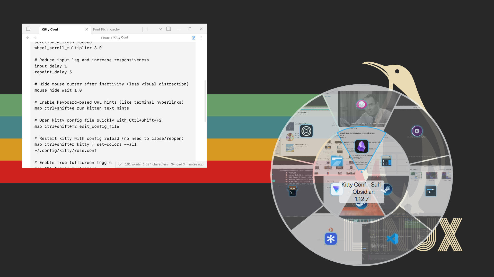

## The idea

Alt+Tab is a horizontal strip on almost every desktop. But a strip wastes the one piece of
information you always have: where the cursor _is_. Circular Alt+Tab lays your windows out
as pie slices around the cursor instead, so the target is always a short flick away. Hover to
select, click to activate, middle-click to close. It works with the keyboard, the mouse, and the
scroll wheel.

It's a KWin window-switcher plugin for KDE Plasma 6, written in pure QML with no build step.

> **Key Takeaways**
>
> - Windows are arranged as pie slices around the cursor, so the one you want is always a short flick away.
> - Live thumbnails, a multi-ring layout past 8 windows, and full Plasma theme integration, all in pure QML with no build step.
> - Hit-testing reads static ring geometry rather than animated positions, which is what keeps hover selection from jittering.

## What it does

- **Pie-slice layout centered on the cursor**, with live window thumbnails (icons for minimized
  windows).
- **Multi-ring layout** when you have more than 8 windows. They distribute evenly across rings
  via a remainder algorithm, with the overflow pushed to the outer rings.
- **Semi-transparent background that adapts to your Plasma theme**. Colors, captions, and the
  selection indicator all read from Kirigami theme variables, so reduced-motion and high-contrast
  modes are inherited for free rather than reimplemented.

## How it works

The architecture is a small chain, `TabBoxSwitcher → Window → Pie → Repeater → Piece`, with
rotation-based positioning and an `OpacityMask` for clipping each annular sector.

- **Hit-testing reads static ring geometry, not animated per-frame positions.** This is the
  subtle one. If you hit-test against the _scaled-up_ hovered piece, hovering becomes jittery as
  the geometry shifts under the cursor. Testing against the fixed ring layout eliminates that.
- **Single-window mode caps the slice at 180°.** A full 360° circle for one window is
  degenerate and looks broken.
- **It leans on undocumented KWin APIs** (`model.activate()`, `KWin.Workspace.cursorPos`,
  window enumeration), a deliberate, documented trade-off, since the polished interaction simply
  isn't reachable through the public TabBox surface.

The layout rests on a simple piece of geometry, the same idea behind Fitts's law: when windows
are spread around the cursor rather than lined up in a strip at the screen edge, the cursor has
less distance to travel, on average, to reach the one you want.

## Limitations

The README ships a frank limitations section, because that's what I'd want to read before
installing a compositor plugin. The undocumented APIs could break on a future Plasma point
release; there's no screen-reader support (the pie layout is inherently spatial and KWin's
overlay API exposes no accessibility hook to attach to); and multi-monitor is verified on one
mixed-DPI setup, not all of them.

It started as a Plasma 6 port of an older switcher and has since been substantially reworked:
multi-ring layout, live thumbnails, scroll support, and theme integration. Pure QML, GPLv3,
installable from a release zip or a one-line script.
