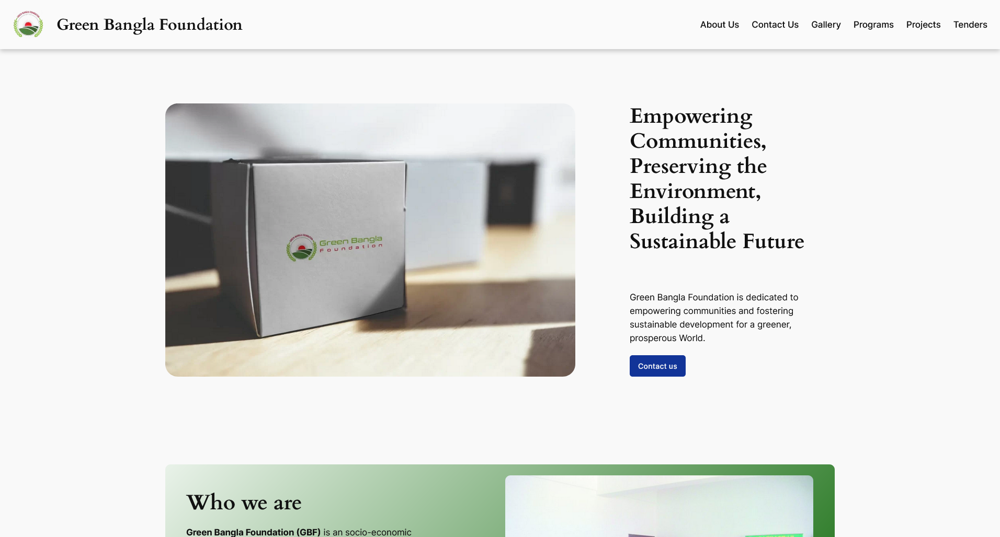
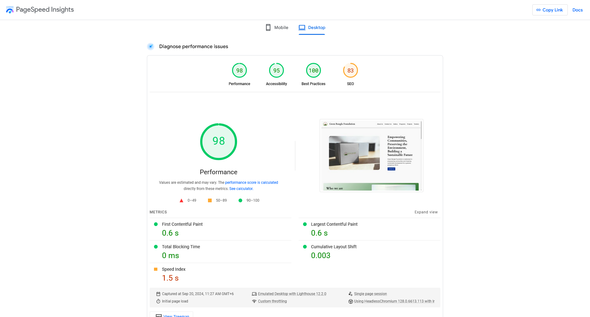
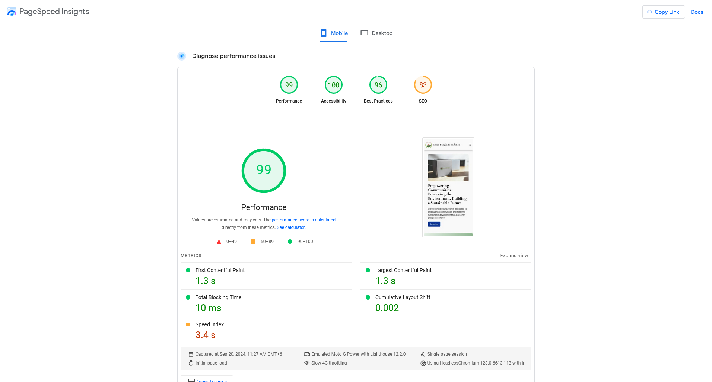

Green Bangla Foundation is a socio-economic development nonprofit in Bangladesh. It runs programmes in housing, farming, fish farming, eco-parks, restaurants and hotels. It needed a new website quickly and on a small budget.

> **Key Takeaways**
>
> - Fewer plugins meant less code to keep patched. The layout is WordPress's own block editor (Full Site Editing) plus custom CSS, not a page builder.
> - Staff edit pages in the same block editor the site is built with, so changing a programme or a tender doesn't need a developer.
> - At launch it scored 98 for performance on desktop and 99 on mobile in PageSpeed Insights, with the main content on screen in 0.6 s and 1.3 s.

## What the site needed

Six sections: About Us, Programs, Projects, Gallery, Tenders and Contact Us. Projects lists each of the foundation's initiatives as a card, some with their own call to action, such as an application link for the housing project. Tenders gives the foundation a place to publish calls for suppliers.

## Why so few plugins

I kept the dependency list short. Every plugin is code that needs updates, and out-of-date plugins are the most common way into a WordPress site. Gutenberg Full Site Editing handled the layout and CSS handled the rest. Fewer moving parts also meant a lighter page, and a site the foundation's staff can manage themselves.

## How it performed at launch

I tested the finished site with Google PageSpeed Insights on 20 September 2024.

| PageSpeed Insights       | Desktop | Mobile |
| ------------------------ | ------: | -----: |
| Performance              |      98 |     99 |
| Accessibility            |      95 |    100 |
| Best practices           |     100 |     96 |
| SEO                      |      83 |     83 |
| First Contentful Paint   |   0.6 s |  1.3 s |
| Largest Contentful Paint |   0.6 s |  1.3 s |
| Total Blocking Time      |    0 ms |  10 ms |

The mobile test runs on a simulated mid-range phone over a slow 4G connection, so its 1.3 seconds to the main content is the closer guide to a real visit.

