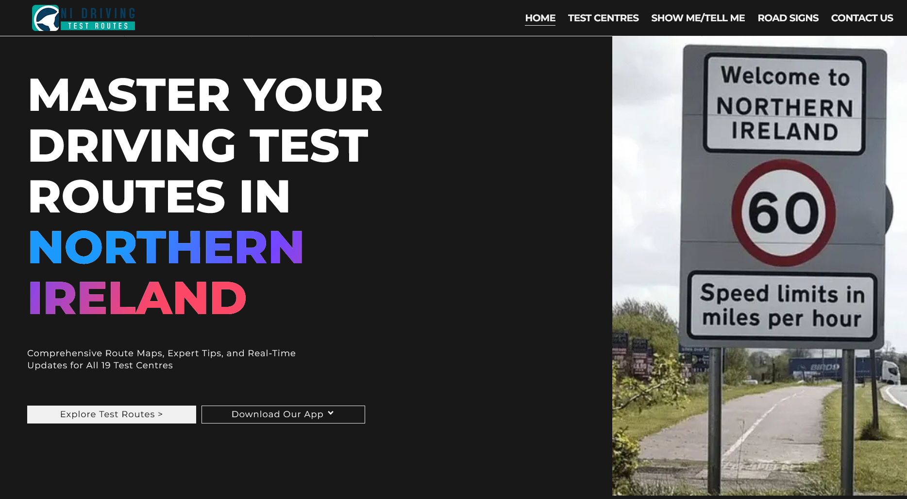
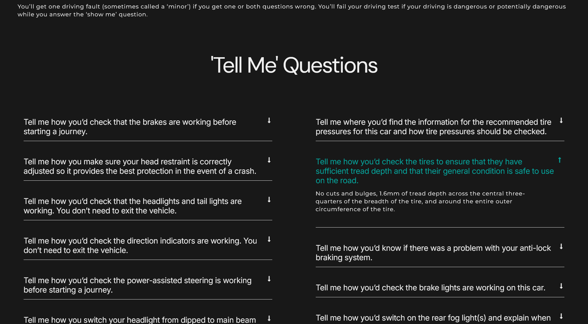
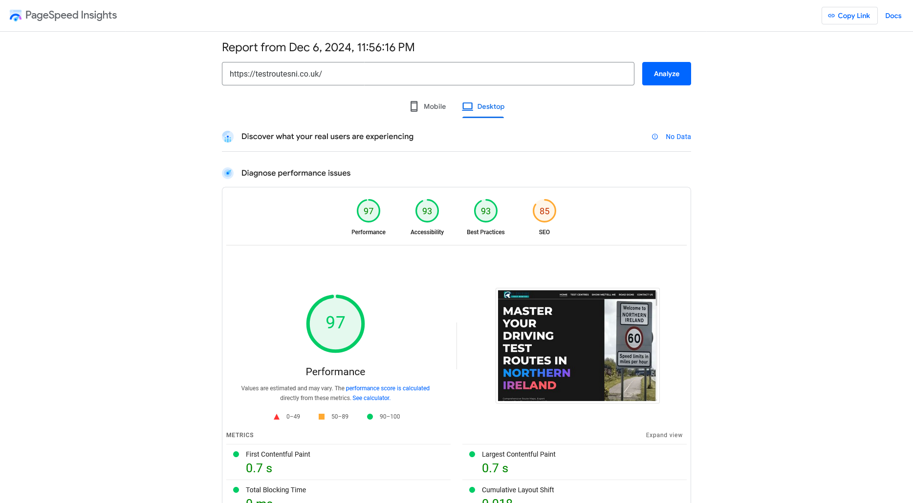
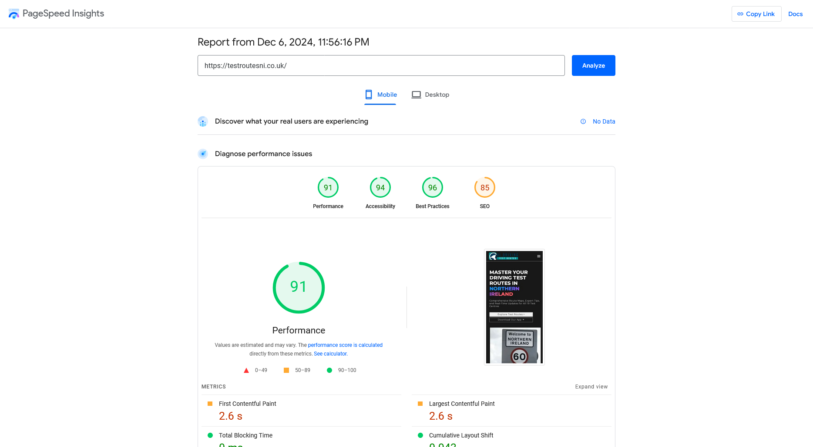

I built a site about Northern Ireland driving test routes. The audience: people nervous about their test who want to know exactly where they'll be driving. They're searching on their phones while prepping, so every second of load time matters.

The brief was straightforward. Useful content. Fast pages. A clean mobile experience. And a way to pay for the routes: the site is a shop. Each test centre's route guide is a product in WooCommerce, paid for by card through Stripe. It runs on WordPress with the Elementor page builder.

> **Key Takeaways**
>
> - The site is a shop: each test centre's route guide is a WooCommerce product, paid for by card through Stripe.
> - In PageSpeed Insights it scored 97 for performance on desktop and 91 on mobile, with the main content on screen in 0.7 s and 2.6 s.
> - I've kept the site running since launch: updates, payments, a bonus guide with each purchase and a link to the companion app.

## What the site covers

Route pages for all 19 test centres in Northern Ireland, the "show me, tell me" vehicle questions examiners ask at the start of the test, road signs, and a contact page. The home page leads with two actions: explore the test routes, or download the companion app.

## How the site performed

I tested the site with Google PageSpeed Insights in December 2024.

| PageSpeed Insights       | Desktop | Mobile |
| ------------------------ | ------: | -----: |
| Performance              |      97 |     91 |
| Accessibility            |      93 |     94 |
| Best practices           |      93 |     96 |
| SEO                      |      85 |     85 |
| First Contentful Paint   |   0.7 s |  2.6 s |
| Largest Contentful Paint |   0.7 s |  2.6 s |

Desktop loads its main content in 0.7 seconds. Mobile is slower on PageSpeed's simulated slow phone, 2.6 seconds, and that's the number that matters most, because most people checking routes are on a phone, often while they're out.

## Keeping it running

I've kept looking after the site since launch. Some of that work:

- **Updates.** PHP, WordPress and every plugin kept current, with card payments through Stripe checked after updates.
- **A bonus guide with each purchase.** The route guides now come with a bonus PDF, added to the products in WooCommerce, with a banner on the product and checkout pages.
- **The app.** The site's popup now links to the companion app in the App Store, and I changed when the popup appears.
- **An FAQ page.**
